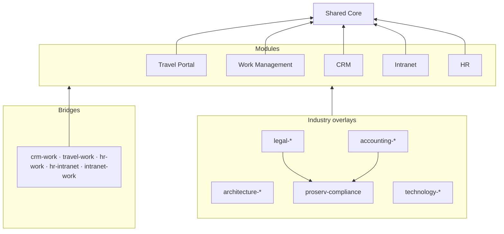

# Pilot Projects

Five reusable, production-shaped business solutions — **Travel Portal, Work Management, CRM, Intranet and
HR** — built on one canonical, platform-neutral data model that can be deployed to **Dataverse**
(model-driven apps, canvas apps, Power Pages), **SharePoint Online** (lists, libraries, SPFx) or **SQL**
(pro-code apps), and adapted to **architecture, law, accounting, technology or any other firm** through
overlay layers instead of copies.

> **Status:** schema v1.0.0 validated. **Phase 1 (core + HR) is under way** — the Dataverse build, the
> three security roles, the HR Power BI model and the demo firm are all generated from the schema and
> checked in CI; what remains is a tenant to apply them to, plus the apps and flows. See the
> [Phase 1 build guide](docs/06-phase1-core-hr.md) and the [plan and roadmap](docs/01-plan-and-roadmap.md).

## What's here

| | |
|---|---|
| [**Plan and roadmap**](docs/01-plan-and-roadmap.md) | What we are building, showcase stack per pilot, build order, phases, definition of done, open decisions |
| [**Tech stack strategy**](docs/02-tech-stack-strategy.md) | Stack tiers, module × stack fit, industry defaults, platform mapping and limits, ALM |
| [**Schema principles**](docs/03-schema-principles.md) | The rules that keep the schemas futureproof |
| [**Schema format**](docs/04-schema-format.md) | How to read and write the YAML; what the validator checks |
| [**Industry adaptation**](docs/05-industry-adaptation.md) | Same concept, different words; what each overlay adds; client adaptation playbook |
| [**Phase 1 build guide**](docs/06-phase1-core-hr.md) | Build order, security design, the approval engine, the leave walkthrough, the dashboard, demo data |
| [**Data dictionary**](docs/data-dictionary/README.md) | Every table and column with Dataverse / SharePoint / SQL mappings and ER diagrams (generated) |

## The model at a glance

| Layer | Tables | Highlights |
|---|--:|---|
| [Shared Core](docs/data-dictionary/core.md) | 23 | Employee (directory), OrgUnit, LegalEntity, CostCenter, Office, Account, Contact, currencies, countries, holidays, taxonomy, **one approval engine**, document links, comments, audit |
| [Travel Portal](docs/data-dictionary/travel.md) | 15 | Policy, per diems, destination risk, traveller profile & documents (restricted), trip requests, bookings with CO₂, expenses, card feed |
| [Work Management](docs/data-dictionary/work.md) | 17 | Projects/matters/engagements, phases, team & rates, work items, sprints, milestones, timesheets, resourcing, RAID, status reports |
| [CRM](docs/data-dictionary/crm.md) | 14 | Leads, configurable pipelines, opportunities, proposals, activities, campaigns, consent, account relationships |
| [Intranet](docs/data-dictionary/intranet.md) | 12 | News, announcements, events, policies with attestation, knowledge, quick links, service desk, recognition, site governance |
| [HR](docs/data-dictionary/hr.md) | 33 | Positions, effective-dated assignments & pay, personal data (separate), leave, on/offboarding, recruiting, performance, learning, credentials & CPD, skills |
| 5 bridges | — | Trip/expense → project, opportunity → project, skills-based resourcing, training events, project sites |
| Industry overlays | 20 | Shared risk & compliance (conflicts, ethical walls, KYC/AML), architecture, legal, accounting, technology |

**134 tables · ~1,600 columns · 135 choice sets · 19 term sets · 340+ reference-data rows · 10 deployment profiles**



## Repository layout

```
schemas/
  core.yaml                 foundation layer + standard traits
  modules/                  one file per pilot
  bridges.yaml              cross-module links
  industries/               industry overlays (one YAML document per overlay layer)
  profiles.yaml             which layers each kind of client gets
tools/
  schematool.py             validate · generate docs · export a resolved model
  ppcheck.py                test the service-principal login; list environments and workspaces
  dvgen.py                  resolved model → Dataverse metadata + an ordered deployment plan
  dvdeploy.py               apply a plan to an environment, idempotently (--dry-run first)
  secgen.py                 security roles → Dataverse payloads + a generated access matrix
  pbigen.py                 dashboard spec → Power BI semantic model, measures and theme
  appgen.py                 app spec + model → site map, forms and views
  approvals.py              the shared approval engine, as a tested reference implementation
  flowgen.py                the engine → Power Automate cloud flows
  solgen.py                 assemble everything into a Dataverse solution folder
  sqlgen.py                 resolved model → Azure SQL migrations
  spgen.py                  resolved model → PnP site template + a SharePoint limits report
  demodata.py               a fictional firm, validated against the model before it is written
security/phase1-roles.yaml  the three Phase 1 personas, as data
powerbi/hr-dashboard.yaml   the HR dataset, its 27 measures and its 4 pages, as data
apps/hr-admin.yaml          the HR app's site map, by lifecycle rather than by table
data/firms/*.yaml           the five fictional firms, one file each
tests/                      tests for every tool, plus guards that the repo's own YAML stays valid
docs/                       plan, strategy, principles, format, adaptation, Phase 1 guide
docs/data-dictionary/       generated — do not edit by hand
build/                      generated output — gitignored
```

## Working with the schemas

```bash
pip install -r tools/requirements.txt
python tools/schematool.py validate                     # check every layer
python tools/schematool.py docs                         # regenerate the data dictionary
python tools/schematool.py export --profile law-firm    # one merged model → build/law-firm.model.json
python -m unittest discover -s tests                    # tests
```

## Building Phase 1

```bash
python tools/ppcheck.py
```

```bash
python tools/schematool.py export --profile hr-starter
```

```bash
python tools/dvgen.py --profile hr-starter --prefix wga --layers core,hr --solution WoodgroveHR
```

```bash
python tools/dvdeploy.py --plan build/dataverse/hr-starter --dry-run
```

```bash
python tools/secgen.py --profile hr-starter --prefix wga --strict
```

```bash
python tools/pbigen.py --profile hr-starter --prefix wga --strict
```

```bash
python tools/appgen.py --profile hr-starter --prefix wga --strict
```

```bash
python tools/flowgen.py --profile hr-starter --prefix wga --solution WoodgroveHR --strict
```

```bash
python tools/solgen.py --profile hr-starter --prefix wga --solution WoodgroveHR --publisher "Woodgrove Advisory"
```

```bash
python tools/demodata.py --profile hr-starter --people 64
```

## The other platforms

```bash
python tools/sqlgen.py --profile accounting-firm
```

```bash
python tools/spgen.py --profile travel-starter --prefix pfx --site "Northwind Travel"
```

`spgen` also writes `limits.md`, which lists every place the model asks for
something SharePoint cannot do — the evidence for the stack decision rather than
a hunch.

Full walkthrough, including applying the plan to a real environment: the
[Phase 1 build guide](docs/06-phase1-core-hr.md).

CI runs every one of these on every push, so the schema, the roles, the dashboard, the demo data
and the generated dictionary cannot drift apart. A column renamed in the YAML fails the build that
touches it — not a Dataverse import or a Power BI refresh weeks later.

Profiles: `general-firm`, `architecture-firm`, `law-firm`, `accounting-firm`, `tech-company`, plus
single-pilot starters `travel-starter`, `work-starter`, `crm-starter`, `hr-starter`, `intranet-starter`.
