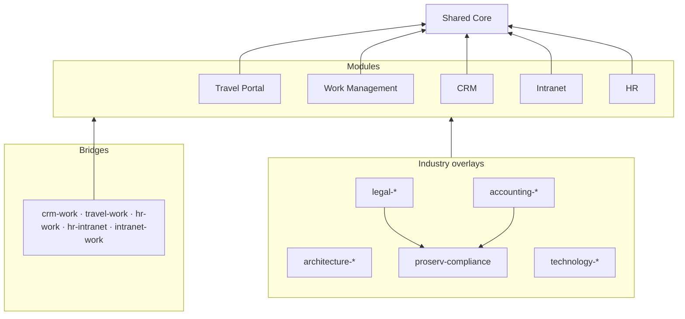

# Pilot Projects

Five reusable, production-shaped business solutions — **Travel Portal, Work Management, CRM, Intranet and
HR** — built on one canonical, platform-neutral data model that can be deployed to **Dataverse**
(model-driven apps, canvas apps, Power Pages), **SharePoint Online** (lists, libraries, SPFx) or **SQL**
(pro-code apps), and adapted to **architecture, law, accounting, technology or any other firm** through
overlay layers instead of copies.

> **Status:** schema v1.0.0 designed and validated. The **CRM pilot** now deploys to Dataverse from the
> schema — see [`pilots/crm-dataverse`](pilots/crm-dataverse/README.md). Next: the rest of the build order
> in the [plan and roadmap](docs/01-plan-and-roadmap.md).

## What's here

| | |
|---|---|
| [**Plan and roadmap**](docs/01-plan-and-roadmap.md) | What we are building, showcase stack per pilot, build order, phases, definition of done, open decisions |
| [**Tech stack strategy**](docs/02-tech-stack-strategy.md) | Stack tiers, module × stack fit, industry defaults, platform mapping and limits, ALM |
| [**Schema principles**](docs/03-schema-principles.md) | The rules that keep the schemas futureproof |
| [**Schema format**](docs/04-schema-format.md) | How to read and write the YAML; what the validator checks |
| [**Industry adaptation**](docs/05-industry-adaptation.md) | Same concept, different words; what each overlay adds; client adaptation playbook |
| [**Data dictionary**](docs/data-dictionary/README.md) | Every table and column with Dataverse / SharePoint / SQL mappings and ER diagrams (generated) |
| [**CRM pilot**](pilots/crm-dataverse/README.md) | Deploys the CRM to Dataverse from the schema: 30 tables, views, forms, charts, a model-driven app, three security roles, reference and demo data |

## The model at a glance

| Layer | Tables | Highlights |
|---|--:|---|
| [Shared Core](docs/data-dictionary/core.md) | 23 | Employee (directory), OrgUnit, LegalEntity, CostCenter, Office, Account, Contact, currencies, countries, holidays, taxonomy, **one approval engine**, document links, comments, audit |
| [Travel Portal](docs/data-dictionary/travel.md) | 15 | Policy, per diems, destination risk, traveller profile & documents (restricted), trip requests, bookings with CO₂, expenses, card feed |
| [Work Management](docs/data-dictionary/work.md) | 17 | Projects/matters/engagements, phases, team & rates, work items, sprints, milestones, timesheets, resourcing, RAID, status reports |
| [CRM](docs/data-dictionary/crm.md) | 14 | Leads, configurable pipelines, opportunities, proposals, activities, campaigns, consent, account relationships |
| [Intranet](docs/data-dictionary/intranet.md) | 12 | News, announcements, events, policies with attestation, knowledge, quick links, service desk, recognition, site governance |
| [HR](docs/data-dictionary/hr.md) | 33 | Positions, effective-dated assignments & pay, personal data (separate), leave, on/offboarding, recruiting, performance, learning, credentials & CPD, skills |
| 5 bridges | — | Trip/expense → project, opportunity → project, skills-based resourcing, training events, project sites |
| Industry overlays | 20 | Shared risk & compliance (conflicts, ethical walls, KYC/AML), architecture, legal, accounting, technology |

**134 tables · ~1,600 columns · 135 choice sets · 19 term sets · 340+ reference-data rows · 10 deployment profiles**



## Repository layout

```
schemas/
  core.yaml                 foundation layer + standard traits
  modules/                  one file per pilot
  bridges.yaml              cross-module links
  industries/               industry overlays (one YAML document per overlay layer)
  profiles.yaml             which layers each kind of client gets
tools/schematool.py         validate · generate docs · export a resolved model
pilots/crm-dataverse/       CRM pilot: Dataverse deployer, app spec and demo data
tests/                      tests for the tool and a guard that the repo schemas stay valid
docs/                       plan, strategy, principles, format, adaptation playbook
docs/data-dictionary/       generated — do not edit by hand
```

## Working with the schemas

```bash
pip install -r tools/requirements.txt
python tools/schematool.py validate                     # check every layer
python tools/schematool.py docs                         # regenerate the data dictionary
python tools/schematool.py export --profile law-firm    # one merged model → build/law-firm.model.json
python -m unittest discover -s tests                    # tests
```

CI runs all of these on every push, so the YAML, the rules and the dictionary cannot drift apart.

Profiles: `general-firm`, `architecture-firm`, `law-firm`, `accounting-firm`, `tech-company`, plus
single-pilot starters `travel-starter`, `work-starter`, `crm-starter`, `law-crm-starter`, `hr-starter`,
`intranet-starter`.

## Deploying the CRM pilot

```bash
pip install -r pilots/crm-dataverse/requirements.txt
```

```bash
cd pilots/crm-dataverse && python -m deploy.cli plan
```

```bash
cd pilots/crm-dataverse && python -m deploy.cli deploy --org https://yourorg.crm.dynamics.com --assign-me
```

`plan` is offline and writes every payload it would send to `build/payloads/`; `deploy` signs in with a
device code and is idempotent, so it can be re-run after a failure. Details and limits:
[`pilots/crm-dataverse/README.md`](pilots/crm-dataverse/README.md).
