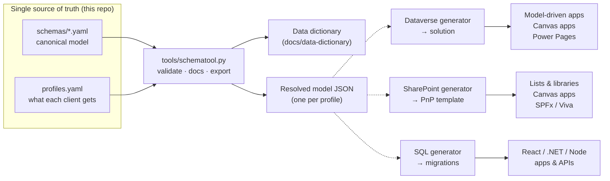
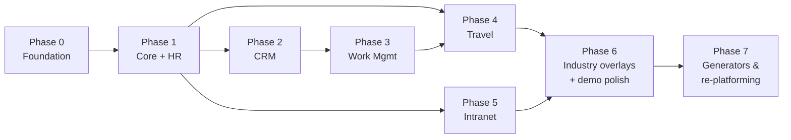

# Plan and roadmap

This is the master plan for the pilot projects. It explains what we are building, how the pieces fit,
which stack each pilot showcases, the order to build them in and what "done" means for each one.

- Phase 1, in detail → [06-phase1-core-hr.md](06-phase1-core-hr.md)
- Phase 2, in detail → [08-phase2-crm.md](08-phase2-crm.md)
- The generators → [07-generators.md](07-generators.md)
- Schema rules → [03-schema-principles.md](03-schema-principles.md)
- Stack choices → [02-tech-stack-strategy.md](02-tech-stack-strategy.md)
- Adapting to a client or industry → [05-industry-adaptation.md](05-industry-adaptation.md)
- The schemas themselves → [data-dictionary/](data-dictionary/README.md)

---

## 1. What we are building

Five **pilot accelerators**: realistic, production-shaped starter solutions that can be adapted to a new
client in days instead of built from scratch in months.

| Pilot | What it covers | Main tables |
|---|---|---|
| **Travel Portal** | Travel policy → trip request → approval → booking → duty of care → expense claim → card reconciliation | TripRequest, TravelBooking, TravellerProfile, ExpenseReport, ExpenseLine, CardTransaction |
| **Work Management** | Projects / matters / engagements, phases, team and rates, tasks and sprints, timesheets, resourcing, RAID log, status reports | Project, ProjectPhase, WorkItem, Sprint, TimeEntry, ResourceRequest, RaidItem |
| **CRM** | Clients and contacts, leads, opportunities on configurable pipelines, proposals, activities, campaigns, consent | Account, Contact, Lead, Opportunity, Proposal, Activity, ConsentRecord |
| **Intranet** | News, announcements, events, policy library with attestation, knowledge base, quick links, service desk, recognition, site governance | NewsArticle, PolicyDocument, PolicyAttestation, ServiceRequest, Site |
| **HR** | Positions and job architecture, employment and assignment history, compensation, leave, onboarding/offboarding, recruiting, performance, learning, credentials and CPD, skills | Position, JobAssignment, Compensation, LeaveRequest, JobRequisition, PerformanceReview, EmployeeCredential |

All five share **one canonical data model** (134 tables, ~1,600 columns today) defined in YAML under
[`schemas/`](../schemas). Every build — Dataverse, SharePoint or SQL — is derived from it.

## 2. How the pieces fit

**All three generators now exist**, built during Phase 1 rather than waiting for Phase 7: doing core by
hand needed a tenant, and generating it needed only the resolved model.

| Generator | Output |
|---|---|
| `tools/dvgen.py` → `tools/dvdeploy.py` | Dataverse metadata, applied idempotently |
| `tools/sqlgen.py` | Azure SQL migrations, with choices as foreign keys and effective dating as a constraint |
| `tools/spgen.py` | a PnP site template, plus a report of every SharePoint limit the model runs into |

Alongside them: `secgen.py` (security roles), `appgen.py` (site map, forms and views),
`flowgen.py` (the approval flows, from the engine in `approvals.py`), `pbigen.py` (the Power BI
semantic model), `solgen.py` (one solution folder from all of the above) and `demodata.py` (five
fictional firms). Each is described in [07-generators.md](07-generators.md).

The model is **layered**. Each layer only adds to the ones below it:

| Layer | Example | Purpose |
|---|---|---|
| **Foundation** | `core` | Shared master data (people, org, clients, currencies, taxonomy) and shared services (approvals, documents, comments, audit) |
| **Modules** | `travel`, `work`, `crm`, `intranet`, `hr` | One per pilot. Each depends only on `core`, so each can be sold and deployed alone |
| **Bridges** | `travel-work`, `crm-work`, `hr-work`… | Cross-module links that exist only when both modules are deployed (e.g. charge a trip to a project) |
| **Industry overlays** | `legal-work`, `accounting-crm`, `architecture-work`… | Industry terminology, extra columns and tables, and reference data |
| **Client overlay** | `clients/<client>.yaml` *(per engagement)* | The last 10%: client-specific labels, columns and reference data |

A **profile** (in [`schemas/profiles.yaml`](../schemas/profiles.yaml)) is the set of layers deployed for a
kind of client — `law-firm`, `accounting-firm`, `architecture-firm`, `tech-company`, `general-firm`, or a
single-pilot starter such as `travel-starter`.

## 3. Decisions already built into the schemas

| Decision | Why it matters |
|---|---|
| One generic model + **terminology** instead of per-industry copies. `Project` is shown as *Matter* (law), *Engagement* (accounting), *Project* (architecture, tech) | One codebase to maintain; adapting to an industry is configuration |
| **Shared core** for people, org, clients, approvals and documents | Approvals, document links and the people directory are built once and reused by all five pilots |
| **Modules are independent**; bridges carry cross-links | Each pilot can be sold alone; no "you need the CRM to use Travel" |
| **Extend, never edit** — industry and client changes live in overlay layers | Upgrading the base never overwrites a client's customisations (maps to Dataverse solution layering) |
| **Reference data as tables and term sets**, not hard-coded choices, for anything a client will want to change | Most of the adaptation work is data loading, not schema change |
| **Sensitive data in separate tables** (compensation, personal details, traveller documents) | Works on SharePoint (no column-level security) as well as Dataverse and SQL |
| **Stable identity**: GUID keys, `externalId` for integrations, Entra Object ID for people | Safe data migration and integration; no breakage when emails or names change |
| **Platform rules checked automatically** (reserved names, money needs a currency, dependencies, seeds) | Problems are caught in the YAML, before anything is built |

The full list with reasoning is in [03-schema-principles.md](03-schema-principles.md).

## 4. Showcase plan — which stack and industry for each pilot

Pick the stack by **client size, licensing and data sensitivity**, not by industry (see
[02-tech-stack-strategy.md](02-tech-stack-strategy.md)). For the portfolio, though, build each pilot on a
*different* stack and dress it for a *different* industry, so the five together prove five skill sets:

| # | Pilot | Showcase stack | Industry flavour (profile) | Why this pairing | What it proves |
|---|---|---|---|---|---|
| 1 | **HR** | Dataverse + model-driven app (HR admin) + canvas app (employee self-service in Teams) | Accounting firm (`accounting-firm`) — credentials, CPE, independence | Most sensitive data → needs Dataverse security roles, business units, column security, auditing | Security model design, effective-dated data, approvals, Power BI |
| 2 | **CRM** | Dataverse + model-driven app + Power Pages client portal | Law firm (`law-firm`) — intake, conflict checks, matters, ethical walls | Relational data, row-level security, external client access through Contact | Model-driven UX, business process flows, portal table permissions |
| 3 | **Work Management** | Pro-code: React + Fluent UI front end, .NET or Node API, Azure SQL, Entra ID sign-in | Tech company (`tech-company`) — backlog, sprints, releases | High-volume time and task data, drag-and-drop boards beyond low-code | Full-stack design, API, migrations, CI/CD |
| 4 | **Travel Portal** | Canvas app on SharePoint lists + Power Automate, embedded in Teams | Any firm (`general-firm`) | Shows the "Microsoft 365 licences only" tier most small firms can afford | Delegation-aware canvas design, SharePoint data modelling, mobile receipt capture |
| 5 | **Intranet** | SharePoint hub sites + SPFx web parts + Viva Connections | Architecture firm (`architecture-firm`) — visual project showcases | Native SharePoint fit; a design-led industry rewards visual polish | Information architecture, SPFx, PnP provisioning, governance |

If you prefer to stay fully low-code, build Work Management on Dataverse with a model-driven app plus a
canvas or PCF board — the schema is the same either way. Later, re-platform one pilot (e.g. Travel on
Dataverse) from the same schema to prove portability; that is a strong portfolio story in itself.

## 5. Build order

The order follows the data: people and org (core + HR) are used by everything; clients (CRM) are needed
by projects; projects are needed to charge travel; the intranet is the front door that surfaces the rest.
If you want a quick visible win, the Intranet can run in parallel from Phase 1 — it only needs `core`.

Effort below is a rough guide for one person working full time; scale it to your availability.

| Phase | Effort | Deliverables | Exit criteria |
|---|---|---|---|
| **0. Foundation** | 1–2 weeks | Schema v1 reviewed and tagged; publisher prefix chosen; dev tenant and Dev/Test environments; repo folders for solutions, SharePoint and apps; demo-data plan | `validate` and `docs --check` green in CI; environment access working; open decisions (§9) answered |
| **1. Core + HR** *(in progress)* | 3–4 weeks | Core tables and approval engine in Dataverse; HR model-driven app; employee self-service canvas app (leave, profile, training); onboarding flow; HR Power BI page | Three personas (employee, manager, HR) with security roles; leave request approved end-to-end; compensation invisible to non-HR |
| **2. CRM** *(built from source)* | 3–4 weeks | CRM model-driven app; pipeline and proposal flow; Power Pages client portal; conflict-check process (law overlay) | Lead → opportunity → won → project hand-off works; portal user sees only their own records |
| **3. Work Management** | 4–6 weeks | Project/backlog/time app on the chosen stack; timesheet approval; resourcing view; status report; utilisation report | 10k+ demo time entries perform well; project created from a won opportunity |
| **4. Travel Portal** | 2–3 weeks | SharePoint lists provisioned from template; canvas app (request, approve, expenses with receipt photo); policy checks; duty-of-care view | Trip request → approval → booking → expense claim → paid, with an out-of-policy example |
| **5. Intranet** | 3–4 weeks | Hub + communication sites from PnP template; news, events, policy library with attestation, service desk; SPFx web parts; Viva Connections dashboard | Audience targeting works; policy attestation report; mobile-friendly |
| **6. Industry overlays + polish** | 2–3 weeks | Apply each industry profile to at least one pilot; demo data per fictional firm; demo videos and case studies | Each profile deploys cleanly from scratch; 3–5 minute video per pilot |
| **7. Generators & re-platforming** *(generators done)* | ongoing | ~~Generators from the resolved model (Dataverse, SharePoint, SQL)~~; one pilot rebuilt on a second stack | Re-platformed pilot built without editing the canonical schema |

## 6. Definition of done for every pilot

- [ ] Deploys from source into a clean environment with a script (solution import, PnP apply or migrations)
- [ ] Reference data loaded from the schema seeds; demo data for at least one industry profile
- [ ] At least three personas with least-privilege security roles
- [ ] At least one approval flow working end to end, using the shared approval engine
- [ ] A Power BI report or dashboard on the pilot's data
- [ ] Accessible (keyboard navigation, contrast, screen-reader labels) and usable on mobile
- [ ] README with architecture diagram, link to its data-dictionary page, setup steps and known limits
- [ ] A 3–5 minute demo video and a one-page case study (problem → solution → outcome)
- [ ] A short "how to adapt it" note: which overlay and seed data change per industry

## 7. Environments and tooling

| Need | Recommendation |
|---|---|
| Tenant | A Microsoft 365 developer or trial tenant dedicated to demos (keep client data out of it) |
| Power Platform | Developer environments (the free Power Apps Developer Plan) for Dev; separate Test and Demo environments |
| Source control | This repo. Planned folders: `solutions/` (unpacked Dataverse solutions), `sharepoint/` (PnP templates, SPFx), `apps/` (pro-code), `data/` (demo data), `generators/` |
| CLI | Power Platform CLI (`pac`), PnP PowerShell, Node LTS + SPFx toolchain, .NET SDK or Node for the pro-code pilot, Azure CLI/Bicep |
| CI/CD | GitHub Actions (schema checks already run on every push); Power Platform Pipelines or `pac` in Actions for solutions |
| Naming | One publisher prefix for everything (the docs use the placeholder `pfx`); table and column names come from the schema |

## 8. Demo companies

Use Microsoft's well-known fictional brands so screenshots never show a real firm:

| Profile | Fictional firm | Story |
|---|---|---|
| `architecture-firm` | **Adatum Architects** | 60-person practice, two studios, RIBA stages, a hospital and a school on the boards |
| `law-firm` | **Fabrikam Legal LLP** | 120 lawyers, litigation and corporate practices, client portal, ethical wall on a sensitive matter |
| `accounting-firm` | **Woodgrove Advisory** | Audit, tax and bookkeeping; busy-season deadlines; PBC requests through the portal |
| `tech-company` | **Contoso Technologies** | SaaS product company with sprints, releases and customer implementations |
| `general-firm` | **Northwind Group** | Generic mid-size firm used for the Travel Portal |

## 9. Decisions you need to make

1. **Publisher prefix and brand** — used in every Dataverse table name; hard to change later.
2. **Primary market and privacy law** (GDPR/UK GDPR, India DPDP Act, US state laws) — sets consent and
   retention defaults.
3. **Licensing assumption per showcase** — Microsoft 365 only, Power Apps Premium, or Dynamics 365
   (if Dynamics 365 Sales is available, Lead and Opportunity map to its standard tables).
4. **Lead industry** — which profile to polish first for the portfolio.
5. **Pro-code preferences** for Work Management (.NET or Node; React SPA or Next.js), or stay low-code.
6. **Entity names** — review the data dictionary now; renaming a table after it is built is expensive on
   every platform.

## 10. Progress

Generated from the schema and checked in CI:

| Done | |
|---|---|
| Dataverse build | 50 tables, 434 columns, 133 relationships, 28 alternate keys, 45 choice sets — 640 components, no manual metadata steps |
| Security roles | the three personas, with a generated access matrix and the compensation boundary asserted by tests |
| Power BI | 25-table semantic model, 27 measures, theme; every DAX reference checked against the generated columns |
| Demo data | Woodgrove Advisory, 64 staff, ~1,800 rows, validated against the model |
| Access checker | `tools/ppcheck.py`, which reports exactly what is missing before anything is applied |

| Also done, ahead of schedule | |
|---|---|
| SQL generator (Phase 7) | 123 tables, 1,030 foreign keys for the full accounting profile; the DDL is executed in tests, not just inspected |
| SharePoint generator (Phase 7) | a PnP template plus `limits.md`, which is the evidence for each stack decision |
| The approval engine | `approvals.py`, tested across all seven approverTypes; `flowgen.py` turns it into four cloud flows |
| HR model-driven app | site map, 48 forms and 48 views |
| Solution packaging | 767 components in one folder, with its manifest |
| Five fictional firms | Woodgrove, Fabrikam, Adatum, Contoso and Northwind, each dressed for its industry |

| Still to do | Needs |
|---|---|
| Apply the plan to a Dev environment | a tenant, and `PP_TENANT_ID` / `PP_CLIENT_ID` / `PP_CLIENT_SECRET` |
| The approval flow | Power Automate, built once against the generated tables |
| HR model-driven app and the self-service canvas app | the maker portal |
| Onboarding flow | Power Automate |
| The report canvas | Power BI Desktop, from the generated page spec |
| Demo video and case study | the above, working |

### Phase 2 — CRM, built from source

The second pilot was three declarative specs and one profile, run through the same
generators: 55 tables, 4 security roles, 37 forms and views, 26 Power BI measures, 829
solution components and a 514-row demo firm. What it cost in tool changes — all of them
latent defects a second pilot was always going to surface — is in
[08-phase2-crm.md §7](08-phase2-crm.md#7-what-the-second-pilot-actually-cost).

The full build guides are [06-phase1-core-hr.md](06-phase1-core-hr.md) and
[08-phase2-crm.md](08-phase2-crm.md).

## 11. Next ten steps

1. Read the [data dictionary](data-dictionary/README.md) module by module and note anything to rename,
   add or drop. Change the YAML, run `python tools/schematool.py validate && python tools/schematool.py docs`.
2. Answer the decisions in §9 and record them in this file.
3. Tag the schema `v1.0.0` once reviewed.
4. Set up the tenant and the Dev/Test/Demo environments; create the publisher.
5. ~~Build the `core` tables in Dataverse by hand from the dictionary~~ — **done differently**: the
   Dataverse generator came first, because building by hand needed a tenant and generating needed only
   the resolved model. Run `tools/dvgen.py` then `tools/dvdeploy.py`.
6. Build the shared approval flow (ApprovalPolicy → ApprovalRequest → ApprovalStep) once; every pilot reuses it.
7. Build HR (Phase 1) against the `accounting-firm` profile; load its seed data.
8. Write the demo-data generator (fictional people, clients, projects) driven by the resolved model.
9. Record the first demo video and case study as soon as HR meets its exit criteria.
10. Move on to CRM, keeping this roadmap's checklist up to date.
