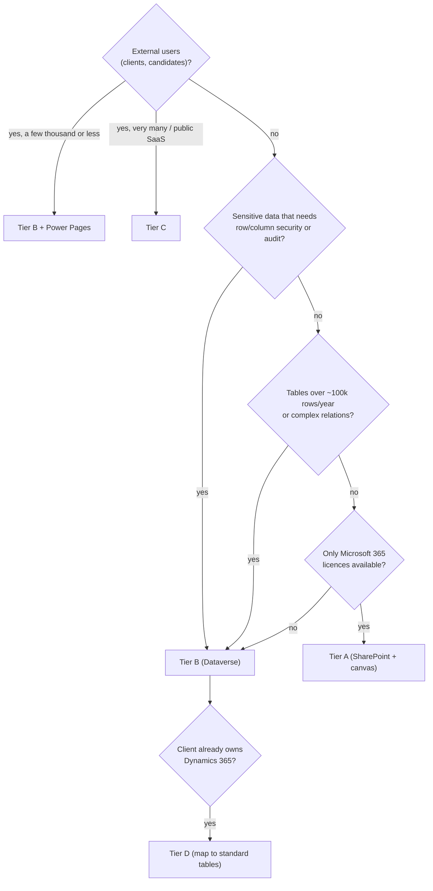

# Tech stack strategy

The same schema can be built on several Microsoft stacks. This document says which stack fits which
situation, how each schema concept maps to each platform, which platform limits the schema already
respects, and how to manage deployments.

## 1. Stack tiers

| | **Tier A — Microsoft 365** | **Tier B — Dataverse / Power Platform** | **Tier C — Pro-code on Azure** | **Tier D — Dynamics 365** |
|---|---|---|---|---|
| **Data** | SharePoint lists and libraries | Dataverse | Azure SQL (or PostgreSQL) + Blob storage | Dataverse with first-party tables |
| **Apps** | Canvas apps, SharePoint pages, SPFx, Teams | Model-driven + canvas apps, Power Pages for external users | React/Next.js (Fluent UI), SPFx, Teams apps, APIs (.NET / Node / Functions) | Dynamics 365 apps extended with the schema's custom tables |
| **Automation** | Power Automate (standard connectors) | Power Automate (premium), business rules, plug-ins | Azure Functions, Logic Apps, queues | Same as Tier B |
| **Reporting** | Power BI on lists | Power BI on Dataverse | Power BI on SQL | Power BI / built-in dashboards |
| **Licensing** | Included with most Microsoft 365 plans | Power Apps Premium (per user or pay-as-you-go); Power Pages capacity | Azure consumption + development effort | Dynamics 365 licences |
| **Best for** | Small firms, internal-only, low volume, tight budget | Relational, security-sensitive, audited processes; mid-size firms | High volume, bespoke UX, SaaS/multi-tenant, large external audiences | Clients who already own Dynamics 365 |
| **Watch out for** | No column-level security, list view threshold, delegation limits, weak referential integrity | Licensing cost per user; capacity (database vs file) | Build and run cost; you own security and hosting | Licence cost; stay inside standard tables where possible |

### Choosing a tier

## 2. Module × stack fit

✅ good fit · ◐ works with care · ✗ avoid

| Module | Tier A (SharePoint + canvas) | Tier B (Dataverse) | Tier C (pro-code) | Notes |
|---|---|---|---|---|
| **Travel** | ✅ for pilots and small firms | ✅ | ◐ | `CardTransaction` and `ExpenseLine` are high volume — archive yearly or use Dataverse |
| **Work Management** | ◐ small teams only | ✅ | ✅ best UX for boards | `TimeEntry` and `WorkItem` grow fast; SharePoint only for a short pilot |
| **CRM** | ◐ | ✅ | ◐ | Row-level security and activity volume favour Dataverse; Power Pages for client portals |
| **Intranet** | ✅ native | ◐ for supporting data (service desk) | ◐ SPFx web parts | Content belongs in SharePoint pages and libraries on every tier |
| **HR** | ✗ for compensation and personal data | ✅ | ◐ | SharePoint cannot hide columns; only acceptable with separate restricted lists — and still not recommended for pay |

## 3. Industry defaults

| Industry | Typical client | Default stack | Reasoning |
|---|---|---|---|
| **Architecture** | 10–200 people, Microsoft 365, visual culture, files in SharePoint/CDE | Tier A for Intranet and Travel; Tier B for Work Management (time and fees) once lists are outgrown | Budget-conscious; heavy files stay in SharePoint/CDE; the drawing register fits lists for small practices |
| **Law** | Confidentiality, ethical walls, a DMS (iManage, NetDocuments), client portals | Tier B + Power Pages | Needs business units, security roles, column security and auditing; documents stay in the DMS via `DocumentReference` |
| **Accounting** | Seasonal deadlines, PBC requests, AML/KYC, practice software (Xero, QuickBooks, Tally) | Tier B + Power Pages | Client portal for document requests; integrations keyed on `externalId` |
| **Technology** | Engineers on staff, Azure, Jira/Azure DevOps already in place | Tier C, or Tier B integrated with Jira/DevOps | Often integrate with existing trackers instead of replacing them |
| **Any firm** | Microsoft 365 only | Start at Tier A, grow into Tier B | The schema is the same, so moving up a tier is a data migration, not a redesign |

## 4. How the schema maps to each platform

One schema layer becomes one deployable unit on every platform. This 1:1 rule is what keeps the builds in
step with each other.

| Schema concept | Dataverse | SharePoint | SQL |
|---|---|---|---|
| **Layer** (core, hr, legal-work…) | One solution (unmanaged in Dev, managed in Test/Prod) | One PnP provisioning template | One database schema + migration folder |
| **Entity** | Table (`pfx_name`) or a standard table (`account`, `contact`) | List, library or page content type | Table |
| **Enum** | Global choice (value = publisher choice prefix + code) | Choice site column | `int` column + choice table |
| **Term set** | `Term` table | Term store term set | `Term` table |
| **Trait** | Native columns (owner, state, audit) or a column set | Site columns in a base content type | Generated columns |
| **Extension** (overlay adds columns) | Columns added by the overlay's solution | Site columns added by the overlay's template | `ALTER TABLE` in the overlay's migration |
| **Terminology** | Table/column display names | List titles and column display names | UI resource strings |
| **Seed** | Configuration data import | List items in the template | `INSERT` seed scripts |
| **Profile** | Set of solutions in a pipeline | Set of templates applied in order | Set of migrations |

Column-level mappings for every logical type are in the
[data dictionary](data-dictionary/README.md#logical-type--platform-mapping).

## 5. Platform rules already respected by the schema

**SharePoint**
- The primary column of every entity becomes the list's `Title` column.
- Single line of text holds at most 255 characters; longer strings map to multiple lines of text.
- List view threshold of 5,000 items: entities are tagged `volume: low | medium | high`; high-volume ones
  are flagged in the dictionary and should not live in lists beyond a pilot. Index the columns you filter on.
- Lookup threshold: a view can include at most 12 lookup-type columns (lookups, Person, managed metadata).
  Keep list views lean.
- No column-level security, so sensitive data sits in **separate tables** (`EmployeePersonalDetails`,
  `Compensation`, `TravellerProfile`, `TravelDocument`) that can be separate lists with their own permissions.
- Avoid item-level unique permissions at scale; use separate lists or sites instead.
- Lookups to `Employee` become **Person** columns bound to Entra ID users.
- Reserved names (`Title`, `Author`, `Editor`, `Created`, `Modified`, `ID`, `Version`, `Path`, `Order`…) are
  rejected by the validator.

**Canvas apps**
- Non-delegable queries only see the first 500 rows (configurable up to 2,000). Filter on simple equality
  and indexed columns; Dataverse supports far more delegation than SharePoint.
- Compare choices by their stable code/key, not their label (labels get renamed by terminology).

**Dataverse**
- Choose the publisher prefix once.
- A table's ownership (user/team vs organisation) **cannot be changed after creation** — every entity
  declares it up front.
- Use global choices so the same enum is shared by every table.
- Business dates (leave, due dates) use *date only* behaviour so they do not shift across time zones.
- Files count against file capacity; documents are referenced (`DocumentReference`) and stored in
  SharePoint or a DMS instead.
- Column security profiles protect columns tagged `confidential`/`restricted`; auditing covers changes.
- Very high-volume tables (card transactions, audit) can use elastic tables if needed.
- Power Pages identifies external users as **Contact** rows, which is why clients and candidates are contacts.

**SQL (Azure SQL / SQL Server)**
- One schema per layer, `uniqueidentifier` keys with sequential GUIDs, `rowversion` for concurrency.
- System-versioned temporal tables suit `effectiveDated` entities and the audit trail.
- `decimal(19,4)` for money — never floating point.

## 6. Application lifecycle (ALM)

| Concern | Dataverse | SharePoint | Pro-code |
|---|---|---|---|
| Environments | Dev (developer env) → Test → Demo/Prod | Dev site collection → Demo tenant | Dev → Test → Prod (Azure) |
| Packaging | Solutions per layer; environment variables and connection references for anything environment-specific | PnP templates per layer; SPFx `.sppkg` in the app catalog | Container/app package + migrations |
| Source control | `pac solution unpack` / clone into `solutions/` | Templates and SPFx source in `sharepoint/` | `apps/` |
| Deployment | Power Platform Pipelines or GitHub Actions with `pac` | PnP PowerShell in GitHub Actions | GitHub Actions + Bicep |
| Reference data | Configuration data import generated from schema seeds | List items in the template | Seed scripts |
| Secrets | Azure Key Vault–backed environment variables | Never in lists | Azure Key Vault |

Rule of thumb: nothing reaches Test or Demo without coming from source control, and nothing is
configured by hand that the next client would also need.
