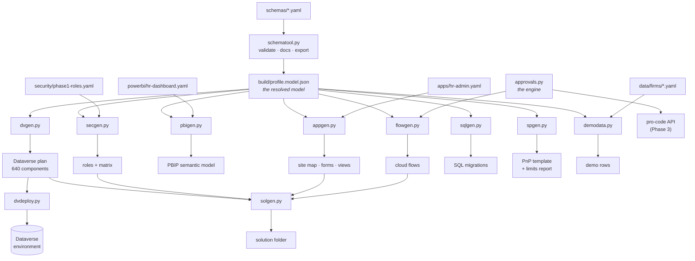

# The generators

Nine tools turn the YAML in [`schemas/`](../schemas) into things you can deploy. This page is
the map: what each one takes, what it produces, and what it checks.



---

## 1. What each one does

| Tool | Takes | Produces | Target |
|---|---|---|---|
| [`schematool.py`](../tools/schematool.py) | the YAML | the data dictionary, a resolved model per profile | — |
| [`ppcheck.py`](../tools/ppcheck.py) | `PP_*` credentials | an access report: environments, Dataverse, Power BI workspaces | — |
| [`dvgen.py`](../tools/dvgen.py) | resolved model | choice sets, tables, columns, relationships, alternate keys | Dataverse |
| [`dvdeploy.py`](../tools/dvdeploy.py) | a dvgen plan | applies it, idempotently | Dataverse |
| [`secgen.py`](../tools/secgen.py) | roles YAML + model | role payloads, column profiles, an access matrix | Dataverse |
| [`appgen.py`](../tools/appgen.py) | app YAML + model | site map, a form and a view per table | Dataverse |
| [`approvals.py`](../tools/approvals.py) | — | the approval engine's rules, as tested code | any |
| [`flowgen.py`](../tools/flowgen.py) | model + the engine | four Power Automate cloud flows | Dataverse |
| [`solgen.py`](../tools/solgen.py) | the above | one solution folder, with its manifest | Dataverse |
| [`pbigen.py`](../tools/pbigen.py) | dashboard YAML + model | a PBIP semantic model, measures and theme | Power BI |
| [`sqlgen.py`](../tools/sqlgen.py) | resolved model | ordered Azure SQL migrations | SQL |
| [`spgen.py`](../tools/spgen.py) | resolved model | a PnP site template, and a limits report | SharePoint |
| [`demodata.py`](../tools/demodata.py) | firm YAML + model | demo rows for one of five fictional firms | any |

Everything writes to `build/`, which is gitignored: the inputs are the YAML, and the outputs
are rebuilt on demand so they cannot drift.

## 2. Why generate rather than build by hand

The roadmap put the generators in Phase 7 and said to build `core` by hand first, to learn
what a generator must produce. In practice building by hand needed a tenant, and generating
needed only the resolved model — so the generators came first. Three things justify them
beyond saving clicks.

**A rename fails the build, not the refresh.** `pbigen` resolves every DAX reference against
the columns it generated; `appgen` checks every form control; `flowgen` checks every entity
and option-set code. A column renamed in the YAML fails the job that touches it rather than a
Dataverse import, a Power BI refresh or a flow run weeks later.

**The checks catch what review does not.** The full list is in §4; the pattern is that each
check encodes something specific about a platform — Dataverse's 50-character names,
SharePoint's 12-lookup view budget, SQL Server's refusal to cascade in a cycle — and no
amount of reading the YAML surfaces those.

**One rule, one place.** A money table's currency is the native `transactioncurrencyid` that
the money column creates. That rule diverged three times — Dataverse against Power BI, then
again in the app — each time producing something that imported cleanly and then failed at
run time. It now lives in one function that all four generators import, and
[`tests/test_consistency.py`](../tests/test_consistency.py) asserts they agree.

## 3. Running them

Order matters only where one tool reads another's output.

```bash
python tools/schematool.py export --profile hr-starter
```

Then, in any order:

```bash
python tools/dvgen.py --profile hr-starter --prefix wga --layers core,hr --solution WoodgroveHR
```

```bash
python tools/secgen.py --profile hr-starter --prefix wga --strict
```

```bash
python tools/appgen.py --profile hr-starter --prefix wga --strict
```

```bash
python tools/flowgen.py --profile hr-starter --prefix wga --solution WoodgroveHR --strict
```

`solgen` must come after those four, because it assembles what they produced:

```bash
python tools/solgen.py --profile hr-starter --prefix wga --solution WoodgroveHR --publisher "Woodgrove Advisory"
```

`dvdeploy` is the only one that writes to a tenant. Always dry-run first:

```bash
python tools/dvdeploy.py --plan build/dataverse/hr-starter --dry-run
```

### `--strict`, notes and warnings

Every generator separates three things, and the distinction is deliberate:

| | Meaning | `--strict` |
|---|---|---|
| **error** | the output would be wrong; nothing is written | always fails |
| **warning** | this may be wrong, and a person should look | fails |
| **note** | a deliberate choice worth recording | never fails |

So `spgen` *warns* that a list exceeds the lookup budget — a real platform limit someone must
decide about — and *notes* that a polylookup became two text columns, which is the documented
mapping working as intended. CI runs `--strict` everywhere it is meaningful.

## 4. What the checks have actually caught

Not a list of features: these are defects the checks found in this repo's own output.

| Found by | Defect |
|---|---|
| `pbigen` reference resolution | the primary key was dropped from the BI model, so 25 relationships pointed at a column that did not exist |
| cross-tool consistency | the currency rule diverged, so the Power BI model read `wga_currency` on four tables where it is never created — a clean import and a failed first refresh |
| the same check, in `appgen` | form controls bound to that same missing column |
| `flowgen` naming test | every entity set name was pluralised wrongly, so every flow referenced a table that does not exist. The cross-check missed it first time because it used the tool's own function on both sides |
| relationship priority | `createdBy` had become the active path from `LeaveRequest` to `Employee`, crowding out `employee` |
| `demodata` validation | `Candidate.retainUntil` was missing — the required field saying when an unsuccessful applicant's data must be deleted |
| the approval engine, run against the demo firm | seven department heads could not have their leave approved, and the firm had no partners at all |
| comparing five firms | the leave entitlement was hardcoded at 25 days, so Contoso's 20-day PTO and Fabrikam's 27 days were both ignored |
| `sqlgen` executed against SQLite | nothing, after the first pass — which is the point of running the DDL rather than asserting on its text |

## 5. How each one is tested

The tests are not uniform, because what is checkable differs by target.

| Tool | How it is tested |
|---|---|
| `sqlgen` | the generated T-SQL is transpiled to SQLite and **executed**: 49 reference tables, 61 tables and 334 indexes run, and all 408 foreign keys resolve to a table and column that exist |
| `spgen` | the PnP XML is parsed; every field reference resolves, every lookup points at a list in the same template, no view exceeds the lookup budget, no internal name exceeds 32 characters |
| `dvgen` | the payload shapes, and every mapping rule — cascade behaviour, column security, alternate keys, the currency rule |
| `pbigen` | a deliberately broken dashboard spec must produce all five classes of error |
| `appgen` | form sections, view trimming, and every control and column against what `dvgen` will create |
| `approvals` | all seven approverTypes, and the edge cases: no manager, the approver is the requester, the approver has left, a cycle in the reporting line |
| `flowgen` | structure, every `runAfter`, every entity, column and option-set code |
| `solgen` | every component has a file, every entity folder has its entity, every type code is one Dataverse uses |
| `demodata` | every row against the model, plus four invariants the model implies |
| all of them | [`test_consistency.py`](../tests/test_consistency.py) checks the seams, including that every generator runs with no errors and no warnings |

```bash
python -m unittest discover -s tests
```

## 6. What is still done by hand

Honestly, and with the reason:

| Not generated | Why |
|---|---|
| The Power BI report canvas | no file format expresses it reliably; `pbigen` writes `pages.md` as the layout to build from, and the saved `.Report` folder is committed after |
| Four child flows | notify, escalate, write-back and approver resolution. The rules are in `approvals.py`; the adaptive cards and Teams calls are designer work |
| The canvas app | Power Fx source is unpacked from a `.msapp`, so it is authored and then committed |
| Whether `pac solution pack` accepts the folder | needs the CLI. `pack.sh` is generated to be run; `dvdeploy.py` is the import path that works without it |
| Business process flows | the `PerformanceReview` stage gate, which is what stops an employee editing a submitted self-assessment |

## 7. Adding a generator

The shape they share, in the order it matters:

1. **Take the resolved model, not the YAML.** Layering, terminology and seeds are already
   applied, so a generator never re-implements them.
2. **Separate errors, warnings and notes** as in §3, and write nothing when there is an error.
3. **Check names against the target's limits** — length, reserved words, identifier rules —
   and report rather than truncate silently. Where truncation is unavoidable, make it stable
   and write out the mapping.
4. **Put a shared rule in one place** and import it. `dvgen.native_currency_column` is the
   example, and the reason is in §2.
5. **Write a manifest** next to the output with the counts, notes and warnings, so the next
   tool and the next person can both read what happened.
6. **Test against the real profiles**, not only fixtures. Several of the defects in §4 only
   appear at the scale of 134 tables.
