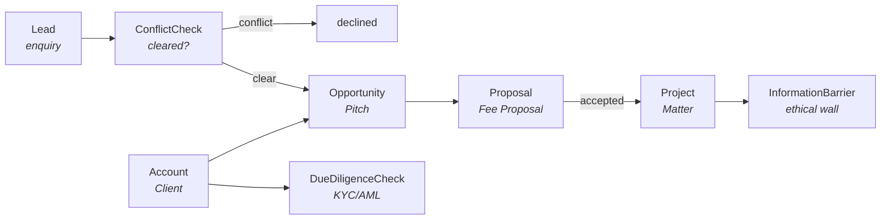

# Phase 2 — CRM

The second pilot: client intake, conflict checks, the pitch pipeline, fee proposals and the
hand-off to a matter, for **Fabrikam Legal LLP** on the `law-firm-crm` profile.

This phase is also the accelerator's claim being tested. Phase 1 built twelve generators;
Phase 2 was meant to be three declarative specs and a profile, with no new tooling. It very
nearly was — and what it cost instead is recorded in [§7](#7-what-the-second-pilot-actually-cost),
because that is the number anyone evaluating this repo should see.

- The plan this phase belongs to → [01-plan-and-roadmap.md](01-plan-and-roadmap.md)
- The generators → [07-generators.md](07-generators.md)
- Phase 1, for comparison → [06-phase1-core-hr.md](06-phase1-core-hr.md)
- The tables → [data-dictionary/crm.md](data-dictionary/crm.md),
  [data-dictionary/legal-crm.md](data-dictionary/legal-crm.md),
  [data-dictionary/proserv-compliance.md](data-dictionary/proserv-compliance.md)

---

## 1. What Phase 2 delivers

```bash
python tools/build.py --profile law-firm-crm --prefix fab --solution FabrikamCRM --firm fabrikam
```

One command, twelve steps, and:

| | |
|---|---|
| **Dataverse** | 55 tables, 477 columns, 162 relationships, 30 alternate keys, 48 choice sets — no manual metadata steps |
| **Security** | 4 roles over 44 / 35 / 29 / 6 tables, with a generated access matrix |
| **App** | 6 areas, 37 forms, 37 views; 4 forms with a Sensitive section |
| **Flows** | the shared approval engine, covering Proposal and Timesheet in this profile |
| **Power BI** | 25-table model, 26 measures |
| **SQL** | 62 tables, 502 foreign keys, 59 reference tables |
| **SharePoint** | 59 lists, 481 site columns, and 23 limits worth knowing about |
| **Solution** | 829 components in 192 files |
| **Demo data** | Fabrikam Legal — 514 rows over 24 tables |

### The profile

`law-firm-crm` is `core`, `crm`, `work`, `crm-work`, `proserv-compliance`, `legal-crm` and
`legal-work`. The matter tables are in it, and that is not padding:
**`proserv-compliance` depends on `work` as well as `crm`**, because a conflict check is
searched against open matters. The dependency is in the schema, and the schema is right —
a conflict search that cannot see the firm's matters is not a conflict search.

That turns out to be the story the pilot wants anyway:



### The terminology does the industry work

Nothing in the app or the dashboard says "law firm". The `legal-crm` and `legal-work` overlays
rename the concepts, and every generator picks it up from the resolved model:

| Table | Reads as |
|---|---|
| `Account` | Client |
| `Opportunity` | Pitch |
| `Proposal` | Fee Proposal |
| `Project` | Matter |
| `ProjectPhase` | Matter Stage |
| `ProjectMember` | Matter Team Member |
| `ServiceLine` | Practice Area |
| `Project.projectManager` | Responsible Lawyer |
| `Project.sponsor` | Supervising Partner |

This is the single clearest demonstration that adapting to an industry is configuration. The
same generators, pointed at `tech-company`, produce an app that says Opportunity and Project.

---

## 2. Security: selling and clearing are different jobs

Four personas, and the shape differs from Phase 1 in one way that matters.

| Role | Tables | What it is for |
|---|--:|---|
| **Fee Earner** | 44 | A lawyer: the clients and pitches in their own practice group, and the matters they run |
| **Business Development** | 35 | The pipeline, campaigns and client master data, firm-wide |
| **Risk & Compliance** | 29 | Conflict checks, due diligence, beneficial owners, ethical walls |
| **Client Portal User** | 6 | An external contact in Power Pages |

**The compliance tables belong to a role that is not the one selling.** A fee earner may
*raise* a conflict check and read their own, and cannot write the decision. A fee earner who
can record their own conflict decision has not had a conflict check — and the same applies to
Business Development, which raises checks on prospects and never clears them.

| Table | Fee Earner | Business Development | Compliance | Portal |
|---|---|---|---|---|
| `Account` | R (all) | CRU (all) | R (all) | R (own) |
| `Opportunity` | CRU (unit) | CRU (all) | R (all) | — |
| `Proposal` | CRU (unit) | CRU (all) | R (all) | R (own) |
| `ConflictCheck` | CR (own) | CR (own) | CRUD (all) | — |
| `DueDiligenceCheck` | — | — | CRUD (all) | — |
| `InformationBarrier` | — | — | CRUD (all) | — |
| `ConsentRecord` | — | CR (all) | R (all) | — |
| `Project` | CRU (unit) | R (all) | R (all) | — |
| `TimeEntry` | CRU (own) | — | — | — |

Four things in that table are deliberate and worth saying out loud:

- **Compliance reads every matter in the firm, at organization depth.** A conflict that spans
  two practice groups is precisely the conflict that matters, so business-unit depth would
  defeat the control.
- **Nobody can edit a `ConsentRecord`.** Business Development may create and read; compliance
  may only read. A consent record is evidence, and evidence that can be edited is not evidence.
- **Time entry is own-row only.** A fee earner who can edit a colleague's time can move revenue
  between matters.
- **The portal role's denial list is the longest thing in the file**, on purpose. For an
  external role the denials *are* the design: a client must never see the pitch behind their
  proposal, the conflict check that cleared them, or the firm's staff directory. Power Pages
  narrows it further with table permissions scoped to the signed-in contact; the role is the
  floor, not the boundary.

### The matrix caught an error in the first draft

Business Development originally **inherited** Fee Earner. It looked tidy, and it gave the BD
team the ability to edit matters, change matter parties and log time — all fee-earning acts.
BD now states its grants in full and reads `Project` and `StatusReport` without touching
anything inside a matter. The role dropped from 46 tables to 35.

That is what the generated matrix is for. The YAML read perfectly well; the matrix made the
consequence visible.

### Column security

Two profiles, both for columns classified more strictly than their table:

| Profile | Columns | Read by |
|---|---|---|
| CRM Sensitive Columns | contact details, tax numbers, `Lead.email`, `Lead.phone` | BD, compliance |
| **CRM Cost Rates** | `ProjectMember.costRate`, `ProjectRole.defaultCostRate` | BD only |

The second is the interesting one. A fee earner sees the **bill** rate and not the **cost**
rate, because the difference is the margin on a matter — and if every matter team knows its
own profitability, the partner conversation changes.

---

## 3. The app follows the intake sequence

Six areas, in the order the work happens: **Clients → Pipeline → Risk & Compliance →
Matters → Marketing → Setup**. Inside Pipeline, `Lead` and `ConflictCheck` sit together and
first, because a lawyer should not be able to work an enquiry nobody has checked.

**A model-driven app is shared.** It declares three internal roles — fee earner, business
development, compliance — and each sub-area appears for whoever can read its table. The
generator reports which tables are empty for which role, so the compliance area being blank
for a fee earner shows up as a design decision rather than as a bug:

```
ConflictParty         visible to compliance, empty for feeEarner, businessDevelopment
DueDiligenceCheck     visible to compliance, empty for feeEarner, businessDevelopment
InformationBarrier    visible to compliance, empty for feeEarner, businessDevelopment
ConsentRecord         visible to businessDevelopment, compliance, empty for feeEarner
ProjectPhase          visible to feeEarner, empty for businessDevelopment, compliance
```

`clientPortal` is deliberately not on that list: it is a Power Pages web role and never opens
this app.

Views carry at most eight columns and skip anything in a Sensitive section — a grid is the
easiest place to leak a column nobody meant to show. The conflict-check view sorts **oldest
first**, because a check waiting is a pitch that cannot start.

---

## 4. The approval engine, unchanged

Phase 1 built the engine; Phase 2 reuses it with no edits. In this profile it covers
`Proposal` (a fee proposal over a threshold needs a partner) and `Timesheet`.

That is the engine working as intended, and it got better in the process: it now derives what
it covers from the model — **any table with an `approvalRequest` column** — rather than from a
list in the tool. Across the full accounting profile that is ten tables in all five modules.
It was three hardcoded HR tables before Phase 2 needed it to be otherwise.

Three tables were found to need care, and are reported rather than wired up wrongly:

| Table | Why |
|---|---|
| `RaidItem`, `ServiceRequest` | their status has no submitted-like value, so there is no moment to start a run from — an approval on one is raised by hand |
| `NewsArticle`, `PolicyDocument`, `JobRequisition` | no rejected-like value, so a rejection is written back as `draft` or `cancelled`, and the generator says it is a fallback to check |

---

## 5. The dashboard puts compliance second, not last

Four pages: **Pipeline**, **Intake and risk**, **Fee proposals**, **Clients**. 26 measures.

Intake sits second because for a law firm the number that matters is not only the pipeline
value but **how long a conflict check takes**. A pitch cannot start until it clears, so a slow
conflicts team is a revenue problem wearing a compliance hat — and `Avg Conflict Check Hours`
is the measure that says so.

Measures worth knowing about:

- **`Weighted Pipeline`** discounts by each pitch's probability. The number to plan on, because
  the unweighted pipeline always flatters.
- **`Win Rate`** counts abandoned pitches as losses. A pitch nobody finished is a pitch that
  was not won.
- **`Conflict Rate`** is the share of decided checks that found something — the measure of
  whether the firm is pitching for work it can actually take.
- **`Due Diligence Overdue`** counts checks past their review date. An expired check means the
  firm cannot act for that client until it is redone.
- **`Marketing Consent %`** is, under UK GDPR, the number that says whether a mailing is lawful.

`BeneficialOwner` and `InformationBarrier` are **not in the dataset at all**. A dataset is a
copy of the data under its own permissions, so a restricted table imported into a report is
readable by anyone who can open the report — and an ethical wall that shows up in Power BI is
not a wall. Risk reporting on those gets its own workspace for the compliance team.

---

## 6. Demo data

Fabrikam Legal: 514 rows over 24 tables — 21 clients and prospects, 32 enquiries, 32 pitches, 24 fee proposals, 32 conflict checks, 15 due diligence checks, 17 consent records and 8 matters handed off from won pitches.

The numbers are tuned to be **credible rather than flattering**, which is the harder target:

| Measure | Shape | Why |
|---|---|---|
| Win rate | ~40% of closed pitches | A firm winning most of its competitive pitches is not a firm anyone will believe, and win rate is the first thing a partner reads |
| Conflict rate | ~1 decided check in 5 finds something | Higher and the conflicts team looks broken; lower and the tile is decoration |
| Due diligence | some overdue, a few high-risk, one PEP | A compliance dashboard where everything is green demonstrates nothing |
| Marketing consent | ~58% of contacts | Because that is roughly what a real consent position looks like |

Both the win rate and the conflict rate have **floors**, for the same reason the credential
watchlist does in Phase 1: on a firm this size a single random draw can easily find no
conflicts at all, and a tile reading zero demonstrates the opposite of what it is for.

---

## 7. What the second pilot actually cost

The claim was that a second pilot would be specs and no new tooling. What it took:

**Written for Phase 2** — the deliverables:

| File | Lines |
|---|--:|
| `security/crm-roles.yaml` | 344 |
| `apps/crm-intake.yaml` | 153 |
| `powerbi/crm-dashboard.yaml` | 408 |
| one profile in `schemas/profiles.yaml` | 8 |
| **total** | **913** |

**Changed in the tools** — and every one of these was a latent defect or a missing
generalisation, not Phase 2 work:

| Change | Why it was needed |
|---|---|
| `appgen --roles`, `pbigen --spec` as real flags | a second pilot is impossible without them |
| `appgen` takes several roles, not one | a model-driven app is shared; the single-role check was the wrong model |
| `appgen`'s role check reports when it skips | it was silently skipping on the wrong roles file, which looks exactly like a pass |
| `appgen` writes per profile | a shared `build/apps` packaged HR forms into a Travel solution |
| `solgen` allows forms on standard tables | `account` and `contact` need no `Entity.xml` |
| `flowgen` derives its tables from the model | it was three hardcoded HR tables |
| `demodata` skips sections a profile lacks | it was HR-shaped and could not run on a CRM profile |
| `demodata` guards overlay columns | it wrote `legal-work` columns on `Project` unconditionally |
| **`pbigen` validates enum labels** | see below |

That last one is the find of the phase. A literal compared against a label column must be a
real enum label: `'Employment'[terminationTypename] = "Voluntary"` is valid DAX, refreshes
without complaint and **matches nothing**. It found four broken measures in the Phase 1 HR
dashboard that had already shipped — `Voluntary Attrition %` could only ever read 0% — and one
in the CRM dashboard being written at the time.

So: the specs were the work, and the tool changes were debt that a second pilot was always
going to surface. Which is roughly the honest version of the accelerator claim.

---

## 8. Still to do

| Not done | Needs |
|---|---|
| Apply to a Dev environment | a tenant, and the `PP_*` credentials |
| Power Pages client portal | the portal itself, its table permissions and the web role |
| The conflict-check business process flow | the stage gate that stops a pitch advancing before a check clears |
| Four child flows | notify, escalate, write-back, approver resolution — shared with Phase 1 |
| The report canvas | Power BI Desktop, from the generated `pages.md` |
| Demo video and case study | the above, working |

The exit criteria from the roadmap — *lead → opportunity → won → project hand-off works*, and
*portal user sees only their own records* — are expressed in the specs and asserted by the
roles and the demo data. Proving them end to end needs the tenant.
