# Data dictionary

> Generated by `tools/schematool.py docs` from the YAML under [`schemas/`](../../schemas). Do not edit by hand.

## Layers

| Layer | Kind | Version | Depends on | Entities | Extended | Enums | Columns | Seed rows |
|---|---|---|---|--:|--:|--:|--:|--:|
| [Shared Core](core.md) `core` | foundation | 1.0.0 | — | 23 | 0 | 16 | 209 | 28 |
| [CRM](crm.md) `crm` | module | 1.0.0 | core | 14 | 2 | 19 | 171 | 15 |
| [HR](hr.md) `hr` | module | 1.0.0 | core | 33 | 0 | 36 | 356 | 39 |
| [Intranet](intranet.md) `intranet` | module | 1.0.0 | core | 12 | 0 | 8 | 151 | 8 |
| [Travel Portal](travel.md) `travel` | module | 1.0.0 | core | 15 | 0 | 13 | 212 | 20 |
| [Work Management](work.md) `work` | module | 1.0.0 | core | 17 | 0 | 14 | 200 | 24 |
| [Bridge – CRM ↔ Work Management](crm-work.md) `crm-work` | bridge | 1.0.0 | crm, work | 0 | 2 | 0 | 3 | 0 |
| [Bridge – HR ↔ Intranet](hr-intranet.md) `hr-intranet` | bridge | 1.0.0 | hr, intranet | 0 | 2 | 0 | 2 | 0 |
| [Bridge – HR ↔ Work Management](hr-work.md) `hr-work` | bridge | 1.0.0 | hr, work | 0 | 2 | 0 | 4 | 0 |
| [Bridge – Intranet ↔ Work Management](intranet-work.md) `intranet-work` | bridge | 1.0.0 | intranet, work | 0 | 1 | 0 | 1 | 0 |
| [Bridge – Travel ↔ Work Management](travel-work.md) `travel-work` | bridge | 1.0.0 | travel, work | 0 | 3 | 0 | 3 | 0 |
| [Accounting – CRM overlay](accounting-crm.md) `accounting-crm` | industry | 1.0.0 | crm | 0 | 1 | 1 | 10 | 2 |
| [Accounting – HR overlay](accounting-hr.md) `accounting-hr` | industry | 1.0.0 | hr | 0 | 0 | 0 | 0 | 7 |
| [Accounting – Intranet overlay](accounting-intranet.md) `accounting-intranet` | industry | 1.0.0 | intranet | 0 | 0 | 0 | 0 | 0 |
| [Accounting – Travel overlay](accounting-travel.md) `accounting-travel` | industry | 1.0.0 | travel | 0 | 0 | 0 | 0 | 2 |
| [Accounting – Engagement management overlay](accounting-work.md) `accounting-work` | industry | 1.0.0 | work, proserv-compliance | 3 | 1 | 5 | 48 | 31 |
| [Architecture – CRM overlay](architecture-crm.md) `architecture-crm` | industry | 1.0.0 | crm | 0 | 0 | 0 | 0 | 10 |
| [Architecture – HR overlay](architecture-hr.md) `architecture-hr` | industry | 1.0.0 | hr | 0 | 0 | 0 | 0 | 10 |
| [Architecture – Travel overlay](architecture-travel.md) `architecture-travel` | industry | 1.0.0 | travel, architecture-work | 0 | 1 | 0 | 1 | 1 |
| [Architecture – Project delivery overlay](architecture-work.md) `architecture-work` | industry | 1.0.0 | work | 6 | 1 | 7 | 75 | 35 |
| [Legal – CRM overlay](legal-crm.md) `legal-crm` | industry | 1.0.0 | crm | 0 | 0 | 0 | 0 | 9 |
| [Legal – HR overlay](legal-hr.md) `legal-hr` | industry | 1.0.0 | hr | 0 | 0 | 0 | 0 | 5 |
| [Legal – Intranet overlay](legal-intranet.md) `legal-intranet` | industry | 1.0.0 | intranet | 0 | 0 | 0 | 0 | 0 |
| [Legal – Travel overlay](legal-travel.md) `legal-travel` | industry | 1.0.0 | travel | 0 | 0 | 0 | 0 | 2 |
| [Legal – Matter management overlay](legal-work.md) `legal-work` | industry | 1.0.0 | work, proserv-compliance | 2 | 1 | 2 | 33 | 46 |
| [Professional Services – Risk & Compliance](proserv-compliance.md) `proserv-compliance` | industry | 1.0.0 | crm, work | 6 | 2 | 8 | 68 | 0 |
| [Technology – CRM overlay](technology-crm.md) `technology-crm` | industry | 1.0.0 | crm | 1 | 1 | 1 | 16 | 8 |
| [Technology – HR overlay](technology-hr.md) `technology-hr` | industry | 1.0.0 | hr | 0 | 0 | 0 | 0 | 16 |
| [Technology – Product delivery overlay](technology-work.md) `technology-work` | industry | 1.0.0 | work | 2 | 2 | 5 | 25 | 24 |
| **Total** | | | | **134** | **22** | **135** | **1588** | **342** |

## Dependency graph

Arrows point from a layer to the layers it depends on.

```mermaid
flowchart BT
    subgraph g0["Foundation"]
        core["core"]
    end
    subgraph g1["Modules"]
        crm["crm"]
        hr["hr"]
        intranet["intranet"]
        travel["travel"]
        work["work"]
    end
    subgraph g2["Bridges"]
        crm_work["crm-work"]
        hr_intranet["hr-intranet"]
        hr_work["hr-work"]
        intranet_work["intranet-work"]
        travel_work["travel-work"]
    end
    subgraph g3["Industry: Accounting"]
        accounting_crm["accounting-crm"]
        accounting_hr["accounting-hr"]
        accounting_intranet["accounting-intranet"]
        accounting_travel["accounting-travel"]
        accounting_work["accounting-work"]
    end
    subgraph g4["Industry: Architecture"]
        architecture_crm["architecture-crm"]
        architecture_hr["architecture-hr"]
        architecture_travel["architecture-travel"]
        architecture_work["architecture-work"]
    end
    subgraph g5["Industry: Legal"]
        legal_crm["legal-crm"]
        legal_hr["legal-hr"]
        legal_intranet["legal-intranet"]
        legal_travel["legal-travel"]
        legal_work["legal-work"]
    end
    subgraph g6["Industry: Professional Services"]
        proserv_compliance["proserv-compliance"]
    end
    subgraph g7["Industry: Technology"]
        technology_crm["technology-crm"]
        technology_hr["technology-hr"]
        technology_work["technology-work"]
    end
    crm --> core
    hr --> core
    intranet --> core
    travel --> core
    work --> core
    crm_work --> crm
    crm_work --> work
    hr_intranet --> hr
    hr_intranet --> intranet
    hr_work --> hr
    hr_work --> work
    intranet_work --> intranet
    intranet_work --> work
    travel_work --> travel
    travel_work --> work
    accounting_crm --> crm
    accounting_hr --> hr
    accounting_intranet --> intranet
    accounting_travel --> travel
    accounting_work --> work
    accounting_work --> proserv_compliance
    architecture_crm --> crm
    architecture_hr --> hr
    architecture_travel --> travel
    architecture_travel --> architecture_work
    architecture_work --> work
    legal_crm --> crm
    legal_hr --> hr
    legal_intranet --> intranet
    legal_travel --> travel
    legal_work --> work
    legal_work --> proserv_compliance
    proserv_compliance --> crm
    proserv_compliance --> work
    technology_crm --> crm
    technology_hr --> hr
    technology_work --> work
```

## Deployment profiles

A profile is the set of layers deployed for one kind of client. `python tools/schematool.py export --profile <name>` resolves it into one model.

| Profile | Description | Layers |
|---|---|---|
| `general-firm` | Any professional or corporate firm. All five pilots with generic reference data. | `core`, `crm`, `work`, `travel`, `hr`, `intranet`, `crm-work`, `travel-work`, `hr-work`, `hr-intranet`, `intranet-work` |
| `architecture-firm` | Architecture and design practices (RIBA/AIA stages, drawings, transmittals, site visits). | `core`, `crm`, `work`, `travel`, `hr`, `intranet`, `crm-work`, `travel-work`, `hr-work`, `hr-intranet`, `intranet-work`, `architecture-crm`, `architecture-work`, `architecture-hr`, `architecture-travel` |
| `law-firm` | Law firms (matters, conflicts, ethical walls, docketing, UTBMS, bar admissions). | `core`, `crm`, `work`, `travel`, `hr`, `intranet`, `crm-work`, `travel-work`, `hr-work`, `hr-intranet`, `intranet-work`, `proserv-compliance`, `legal-crm`, `legal-work`, `legal-hr`, `legal-travel`, `legal-intranet` |
| `accounting-firm` | Accounting, audit and tax firms (engagements, PBC requests, deadlines, independence, CPE). | `core`, `crm`, `work`, `travel`, `hr`, `intranet`, `crm-work`, `travel-work`, `hr-work`, `hr-intranet`, `intranet-work`, `proserv-compliance`, `accounting-crm`, `accounting-work`, `accounting-hr`, `accounting-travel`, `accounting-intranet` |
| `tech-company` | Software and technology companies (products, releases, agile backlog, SaaS subscriptions). | `core`, `crm`, `work`, `travel`, `hr`, `intranet`, `crm-work`, `travel-work`, `hr-work`, `hr-intranet`, `intranet-work`, `technology-crm`, `technology-work`, `technology-hr` |
| `intranet-starter` | Intranet only, on SharePoint Online. | `core`, `intranet` |
| `travel-starter` | Travel portal only (trip requests, bookings, expenses). | `core`, `travel` |
| `hr-starter` | HR only (people, leave, onboarding, hiring, performance, learning). | `core`, `hr` |
| `crm-starter` | CRM only (clients, pipeline, proposals, activities). | `core`, `crm` |
| `work-starter` | Work management only (projects, tasks, time). | `core`, `work` |

## Standard columns (traits)

Every entity gets these columns without declaring them; Dataverse and SharePoint provide most of them natively.

### `base` — every entity

Identity, audit and lifecycle columns on every entity. Dataverse and SharePoint provide them natively; SQL builds generate them.

| Column | Type | Req | Dataverse | SharePoint | SQL | Notes |
|---|---|:-:|---|---|---|---|
| `id` | guid | ✔ | <table>id (native primary key) | UniqueId (native; integer ID also exists) | uniqueidentifier PK (NEWSEQUENTIALID) | Surrogate primary key. Never shown to users, never reused, never derived from data. |
| `createdOn` | datetime | ✔ | createdon (native) | Created (native) | datetime2 (UTC) |  |
| `createdBy` | lookup([Employee](#employee)) |  | createdby (native → systemuser) | Author (native) | uniqueidentifier |  |
| `modifiedOn` | datetime | ✔ | modifiedon (native) | Modified (native) | datetime2 (UTC) |  |
| `modifiedBy` | lookup([Employee](#employee)) |  | modifiedby (native → systemuser) | Editor (native) | uniqueidentifier |  |
| `stateCode` | choice([RecordState](#recordstate)) | ✔ | statecode (native) | IsActive (Yes/No) | tinyint | Record lifecycle (active/inactive). Deactivate instead of deleting. Not the business process status. _default `active`_ |
| `statusReason` | integer |  | statuscode (native) | — | int | Optional reason for the current state. |
| `rowVersion` | integer |  | versionnumber (native) | owshiddenversion (native) | rowversion | Optimistic concurrency token for integrations and offline sync. |

### `owned` — user-owned entities

Record owner used for row-level security and assignment. Only on user-owned entities. In Dataverse the ownership type cannot be changed after the table is created.

| Column | Type | Req | Dataverse | SharePoint | SQL | Notes |
|---|---|:-:|---|---|---|---|
| `owner` | lookup([Employee](#employee)) |  | ownerid (native, user or team) + owningbusinessunit | — (use Author or a Person column; avoid item-level permissions) | uniqueidentifier | User or team that owns the record. |

### `integration` — entities that list it under `traits`

Keys for synchronising with external systems (ERP, HRIS, payroll, DMS, Jira…). Never reuse `id` for this.

| Column | Type | Req | Dataverse | SharePoint | SQL | Notes |
|---|---|:-:|---|---|---|---|
| `externalId` | string(100) |  | Text (100) | Single line of text | nvarchar(100) | Identifier of this record in the external system. _indexed_ |
| `sourceSystem` | string(50) |  | Text (50) | Single line of text | nvarchar(50) | System that masters this record, e.g. Workday, Xero, iManage. |
| `lastSyncedOn` | datetime |  | Date and time (user local) | Date and time | datetime2 (UTC) |  |

### `classified` — entities that list it under `traits`

Information-protection metadata, aligned with Microsoft Purview sensitivity and retention labels.

| Column | Type | Req | Dataverse | SharePoint | SQL | Notes |
|---|---|:-:|---|---|---|---|
| `sensitivity` | choice([SensitivityLevel](#sensitivitylevel)) |  | Choice (global: SensitivityLevel) | Choice | int | _default `internal`_ |
| `retentionLabel` | string(100) |  | Text (100) | Single line of text | nvarchar(100) | Name of the retention label/policy applied. |

### `effectiveDated` — entities that list it under `traits`

The row is valid for a date range. History is kept by adding rows, never by overwriting.

| Column | Type | Req | Dataverse | SharePoint | SQL | Notes |
|---|---|:-:|---|---|---|---|
| `validFrom` | date | ✔ | Date only (behaviour: date only) | Date (date only) | date |  |
| `validTo` | date |  | Date only (behaviour: date only) | Date (date only) | date | Empty means open-ended (the current row). |

## Logical type → platform mapping

Defaults used throughout this dictionary. A column can override them with `dataverse:`, `sharepoint:` or `sql:` in its definition.

| Logical type | Dataverse | SharePoint | SQL (Azure SQL / SQL Server) |
|---|---|---|---|
| `string(n)` | Text (n) | Single line of text (n ≤ 255) / Multiple lines (n > 255) | nvarchar(n) |
| `decimal(p,s)` | Decimal (p,s) | Number (s dp) | decimal(p,s) |
| `lookup(Employee)` | Lookup → Employee | Person | uniqueidentifier FK → Employee |
| `lookup(X)` | Lookup → X | Lookup → X | uniqueidentifier FK → X |
| `parent(X)` | Lookup → X (parental) | Lookup → X (cascade delete) | uniqueidentifier FK → X (cascade) |
| `multilookup(X)` | N:N → X | Lookup (multiple) → X | junction table → X |
| `polylookup(A\|B)` | Multi-table lookup | Text ×2 (list name + id) | nvarchar(100) + uniqueidentifier |
| `polylookup(*)` | Text ×2 (table name + id) | Text ×2 (list name + id) | nvarchar(100) + uniqueidentifier |
| `choice(E)` | Choice (global: E) | Choice | int |
| `multichoice(E)` | Choices (global: E) | Choice (multiple) | junction table |
| `term(S)` | Lookup → Term (set S) | Managed metadata (S) | uniqueidentifier FK → Term |
| `multiterm(S)` | N:N → Term (set S) | Managed metadata, multiple (S) | junction table → Term |
| `autonumber` | Autonumber `PRE-{SEQNUM:6}` | Single line of text (set by flow) | nvarchar(30) + sequence |
| `guid` | Unique identifier | Single line of text | uniqueidentifier |
| `text` | Multiline text | Multiple lines (plain) | nvarchar(max) |
| `richtext` | Multiline text (rich text) | Multiple lines (enhanced rich text) | nvarchar(max) |
| `email` | Text (email) | Single line of text | nvarchar(320) |
| `phone` | Text (phone) | Single line of text | nvarchar(50) |
| `url` | Text (URL) | Hyperlink | nvarchar(2000) |
| `integer` | Whole number | Number (0 dp) | int |
| `percent` | Decimal (5,2) | Number (%) | decimal(5,2) |
| `money` | Currency | Currency | decimal(19,4) |
| `boolean` | Yes/No | Yes/No | bit |
| `date` | Date only (behaviour: date only) | Date (date only) | date |
| `datetime` | Date and time (user local) | Date and time | datetime2 (UTC) |
| `duration` | Whole number (duration) | Number (minutes) | int (minutes) |
| `address` | Text ×5 + Lookup → Country | Text ×5 + Lookup → Country | nvarchar ×5 + FK → Country |
| `file` | File | Attachment / library file | nvarchar(2000) (blob URL) |
| `image` | Image | Image | nvarchar(2000) (blob URL) |
