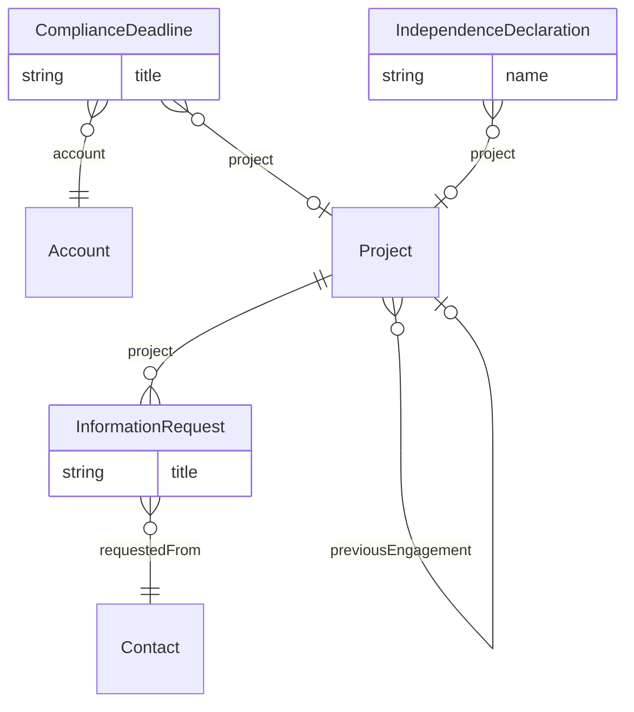

# Accounting – Engagement management overlay (`accounting-work` v1.0.0)

> Generated from [`schemas/industries/accounting.yaml`](../../schemas/industries/accounting.yaml) by `tools/schematool.py docs`. Do not edit by hand.

Turns Work Management into engagement management: engagement terminology, audit and tax phases, roll-forward of recurring engagements, quality review, PBC (prepared-by-client) requests, statutory filing deadlines and independence declarations.

| Kind | Depends on | Entities | Extended entities | Enums | Term sets |
|---|---|---|---|---|---|
| industry | [`work`](work.md), [`proserv-compliance`](proserv-compliance.md) | 3 | 1 | 5 | 2 |

## Terminology

Display names this layer applies on top of the generic model.

| Generic name | Shown as |
|---|---|
| `Project` | Engagement / Engagements |
| `ProjectType` | Engagement Type / Engagement Types |
| `ProjectMember` | Engagement Team Member / Engagement Team |
| `Project.projectNumber` | Engagement Number |
| `Project.projectManager` | Engagement Manager |
| `Project.sponsor` | Engagement Partner |

## Entities

| Entity | Description | Dataverse | SharePoint | Volume | Sensitivity |
|---|---|---|---|---|---|
| [InformationRequest](#informationrequest) | Prepared-by-client (PBC) request for documents or data, typically answered through a client portal. | custom | list | medium | internal |
| [ComplianceDeadline](#compliancedeadline) | Statutory filing or payment deadline for a client. | custom | list | medium | internal |
| [IndependenceDeclaration](#independencedeclaration) | A person's declaration of independence (annual, new joiner or per engagement). | custom | list | low | restricted |

## Relationships

Lookups to Country, Currency, Employee, Language are left out of the diagram to keep it readable.

### InformationRequest

Prepared-by-client (PBC) request for documents or data, typically answered through a client portal.

- **Display name:** Information Request / Information Requests
- **Ownership:** user · **Volume:** medium · **Sensitivity:** internal
- **Dataverse:** custom table `pfx_informationrequest` · **SharePoint:** list · **SQL:** table
- **Primary column:** `title`
- **Standard columns from traits:** `base` (id, createdOn, createdBy, modifiedOn, modifiedBy, stateCode, statusReason, rowVersion), `owned` (owner)

| Column | Type | Req | Dataverse | SharePoint | SQL | Notes |
|---|---|:-:|---|---|---|---|
| `project` | parent([Project](work.md#project)) | ✔ | Lookup → Project (parental) | Lookup → Project (cascade delete) | uniqueidentifier FK → Project (cascade) |  |
| `title` | string(200) | ✔ | Text (200) | Title (primary column) | nvarchar(200) |  |
| `area` | string(100) |  | Text (100) | Single line of text | nvarchar(100) | Audit area, e.g. Fixed assets, Payroll, Revenue. |
| `requestedFrom` | lookup([Contact](core.md#contact)) | ✔ | Lookup → Contact | Lookup → Contact | uniqueidentifier FK → Contact |  |
| `requestedBy` | lookup([Employee](core.md#employee)) |  | Lookup → Employee | Person | uniqueidentifier FK → Employee |  |
| `requestedOn` | date | ✔ | Date only (behaviour: date only) | Date (date only) | date |  |
| `dueDate` | date | ✔ | Date only (behaviour: date only) | Date (date only) | date |  |
| `receivedOn` | date |  | Date only (behaviour: date only) | Date (date only) | date |  |
| `status` | choice([InfoRequestStatus](#inforequeststatus)) | ✔ | Choice (global: InfoRequestStatus) | Choice | int | _default `notSent`_ |
| `followUpCount` | integer |  | Whole number | Number (0 dp) | int |  |
| `documentUrl` | url |  | Text (URL) | Hyperlink | nvarchar(2000) |  |
| `description` | text |  | Multiline text | Multiple lines (plain) | nvarchar(max) |  |

### ComplianceDeadline

Statutory filing or payment deadline for a client.

- **Display name:** Compliance Deadline / Compliance Deadlines
- **Ownership:** user · **Volume:** medium · **Sensitivity:** internal
- **Dataverse:** custom table `pfx_compliancedeadline` · **SharePoint:** list · **SQL:** table
- **Primary column:** `title`
- **Standard columns from traits:** `base` (id, createdOn, createdBy, modifiedOn, modifiedBy, stateCode, statusReason, rowVersion), `owned` (owner)

| Column | Type | Req | Dataverse | SharePoint | SQL | Notes |
|---|---|:-:|---|---|---|---|
| `title` | string(200) | ✔ | Text (200) | Title (primary column) | nvarchar(200) |  |
| `account` | lookup([Account](core.md#account)) | ✔ | Lookup → Account | Lookup → Account | uniqueidentifier FK → Account |  |
| `project` | lookup([Project](work.md#project)) |  | Lookup → Project | Lookup → Project | uniqueidentifier FK → Project |  |
| `deadlineType` | term([DeadlineType](#deadlinetype)) | ✔ | Lookup → Term (set DeadlineType) | Managed metadata (DeadlineType) | uniqueidentifier FK → Term |  |
| `jurisdiction` | lookup([Country](core.md#country)) |  | Lookup → Country | Lookup → Country | uniqueidentifier FK → Country |  |
| `periodEnd` | date |  | Date only (behaviour: date only) | Date (date only) | date |  |
| `dueDate` | date | ✔ | Date only (behaviour: date only) | Date (date only) | date |  |
| `extendedTo` | date |  | Date only (behaviour: date only) | Date (date only) | date |  |
| `status` | choice([DeadlineStatus](#deadlinestatus)) | ✔ | Choice (global: DeadlineStatus) | Choice | int | _default `upcoming`_ |
| `responsible` | lookup([Employee](core.md#employee)) | ✔ | Lookup → Employee | Person | uniqueidentifier FK → Employee |  |
| `filedOn` | date |  | Date only (behaviour: date only) | Date (date only) | date |  |
| `filedBy` | lookup([Employee](core.md#employee)) |  | Lookup → Employee | Person | uniqueidentifier FK → Employee |  |
| `filingReference` | string(100) |  | Text (100) | Single line of text | nvarchar(100) |  |

### IndependenceDeclaration

A person's declaration of independence (annual, new joiner or per engagement).

- **Display name:** Independence Declaration / Independence Declarations
- **Ownership:** user · **Volume:** low · **Sensitivity:** restricted
- **Dataverse:** custom table `pfx_independencedeclaration` · **SharePoint:** list · **SQL:** table
- **Primary column:** `name` (auto-generated)
- **Standard columns from traits:** `base` (id, createdOn, createdBy, modifiedOn, modifiedBy, stateCode, statusReason, rowVersion), `owned` (owner)

| Column | Type | Req | Dataverse | SharePoint | SQL | Notes |
|---|---|:-:|---|---|---|---|
| `name` | string(200) | ✔ | Text (200) | Title (primary column) | nvarchar(200) | Display label generated automatically (flow, plug-in or trigger). Required by Dataverse (primary name) and SharePoint (Title). _read-only_ |
| `employee` | lookup([Employee](core.md#employee)) | ✔ | Lookup → Employee | Person | uniqueidentifier FK → Employee |  |
| `declarationType` | choice([DeclarationType](#declarationtype)) | ✔ | Choice (global: DeclarationType) | Choice | int |  |
| `project` | lookup([Project](work.md#project)) |  | Lookup → Project | Lookup → Project | uniqueidentifier FK → Project |  |
| `periodYear` | integer |  | Whole number | Number (0 dp) | int |  |
| `status` | choice([DeclarationStatus](#declarationstatus)) | ✔ | Choice (global: DeclarationStatus) | Choice | int | _default `pending`_ |
| `declaredOn` | datetime |  | Date and time (user local) | Date and time | datetime2 (UTC) |  |
| `hasInterestsToDeclare` | boolean |  | Yes/No | Yes/No | bit |  |
| `details` | text |  | Multiline text | Multiple lines (plain) | nvarchar(max) | _PII_ |
| `reviewedBy` | lookup([Employee](core.md#employee)) |  | Lookup → Employee | Person | uniqueidentifier FK → Employee |  |
| `reviewedOn` | date |  | Date only (behaviour: date only) | Date (date only) | date |  |

## Extensions to entities from other layers

### Project (+12)

Adds columns to [Project](work.md#project) from `work`.

| Column | Type | Req | Dataverse | SharePoint | SQL | Notes |
|---|---|:-:|---|---|---|---|
| `periodStart` | date |  | Date only (behaviour: date only) | Date (date only) | date | Start of the financial period covered. |
| `periodEnd` | date |  | Date only (behaviour: date only) | Date (date only) | date |  |
| `reportingFramework` | term([ReportingFramework](#reportingframework)) |  | Lookup → Term (set ReportingFramework) | Managed metadata (ReportingFramework) | uniqueidentifier FK → Term |  |
| `isRecurring` | boolean |  | Yes/No | Yes/No | bit |  |
| `recurrence` | choice([RecurrencePattern](#recurrencepattern)) |  | Choice (global: RecurrencePattern) | Choice | int |  |
| `previousEngagement` | lookup([Project](work.md#project)) |  | Lookup → Project | Lookup → Project | uniqueidentifier FK → Project | Prior-year engagement this one rolled forward from. |
| `reportDeadline` | date |  | Date only (behaviour: date only) | Date (date only) | date |  |
| `reportSignedOn` | date |  | Date only (behaviour: date only) | Date (date only) | date |  |
| `qualityReviewRequired` | boolean |  | Yes/No | Yes/No | bit | Engagement quality review (EQR) required. |
| `qualityReviewer` | lookup([Employee](core.md#employee)) |  | Lookup → Employee | Person | uniqueidentifier FK → Employee |  |
| `independenceConfirmed` | boolean |  | Yes/No | Yes/No | bit |  |
| `materiality` | money |  | Currency | Currency | decimal(19,4) |  |

## Choices (enums)

Codes are stable forever. Dataverse option value = publisher choice prefix + code.

### RecurrencePattern

How often an engagement recurs.

| Code | Key | Label |
|--:|---|---|
| 1 | `oneOff` | One Off |
| 2 | `annual` | Annual |
| 3 | `quarterly` | Quarterly |
| 4 | `monthly` | Monthly |

### InfoRequestStatus

State of a prepared-by-client request.

| Code | Key | Label |
|--:|---|---|
| 1 | `notSent` | Not Sent |
| 2 | `requested` | Requested |
| 3 | `partiallyReceived` | Partially Received |
| 4 | `received` | Received |
| 5 | `accepted` | Accepted |
| 6 | `notApplicable` | Not Applicable |

### DeadlineStatus

State of a statutory deadline.

| Code | Key | Label |
|--:|---|---|
| 1 | `upcoming` | Upcoming |
| 2 | `inProgress` | In Progress |
| 3 | `filed` | Filed |
| 4 | `extended` | Extended |
| 5 | `missed` | Missed |
| 6 | `notRequired` | Not Required |

### DeclarationType

Occasion of an independence declaration.

| Code | Key | Label |
|--:|---|---|
| 1 | `annual` | Annual |
| 2 | `engagementSpecific` | Engagement Specific |
| 3 | `newJoiner` | New Joiner |

### DeclarationStatus

Review state of an independence declaration.

| Code | Key | Label |
|--:|---|---|
| 1 | `pending` | Pending |
| 2 | `submitted` | Submitted |
| 3 | `underReview` | Under Review |
| 4 | `cleared` | Cleared |
| 5 | `actionRequired` | Action Required |

## Term sets

Stored in the SharePoint term store; mirrored to the Term table on Dataverse/SQL.

### ReportingFramework

Financial reporting framework of an engagement.

- IFRS
- IFRS for SMEs
- US GAAP
- UK GAAP (FRS 102)
- FRS 105
- Ind AS
- Local GAAP – other
- Cash basis

### DeadlineType

Kind of statutory or client deadline.

- Corporate tax return
- Personal tax return
- VAT / GST / sales tax return
- Payroll filing
- Annual accounts filing
- Annual return / confirmation statement
- Estimated tax payment
- Audit report

## Reference data (seed)

Loaded at deployment. Deactivate rows you do not need instead of deleting them.

### ProjectType (8 rows)

| code | name | defaultBillingModel | requiresClient | isInternal | numberPrefix |
|---|---|---|---|---|---|
| ACC_AUDIT | Statutory audit | fixedFee | yes | no | AUD- |
| ACC_REVIEW | Review engagement | fixedFee | yes | no | REV- |
| ACC_COMPILATION | Compilation / accounts preparation | fixedFee | yes | no | ACC- |
| ACC_TAX_COMPLIANCE | Tax compliance | fixedFee | yes | no | TAX- |
| ACC_TAX_ADVISORY | Tax advisory | timeAndMaterials | yes | no | TAX- |
| ACC_BOOKKEEPING | Bookkeeping | retainer | yes | no | BK- |
| ACC_PAYROLL | Payroll services | subscription | yes | no | PAY- |
| ACC_ADVISORY | Business advisory / transaction services | timeAndMaterials | yes | no | ADV- |

### ProjectPhaseDefinition (11 rows)

| code | name | framework | projectType | sequence |
|---|---|---|---|---|
| ACC_AUD_ACCEPT | Acceptance & continuance | Audit | ACC_AUDIT | 1 |
| ACC_AUD_PLAN | Planning & risk assessment | Audit | ACC_AUDIT | 2 |
| ACC_AUD_INTERIM | Interim fieldwork | Audit | ACC_AUDIT | 3 |
| ACC_AUD_FINAL | Final fieldwork | Audit | ACC_AUDIT | 4 |
| ACC_AUD_COMPLETE | Completion & review | Audit | ACC_AUDIT | 5 |
| ACC_AUD_REPORT | Reporting | Audit | ACC_AUDIT | 6 |
| ACC_TAX_GATHER | Information gathering | Tax compliance | ACC_TAX_COMPLIANCE | 1 |
| ACC_TAX_PREPARE | Preparation | Tax compliance | ACC_TAX_COMPLIANCE | 2 |
| ACC_TAX_REVIEW | Review | Tax compliance | ACC_TAX_COMPLIANCE | 3 |
| ACC_TAX_APPROVE | Client approval | Tax compliance | ACC_TAX_COMPLIANCE | 4 |
| ACC_TAX_FILE | Filing | Tax compliance | ACC_TAX_COMPLIANCE | 5 |

### ProjectRole (6 rows)

| code | name |
|---|---|
| ACC_ENG_PARTNER | Engagement partner |
| ACC_EQR | Engagement quality reviewer |
| ACC_MANAGER | Manager |
| ACC_SENIOR | Senior |
| ACC_STAFF | Staff accountant / associate |
| ACC_TAX_SPECIALIST | Tax specialist |

### TimeCode (6 rows)

| code | name | codeSet | isBillableDefault |
|---|---|---|---|
| ACC_PLANNING | Planning | Audit | yes |
| ACC_FIELDWORK | Fieldwork | Audit | yes |
| ACC_REVIEW_TIME | Review | Audit | yes |
| ACC_REPORTING | Reporting | Audit | yes |
| ACC_TAX_PREP | Tax return preparation | Tax | yes |
| ACC_BOOKS | Bookkeeping | Accounts | yes |
