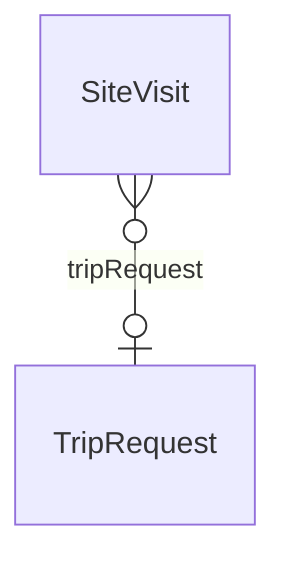

# Architecture – Travel overlay (`architecture-travel` v1.0.0)

> Generated from [`schemas/industries/architecture.yaml`](../../schemas/industries/architecture.yaml) by `tools/schematool.py docs`. Do not edit by hand.

Site-visit travel linked to site visit reports.

| Kind | Depends on | Entities | Extended entities | Enums | Term sets |
|---|---|---|---|---|---|
| industry | [`travel`](travel.md), [`architecture-work`](architecture-work.md) | 0 | 1 | 0 | 0 |

## Relationships

Lookups to Country, Currency, Employee, Language are left out of the diagram to keep it readable.

## Extensions to entities from other layers

### SiteVisit (+1)

Adds columns to [SiteVisit](architecture-work.md#sitevisit) from `architecture-work`.

| Column | Type | Req | Dataverse | SharePoint | SQL | Notes |
|---|---|:-:|---|---|---|---|
| `tripRequest` | lookup([TripRequest](travel.md#triprequest)) |  | Lookup → TripRequest | Lookup → TripRequest | uniqueidentifier FK → TripRequest |  |

## Reference data (seed)

Loaded at deployment. Deactivate rows you do not need instead of deleting them.

### TravelPurpose (1 rows)

| code | name | requiresClient | isBillableDefault |
|---|---|---|---|
| ARC_SITE_VISIT | Site visit | yes | yes |
