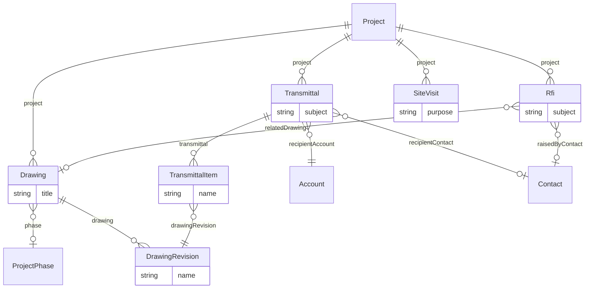

# Architecture – Project delivery overlay (`architecture-work` v1.0.0)

> Generated from [`schemas/industries/architecture.yaml`](../../schemas/industries/architecture.yaml) by `tools/schematool.py docs`. Do not edit by hand.

Architecture project data (site, sector, areas, construction budget, planning), RIBA Plan of Work 2020 and AIA phases, an ISO 19650-style drawing register with revisions and transmittals, RFIs and site visit reports.

| Kind | Depends on | Entities | Extended entities | Enums | Term sets |
|---|---|---|---|---|---|
| industry | [`work`](work.md) | 6 | 1 | 7 | 3 |

## Entities

| Entity | Description | Dataverse | SharePoint | Volume | Sensitivity |
|---|---|---|---|---|---|
| [Drawing](#drawing) | Drawing or model in the project's information register, named to ISO 19650 conventions. | custom | list ⚠ high volume | high | internal |
| [DrawingRevision](#drawingrevision) | One revision of a drawing with its suitability and sign-off. | custom | list ⚠ high volume | high | internal |
| [Transmittal](#transmittal) | Formal issue of drawings/documents to a client, consultant or contractor. | custom | list | medium | internal |
| [TransmittalItem](#transmittalitem) | Drawing revision included in a transmittal. | custom | list ⚠ high volume | high | internal |
| [Rfi](#rfi) | Request for information raised during design or construction. | custom | list | medium | internal |
| [SiteVisit](#sitevisit) | Site inspection with observations and actions. | custom | list | medium | internal |

## Relationships

Lookups to Country, Currency, Employee, Language are left out of the diagram to keep it readable.

### Drawing

Drawing or model in the project's information register, named to ISO 19650 conventions.

- **Display name:** Drawing / Drawings
- **Ownership:** user · **Volume:** high · **Sensitivity:** internal
- **Dataverse:** custom table `pfx_drawing` · **SharePoint:** list ⚠ high volume · **SQL:** table
- **Primary column:** `title`
- **Alternate keys:** (`drawingNumber`)
- **Standard columns from traits:** `base` (id, createdOn, createdBy, modifiedOn, modifiedBy, stateCode, statusReason, rowVersion), `owned` (owner)

| Column | Type | Req | Dataverse | SharePoint | SQL | Notes |
|---|---|:-:|---|---|---|---|
| `project` | parent([Project](work.md#project)) | ✔ | Lookup → Project (parental) | Lookup → Project (cascade delete) | uniqueidentifier FK → Project (cascade) |  |
| `drawingNumber` | string(60) | ✔ | Text (60) | Single line of text | nvarchar(60) | Project-Originator-Volume-Level-Type-Role-Number. _unique_ |
| `title` | string(250) | ✔ | Text (250) | Title (primary column) | nvarchar(250) |  |
| `discipline` | term([Discipline](#discipline)) |  | Lookup → Term (set Discipline) | Managed metadata (Discipline) | uniqueidentifier FK → Term |  |
| `drawingType` | choice([DrawingType](#drawingtype)) |  | Choice (global: DrawingType) | Choice | int |  |
| `phase` | lookup([ProjectPhase](work.md#projectphase)) |  | Lookup → ProjectPhase | Lookup → ProjectPhase | uniqueidentifier FK → ProjectPhase |  |
| `scale` | string(20) |  | Text (20) | Single line of text | nvarchar(20) |  |
| `paperSize` | string(10) |  | Text (10) | Single line of text | nvarchar(10) |  |
| `currentRevision` | string(10) |  | Text (10) | Single line of text | nvarchar(10) | _read-only_ |
| `currentSuitability` | choice([SuitabilityCode](#suitabilitycode)) |  | Choice (global: SuitabilityCode) | Choice | int | _read-only_ |
| `lastIssuedOn` | date |  | Date only (behaviour: date only) | Date (date only) | date | _read-only_ |
| `fileUrl` | url |  | Text (URL) | Hyperlink | nvarchar(2000) |  |

### DrawingRevision

One revision of a drawing with its suitability and sign-off.

- **Display name:** Drawing Revision / Drawing Revisions
- **Ownership:** user · **Volume:** high · **Sensitivity:** internal
- **Dataverse:** custom table `pfx_drawingrevision` · **SharePoint:** list ⚠ high volume · **SQL:** table
- **Primary column:** `name` (auto-generated)
- **Alternate keys:** (`drawing`, `revision`)
- **Standard columns from traits:** `base` (id, createdOn, createdBy, modifiedOn, modifiedBy, stateCode, statusReason, rowVersion), `owned` (owner)

| Column | Type | Req | Dataverse | SharePoint | SQL | Notes |
|---|---|:-:|---|---|---|---|
| `name` | string(200) | ✔ | Text (200) | Title (primary column) | nvarchar(200) | Display label generated automatically (flow, plug-in or trigger). Required by Dataverse (primary name) and SharePoint (Title). _read-only_ |
| `drawing` | parent([Drawing](#drawing)) | ✔ | Lookup → Drawing (parental) | Lookup → Drawing (cascade delete) | uniqueidentifier FK → Drawing (cascade) |  |
| `revision` | string(10) | ✔ | Text (10) | Single line of text | nvarchar(10) | e.g. P01, P02, C01. |
| `revisionDate` | date | ✔ | Date only (behaviour: date only) | Date (date only) | date |  |
| `description` | string(250) | ✔ | Text (250) | Single line of text | nvarchar(250) |  |
| `suitability` | choice([SuitabilityCode](#suitabilitycode)) | ✔ | Choice (global: SuitabilityCode) | Choice | int |  |
| `preparedBy` | lookup([Employee](core.md#employee)) |  | Lookup → Employee | Person | uniqueidentifier FK → Employee |  |
| `checkedBy` | lookup([Employee](core.md#employee)) |  | Lookup → Employee | Person | uniqueidentifier FK → Employee |  |
| `approvedBy` | lookup([Employee](core.md#employee)) |  | Lookup → Employee | Person | uniqueidentifier FK → Employee |  |
| `fileUrl` | url |  | Text (URL) | Hyperlink | nvarchar(2000) |  |

### Transmittal

Formal issue of drawings/documents to a client, consultant or contractor.

- **Display name:** Transmittal / Transmittals
- **Ownership:** user · **Volume:** medium · **Sensitivity:** internal
- **Dataverse:** custom table `pfx_transmittal` · **SharePoint:** list · **SQL:** table
- **Primary column:** `subject`
- **Alternate keys:** (`transmittalNumber`)
- **Standard columns from traits:** `base` (id, createdOn, createdBy, modifiedOn, modifiedBy, stateCode, statusReason, rowVersion), `owned` (owner)

| Column | Type | Req | Dataverse | SharePoint | SQL | Notes |
|---|---|:-:|---|---|---|---|
| `subject` | string(200) | ✔ | Text (200) | Title (primary column) | nvarchar(200) |  |
| `transmittalNumber` | autonumber |  | Autonumber `TX-{SEQNUM:5}` | Single line of text (set by flow) | nvarchar(30) + sequence |  |
| `project` | parent([Project](work.md#project)) | ✔ | Lookup → Project (parental) | Lookup → Project (cascade delete) | uniqueidentifier FK → Project (cascade) |  |
| `recipientAccount` | lookup([Account](core.md#account)) | ✔ | Lookup → Account | Lookup → Account | uniqueidentifier FK → Account |  |
| `recipientContact` | lookup([Contact](core.md#contact)) |  | Lookup → Contact | Lookup → Contact | uniqueidentifier FK → Contact |  |
| `purpose` | choice([TransmittalPurpose](#transmittalpurpose)) | ✔ | Choice (global: TransmittalPurpose) | Choice | int |  |
| `method` | choice([TransmittalMethod](#transmittalmethod)) | ✔ | Choice (global: TransmittalMethod) | Choice | int |  |
| `issuedOn` | date | ✔ | Date only (behaviour: date only) | Date (date only) | date |  |
| `issuedBy` | lookup([Employee](core.md#employee)) |  | Lookup → Employee | Person | uniqueidentifier FK → Employee |  |
| `acknowledgedOn` | date |  | Date only (behaviour: date only) | Date (date only) | date |  |
| `notes` | text |  | Multiline text | Multiple lines (plain) | nvarchar(max) |  |

### TransmittalItem

Drawing revision included in a transmittal.

- **Display name:** Transmittal Item / Transmittal Items
- **Ownership:** user · **Volume:** high · **Sensitivity:** internal
- **Dataverse:** custom table `pfx_transmittalitem` · **SharePoint:** list ⚠ high volume · **SQL:** table
- **Primary column:** `name` (auto-generated)
- **Standard columns from traits:** `base` (id, createdOn, createdBy, modifiedOn, modifiedBy, stateCode, statusReason, rowVersion), `owned` (owner)

| Column | Type | Req | Dataverse | SharePoint | SQL | Notes |
|---|---|:-:|---|---|---|---|
| `name` | string(200) | ✔ | Text (200) | Title (primary column) | nvarchar(200) | Display label generated automatically (flow, plug-in or trigger). Required by Dataverse (primary name) and SharePoint (Title). _read-only_ |
| `transmittal` | parent([Transmittal](#transmittal)) | ✔ | Lookup → Transmittal (parental) | Lookup → Transmittal (cascade delete) | uniqueidentifier FK → Transmittal (cascade) |  |
| `drawingRevision` | lookup([DrawingRevision](#drawingrevision)) | ✔ | Lookup → DrawingRevision | Lookup → DrawingRevision | uniqueidentifier FK → DrawingRevision |  |
| `fileFormat` | string(20) |  | Text (20) | Single line of text | nvarchar(20) | PDF, DWG, IFC… |
| `copies` | integer |  | Whole number | Number (0 dp) | int |  |

### Rfi

Request for information raised during design or construction.

- **Display name:** RFI / RFIs
- **Ownership:** user · **Volume:** medium · **Sensitivity:** internal
- **Dataverse:** custom table `pfx_rfi` · **SharePoint:** list · **SQL:** table
- **Primary column:** `subject`
- **Alternate keys:** (`rfiNumber`)
- **Standard columns from traits:** `base` (id, createdOn, createdBy, modifiedOn, modifiedBy, stateCode, statusReason, rowVersion), `owned` (owner)

| Column | Type | Req | Dataverse | SharePoint | SQL | Notes |
|---|---|:-:|---|---|---|---|
| `subject` | string(200) | ✔ | Text (200) | Title (primary column) | nvarchar(200) |  |
| `rfiNumber` | autonumber |  | Autonumber `RFI-{SEQNUM:4}` | Single line of text (set by flow) | nvarchar(30) + sequence |  |
| `project` | parent([Project](work.md#project)) | ✔ | Lookup → Project (parental) | Lookup → Project (cascade delete) | uniqueidentifier FK → Project (cascade) |  |
| `question` | text | ✔ | Multiline text | Multiple lines (plain) | nvarchar(max) |  |
| `raisedByContact` | lookup([Contact](core.md#contact)) |  | Lookup → Contact | Lookup → Contact | uniqueidentifier FK → Contact |  |
| `raisedByEmployee` | lookup([Employee](core.md#employee)) |  | Lookup → Employee | Person | uniqueidentifier FK → Employee |  |
| `raisedOn` | date | ✔ | Date only (behaviour: date only) | Date (date only) | date |  |
| `responseDue` | date |  | Date only (behaviour: date only) | Date (date only) | date |  |
| `response` | text |  | Multiline text | Multiple lines (plain) | nvarchar(max) |  |
| `respondedBy` | lookup([Employee](core.md#employee)) |  | Lookup → Employee | Person | uniqueidentifier FK → Employee |  |
| `respondedOn` | date |  | Date only (behaviour: date only) | Date (date only) | date |  |
| `status` | choice([RfiStatus](#rfistatus)) | ✔ | Choice (global: RfiStatus) | Choice | int | _default `open`_ |
| `costImpact` | boolean |  | Yes/No | Yes/No | bit |  |
| `scheduleImpact` | boolean |  | Yes/No | Yes/No | bit |  |
| `relatedDrawing` | lookup([Drawing](#drawing)) |  | Lookup → Drawing | Lookup → Drawing | uniqueidentifier FK → Drawing |  |

### SiteVisit

Site inspection with observations and actions.

- **Display name:** Site Visit / Site Visits
- **Ownership:** user · **Volume:** medium · **Sensitivity:** internal
- **Dataverse:** custom table `pfx_sitevisit` · **SharePoint:** list · **SQL:** table
- **Primary column:** `purpose`
- **Standard columns from traits:** `base` (id, createdOn, createdBy, modifiedOn, modifiedBy, stateCode, statusReason, rowVersion), `owned` (owner)
- **Extended by:** [`architecture-travel`](architecture-travel.md#sitevisit-1)

| Column | Type | Req | Dataverse | SharePoint | SQL | Notes |
|---|---|:-:|---|---|---|---|
| `project` | parent([Project](work.md#project)) | ✔ | Lookup → Project (parental) | Lookup → Project (cascade delete) | uniqueidentifier FK → Project (cascade) |  |
| `purpose` | string(200) | ✔ | Text (200) | Title (primary column) | nvarchar(200) |  |
| `visitDate` | date | ✔ | Date only (behaviour: date only) | Date (date only) | date |  |
| `leadVisitor` | lookup([Employee](core.md#employee)) | ✔ | Lookup → Employee | Person | uniqueidentifier FK → Employee |  |
| `otherVisitors` | multilookup([Employee](core.md#employee)) |  | N:N → Employee | Person (multiple) | junction table → Employee |  |
| `weather` | string(100) |  | Text (100) | Single line of text | nvarchar(100) |  |
| `observations` | richtext |  | Multiline text (rich text) | Multiple lines (enhanced rich text) | nvarchar(max) |  |
| `actionsRequired` | richtext |  | Multiline text (rich text) | Multiple lines (enhanced rich text) | nvarchar(max) |  |
| `photosUrl` | url |  | Text (URL) | Hyperlink | nvarchar(2000) |  |
| `reportIssuedOn` | date |  | Date only (behaviour: date only) | Date (date only) | date |  |

## Extensions to entities from other layers

### Project (+12)

Adds columns to [Project](work.md#project) from `work`.

| Column | Type | Req | Dataverse | SharePoint | SQL | Notes |
|---|---|:-:|---|---|---|---|
| `siteAddress` | address |  | Text ×5 + Lookup → Country | Text ×5 + Lookup → Country | nvarchar ×5 + FK → Country |  |
| `sector` | term([BuildingSector](#buildingsector)) |  | Lookup → Term (set BuildingSector) | Managed metadata (BuildingSector) | uniqueidentifier FK → Term |  |
| `procurementRoute` | choice([ProcurementRoute](#procurementroute)) |  | Choice (global: ProcurementRoute) | Choice | int |  |
| `contractForm` | string(100) |  | Text (100) | Single line of text | nvarchar(100) | Appointment form, e.g. RIBA PSC 2020, AIA B101. |
| `grossFloorArea` | decimal(12,2) |  | Decimal (12,2) | Number (2 dp) | decimal(12,2) | Square metres. |
| `constructionBudget` | money |  | Currency | Currency | decimal(19,4) | Estimated construction cost; basis for percentage fees. |
| `feePercentOfConstruction` | percent |  | Decimal (5,2) | Number (%) | decimal(5,2) |  |
| `planningReference` | string(50) |  | Text (50) | Single line of text | nvarchar(50) |  |
| `planningStatus` | choice([PlanningStatus](#planningstatus)) |  | Choice (global: PlanningStatus) | Choice | int |  |
| `sustainabilityTarget` | term([SustainabilityStandard](#sustainabilitystandard)) |  | Lookup → Term (set SustainabilityStandard) | Managed metadata (SustainabilityStandard) | uniqueidentifier FK → Term |  |
| `bimRequired` | boolean |  | Yes/No | Yes/No | bit |  |
| `isPrincipalDesigner` | boolean |  | Yes/No | Yes/No | bit | Firm holds the principal designer (health & safety) duty. |

## Choices (enums)

Codes are stable forever. Dataverse option value = publisher choice prefix + code.

### ProcurementRoute

How the building contract is procured.

| Code | Key | Label |
|--:|---|---|
| 1 | `traditional` | Traditional |
| 2 | `designAndBuild` | Design And Build |
| 3 | `constructionManagement` | Construction Management |
| 4 | `managementContracting` | Management Contracting |
| 5 | `twoStageTender` | Two Stage Tender |
| 6 | `frameworkCallOff` | Framework Call Off |

### PlanningStatus

Status of planning permission / building permit.

| Code | Key | Label |
|--:|---|---|
| 1 | `notRequired` | Not Required |
| 2 | `preApplication` | Pre Application |
| 3 | `submitted` | Submitted |
| 4 | `approved` | Approved |
| 5 | `approvedWithConditions` | Approved With Conditions |
| 6 | `refused` | Refused |
| 7 | `appeal` | Appeal |

### DrawingType

Kind of drawing or model.

| Code | Key | Label |
|--:|---|---|
| 1 | `plan` | Plan |
| 2 | `section` | Section |
| 3 | `elevation` | Elevation |
| 4 | `detail` | Detail |
| 5 | `schedule` | Schedule |
| 6 | `model` | Model |
| 7 | `specification` | Specification |
| 8 | `visualisation` | Visualisation |

### SuitabilityCode

Information container status (ISO 19650 / UK National Annex suitability codes).

| Code | Key | Label |
|--:|---|---|
| 1 | `s0` | S0 – Work in progress |
| 2 | `s1` | S1 – Suitable for coordination |
| 3 | `s2` | S2 – Suitable for information |
| 4 | `s3` | S3 – Suitable for review & comment |
| 5 | `s4` | S4 – Suitable for stage approval |
| 6 | `a` | A – Authorised / for construction |
| 7 | `b` | B – Partially authorised |
| 8 | `cr` | CR – As constructed record |

### TransmittalPurpose

Why information is issued.

| Code | Key | Label |
|--:|---|---|
| 1 | `forInformation` | For Information |
| 2 | `forComment` | For Comment |
| 3 | `forApproval` | For Approval |
| 4 | `forTender` | For Tender |
| 5 | `forPlanning` | For Planning |
| 6 | `forConstruction` | For Construction |

### TransmittalMethod

How information is issued.

| Code | Key | Label |
|--:|---|---|
| 1 | `commonDataEnvironment` | Common Data Environment |
| 2 | `email` | Email |
| 3 | `clientPortal` | Client Portal |
| 4 | `hardCopy` | Hard Copy |

### RfiStatus

State of a request for information.

| Code | Key | Label |
|--:|---|---|
| 1 | `open` | Open |
| 2 | `answered` | Answered |
| 3 | `closed` | Closed |
| 4 | `void` | Void |

## Term sets

Stored in the SharePoint term store; mirrored to the Term table on Dataverse/SQL.

### BuildingSector

Market sector of an architecture project.

- Residential
- Commercial office
- Retail
- Education
- Healthcare
- Hospitality
- Cultural & civic
- Industrial & logistics
- Mixed use
- Infrastructure

### Discipline

Design discipline that produces a drawing.

- Architecture
- Structural
- Mechanical, electrical & plumbing
- Civil
- Landscape
- Interiors
- Fire
- Acoustics

### SustainabilityStandard

Sustainability or wellbeing certification targeted.

- BREEAM
- LEED
- WELL
- Passivhaus
- NABERS
- IGBC / GRIHA
- None

## Reference data (seed)

Loaded at deployment. Deactivate rows you do not need instead of deleting them.

### ProjectType (6 rows)

| code | name | defaultBillingModel | requiresClient | isInternal |
|---|---|---|---|---|
| ARC_NEW_BUILD | New build | percentageOfValue | yes | no |
| ARC_REFURB | Refurbishment / retrofit | percentageOfValue | yes | no |
| ARC_INTERIORS | Interior fit-out | fixedFee | yes | no |
| ARC_MASTERPLAN | Masterplanning | fixedFee | yes | no |
| ARC_FEASIBILITY | Feasibility study | fixedFee | yes | no |
| ARC_COMPETITION | Design competition | nonBillable | no | yes |

### ProjectPhaseDefinition (13 rows)

| code | name | framework | sequence | defaultFeePercent |
|---|---|---|---|---|
| RIBA_0 | 0 – Strategic definition | RIBA 2020 | 0 |  |
| RIBA_1 | 1 – Preparation & briefing | RIBA 2020 | 1 | 5 |
| RIBA_2 | 2 – Concept design | RIBA 2020 | 2 | 15 |
| RIBA_3 | 3 – Spatial coordination | RIBA 2020 | 3 | 20 |
| RIBA_4 | 4 – Technical design | RIBA 2020 | 4 | 30 |
| RIBA_5 | 5 – Manufacturing & construction | RIBA 2020 | 5 | 25 |
| RIBA_6 | 6 – Handover | RIBA 2020 | 6 | 5 |
| RIBA_7 | 7 – Use | RIBA 2020 | 7 |  |
| AIA_SD | Schematic design | AIA | 1 | 15 |
| AIA_DD | Design development | AIA | 2 | 20 |
| AIA_CD | Construction documents | AIA | 3 | 40 |
| AIA_BN | Bidding / negotiation | AIA | 4 | 5 |
| AIA_CA | Construction administration | AIA | 5 | 20 |

### ProjectRole (7 rows)

| code | name |
|---|---|
| ARC_PRINCIPAL | Principal / director |
| ARC_PROJECT_ARCH | Project architect |
| ARC_ARCHITECT | Architect |
| ARC_ASSISTANT | Architectural assistant |
| ARC_TECHNOLOGIST | Architectural technologist |
| ARC_INTERIOR | Interior designer |
| ARC_BIM | BIM coordinator |

### WorkItemType (4 rows)

| code | name | category | allowsChildren |
|---|---|---|---|
| ARC_DRAWING_PKG | Drawing package | deliverable | yes |
| ARC_DESIGN_REVIEW | Design review | task | no |
| ARC_SUBMISSION | Planning / permit submission | deliverable | yes |
| ARC_SITE_INSPECTION | Site inspection | task | no |

### TimeCode (5 rows)

| code | name | codeSet | isBillableDefault |
|---|---|---|---|
| ARC_DESIGN | Design | Architecture | yes |
| ARC_COORDINATION | Coordination with consultants | Architecture | yes |
| ARC_PLANNING_APP | Planning application | Architecture | yes |
| ARC_SITE | Site / contract administration | Architecture | yes |
| ARC_VISUALS | Visualisation | Architecture | yes |
