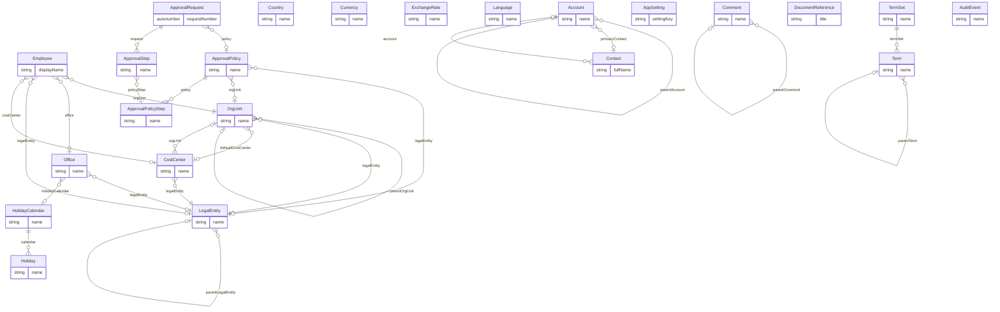

# Shared Core (`core` v1.0.0)

> Generated from [`schemas/core.yaml`](../../schemas/core.yaml) by `tools/schematool.py docs`. Do not edit by hand.

Master data (organisation structure, people, external parties, currencies, countries, calendars, taxonomy) and shared services (approvals, documents, comments, audit, settings) that every pilot reuses. Nothing in here is industry-specific; industries adapt it through terminology, reference data and overlay layers.

| Kind | Depends on | Entities | Extended entities | Enums | Term sets |
|---|---|---|---|---|---|
| foundation | — | 23 | 0 | 16 | 3 |

## Entities

| Entity | Description | Dataverse | SharePoint | Volume | Sensitivity |
|---|---|---|---|---|---|
| [LegalEntity](#legalentity) | A company of the group that employs people, signs contracts and keeps books. | custom | list | low | internal |
| [OrgUnit](#orgunit) | Internal organisational unit (division, department, team, practice group, studio). | custom | list | low | internal |
| [CostCenter](#costcenter) | Accounting cost centre used to allocate cost and spend. | custom | list | low | internal |
| [Office](#office) | Physical office or site of the firm. | custom | list | low | internal |
| [Employee](#employee) | Directory profile of a person who works for the firm (employees, partners, contractors). | custom | list | medium | internal |
| [Account](#account) | Any external organisation — client, prospect, vendor, partner, court, regulator. | standard:account | list | medium | internal |
| [Contact](#contact) | A person outside the firm (client contact, vendor contact, opposing counsel, candidate referee…). | standard:contact | list | medium | internal |
| [Country](#country) | ISO 3166 country. | custom | list | low | internal |
| [Currency](#currency) | ISO 4217 currency. | standard:transactioncurrency | list | low | internal |
| [ExchangeRate](#exchangerate) | Dated exchange rate between two currencies (SharePoint and SQL builds; Dataverse keeps one rate per currency). | native | list | medium | internal |
| [Language](#language) | Language, identified by its BCP-47 tag. | custom | list | low | internal |
| [HolidayCalendar](#holidaycalendar) | Set of public holidays that applies to an office or country. | custom | list | low | internal |
| [Holiday](#holiday) | One public holiday in a holiday calendar. | custom | list | low | internal |
| [TermSet](#termset) | A taxonomy (term set) for Dataverse and SQL builds. | custom | termstore | low | internal |
| [Term](#term) | One term in a term set. | custom | termstore | medium | internal |
| [AppSetting](#appsetting) | Non-secret configuration value for SharePoint and SQL builds. | native | list | low | internal |
| [ApprovalPolicy](#approvalpolicy) | Rule that decides which approval chain applies to a record (by entity, legal entity, org unit and amount). | custom | list | low | internal |
| [ApprovalPolicyStep](#approvalpolicystep) | One step of an approval policy. | custom | list | low | internal |
| [ApprovalRequest](#approvalrequest) | One approval run for one record. | custom | list | medium | internal |
| [ApprovalStep](#approvalstep) | Task for one approver within an approval request. | custom | list ⚠ high volume | high | internal |
| [DocumentReference](#documentreference) | Metadata and link for a file stored outside the database (SharePoint, blob, DMS). | custom | list ⚠ high volume | high | internal |
| [Comment](#comment) | Threaded comment on any record. | custom | list ⚠ high volume | high | internal |
| [AuditEvent](#auditevent) | Change log for SQL builds. | native | native | high | confidential |

## Relationships

Lookups to Country, Currency, Employee, Language are left out of the diagram to keep it readable.

### LegalEntity

A company of the group that employs people, signs contracts and keeps books.

- **Display name:** Legal Entity / Legal Entities
- **Ownership:** organization · **Volume:** low · **Sensitivity:** internal
- **Dataverse:** custom table `pfx_legalentity` · **SharePoint:** list · **SQL:** table
- **Primary column:** `name`
- **Alternate keys:** (`code`)
- **Standard columns from traits:** `base` (id, createdOn, createdBy, modifiedOn, modifiedBy, stateCode, statusReason, rowVersion), `integration` (externalId, sourceSystem, lastSyncedOn)

| Column | Type | Req | Dataverse | SharePoint | SQL | Notes |
|---|---|:-:|---|---|---|---|
| `name` | string(200) | ✔ | Text (200) | Title (primary column) | nvarchar(200) |  |
| `code` | string(20) | ✔ | Text (20) | Single line of text | nvarchar(20) | _unique_ |
| `registrationNumber` | string(50) |  | Text (50) | Single line of text | nvarchar(50) |  |
| `taxNumber` | string(50) |  | Text (50) | Single line of text | nvarchar(50) |  |
| `country` | lookup([Country](#country)) | ✔ | Lookup → Country | Lookup → Country | uniqueidentifier FK → Country |  |
| `baseCurrency` | lookup([Currency](#currency)) | ✔ | Lookup → Currency | Lookup → Currency | uniqueidentifier FK → Currency |  |
| `registeredAddress` | address |  | Text ×5 + Lookup → Country | Text ×5 + Lookup → Country | nvarchar ×5 + FK → Country |  |
| `parentLegalEntity` | lookup([LegalEntity](#legalentity)) |  | Lookup → LegalEntity | Lookup → LegalEntity | uniqueidentifier FK → LegalEntity |  |
| `fiscalYearStartMonth` | integer |  | Whole number | Number (0 dp) | int |  |
| `timeZone` | string(64) |  | Text (64) | Single line of text | nvarchar(64) | IANA time zone, e.g. Europe/London. |

### OrgUnit

Internal organisational unit (division, department, team, practice group, studio).

- **Display name:** Org Unit / Org Units
- **Ownership:** organization · **Volume:** low · **Sensitivity:** internal
- **Dataverse:** custom table `pfx_orgunit` · **SharePoint:** list · **SQL:** table
- **Primary column:** `name`
- **Alternate keys:** (`code`)
- **Standard columns from traits:** `base` (id, createdOn, createdBy, modifiedOn, modifiedBy, stateCode, statusReason, rowVersion), `integration` (externalId, sourceSystem, lastSyncedOn)

| Column | Type | Req | Dataverse | SharePoint | SQL | Notes |
|---|---|:-:|---|---|---|---|
| `name` | string(200) | ✔ | Text (200) | Title (primary column) | nvarchar(200) |  |
| `code` | string(30) |  | Text (30) | Single line of text | nvarchar(30) | _unique_ |
| `unitType` | choice([OrgUnitType](#orgunittype)) | ✔ | Choice (global: OrgUnitType) | Choice | int |  |
| `parentOrgUnit` | lookup([OrgUnit](#orgunit)) |  | Lookup → OrgUnit | Lookup → OrgUnit | uniqueidentifier FK → OrgUnit |  |
| `head` | lookup([Employee](#employee)) |  | Lookup → Employee | Person | uniqueidentifier FK → Employee |  |
| `legalEntity` | lookup([LegalEntity](#legalentity)) |  | Lookup → LegalEntity | Lookup → LegalEntity | uniqueidentifier FK → LegalEntity |  |
| `defaultCostCenter` | lookup([CostCenter](#costcenter)) |  | Lookup → CostCenter | Lookup → CostCenter | uniqueidentifier FK → CostCenter |  |
| `entraGroupId` | string(36) |  | Text (36) | Single line of text | nvarchar(36) | Entra ID group that mirrors this unit. Used for audience targeting and security sync. |
| `description` | text |  | Multiline text | Multiple lines (plain) | nvarchar(max) |  |

### CostCenter

Accounting cost centre used to allocate cost and spend.

- **Display name:** Cost Center / Cost Centers
- **Ownership:** organization · **Volume:** low · **Sensitivity:** internal
- **Dataverse:** custom table `pfx_costcenter` · **SharePoint:** list · **SQL:** table
- **Primary column:** `name`
- **Alternate keys:** (`code`)
- **Standard columns from traits:** `base` (id, createdOn, createdBy, modifiedOn, modifiedBy, stateCode, statusReason, rowVersion), `integration` (externalId, sourceSystem, lastSyncedOn)

| Column | Type | Req | Dataverse | SharePoint | SQL | Notes |
|---|---|:-:|---|---|---|---|
| `name` | string(200) | ✔ | Text (200) | Title (primary column) | nvarchar(200) |  |
| `code` | string(30) | ✔ | Text (30) | Single line of text | nvarchar(30) | _unique_ |
| `legalEntity` | lookup([LegalEntity](#legalentity)) | ✔ | Lookup → LegalEntity | Lookup → LegalEntity | uniqueidentifier FK → LegalEntity |  |
| `orgUnit` | lookup([OrgUnit](#orgunit)) |  | Lookup → OrgUnit | Lookup → OrgUnit | uniqueidentifier FK → OrgUnit |  |
| `budgetOwner` | lookup([Employee](#employee)) |  | Lookup → Employee | Person | uniqueidentifier FK → Employee |  |

### Office

Physical office or site of the firm.

- **Display name:** Office / Offices
- **Ownership:** organization · **Volume:** low · **Sensitivity:** internal
- **Dataverse:** custom table `pfx_office` · **SharePoint:** list · **SQL:** table
- **Primary column:** `name`
- **Alternate keys:** (`code`)
- **Standard columns from traits:** `base` (id, createdOn, createdBy, modifiedOn, modifiedBy, stateCode, statusReason, rowVersion), `integration` (externalId, sourceSystem, lastSyncedOn)

| Column | Type | Req | Dataverse | SharePoint | SQL | Notes |
|---|---|:-:|---|---|---|---|
| `name` | string(200) | ✔ | Text (200) | Title (primary column) | nvarchar(200) |  |
| `code` | string(20) |  | Text (20) | Single line of text | nvarchar(20) | _unique_ |
| `legalEntity` | lookup([LegalEntity](#legalentity)) |  | Lookup → LegalEntity | Lookup → LegalEntity | uniqueidentifier FK → LegalEntity |  |
| `address` | address | ✔ | Text ×5 + Lookup → Country | Text ×5 + Lookup → Country | nvarchar ×5 + FK → Country |  |
| `timeZone` | string(64) | ✔ | Text (64) | Single line of text | nvarchar(64) | IANA time zone, e.g. America/New_York. |
| `phone` | phone |  | Text (phone) | Single line of text | nvarchar(50) |  |
| `isHeadquarters` | boolean |  | Yes/No | Yes/No | bit |  |
| `deskCapacity` | integer |  | Whole number | Number (0 dp) | int |  |
| `holidayCalendar` | lookup([HolidayCalendar](#holidaycalendar)) |  | Lookup → HolidayCalendar | Lookup → HolidayCalendar | uniqueidentifier FK → HolidayCalendar |  |
| `latitude` | decimal(9,6) |  | Decimal (9,6) | Number (6 dp) | decimal(9,6) |  |
| `longitude` | decimal(9,6) |  | Decimal (9,6) | Number (6 dp) | decimal(9,6) |  |

### Employee

Directory profile of a person who works for the firm (employees, partners, contractors). Non-sensitive data only; HR keeps sensitive data in separate, locked-down tables.

- **Display name:** Employee / Employees
- **Ownership:** organization · **Volume:** medium · **Sensitivity:** internal
- **Dataverse:** custom table `pfx_employee` · **SharePoint:** list · **SQL:** table
- **Primary column:** `displayName`
- **Alternate keys:** (`workEmail`); (`entraObjectId`); (`employeeNumber`)
- **Standard columns from traits:** `base` (id, createdOn, createdBy, modifiedOn, modifiedBy, stateCode, statusReason, rowVersion), `integration` (externalId, sourceSystem, lastSyncedOn)

| Column | Type | Req | Dataverse | SharePoint | SQL | Notes |
|---|---|:-:|---|---|---|---|
| `displayName` | string(200) | ✔ | Text (200) | Title (primary column) | nvarchar(200) |  |
| `employeeNumber` | autonumber |  | Autonumber `EMP-{SEQNUM:6}` | Single line of text (set by flow) | nvarchar(30) + sequence | Overwrite with the HR/payroll number when one exists. |
| `firstName` | string(100) | ✔ | Text (100) | Single line of text | nvarchar(100) |  |
| `lastName` | string(100) | ✔ | Text (100) | Single line of text | nvarchar(100) |  |
| `preferredName` | string(100) |  | Text (100) | Single line of text | nvarchar(100) |  |
| `pronouns` | string(30) |  | Text (30) | Single line of text | nvarchar(30) |  |
| `workEmail` | email | ✔ | Text (email) | Single line of text | nvarchar(320) | _unique_ · _indexed_ |
| `entraObjectId` | string(36) |  | Text (36) | Single line of text | nvarchar(36) | Identity anchor that links this person to Entra ID, Dataverse systemuser and SharePoint Person columns. Never key people on email or UPN — they change. _unique_ · _indexed_ |
| `userPrincipalName` | string(200) |  | Text (200) | Single line of text | nvarchar(200) |  |
| `workPhone` | phone |  | Text (phone) | Single line of text | nvarchar(50) |  |
| `mobilePhone` | phone |  | Text (phone) | Single line of text | nvarchar(50) | _PII_ |
| `jobTitle` | string(150) |  | Text (150) | Single line of text | nvarchar(150) |  |
| `workerType` | choice([WorkerType](#workertype)) | ✔ | Choice (global: WorkerType) | Choice | int | _default `employee`_ |
| `employmentStatus` | choice([EmploymentStatus](#employmentstatus)) | ✔ | Choice (global: EmploymentStatus) | Choice | int | _default `active`_ |
| `orgUnit` | lookup([OrgUnit](#orgunit)) | ✔ | Lookup → OrgUnit | Lookup → OrgUnit | uniqueidentifier FK → OrgUnit |  |
| `manager` | lookup([Employee](#employee)) |  | Lookup → Employee | Person | uniqueidentifier FK → Employee |  |
| `office` | lookup([Office](#office)) |  | Lookup → Office | Lookup → Office | uniqueidentifier FK → Office |  |
| `legalEntity` | lookup([LegalEntity](#legalentity)) |  | Lookup → LegalEntity | Lookup → LegalEntity | uniqueidentifier FK → LegalEntity |  |
| `costCenter` | lookup([CostCenter](#costcenter)) |  | Lookup → CostCenter | Lookup → CostCenter | uniqueidentifier FK → CostCenter |  |
| `startDate` | date |  | Date only (behaviour: date only) | Date (date only) | date |  |
| `endDate` | date |  | Date only (behaviour: date only) | Date (date only) | date |  |
| `timeZone` | string(64) |  | Text (64) | Single line of text | nvarchar(64) |  |
| `photo` | image |  | Image | Image | nvarchar(2000) (blob URL) |  |
| `bio` | text |  | Multiline text | Multiple lines (plain) | nvarchar(max) |  |
| `languages` | multilookup([Language](#language)) |  | N:N → Language | Lookup (multiple) → Language | junction table → Language |  |
| `isPeopleManager` | boolean |  | Yes/No | Yes/No | bit | *Calculated:* true when any active Employee has this person as manager _read-only_ |

> In HR deployments this is a read model kept current from HR JobAssignment rows by a flow or integration.  
> On SharePoint, lookups to Employee become Person columns bound to Entra ID users.

### Account

Any external organisation — client, prospect, vendor, partner, court, regulator. One table with roles instead of separate client/vendor tables.

- **Display name:** Account / Accounts
- **Ownership:** user · **Volume:** medium · **Sensitivity:** internal
- **Dataverse:** standard table `account` · **SharePoint:** list · **SQL:** table
- **Primary column:** `name`
- **Alternate keys:** (`accountNumber`)
- **Standard columns from traits:** `base` (id, createdOn, createdBy, modifiedOn, modifiedBy, stateCode, statusReason, rowVersion), `owned` (owner), `integration` (externalId, sourceSystem, lastSyncedOn), `classified` (sensitivity, retentionLabel)
- **Extended by:** [`crm`](crm.md#account-9), [`accounting-crm`](accounting-crm.md#account-10), [`proserv-compliance`](proserv-compliance.md#account-4), [`technology-crm`](technology-crm.md#account-4)

| Column | Type | Req | Dataverse | SharePoint | SQL | Notes |
|---|---|:-:|---|---|---|---|
| `name` | string(200) | ✔ | name (native) | Title (primary column) | nvarchar(200) |  |
| `accountNumber` | string(30) |  | accountnumber (native) | Single line of text | nvarchar(30) | _unique_ |
| `roles` | multichoice([AccountRole](#accountrole)) | ✔ | Choices (global: AccountRole) | Choice (multiple) | junction table |  |
| `parentAccount` | lookup([Account](#account)) |  | parentaccountid (native) | Lookup → Account | uniqueidentifier FK → Account |  |
| `industry` | term([Industry](#industry)) |  | Lookup → Term (set Industry) | Managed metadata (Industry) | uniqueidentifier FK → Term |  |
| `website` | url |  | websiteurl (native) | Hyperlink | nvarchar(2000) |  |
| `mainPhone` | phone |  | telephone1 (native) | Single line of text | nvarchar(50) |  |
| `email` | email |  | emailaddress1 (native) | Single line of text | nvarchar(320) |  |
| `address` | address |  | address1_* (native) | Text ×5 + Lookup → Country | nvarchar ×5 + FK → Country |  |
| `primaryContact` | lookup([Contact](#contact)) |  | primarycontactid (native) | Lookup → Contact | uniqueidentifier FK → Contact |  |
| `relationshipManager` | lookup([Employee](#employee)) |  | Lookup → Employee | Person | uniqueidentifier FK → Employee |  |
| `registrationNumber` | string(50) |  | Text (50) | Single line of text | nvarchar(50) |  |
| `taxNumber` | string(50) |  | Text (50) | Single line of text | nvarchar(50) | _confidential_ |
| `currency` | lookup([Currency](#currency)) |  | transactioncurrencyid (native) | Lookup → Currency | uniqueidentifier FK → Currency |  |
| `description` | text |  | description (native) | Multiple lines (plain) | nvarchar(max) |  |

### Contact

A person outside the firm (client contact, vendor contact, opposing counsel, candidate referee…).

- **Display name:** Contact / Contacts
- **Ownership:** user · **Volume:** medium · **Sensitivity:** internal
- **Dataverse:** standard table `contact` · **SharePoint:** list · **SQL:** table
- **Primary column:** `fullName`
- **Standard columns from traits:** `base` (id, createdOn, createdBy, modifiedOn, modifiedBy, stateCode, statusReason, rowVersion), `owned` (owner), `integration` (externalId, sourceSystem, lastSyncedOn), `classified` (sensitivity, retentionLabel)
- **Extended by:** [`crm`](crm.md#contact-7)

| Column | Type | Req | Dataverse | SharePoint | SQL | Notes |
|---|---|:-:|---|---|---|---|
| `fullName` | string(200) | ✔ | fullname (native) | Title (primary column) | nvarchar(200) | *Calculated:* firstName + lastName _read-only_ |
| `salutation` | string(20) |  | Text (20) | Single line of text | nvarchar(20) |  |
| `firstName` | string(100) |  | firstname (native) | Single line of text | nvarchar(100) |  |
| `lastName` | string(100) | ✔ | lastname (native) | Single line of text | nvarchar(100) |  |
| `jobTitle` | string(150) |  | jobtitle (native) | Single line of text | nvarchar(150) |  |
| `account` | lookup([Account](#account)) |  | parentcustomerid (native) | Lookup → Account | uniqueidentifier FK → Account |  |
| `email` | email |  | emailaddress1 (native) | Single line of text | nvarchar(320) | _PII_ |
| `businessPhone` | phone |  | telephone1 (native) | Single line of text | nvarchar(50) | _PII_ |
| `mobilePhone` | phone |  | mobilephone (native) | Single line of text | nvarchar(50) | _PII_ |
| `address` | address |  | address1_* (native) | Text ×5 + Lookup → Country | nvarchar ×5 + FK → Country | _PII_ |
| `linkedInUrl` | url |  | Text (URL) | Hyperlink | nvarchar(2000) |  |
| `preferredLanguage` | lookup([Language](#language)) |  | Lookup → Language | Lookup → Language | uniqueidentifier FK → Language |  |
| `doNotContact` | boolean |  | Yes/No | Yes/No | bit |  |
| `description` | text |  | Multiline text | Multiple lines (plain) | nvarchar(max) |  |

> Power Pages uses Contact as the identity of external portal users (client portals, candidate portals).

### Country

ISO 3166 country.

- **Display name:** Country / Countries
- **Ownership:** organization · **Volume:** low · **Sensitivity:** internal
- **Dataverse:** custom table `pfx_country` · **SharePoint:** list · **SQL:** table
- **Primary column:** `name`
- **Alternate keys:** (`isoCode2`)
- **Standard columns from traits:** `base` (id, createdOn, createdBy, modifiedOn, modifiedBy, stateCode, statusReason, rowVersion)

| Column | Type | Req | Dataverse | SharePoint | SQL | Notes |
|---|---|:-:|---|---|---|---|
| `name` | string(100) | ✔ | Text (100) | Title (primary column) | nvarchar(100) |  |
| `isoCode2` | string(2) | ✔ | Text (2) | Single line of text | nvarchar(2) | _unique_ |
| `isoCode3` | string(3) |  | Text (3) | Single line of text | nvarchar(3) |  |
| `region` | string(50) |  | Text (50) | Single line of text | nvarchar(50) | Reporting region, e.g. EMEA, APAC, Americas. |
| `dialingCode` | string(10) |  | Text (10) | Single line of text | nvarchar(10) |  |
| `defaultCurrency` | lookup([Currency](#currency)) |  | Lookup → Currency | Lookup → Currency | uniqueidentifier FK → Currency |  |

> Seed contains a starter set; load the full ISO 3166 list at deployment.

### Currency

ISO 4217 currency. Dataverse manages exchange rates on the currency itself.

- **Display name:** Currency / Currencies
- **Ownership:** organization · **Volume:** low · **Sensitivity:** internal
- **Dataverse:** standard table `transactioncurrency` · **SharePoint:** list · **SQL:** table
- **Primary column:** `name`
- **Alternate keys:** (`isoCode`)
- **Standard columns from traits:** `base` (id, createdOn, createdBy, modifiedOn, modifiedBy, stateCode, statusReason, rowVersion)

| Column | Type | Req | Dataverse | SharePoint | SQL | Notes |
|---|---|:-:|---|---|---|---|
| `name` | string(100) | ✔ | currencyname (native) | Title (primary column) | nvarchar(100) |  |
| `isoCode` | string(3) | ✔ | isocurrencycode (native) | Single line of text | nvarchar(3) | _unique_ |
| `symbol` | string(5) |  | currencysymbol (native) | Single line of text | nvarchar(5) |  |
| `decimalPlaces` | integer |  | currencyprecision (native) | Number (0 dp) | int |  |

### ExchangeRate

Dated exchange rate between two currencies (SharePoint and SQL builds; Dataverse keeps one rate per currency).

- **Display name:** Exchange Rate / Exchange Rates
- **Ownership:** organization · **Volume:** medium · **Sensitivity:** internal
- **Dataverse:** provided by the platform · **SharePoint:** list · **SQL:** table
- **Primary column:** `name` (auto-generated)
- **Alternate keys:** (`fromCurrency`, `toCurrency`, `effectiveDate`)
- **Standard columns from traits:** `base` (id, createdOn, createdBy, modifiedOn, modifiedBy, stateCode, statusReason, rowVersion)

| Column | Type | Req | Dataverse | SharePoint | SQL | Notes |
|---|---|:-:|---|---|---|---|
| `name` | string(200) | ✔ | Text (200) | Title (primary column) | nvarchar(200) | Display label generated automatically (flow, plug-in or trigger). Required by Dataverse (primary name) and SharePoint (Title). _read-only_ |
| `fromCurrency` | lookup([Currency](#currency)) | ✔ | Lookup → Currency | Lookup → Currency | uniqueidentifier FK → Currency |  |
| `toCurrency` | lookup([Currency](#currency)) | ✔ | Lookup → Currency | Lookup → Currency | uniqueidentifier FK → Currency |  |
| `rate` | decimal(18,10) | ✔ | Decimal (18,10) | Number (10 dp) | decimal(18,10) |  |
| `effectiveDate` | date | ✔ | Date only (behaviour: date only) | Date (date only) | date |  |
| `source` | string(50) |  | Text (50) | Single line of text | nvarchar(50) | e.g. ECB, central bank, treasury system. |

### Language

Language, identified by its BCP-47 tag.

- **Display name:** Language / Languages
- **Ownership:** organization · **Volume:** low · **Sensitivity:** internal
- **Dataverse:** custom table `pfx_language` · **SharePoint:** list · **SQL:** table
- **Primary column:** `name`
- **Standard columns from traits:** `base` (id, createdOn, createdBy, modifiedOn, modifiedBy, stateCode, statusReason, rowVersion)

| Column | Type | Req | Dataverse | SharePoint | SQL | Notes |
|---|---|:-:|---|---|---|---|
| `name` | string(100) | ✔ | Text (100) | Title (primary column) | nvarchar(100) |  |
| `code` | string(10) | ✔ | Text (10) | Single line of text | nvarchar(10) | BCP-47 tag, e.g. en-GB, fr-FR. _unique_ |
| `isUiLanguage` | boolean |  | Yes/No | Yes/No | bit | The apps and intranet are available in this language. |

### HolidayCalendar

Set of public holidays that applies to an office or country.

- **Display name:** Holiday Calendar / Holiday Calendars
- **Ownership:** organization · **Volume:** low · **Sensitivity:** internal
- **Dataverse:** custom table `pfx_holidaycalendar` · **SharePoint:** list · **SQL:** table
- **Primary column:** `name`
- **Standard columns from traits:** `base` (id, createdOn, createdBy, modifiedOn, modifiedBy, stateCode, statusReason, rowVersion)

| Column | Type | Req | Dataverse | SharePoint | SQL | Notes |
|---|---|:-:|---|---|---|---|
| `name` | string(100) | ✔ | Text (100) | Title (primary column) | nvarchar(100) |  |
| `country` | lookup([Country](#country)) |  | Lookup → Country | Lookup → Country | uniqueidentifier FK → Country |  |
| `description` | text |  | Multiline text | Multiple lines (plain) | nvarchar(max) |  |

### Holiday

One public holiday in a holiday calendar.

- **Display name:** Holiday / Holidays
- **Ownership:** organization · **Volume:** low · **Sensitivity:** internal
- **Dataverse:** custom table `pfx_holiday` · **SharePoint:** list · **SQL:** table
- **Primary column:** `name`
- **Standard columns from traits:** `base` (id, createdOn, createdBy, modifiedOn, modifiedBy, stateCode, statusReason, rowVersion)

| Column | Type | Req | Dataverse | SharePoint | SQL | Notes |
|---|---|:-:|---|---|---|---|
| `calendar` | parent([HolidayCalendar](#holidaycalendar)) | ✔ | Lookup → HolidayCalendar (parental) | Lookup → HolidayCalendar (cascade delete) | uniqueidentifier FK → HolidayCalendar (cascade) |  |
| `name` | string(100) | ✔ | Text (100) | Title (primary column) | nvarchar(100) |  |
| `holidayDate` | date | ✔ | Date only (behaviour: date only) | Date (date only) | date |  |
| `isHalfDay` | boolean |  | Yes/No | Yes/No | bit |  |

### TermSet

A taxonomy (term set) for Dataverse and SQL builds. SharePoint uses its term store instead.

- **Display name:** Term Set / Term Sets
- **Ownership:** organization · **Volume:** low · **Sensitivity:** internal
- **Dataverse:** custom table `pfx_termset` · **SharePoint:** termstore · **SQL:** table
- **Primary column:** `name`
- **Standard columns from traits:** `base` (id, createdOn, createdBy, modifiedOn, modifiedBy, stateCode, statusReason, rowVersion)

| Column | Type | Req | Dataverse | SharePoint | SQL | Notes |
|---|---|:-:|---|---|---|---|
| `name` | string(100) | ✔ | Text (100) | Title (primary column) | nvarchar(100) |  |
| `code` | string(50) | ✔ | Text (50) | Single line of text | nvarchar(50) | _unique_ |
| `description` | text |  | Multiline text | Multiple lines (plain) | nvarchar(max) |  |
| `isHierarchical` | boolean |  | Yes/No | Yes/No | bit |  |
| `isOpen` | boolean |  | Yes/No | Yes/No | bit | Users may add new terms. |

### Term

One term in a term set.

- **Display name:** Term / Terms
- **Ownership:** organization · **Volume:** medium · **Sensitivity:** internal
- **Dataverse:** custom table `pfx_term` · **SharePoint:** termstore · **SQL:** table
- **Primary column:** `name`
- **Standard columns from traits:** `base` (id, createdOn, createdBy, modifiedOn, modifiedBy, stateCode, statusReason, rowVersion)

| Column | Type | Req | Dataverse | SharePoint | SQL | Notes |
|---|---|:-:|---|---|---|---|
| `termSet` | parent([TermSet](#termset)) | ✔ | Lookup → TermSet (parental) | Lookup → TermSet (cascade delete) | uniqueidentifier FK → TermSet (cascade) |  |
| `name` | string(200) | ✔ | Text (200) | Title (primary column) | nvarchar(200) |  |
| `parentTerm` | lookup([Term](#term)) |  | Lookup → Term | Lookup → Term | uniqueidentifier FK → Term |  |
| `sortOrder` | integer |  | Whole number | Number (0 dp) | int |  |
| `isAvailableForTagging` | boolean |  | Yes/No | Yes/No | bit | _default `True`_ |
| `synonyms` | text |  | Multiline text | Multiple lines (plain) | nvarchar(max) |  |
| `sharePointTermId` | string(36) |  | Text (36) | Single line of text | nvarchar(36) | Sync anchor to the SharePoint term store. _indexed_ |

### AppSetting

Non-secret configuration value for SharePoint and SQL builds. Dataverse builds use environment variables. Secrets always go to Azure Key Vault, never here.

- **Display name:** App Setting / App Settings
- **Ownership:** organization · **Volume:** low · **Sensitivity:** internal
- **Dataverse:** provided by the platform · **SharePoint:** list · **SQL:** table
- **Primary column:** `settingKey`
- **Alternate keys:** (`module`, `settingKey`)
- **Standard columns from traits:** `base` (id, createdOn, createdBy, modifiedOn, modifiedBy, stateCode, statusReason, rowVersion)

| Column | Type | Req | Dataverse | SharePoint | SQL | Notes |
|---|---|:-:|---|---|---|---|
| `settingKey` | string(100) | ✔ | Text (100) | Title (primary column) | nvarchar(100) |  |
| `module` | string(50) | ✔ | Text (50) | Single line of text | nvarchar(50) |  |
| `value` | text |  | Multiline text | Multiple lines (plain) | nvarchar(max) |  |
| `valueType` | choice([SettingValueType](#settingvaluetype)) | ✔ | Choice (global: SettingValueType) | Choice | int | _default `text`_ |
| `description` | text |  | Multiline text | Multiple lines (plain) | nvarchar(max) |  |

### ApprovalPolicy

Rule that decides which approval chain applies to a record (by entity, legal entity, org unit and amount). One engine serves travel, expenses, leave, hiring, content and more.

- **Display name:** Approval Policy / Approval Policies
- **Ownership:** organization · **Volume:** low · **Sensitivity:** internal
- **Dataverse:** custom table `pfx_approvalpolicy` · **SharePoint:** list · **SQL:** table
- **Primary column:** `name`
- **Standard columns from traits:** `base` (id, createdOn, createdBy, modifiedOn, modifiedBy, stateCode, statusReason, rowVersion)

| Column | Type | Req | Dataverse | SharePoint | SQL | Notes |
|---|---|:-:|---|---|---|---|
| `name` | string(200) | ✔ | Text (200) | Title (primary column) | nvarchar(200) |  |
| `code` | string(50) | ✔ | Text (50) | Single line of text | nvarchar(50) | _unique_ |
| `appliesToEntity` | string(100) | ✔ | Text (100) | Single line of text | nvarchar(100) | Logical entity name, e.g. TripRequest. |
| `legalEntity` | lookup([LegalEntity](#legalentity)) |  | Lookup → LegalEntity | Lookup → LegalEntity | uniqueidentifier FK → LegalEntity |  |
| `orgUnit` | lookup([OrgUnit](#orgunit)) |  | Lookup → OrgUnit | Lookup → OrgUnit | uniqueidentifier FK → OrgUnit | Empty means every org unit. |
| `minAmount` | money |  | Currency | Currency | decimal(19,4) |  |
| `maxAmount` | money |  | Currency | Currency | decimal(19,4) |  |
| `currency` | lookup([Currency](#currency)) |  | Lookup → Currency | Lookup → Currency | uniqueidentifier FK → Currency |  |
| `evaluationOrder` | integer | ✔ | Whole number | Number (0 dp) | int | Lower numbers are evaluated first; the first match wins. |
| `reminderAfterHours` | integer |  | Whole number | Number (0 dp) | int |  |
| `escalateAfterHours` | integer |  | Whole number | Number (0 dp) | int |  |
| `description` | text |  | Multiline text | Multiple lines (plain) | nvarchar(max) |  |

### ApprovalPolicyStep

One step of an approval policy.

- **Display name:** Approval Policy Step / Approval Policy Steps
- **Ownership:** organization · **Volume:** low · **Sensitivity:** internal
- **Dataverse:** custom table `pfx_approvalpolicystep` · **SharePoint:** list · **SQL:** table
- **Primary column:** `name`
- **Standard columns from traits:** `base` (id, createdOn, createdBy, modifiedOn, modifiedBy, stateCode, statusReason, rowVersion)

| Column | Type | Req | Dataverse | SharePoint | SQL | Notes |
|---|---|:-:|---|---|---|---|
| `policy` | parent([ApprovalPolicy](#approvalpolicy)) | ✔ | Lookup → ApprovalPolicy (parental) | Lookup → ApprovalPolicy (cascade delete) | uniqueidentifier FK → ApprovalPolicy (cascade) |  |
| `name` | string(100) | ✔ | Text (100) | Title (primary column) | nvarchar(100) |  |
| `sequence` | integer | ✔ | Whole number | Number (0 dp) | int |  |
| `approverType` | choice([ApproverType](#approvertype)) | ✔ | Choice (global: ApproverType) | Choice | int |  |
| `approver` | lookup([Employee](#employee)) |  | Lookup → Employee | Person | uniqueidentifier FK → Employee | When approverType = specificEmployee. |
| `approverGroupId` | string(36) |  | Text (36) | Single line of text | nvarchar(36) | Entra ID group when approverType = group. |
| `approverField` | string(100) |  | Text (100) | Single line of text | nvarchar(100) | Column on the record when approverType = recordField. |
| `completionRule` | choice([ApprovalCompletionRule](#approvalcompletionrule)) | ✔ | Choice (global: ApprovalCompletionRule) | Choice | int | _default `anyApprover`_ |
| `minAmount` | money |  | Currency | Currency | decimal(19,4) | Step only applies at or above this amount. |
| `currency` | lookup([Currency](#currency)) |  | Lookup → Currency | Lookup → Currency | uniqueidentifier FK → Currency |  |
| `allowDelegation` | boolean |  | Yes/No | Yes/No | bit |  |
| `timeoutHours` | integer |  | Whole number | Number (0 dp) | int |  |

### ApprovalRequest

One approval run for one record. Business records keep a lookup to their latest request.

- **Display name:** Approval Request / Approval Requests
- **Ownership:** user · **Volume:** medium · **Sensitivity:** internal
- **Dataverse:** custom table `pfx_approvalrequest` · **SharePoint:** list · **SQL:** table
- **Primary column:** `requestNumber`
- **Standard columns from traits:** `base` (id, createdOn, createdBy, modifiedOn, modifiedBy, stateCode, statusReason, rowVersion), `owned` (owner)

| Column | Type | Req | Dataverse | SharePoint | SQL | Notes |
|---|---|:-:|---|---|---|---|
| `requestNumber` | autonumber |  | Autonumber `APR-{SEQNUM:7}` | Title (primary column) | nvarchar(30) + sequence |  |
| `subject` | string(200) | ✔ | Text (200) | Single line of text | nvarchar(200) |  |
| `regarding` | polylookup(*) | ✔ | Text ×2 (table name + id) | Text ×2 (list name + id) | nvarchar(100) + uniqueidentifier |  |
| `policy` | lookup([ApprovalPolicy](#approvalpolicy)) |  | Lookup → ApprovalPolicy | Lookup → ApprovalPolicy | uniqueidentifier FK → ApprovalPolicy |  |
| `requester` | lookup([Employee](#employee)) | ✔ | Lookup → Employee | Person | uniqueidentifier FK → Employee |  |
| `status` | choice([ApprovalStatus](#approvalstatus)) | ✔ | Choice (global: ApprovalStatus) | Choice | int | _default `pending`_ |
| `submittedOn` | datetime |  | Date and time (user local) | Date and time | datetime2 (UTC) |  |
| `completedOn` | datetime |  | Date and time (user local) | Date and time | datetime2 (UTC) |  |
| `currentStep` | integer |  | Whole number | Number (0 dp) | int |  |
| `amount` | money |  | Currency | Currency | decimal(19,4) |  |
| `currency` | lookup([Currency](#currency)) |  | Lookup → Currency | Lookup → Currency | uniqueidentifier FK → Currency |  |
| `summary` | text |  | Multiline text | Multiple lines (plain) | nvarchar(max) |  |
| `outcomeComments` | text |  | Multiline text | Multiple lines (plain) | nvarchar(max) |  |
| `flowRunId` | string(100) |  | Text (100) | Single line of text | nvarchar(100) | Power Automate run or workflow instance that drives the request. |

### ApprovalStep

Task for one approver within an approval request.

- **Display name:** Approval Step / Approval Steps
- **Ownership:** user · **Volume:** high · **Sensitivity:** internal
- **Dataverse:** custom table `pfx_approvalstep` · **SharePoint:** list ⚠ high volume · **SQL:** table
- **Primary column:** `name` (auto-generated)
- **Standard columns from traits:** `base` (id, createdOn, createdBy, modifiedOn, modifiedBy, stateCode, statusReason, rowVersion), `owned` (owner)

| Column | Type | Req | Dataverse | SharePoint | SQL | Notes |
|---|---|:-:|---|---|---|---|
| `name` | string(200) | ✔ | Text (200) | Title (primary column) | nvarchar(200) | Display label generated automatically (flow, plug-in or trigger). Required by Dataverse (primary name) and SharePoint (Title). _read-only_ |
| `request` | parent([ApprovalRequest](#approvalrequest)) | ✔ | Lookup → ApprovalRequest (parental) | Lookup → ApprovalRequest (cascade delete) | uniqueidentifier FK → ApprovalRequest (cascade) |  |
| `policyStep` | lookup([ApprovalPolicyStep](#approvalpolicystep)) |  | Lookup → ApprovalPolicyStep | Lookup → ApprovalPolicyStep | uniqueidentifier FK → ApprovalPolicyStep |  |
| `sequence` | integer | ✔ | Whole number | Number (0 dp) | int |  |
| `approver` | lookup([Employee](#employee)) | ✔ | Lookup → Employee | Person | uniqueidentifier FK → Employee |  |
| `delegatedFrom` | lookup([Employee](#employee)) |  | Lookup → Employee | Person | uniqueidentifier FK → Employee |  |
| `status` | choice([ApprovalStepStatus](#approvalstepstatus)) | ✔ | Choice (global: ApprovalStepStatus) | Choice | int | _default `waiting`_ |
| `assignedOn` | datetime |  | Date and time (user local) | Date and time | datetime2 (UTC) |  |
| `dueOn` | datetime |  | Date and time (user local) | Date and time | datetime2 (UTC) |  |
| `decidedOn` | datetime |  | Date and time (user local) | Date and time | datetime2 (UTC) |  |
| `comments` | text |  | Multiline text | Multiple lines (plain) | nvarchar(max) |  |

### DocumentReference

Metadata and link for a file stored outside the database (SharePoint, blob, DMS). Keeps database capacity low and lets each client keep its own document system.

- **Display name:** Document Reference / Document References
- **Ownership:** user · **Volume:** high · **Sensitivity:** internal
- **Dataverse:** custom table `pfx_documentreference` · **SharePoint:** list ⚠ high volume · **SQL:** table
- **Primary column:** `title`
- **Standard columns from traits:** `base` (id, createdOn, createdBy, modifiedOn, modifiedBy, stateCode, statusReason, rowVersion), `owned` (owner), `classified` (sensitivity, retentionLabel), `integration` (externalId, sourceSystem, lastSyncedOn)

| Column | Type | Req | Dataverse | SharePoint | SQL | Notes |
|---|---|:-:|---|---|---|---|
| `title` | string(250) | ✔ | Text (250) | Title (primary column) | nvarchar(250) |  |
| `regarding` | polylookup(*) | ✔ | Text ×2 (table name + id) | Text ×2 (list name + id) | nvarchar(100) + uniqueidentifier |  |
| `documentType` | term([DocumentType](#documenttype)) |  | Lookup → Term (set DocumentType) | Managed metadata (DocumentType) | uniqueidentifier FK → Term |  |
| `storage` | choice([DocumentStorage](#documentstorage)) | ✔ | Choice (global: DocumentStorage) | Choice | int | _default `sharePoint`_ |
| `url` | url | ✔ | Text (URL) | Hyperlink | nvarchar(2000) |  |
| `fileName` | string(250) |  | Text (250) | Single line of text | nvarchar(250) |  |
| `fileExtension` | string(10) |  | Text (10) | Single line of text | nvarchar(10) |  |
| `sizeKb` | integer |  | Whole number | Number (0 dp) | int |  |
| `versionLabel` | string(20) |  | Text (20) | Single line of text | nvarchar(20) |  |
| `uploadedBy` | lookup([Employee](#employee)) |  | Lookup → Employee | Person | uniqueidentifier FK → Employee |  |
| `uploadedOn` | datetime |  | Date and time (user local) | Date and time | datetime2 (UTC) |  |
| `isClientVisible` | boolean |  | Yes/No | Yes/No | bit | May be shown in client/external portals. |

### Comment

Threaded comment on any record.

- **Display name:** Comment / Comments
- **Ownership:** user · **Volume:** high · **Sensitivity:** internal
- **Dataverse:** custom table `pfx_comment` · **SharePoint:** list ⚠ high volume · **SQL:** table
- **Primary column:** `name` (auto-generated)
- **Standard columns from traits:** `base` (id, createdOn, createdBy, modifiedOn, modifiedBy, stateCode, statusReason, rowVersion), `owned` (owner)

| Column | Type | Req | Dataverse | SharePoint | SQL | Notes |
|---|---|:-:|---|---|---|---|
| `name` | string(200) | ✔ | Text (200) | Title (primary column) | nvarchar(200) | Display label generated automatically (flow, plug-in or trigger). Required by Dataverse (primary name) and SharePoint (Title). _read-only_ |
| `regarding` | polylookup(*) | ✔ | Text ×2 (table name + id) | Text ×2 (list name + id) | nvarchar(100) + uniqueidentifier |  |
| `body` | text | ✔ | Multiline text | Multiple lines (plain) | nvarchar(max) |  |
| `postedBy` | lookup([Employee](#employee)) | ✔ | Lookup → Employee | Person | uniqueidentifier FK → Employee |  |
| `parentComment` | lookup([Comment](#comment)) |  | Lookup → Comment | Lookup → Comment | uniqueidentifier FK → Comment |  |
| `isInternal` | boolean |  | Yes/No | Yes/No | bit | Hidden from external portal users. _default `True`_ |
| `mentions` | multilookup([Employee](#employee)) |  | N:N → Employee | Person (multiple) | junction table → Employee |  |

> Dataverse alternative for simple cases is the native Notes (annotation) table.

### AuditEvent

Change log for SQL builds. Dataverse auditing and SharePoint version history cover the other stacks.

- **Display name:** Audit Event / Audit Events
- **Ownership:** organization · **Volume:** high · **Sensitivity:** confidential
- **Dataverse:** provided by the platform · **SharePoint:** native · **SQL:** table
- **Primary column:** `name` (auto-generated)
- **Standard columns from traits:** `base` (id, createdOn, createdBy, modifiedOn, modifiedBy, stateCode, statusReason, rowVersion)

| Column | Type | Req | Dataverse | SharePoint | SQL | Notes |
|---|---|:-:|---|---|---|---|
| `name` | string(200) | ✔ | Text (200) | Title (primary column) | nvarchar(200) | Display label generated automatically (flow, plug-in or trigger). Required by Dataverse (primary name) and SharePoint (Title). _read-only_ |
| `entityName` | string(100) | ✔ | Text (100) | Single line of text | nvarchar(100) |  |
| `recordId` | string(36) | ✔ | Text (36) | Single line of text | nvarchar(36) | _indexed_ |
| `action` | choice([AuditAction](#auditaction)) | ✔ | Choice (global: AuditAction) | Choice | int |  |
| `changedBy` | lookup([Employee](#employee)) |  | Lookup → Employee | Person | uniqueidentifier FK → Employee |  |
| `changedOn` | datetime | ✔ | Date and time (user local) | Date and time | datetime2 (UTC) |  |
| `changes` | text |  | Multiline text | Multiple lines (plain) | nvarchar(max) | JSON diff of old and new values. |
| `correlationId` | string(100) |  | Text (100) | Single line of text | nvarchar(100) |  |

## Choices (enums)

Codes are stable forever. Dataverse option value = publisher choice prefix + code.

### RecordState

Record lifecycle. Matches Dataverse statecode values.

| Code | Key | Label |
|--:|---|---|
| 0 | `active` | Active |
| 1 | `inactive` | Inactive |

### SensitivityLevel

Information classification. Map 1:1 to the tenant's Purview sensitivity labels.

| Code | Key | Label |
|--:|---|---|
| 1 | `public` | Public |
| 2 | `internal` | Internal |
| 3 | `confidential` | Confidential |
| 4 | `restricted` | Restricted |

### AccountRole

Why the firm has a relationship with an external organisation. An account can have several roles.

| Code | Key | Label |
|--:|---|---|
| 1 | `client` | Client |
| 2 | `prospect` | Prospect |
| 3 | `vendor` | Vendor |
| 4 | `partner` | Partner |
| 5 | `competitor` | Competitor |
| 6 | `referralSource` | Referral Source |
| 7 | `government` | Government / Regulator / Court |
| 99 | `other` | Other |

### OrgUnitType

Kind of internal organisational unit.

| Code | Key | Label |
|--:|---|---|
| 1 | `division` | Division |
| 2 | `department` | Department |
| 3 | `team` | Team |
| 4 | `practiceGroup` | Practice Group |
| 5 | `serviceLine` | Service Line |
| 6 | `studio` | Studio |
| 99 | `other` | Other |

### WorkerType

Relationship of a person to the firm. Equity partners are often not employees.

| Code | Key | Label |
|--:|---|---|
| 1 | `employee` | Employee |
| 2 | `partner` | Partner |
| 3 | `contractor` | Contractor |
| 4 | `intern` | Intern |
| 5 | `temporary` | Temporary |

### EmploymentStatus

Directory-level status of a person.

| Code | Key | Label |
|--:|---|---|
| 1 | `preboarding` | Preboarding |
| 2 | `active` | Active |
| 3 | `onLeave` | On Leave |
| 4 | `leaver` | Leaver |

### Priority

Shared priority scale.

| Code | Key | Label |
|--:|---|---|
| 1 | `low` | Low |
| 2 | `medium` | Medium |
| 3 | `high` | High |
| 4 | `critical` | Critical |

### BillingModel

How work is charged. Shared by proposals (CRM) and projects (Work Management).

| Code | Key | Label |
|--:|---|---|
| 1 | `timeAndMaterials` | Time And Materials |
| 2 | `fixedFee` | Fixed Fee |
| 3 | `cappedFee` | Capped fee (T&M not to exceed) |
| 4 | `retainer` | Retainer |
| 5 | `milestone` | Milestone |
| 6 | `contingency` | Contingency |
| 7 | `percentageOfValue` | Percentage of value (e.g. of construction cost) |
| 8 | `subscription` | Subscription |
| 9 | `nonBillable` | Non Billable |

### UnitOfMeasure

Units used for pricing, quantities and mileage.

| Code | Key | Label |
|--:|---|---|
| 1 | `hour` | Hour |
| 2 | `day` | Day |
| 3 | `week` | Week |
| 4 | `month` | Month |
| 5 | `each` | Each |
| 6 | `fixed` | Fixed |
| 7 | `kilometre` | Kilometre |
| 8 | `mile` | Mile |
| 9 | `night` | Night |
| 10 | `squareMetre` | Square Metre |
| 11 | `squareFoot` | Square Foot |

### ApprovalStatus

Overall outcome of an approval request.

| Code | Key | Label |
|--:|---|---|
| 1 | `pending` | Pending |
| 2 | `approved` | Approved |
| 3 | `rejected` | Rejected |
| 4 | `cancelled` | Cancelled |
| 5 | `expired` | Expired |

### ApprovalStepStatus

State of one approver's task.

| Code | Key | Label |
|--:|---|---|
| 1 | `waiting` | Waiting (earlier step not finished) |
| 2 | `pending` | Pending |
| 3 | `approved` | Approved |
| 4 | `rejected` | Rejected |
| 5 | `skipped` | Skipped |
| 6 | `delegated` | Delegated |
| 7 | `expired` | Expired |

### ApproverType

How the approver of a policy step is resolved at run time.

| Code | Key | Label |
|--:|---|---|
| 1 | `manager` | Requester's manager |
| 2 | `skipLevelManager` | Manager's manager |
| 3 | `specificEmployee` | Specific Employee |
| 4 | `orgUnitHead` | Org Unit Head |
| 5 | `costCenterOwner` | Cost Center Owner |
| 6 | `recordField` | Person in a field of the record (e.g. project manager) |
| 7 | `group` | Any member of an Entra ID group |

### ApprovalCompletionRule

When a step with several approvers is complete.

| Code | Key | Label |
|--:|---|---|
| 1 | `anyApprover` | Any Approver |
| 2 | `allApprovers` | All Approvers |

### DocumentStorage

Where the file behind a document reference lives.

| Code | Key | Label |
|--:|---|---|
| 1 | `sharePoint` | SharePoint / OneDrive |
| 2 | `azureBlob` | Azure Blob |
| 3 | `dataverse` | Dataverse |
| 4 | `externalDms` | External DMS (iManage |
| 5 | `externalUrl` | External Url |

### AuditAction

Kind of change captured in the audit log (SQL builds).

| Code | Key | Label |
|--:|---|---|
| 1 | `create` | Create |
| 2 | `update` | Update |
| 3 | `delete` | Delete |
| 4 | `assign` | Assign |
| 5 | `share` | Share |
| 6 | `statusChange` | Status Change |
| 7 | `read` | Read (sensitive records only) |

### SettingValueType

Data type of an application setting.

| Code | Key | Label |
|--:|---|---|
| 1 | `text` | Text |
| 2 | `number` | Number |
| 3 | `boolean` | Boolean |
| 4 | `json` | Json |
| 5 | `url` | Url |

## Term sets

Stored in the SharePoint term store; mirrored to the Term table on Dataverse/SQL.

### Industry

Industry classification of client and prospect organisations.

- Technology
- Financial Services
- Healthcare & Life Sciences
- Manufacturing
- Retail & Consumer
- Real Estate & Construction
- Public Sector
- Education
- Energy & Utilities
- Professional Services
- Media & Entertainment
- Hospitality & Travel
- Not-for-profit

### ServiceLine

The firm's own lines of service. Industries rename it (law: Practice Area) and add terms through overlay layers. _(hierarchical)_

- Consulting
- Implementation
- Managed Services
- Training

### DocumentType

Classification of documents linked to records. _(open)_

- Contract
- Proposal
- Invoice
- Receipt
- Policy
- Report
- Correspondence
- Identification
- Certificate
- Other

## Reference data (seed)

Loaded at deployment. Deactivate rows you do not need instead of deleting them.

### Currency (9 rows)

| isoCode | name | symbol | decimalPlaces |
|---|---|---|---|
| USD | US Dollar | $ | 2 |
| EUR | Euro | € | 2 |
| GBP | Pound Sterling | £ | 2 |
| INR | Indian Rupee | ₹ | 2 |
| AED | UAE Dirham | د.إ | 2 |
| AUD | Australian Dollar | $ | 2 |
| CAD | Canadian Dollar | $ | 2 |
| SGD | Singapore Dollar | $ | 2 |
| JPY | Japanese Yen | ¥ | 0 |

### Country (12 rows)

| isoCode2 | isoCode3 | name | region | dialingCode | defaultCurrency |
|---|---|---|---|---|---|
| US | USA | United States | Americas | +1 | USD |
| CA | CAN | Canada | Americas | +1 | CAD |
| GB | GBR | United Kingdom | EMEA | +44 | GBP |
| IE | IRL | Ireland | EMEA | +353 | EUR |
| DE | DEU | Germany | EMEA | +49 | EUR |
| FR | FRA | France | EMEA | +33 | EUR |
| NL | NLD | Netherlands | EMEA | +31 | EUR |
| AE | ARE | United Arab Emirates | EMEA | +971 | AED |
| IN | IND | India | APAC | +91 | INR |
| SG | SGP | Singapore | APAC | +65 | SGD |
| AU | AUS | Australia | APAC | +61 | AUD |
| JP | JPN | Japan | APAC | +81 | JPY |

### Language (7 rows)

| code | name | isUiLanguage |
|---|---|---|
| en-US | English (United States) | yes |
| en-GB | English (United Kingdom) | yes |
| fr-FR | French | no |
| de-DE | German | no |
| es-ES | Spanish | no |
| ar-AE | Arabic | no |
| hi-IN | Hindi | no |
