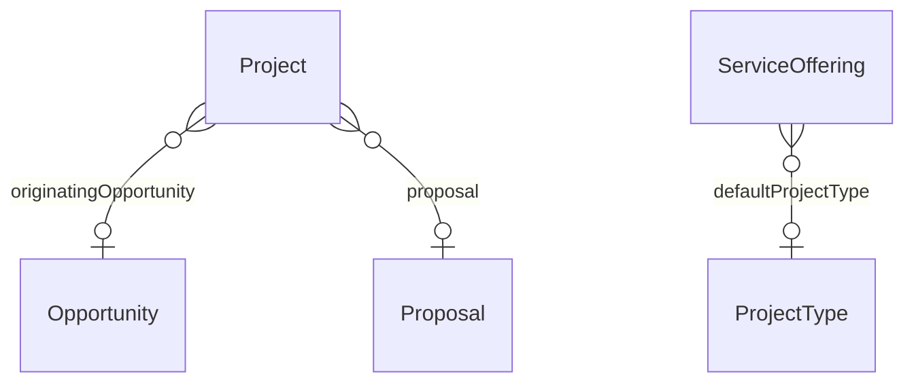

# Bridge – CRM ↔ Work Management (`crm-work` v1.0.0)

> Generated from [`schemas/bridges.yaml`](../../schemas/bridges.yaml) by `tools/schematool.py docs`. Do not edit by hand.

Connects won business to delivery: a project remembers the opportunity and proposal it came from, and services in the catalogue suggest the project type to create.

| Kind | Depends on | Entities | Extended entities | Enums | Term sets |
|---|---|---|---|---|---|
| bridge | [`crm`](crm.md), [`work`](work.md) | 0 | 2 | 0 | 0 |

## Relationships

Lookups to Country, Currency, Employee, Language are left out of the diagram to keep it readable.

## Extensions to entities from other layers

### Project (+2)

Adds columns to [Project](work.md#project) from `work`.

| Column | Type | Req | Dataverse | SharePoint | SQL | Notes |
|---|---|:-:|---|---|---|---|
| `originatingOpportunity` | lookup([Opportunity](crm.md#opportunity)) |  | Lookup → Opportunity | Lookup → Opportunity | uniqueidentifier FK → Opportunity |  |
| `proposal` | lookup([Proposal](crm.md#proposal)) |  | Lookup → Proposal | Lookup → Proposal | uniqueidentifier FK → Proposal |  |

### ServiceOffering (+1)

Adds columns to [ServiceOffering](crm.md#serviceoffering) from `crm`.

| Column | Type | Req | Dataverse | SharePoint | SQL | Notes |
|---|---|:-:|---|---|---|---|
| `defaultProjectType` | lookup([ProjectType](work.md#projecttype)) |  | Lookup → ProjectType | Lookup → ProjectType | uniqueidentifier FK → ProjectType |  |
