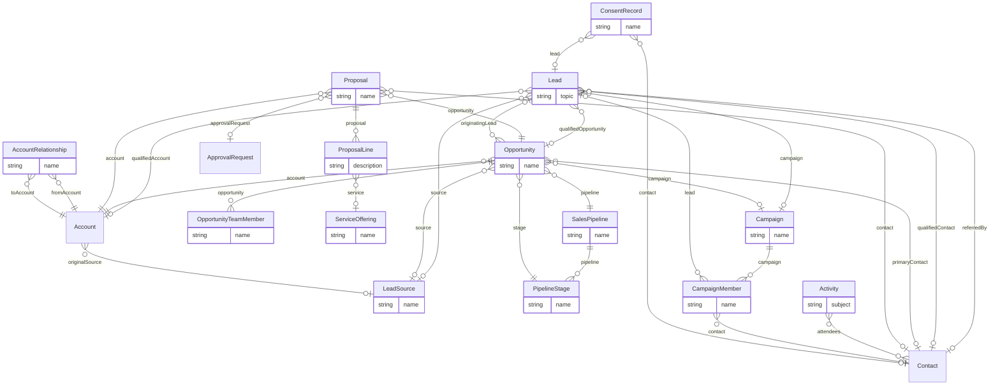

# CRM (`crm` v1.0.0)

> Generated from [`schemas/modules/crm.yaml`](../../schemas/modules/crm.yaml) by `tools/schematool.py docs`. Do not edit by hand.

Client relationship management for professional-services firms: leads, opportunities on configurable pipelines, proposals/fee quotes, activities, campaigns and events, consent tracking and account relationships (used for conflict checks in law and accounting). Builds on the core Account and Contact tables instead of creating its own.

| Kind | Depends on | Entities | Extended entities | Enums | Term sets |
|---|---|---|---|---|---|
| module | [`core`](core.md) | 14 | 2 | 19 | 0 |

## Entities

| Entity | Description | Dataverse | SharePoint | Volume | Sensitivity |
|---|---|---|---|---|---|
| [LeadSource](#leadsource) | Where leads and opportunities come from. | custom | list | low | internal |
| [Lead](#lead) | Unqualified interest from a person or company. | custom | list | medium | internal |
| [SalesPipeline](#salespipeline) | A configurable sales process (e.g. | custom | list | low | internal |
| [PipelineStage](#pipelinestage) | Ordered stage of a sales pipeline. | custom | list | low | internal |
| [Opportunity](#opportunity) | A potential piece of work for an account, tracked through a pipeline to won or lost. | custom | list | medium | internal |
| [OpportunityTeamMember](#opportunityteammember) | Employee working on a pursuit. | custom | list | low | internal |
| [ServiceOffering](#serviceoffering) | Catalogue of services or products the firm sells, with default pricing. | custom | list | low | internal |
| [Proposal](#proposal) | A priced offer to a client — quote, fee proposal, pitch or engagement proposal. | custom | list | medium | internal |
| [ProposalLine](#proposalline) | Priced line on a proposal. | custom | list | medium | internal |
| [Activity](#activity) | A logged client interaction or follow-up (call, meeting, email, task, note). | standard:activitypointer | list ⚠ high volume | high | internal |
| [Campaign](#campaign) | Marketing or business-development initiative (seminar, webinar, newsletter, sponsorship). | custom | list | low | internal |
| [CampaignMember](#campaignmember) | A contact or lead targeted by a campaign and their response. | custom | list | medium | internal |
| [ConsentRecord](#consentrecord) | Append-only evidence of a consent decision (GDPR/CCPA/DPDP). | custom | list | medium | confidential |
| [AccountRelationship](#accountrelationship) | Directed relationship between two organisations (ownership, affiliates, former names). | custom | list | low | internal |

## Relationships

Lookups to Country, Currency, Employee, Language are left out of the diagram to keep it readable.

### LeadSource

Where leads and opportunities come from.

- **Display name:** Lead Source / Lead Sources
- **Ownership:** organization · **Volume:** low · **Sensitivity:** internal
- **Dataverse:** custom table `pfx_leadsource` · **SharePoint:** list · **SQL:** table
- **Primary column:** `name`
- **Standard columns from traits:** `base` (id, createdOn, createdBy, modifiedOn, modifiedBy, stateCode, statusReason, rowVersion)

| Column | Type | Req | Dataverse | SharePoint | SQL | Notes |
|---|---|:-:|---|---|---|---|
| `name` | string(100) | ✔ | Text (100) | Title (primary column) | nvarchar(100) |  |
| `code` | string(30) | ✔ | Text (30) | Single line of text | nvarchar(30) | _unique_ |
| `description` | text |  | Multiline text | Multiple lines (plain) | nvarchar(max) |  |

### Lead

Unqualified interest from a person or company. Qualifies into Account, Contact and Opportunity.

- **Display name:** Lead / Leads
- **Ownership:** user · **Volume:** medium · **Sensitivity:** internal
- **Dataverse:** custom table `pfx_lead` · **SharePoint:** list · **SQL:** table
- **Primary column:** `topic`
- **Standard columns from traits:** `base` (id, createdOn, createdBy, modifiedOn, modifiedBy, stateCode, statusReason, rowVersion), `owned` (owner), `integration` (externalId, sourceSystem, lastSyncedOn), `classified` (sensitivity, retentionLabel)

| Column | Type | Req | Dataverse | SharePoint | SQL | Notes |
|---|---|:-:|---|---|---|---|
| `topic` | string(200) | ✔ | Text (200) | Title (primary column) | nvarchar(200) |  |
| `firstName` | string(100) |  | Text (100) | Single line of text | nvarchar(100) |  |
| `lastName` | string(100) | ✔ | Text (100) | Single line of text | nvarchar(100) |  |
| `companyName` | string(200) |  | Text (200) | Single line of text | nvarchar(200) |  |
| `jobTitle` | string(150) |  | Text (150) | Single line of text | nvarchar(150) |  |
| `email` | email |  | Text (email) | Single line of text | nvarchar(320) | _PII_ |
| `phone` | phone |  | Text (phone) | Single line of text | nvarchar(50) | _PII_ |
| `source` | lookup([LeadSource](#leadsource)) |  | Lookup → LeadSource | Lookup → LeadSource | uniqueidentifier FK → LeadSource |  |
| `campaign` | lookup([Campaign](#campaign)) |  | Lookup → Campaign | Lookup → Campaign | uniqueidentifier FK → Campaign |  |
| `referredBy` | lookup([Contact](core.md#contact)) |  | Lookup → Contact | Lookup → Contact | uniqueidentifier FK → Contact |  |
| `status` | choice([LeadStatus](#leadstatus)) | ✔ | Choice (global: LeadStatus) | Choice | int | _default `new`_ |
| `rating` | choice([LeadRating](#leadrating)) |  | Choice (global: LeadRating) | Choice | int |  |
| `serviceLine` | term([ServiceLine](core.md#serviceline)) |  | Lookup → Term (set ServiceLine) | Managed metadata (ServiceLine) | uniqueidentifier FK → Term |  |
| `industry` | term([Industry](core.md#industry)) |  | Lookup → Term (set Industry) | Managed metadata (Industry) | uniqueidentifier FK → Term |  |
| `estimatedValue` | money |  | Currency | Currency | decimal(19,4) |  |
| `currency` | lookup([Currency](core.md#currency)) |  | Lookup → Currency | Lookup → Currency | uniqueidentifier FK → Currency |  |
| `description` | text |  | Multiline text | Multiple lines (plain) | nvarchar(max) |  |
| `qualifiedAccount` | lookup([Account](core.md#account)) |  | Lookup → Account | Lookup → Account | uniqueidentifier FK → Account |  |
| `qualifiedContact` | lookup([Contact](core.md#contact)) |  | Lookup → Contact | Lookup → Contact | uniqueidentifier FK → Contact |  |
| `qualifiedOpportunity` | lookup([Opportunity](#opportunity)) |  | Lookup → Opportunity | Lookup → Opportunity | uniqueidentifier FK → Opportunity |  |
| `disqualifiedReason` | string(200) |  | Text (200) | Single line of text | nvarchar(200) |  |

> With Dynamics 365 Sales licensed, map to the standard lead table instead of a custom one.

### SalesPipeline

A configurable sales process (e.g. new business, tenders/panels, renewals).

- **Display name:** Sales Pipeline / Sales Pipelines
- **Ownership:** organization · **Volume:** low · **Sensitivity:** internal
- **Dataverse:** custom table `pfx_salespipeline` · **SharePoint:** list · **SQL:** table
- **Primary column:** `name`
- **Standard columns from traits:** `base` (id, createdOn, createdBy, modifiedOn, modifiedBy, stateCode, statusReason, rowVersion)

| Column | Type | Req | Dataverse | SharePoint | SQL | Notes |
|---|---|:-:|---|---|---|---|
| `name` | string(100) | ✔ | Text (100) | Title (primary column) | nvarchar(100) |  |
| `code` | string(30) | ✔ | Text (30) | Single line of text | nvarchar(30) | _unique_ |
| `serviceLine` | term([ServiceLine](core.md#serviceline)) |  | Lookup → Term (set ServiceLine) | Managed metadata (ServiceLine) | uniqueidentifier FK → Term |  |
| `isDefault` | boolean |  | Yes/No | Yes/No | bit |  |
| `description` | text |  | Multiline text | Multiple lines (plain) | nvarchar(max) |  |

### PipelineStage

Ordered stage of a sales pipeline.

- **Display name:** Pipeline Stage / Pipeline Stages
- **Ownership:** organization · **Volume:** low · **Sensitivity:** internal
- **Dataverse:** custom table `pfx_pipelinestage` · **SharePoint:** list · **SQL:** table
- **Primary column:** `name`
- **Standard columns from traits:** `base` (id, createdOn, createdBy, modifiedOn, modifiedBy, stateCode, statusReason, rowVersion)

| Column | Type | Req | Dataverse | SharePoint | SQL | Notes |
|---|---|:-:|---|---|---|---|
| `pipeline` | parent([SalesPipeline](#salespipeline)) | ✔ | Lookup → SalesPipeline (parental) | Lookup → SalesPipeline (cascade delete) | uniqueidentifier FK → SalesPipeline (cascade) |  |
| `name` | string(100) | ✔ | Text (100) | Title (primary column) | nvarchar(100) |  |
| `code` | string(30) | ✔ | Text (30) | Single line of text | nvarchar(30) | _unique_ |
| `sequence` | integer | ✔ | Whole number | Number (0 dp) | int |  |
| `defaultProbability` | percent |  | Decimal (5,2) | Number (%) | decimal(5,2) |  |
| `isClosed` | boolean |  | Yes/No | Yes/No | bit |  |
| `isWon` | boolean |  | Yes/No | Yes/No | bit |  |
| `exitCriteria` | text |  | Multiline text | Multiple lines (plain) | nvarchar(max) |  |

### Opportunity

A potential piece of work for an account, tracked through a pipeline to won or lost.

- **Display name:** Opportunity / Opportunities
- **Ownership:** user · **Volume:** medium · **Sensitivity:** internal
- **Dataverse:** custom table `pfx_opportunity` · **SharePoint:** list · **SQL:** table
- **Primary column:** `name`
- **Alternate keys:** (`opportunityNumber`)
- **Standard columns from traits:** `base` (id, createdOn, createdBy, modifiedOn, modifiedBy, stateCode, statusReason, rowVersion), `owned` (owner), `integration` (externalId, sourceSystem, lastSyncedOn), `classified` (sensitivity, retentionLabel)

| Column | Type | Req | Dataverse | SharePoint | SQL | Notes |
|---|---|:-:|---|---|---|---|
| `name` | string(200) | ✔ | Text (200) | Title (primary column) | nvarchar(200) |  |
| `opportunityNumber` | autonumber |  | Autonumber `OPP-{SEQNUM:6}` | Single line of text (set by flow) | nvarchar(30) + sequence |  |
| `account` | lookup([Account](core.md#account)) | ✔ | Lookup → Account | Lookup → Account | uniqueidentifier FK → Account |  |
| `primaryContact` | lookup([Contact](core.md#contact)) |  | Lookup → Contact | Lookup → Contact | uniqueidentifier FK → Contact |  |
| `pipeline` | lookup([SalesPipeline](#salespipeline)) | ✔ | Lookup → SalesPipeline | Lookup → SalesPipeline | uniqueidentifier FK → SalesPipeline |  |
| `stage` | lookup([PipelineStage](#pipelinestage)) | ✔ | Lookup → PipelineStage | Lookup → PipelineStage | uniqueidentifier FK → PipelineStage |  |
| `status` | choice([OpportunityStatus](#opportunitystatus)) | ✔ | Choice (global: OpportunityStatus) | Choice | int | _default `open`_ |
| `probability` | percent |  | Decimal (5,2) | Number (%) | decimal(5,2) |  |
| `estimatedValue` | money | ✔ | Currency | Currency | decimal(19,4) |  |
| `weightedValue` | money |  | Currency | Currency | decimal(19,4) | *Calculated:* estimatedValue × probability _read-only_ |
| `currency` | lookup([Currency](core.md#currency)) | ✔ | Lookup → Currency | Lookup → Currency | uniqueidentifier FK → Currency |  |
| `estimatedCloseDate` | date | ✔ | Date only (behaviour: date only) | Date (date only) | date |  |
| `actualCloseDate` | date |  | Date only (behaviour: date only) | Date (date only) | date |  |
| `actualValue` | money |  | Currency | Currency | decimal(19,4) |  |
| `serviceLine` | term([ServiceLine](core.md#serviceline)) |  | Lookup → Term (set ServiceLine) | Managed metadata (ServiceLine) | uniqueidentifier FK → Term |  |
| `source` | lookup([LeadSource](#leadsource)) |  | Lookup → LeadSource | Lookup → LeadSource | uniqueidentifier FK → LeadSource |  |
| `originatingLead` | lookup([Lead](#lead)) |  | Lookup → Lead | Lookup → Lead | uniqueidentifier FK → Lead |  |
| `campaign` | lookup([Campaign](#campaign)) |  | Lookup → Campaign | Lookup → Campaign | uniqueidentifier FK → Campaign |  |
| `isTender` | boolean |  | Yes/No | Yes/No | bit | Formal RFP / tender / panel process. |
| `tenderDeadline` | datetime |  | Date and time (user local) | Date and time | datetime2 (UTC) |  |
| `lossReason` | choice([LossReason](#lossreason)) |  | Choice (global: LossReason) | Choice | int |  |
| `competitorName` | string(200) |  | Text (200) | Single line of text | nvarchar(200) |  |
| `nextStep` | string(250) |  | Text (250) | Single line of text | nvarchar(250) |  |
| `nextStepDate` | date |  | Date only (behaviour: date only) | Date (date only) | date |  |
| `description` | text |  | Multiline text | Multiple lines (plain) | nvarchar(max) |  |

> With Dynamics 365 Sales licensed, map to the standard opportunity table.

### OpportunityTeamMember

Employee working on a pursuit.

- **Display name:** Opportunity Team Member / Opportunity Team Members
- **Ownership:** user · **Volume:** low · **Sensitivity:** internal
- **Dataverse:** custom table `pfx_opportunityteammember` · **SharePoint:** list · **SQL:** table
- **Primary column:** `name` (auto-generated)
- **Alternate keys:** (`opportunity`, `employee`)
- **Standard columns from traits:** `base` (id, createdOn, createdBy, modifiedOn, modifiedBy, stateCode, statusReason, rowVersion), `owned` (owner)

| Column | Type | Req | Dataverse | SharePoint | SQL | Notes |
|---|---|:-:|---|---|---|---|
| `name` | string(200) | ✔ | Text (200) | Title (primary column) | nvarchar(200) | Display label generated automatically (flow, plug-in or trigger). Required by Dataverse (primary name) and SharePoint (Title). _read-only_ |
| `opportunity` | parent([Opportunity](#opportunity)) | ✔ | Lookup → Opportunity (parental) | Lookup → Opportunity (cascade delete) | uniqueidentifier FK → Opportunity (cascade) |  |
| `employee` | lookup([Employee](core.md#employee)) | ✔ | Lookup → Employee | Person | uniqueidentifier FK → Employee |  |
| `role` | choice([OpportunityRole](#opportunityrole)) | ✔ | Choice (global: OpportunityRole) | Choice | int |  |
| `notes` | string(250) |  | Text (250) | Single line of text | nvarchar(250) |  |

### ServiceOffering

Catalogue of services or products the firm sells, with default pricing.

- **Display name:** Service Offering / Service Offerings
- **Ownership:** organization · **Volume:** low · **Sensitivity:** internal
- **Dataverse:** custom table `pfx_serviceoffering` · **SharePoint:** list · **SQL:** table
- **Primary column:** `name`
- **Standard columns from traits:** `base` (id, createdOn, createdBy, modifiedOn, modifiedBy, stateCode, statusReason, rowVersion)
- **Extended by:** [`crm-work`](crm-work.md#serviceoffering-1)

| Column | Type | Req | Dataverse | SharePoint | SQL | Notes |
|---|---|:-:|---|---|---|---|
| `name` | string(200) | ✔ | Text (200) | Title (primary column) | nvarchar(200) |  |
| `code` | string(30) | ✔ | Text (30) | Single line of text | nvarchar(30) | _unique_ |
| `serviceLine` | term([ServiceLine](core.md#serviceline)) |  | Lookup → Term (set ServiceLine) | Managed metadata (ServiceLine) | uniqueidentifier FK → Term |  |
| `unit` | choice([UnitOfMeasure](core.md#unitofmeasure)) |  | Choice (global: UnitOfMeasure) | Choice | int |  |
| `defaultPrice` | money |  | Currency | Currency | decimal(19,4) |  |
| `currency` | lookup([Currency](core.md#currency)) |  | Lookup → Currency | Lookup → Currency | uniqueidentifier FK → Currency |  |
| `description` | text |  | Multiline text | Multiple lines (plain) | nvarchar(max) |  |

### Proposal

A priced offer to a client — quote, fee proposal, pitch or engagement proposal. Each revision is a new row so sent versions are never overwritten.

- **Display name:** Proposal / Proposals
- **Ownership:** user · **Volume:** medium · **Sensitivity:** internal
- **Dataverse:** custom table `pfx_proposal` · **SharePoint:** list · **SQL:** table
- **Primary column:** `name`
- **Alternate keys:** (`proposalNumber`, `revision`)
- **Standard columns from traits:** `base` (id, createdOn, createdBy, modifiedOn, modifiedBy, stateCode, statusReason, rowVersion), `owned` (owner), `classified` (sensitivity, retentionLabel)

| Column | Type | Req | Dataverse | SharePoint | SQL | Notes |
|---|---|:-:|---|---|---|---|
| `name` | string(200) | ✔ | Text (200) | Title (primary column) | nvarchar(200) |  |
| `proposalNumber` | string(20) | ✔ | Text (20) | Single line of text | nvarchar(20) | Assigned on the first revision (PRP-000123) and copied to later revisions. _indexed_ |
| `revision` | integer | ✔ | Whole number | Number (0 dp) | int | _default `1`_ |
| `opportunity` | lookup([Opportunity](#opportunity)) | ✔ | Lookup → Opportunity | Lookup → Opportunity | uniqueidentifier FK → Opportunity |  |
| `account` | lookup([Account](core.md#account)) | ✔ | Lookup → Account | Lookup → Account | uniqueidentifier FK → Account |  |
| `contact` | lookup([Contact](core.md#contact)) |  | Lookup → Contact | Lookup → Contact | uniqueidentifier FK → Contact |  |
| `status` | choice([ProposalStatus](#proposalstatus)) | ✔ | Choice (global: ProposalStatus) | Choice | int | _default `draft`_ |
| `billingModel` | choice([BillingModel](core.md#billingmodel)) | ✔ | Choice (global: BillingModel) | Choice | int |  |
| `issuedOn` | date |  | Date only (behaviour: date only) | Date (date only) | date |  |
| `validUntil` | date |  | Date only (behaviour: date only) | Date (date only) | date |  |
| `acceptedOn` | date |  | Date only (behaviour: date only) | Date (date only) | date |  |
| `subtotal` | money |  | Currency | Currency | decimal(19,4) | *Calculated:* sum of ProposalLine.lineTotal _read-only_ |
| `discountAmount` | money |  | Currency | Currency | decimal(19,4) |  |
| `taxAmount` | money |  | Currency | Currency | decimal(19,4) |  |
| `totalAmount` | money |  | Currency | Currency | decimal(19,4) | *Calculated:* subtotal − discountAmount + taxAmount _read-only_ |
| `currency` | lookup([Currency](core.md#currency)) | ✔ | Lookup → Currency | Lookup → Currency | uniqueidentifier FK → Currency |  |
| `preparedBy` | lookup([Employee](core.md#employee)) |  | Lookup → Employee | Person | uniqueidentifier FK → Employee |  |
| `approvalRequest` | lookup([ApprovalRequest](core.md#approvalrequest)) |  | Lookup → ApprovalRequest | Lookup → ApprovalRequest | uniqueidentifier FK → ApprovalRequest |  |
| `terms` | richtext |  | Multiline text (rich text) | Multiple lines (enhanced rich text) | nvarchar(max) |  |
| `documentUrl` | url |  | Text (URL) | Hyperlink | nvarchar(2000) | Final issued PDF. |

### ProposalLine

Priced line on a proposal.

- **Display name:** Proposal Line / Proposal Lines
- **Ownership:** user · **Volume:** medium · **Sensitivity:** internal
- **Dataverse:** custom table `pfx_proposalline` · **SharePoint:** list · **SQL:** table
- **Primary column:** `description`
- **Standard columns from traits:** `base` (id, createdOn, createdBy, modifiedOn, modifiedBy, stateCode, statusReason, rowVersion), `owned` (owner)

| Column | Type | Req | Dataverse | SharePoint | SQL | Notes |
|---|---|:-:|---|---|---|---|
| `proposal` | parent([Proposal](#proposal)) | ✔ | Lookup → Proposal (parental) | Lookup → Proposal (cascade delete) | uniqueidentifier FK → Proposal (cascade) |  |
| `lineNumber` | integer | ✔ | Whole number | Number (0 dp) | int |  |
| `service` | lookup([ServiceOffering](#serviceoffering)) |  | Lookup → ServiceOffering | Lookup → ServiceOffering | uniqueidentifier FK → ServiceOffering |  |
| `description` | string(500) | ✔ | Text (500) | Title (primary column) | nvarchar(500) |  |
| `phase` | string(100) |  | Text (100) | Single line of text | nvarchar(100) | Stage/deliverable this line belongs to, e.g. RIBA Stage 2. |
| `quantity` | decimal(12,2) | ✔ | Decimal (12,2) | Number (2 dp) | decimal(12,2) |  |
| `unit` | choice([UnitOfMeasure](core.md#unitofmeasure)) |  | Choice (global: UnitOfMeasure) | Choice | int |  |
| `unitPrice` | money | ✔ | Currency | Currency | decimal(19,4) |  |
| `discountPercent` | percent |  | Decimal (5,2) | Number (%) | decimal(5,2) |  |
| `lineTotal` | money |  | Currency | Currency | decimal(19,4) | *Calculated:* quantity × unitPrice × (1 − discountPercent) _read-only_ |
| `currency` | lookup([Currency](core.md#currency)) | ✔ | Lookup → Currency | Lookup → Currency | uniqueidentifier FK → Currency |  |

### Activity

A logged client interaction or follow-up (call, meeting, email, task, note).

- **Display name:** Activity / Activities
- **Ownership:** user · **Volume:** high · **Sensitivity:** internal
- **Dataverse:** standard table `activitypointer` · **SharePoint:** list ⚠ high volume · **SQL:** table
- **Primary column:** `subject`
- **Standard columns from traits:** `base` (id, createdOn, createdBy, modifiedOn, modifiedBy, stateCode, statusReason, rowVersion), `owned` (owner), `integration` (externalId, sourceSystem, lastSyncedOn)

| Column | Type | Req | Dataverse | SharePoint | SQL | Notes |
|---|---|:-:|---|---|---|---|
| `subject` | string(200) | ✔ | Text (200) | Title (primary column) | nvarchar(200) |  |
| `activityType` | choice([ActivityType](#activitytype)) | ✔ | Choice (global: ActivityType) | Choice | int |  |
| `regarding` | polylookup([Account](core.md#account) \| [Contact](core.md#contact) \| [Lead](#lead) \| [Opportunity](#opportunity)) | ✔ | Multi-table lookup | Text ×2 (list name + id) | nvarchar(100) + uniqueidentifier |  |
| `status` | choice([ActivityStatus](#activitystatus)) | ✔ | Choice (global: ActivityStatus) | Choice | int | _default `open`_ |
| `direction` | choice([ActivityDirection](#activitydirection)) |  | Choice (global: ActivityDirection) | Choice | int |  |
| `priority` | choice([Priority](core.md#priority)) |  | Choice (global: Priority) | Choice | int |  |
| `startOn` | datetime |  | Date and time (user local) | Date and time | datetime2 (UTC) |  |
| `endOn` | datetime |  | Date and time (user local) | Date and time | datetime2 (UTC) |  |
| `dueOn` | datetime |  | Date and time (user local) | Date and time | datetime2 (UTC) |  |
| `completedOn` | datetime |  | Date and time (user local) | Date and time | datetime2 (UTC) |  |
| `durationMinutes` | duration |  | Whole number (duration) | Number (minutes) | int (minutes) |  |
| `location` | string(200) |  | Text (200) | Single line of text | nvarchar(200) |  |
| `attendees` | multilookup([Contact](core.md#contact)) |  | N:N → Contact | Lookup (multiple) → Contact | junction table → Contact |  |
| `internalAttendees` | multilookup([Employee](core.md#employee)) |  | N:N → Employee | Person (multiple) | junction table → Employee |  |
| `description` | richtext |  | Multiline text (rich text) | Multiple lines (enhanced rich text) | nvarchar(max) |  |
| `outcome` | string(250) |  | Text (250) | Single line of text | nvarchar(250) |  |

> In Dataverse use the native activity tables (task, phonecall, appointment, email); server-side sync with Exchange can track meetings and emails automatically.  
> On SharePoint keep only the latest 12–24 months in the list and archive the rest.

### Campaign

Marketing or business-development initiative (seminar, webinar, newsletter, sponsorship).

- **Display name:** Campaign / Campaigns
- **Ownership:** user · **Volume:** low · **Sensitivity:** internal
- **Dataverse:** custom table `pfx_campaign` · **SharePoint:** list · **SQL:** table
- **Primary column:** `name`
- **Standard columns from traits:** `base` (id, createdOn, createdBy, modifiedOn, modifiedBy, stateCode, statusReason, rowVersion), `owned` (owner), `integration` (externalId, sourceSystem, lastSyncedOn)

| Column | Type | Req | Dataverse | SharePoint | SQL | Notes |
|---|---|:-:|---|---|---|---|
| `name` | string(200) | ✔ | Text (200) | Title (primary column) | nvarchar(200) |  |
| `campaignType` | choice([CampaignType](#campaigntype)) | ✔ | Choice (global: CampaignType) | Choice | int |  |
| `status` | choice([CampaignStatus](#campaignstatus)) | ✔ | Choice (global: CampaignStatus) | Choice | int | _default `planned`_ |
| `serviceLine` | term([ServiceLine](core.md#serviceline)) |  | Lookup → Term (set ServiceLine) | Managed metadata (ServiceLine) | uniqueidentifier FK → Term |  |
| `startDate` | date |  | Date only (behaviour: date only) | Date (date only) | date |  |
| `endDate` | date |  | Date only (behaviour: date only) | Date (date only) | date |  |
| `budget` | money |  | Currency | Currency | decimal(19,4) |  |
| `actualCost` | money |  | Currency | Currency | decimal(19,4) |  |
| `currency` | lookup([Currency](core.md#currency)) |  | Lookup → Currency | Lookup → Currency | uniqueidentifier FK → Currency |  |
| `expectedResponses` | integer |  | Whole number | Number (0 dp) | int |  |
| `description` | text |  | Multiline text | Multiple lines (plain) | nvarchar(max) |  |

### CampaignMember

A contact or lead targeted by a campaign and their response.

- **Display name:** Campaign Member / Campaign Members
- **Ownership:** user · **Volume:** medium · **Sensitivity:** internal
- **Dataverse:** custom table `pfx_campaignmember` · **SharePoint:** list · **SQL:** table
- **Primary column:** `name` (auto-generated)
- **Standard columns from traits:** `base` (id, createdOn, createdBy, modifiedOn, modifiedBy, stateCode, statusReason, rowVersion), `owned` (owner)

| Column | Type | Req | Dataverse | SharePoint | SQL | Notes |
|---|---|:-:|---|---|---|---|
| `name` | string(200) | ✔ | Text (200) | Title (primary column) | nvarchar(200) | Display label generated automatically (flow, plug-in or trigger). Required by Dataverse (primary name) and SharePoint (Title). _read-only_ |
| `campaign` | parent([Campaign](#campaign)) | ✔ | Lookup → Campaign (parental) | Lookup → Campaign (cascade delete) | uniqueidentifier FK → Campaign (cascade) |  |
| `contact` | lookup([Contact](core.md#contact)) |  | Lookup → Contact | Lookup → Contact | uniqueidentifier FK → Contact |  |
| `lead` | lookup([Lead](#lead)) |  | Lookup → Lead | Lookup → Lead | uniqueidentifier FK → Lead |  |
| `status` | choice([CampaignMemberStatus](#campaignmemberstatus)) | ✔ | Choice (global: CampaignMemberStatus) | Choice | int | _default `invited`_ |
| `respondedOn` | datetime |  | Date and time (user local) | Date and time | datetime2 (UTC) |  |

> Exactly one of contact or lead must be set (business rule).

### ConsentRecord

Append-only evidence of a consent decision (GDPR/CCPA/DPDP). The current state is the latest record per person and purpose; Contact do-not-contact flags are derived from it.

- **Display name:** Consent Record / Consent Records
- **Ownership:** user · **Volume:** medium · **Sensitivity:** confidential
- **Dataverse:** custom table `pfx_consentrecord` · **SharePoint:** list · **SQL:** table
- **Primary column:** `name` (auto-generated)
- **Standard columns from traits:** `base` (id, createdOn, createdBy, modifiedOn, modifiedBy, stateCode, statusReason, rowVersion), `owned` (owner)

| Column | Type | Req | Dataverse | SharePoint | SQL | Notes |
|---|---|:-:|---|---|---|---|
| `name` | string(200) | ✔ | Text (200) | Title (primary column) | nvarchar(200) | Display label generated automatically (flow, plug-in or trigger). Required by Dataverse (primary name) and SharePoint (Title). _read-only_ |
| `contact` | lookup([Contact](core.md#contact)) |  | Lookup → Contact | Lookup → Contact | uniqueidentifier FK → Contact |  |
| `lead` | lookup([Lead](#lead)) |  | Lookup → Lead | Lookup → Lead | uniqueidentifier FK → Lead |  |
| `purpose` | choice([ConsentPurpose](#consentpurpose)) | ✔ | Choice (global: ConsentPurpose) | Choice | int |  |
| `granted` | boolean |  | Yes/No | Yes/No | bit |  |
| `capturedOn` | datetime | ✔ | Date and time (user local) | Date and time | datetime2 (UTC) |  |
| `method` | choice([ConsentMethod](#consentmethod)) | ✔ | Choice (global: ConsentMethod) | Choice | int |  |
| `source` | string(200) |  | Text (200) | Single line of text | nvarchar(200) | Form, campaign or person that captured it. |
| `expiresOn` | date |  | Date only (behaviour: date only) | Date (date only) | date |  |
| `evidenceUrl` | url |  | Text (URL) | Hyperlink | nvarchar(2000) |  |

### AccountRelationship

Directed relationship between two organisations (ownership, affiliates, former names).

- **Display name:** Account Relationship / Account Relationships
- **Ownership:** user · **Volume:** low · **Sensitivity:** internal
- **Dataverse:** custom table `pfx_accountrelationship` · **SharePoint:** list · **SQL:** table
- **Primary column:** `name` (auto-generated)
- **Standard columns from traits:** `base` (id, createdOn, createdBy, modifiedOn, modifiedBy, stateCode, statusReason, rowVersion), `owned` (owner)

| Column | Type | Req | Dataverse | SharePoint | SQL | Notes |
|---|---|:-:|---|---|---|---|
| `name` | string(200) | ✔ | Text (200) | Title (primary column) | nvarchar(200) | Display label generated automatically (flow, plug-in or trigger). Required by Dataverse (primary name) and SharePoint (Title). _read-only_ |
| `fromAccount` | lookup([Account](core.md#account)) | ✔ | Lookup → Account | Lookup → Account | uniqueidentifier FK → Account |  |
| `toAccount` | lookup([Account](core.md#account)) | ✔ | Lookup → Account | Lookup → Account | uniqueidentifier FK → Account |  |
| `relationshipType` | choice([AccountRelationshipType](#accountrelationshiptype)) | ✔ | Choice (global: AccountRelationshipType) | Choice | int |  |
| `startDate` | date |  | Date only (behaviour: date only) | Date (date only) | date |  |
| `endDate` | date |  | Date only (behaviour: date only) | Date (date only) | date |  |
| `notes` | text |  | Multiline text | Multiple lines (plain) | nvarchar(max) |  |

## Extensions to entities from other layers

### Account (+9)

Adds columns to [Account](core.md#account) from `core`.

| Column | Type | Req | Dataverse | SharePoint | SQL | Notes |
|---|---|:-:|---|---|---|---|
| `accountTier` | choice([AccountTier](#accounttier)) |  | Choice (global: AccountTier) | Choice | int |  |
| `annualRevenue` | money |  | Currency | Currency | decimal(19,4) |  |
| `employeeCount` | integer |  | Whole number | Number (0 dp) | int |  |
| `originalSource` | lookup([LeadSource](#leadsource)) |  | Lookup → LeadSource | Lookup → LeadSource | uniqueidentifier FK → LeadSource |  |
| `clientSince` | date |  | Date only (behaviour: date only) | Date (date only) | date |  |
| `paymentTerms` | choice([PaymentTerms](#paymentterms)) |  | Choice (global: PaymentTerms) | Choice | int |  |
| `creditLimit` | money |  | Currency | Currency | decimal(19,4) |  |
| `linkedInUrl` | url |  | Text (URL) | Hyperlink | nvarchar(2000) |  |
| `lastActivityOn` | datetime |  | Date and time (user local) | Date and time | datetime2 (UTC) | *Calculated:* latest completed Activity regarding this account _read-only_ |

### Contact (+7)

Adds columns to [Contact](core.md#contact) from `core`.

| Column | Type | Req | Dataverse | SharePoint | SQL | Notes |
|---|---|:-:|---|---|---|---|
| `buyingRole` | choice([BuyingRole](#buyingrole)) |  | Choice (global: BuyingRole) | Choice | int |  |
| `preferredChannel` | choice([ContactChannel](#contactchannel)) |  | Choice (global: ContactChannel) | Choice | int |  |
| `relationshipOwner` | lookup([Employee](core.md#employee)) |  | Lookup → Employee | Person | uniqueidentifier FK → Employee |  |
| `doNotEmail` | boolean |  | donotemail (native) | Yes/No | bit |  |
| `doNotPhone` | boolean |  | donotphone (native) | Yes/No | bit |  |
| `doNotBulkEmail` | boolean |  | donotbulkemail (native) | Yes/No | bit |  |
| `lastActivityOn` | datetime |  | Date and time (user local) | Date and time | datetime2 (UTC) | *Calculated:* latest completed Activity regarding this contact _read-only_ |

## Choices (enums)

Codes are stable forever. Dataverse option value = publisher choice prefix + code.

### AccountTier

Strategic importance of a client.

| Code | Key | Label |
|--:|---|---|
| 1 | `strategic` | Strategic |
| 2 | `key` | Key |
| 3 | `standard` | Standard |
| 4 | `transactional` | Transactional |

### PaymentTerms

Default payment terms agreed with an account.

| Code | Key | Label |
|--:|---|---|
| 1 | `dueOnReceipt` | Due On Receipt |
| 2 | `net15` | Net15 |
| 3 | `net30` | Net30 |
| 4 | `net45` | Net45 |
| 5 | `net60` | Net60 |

### ContactChannel

Preferred way to reach a contact.

| Code | Key | Label |
|--:|---|---|
| 1 | `email` | Email |
| 2 | `phone` | Phone |
| 3 | `video` | Video |
| 4 | `inPerson` | In Person |
| 5 | `post` | Post |

### BuyingRole

Role a contact plays in buying decisions.

| Code | Key | Label |
|--:|---|---|
| 1 | `decisionMaker` | Decision Maker |
| 2 | `economicBuyer` | Economic Buyer |
| 3 | `influencer` | Influencer |
| 4 | `champion` | Champion |
| 5 | `endUser` | End User |
| 6 | `gatekeeper` | Gatekeeper |
| 7 | `blocker` | Blocker |

### LeadStatus

Progress of a lead.

| Code | Key | Label |
|--:|---|---|
| 1 | `new` | New |
| 2 | `contacted` | Contacted |
| 3 | `nurturing` | Nurturing |
| 4 | `qualified` | Qualified |
| 5 | `disqualified` | Disqualified |

### LeadRating

Sales temperature of a lead.

| Code | Key | Label |
|--:|---|---|
| 1 | `hot` | Hot |
| 2 | `warm` | Warm |
| 3 | `cold` | Cold |

### OpportunityStatus

Outcome of an opportunity. The stage lives in the pipeline, the outcome here.

| Code | Key | Label |
|--:|---|---|
| 1 | `open` | Open |
| 2 | `won` | Won |
| 3 | `lost` | Lost |
| 4 | `abandoned` | Abandoned |

### LossReason

Why an opportunity was lost or abandoned.

| Code | Key | Label |
|--:|---|---|
| 1 | `price` | Price |
| 2 | `scope` | Scope |
| 3 | `timing` | Timing |
| 4 | `competitor` | Competitor |
| 5 | `noDecision` | No Decision |
| 6 | `relationship` | Relationship |
| 7 | `capability` | Capability |
| 8 | `conflictOfInterest` | Conflict Of Interest |
| 99 | `other` | Other |

### OpportunityRole

Role of an employee on a pursuit team.

| Code | Key | Label |
|--:|---|---|
| 1 | `lead` | Lead |
| 2 | `supporting` | Supporting |
| 3 | `technicalExpert` | Technical Expert |
| 4 | `pricing` | Pricing |
| 5 | `executiveSponsor` | Executive Sponsor |

### ProposalStatus

Lifecycle of a proposal, quote or fee proposal.

| Code | Key | Label |
|--:|---|---|
| 1 | `draft` | Draft |
| 2 | `inReview` | In Review |
| 3 | `sent` | Sent |
| 4 | `accepted` | Accepted |
| 5 | `rejected` | Rejected |
| 6 | `expired` | Expired |
| 7 | `withdrawn` | Withdrawn |

### ActivityType

Kind of client interaction.

| Code | Key | Label |
|--:|---|---|
| 1 | `call` | Call |
| 2 | `meeting` | Meeting |
| 3 | `email` | Email |
| 4 | `task` | Task |
| 5 | `note` | Note |
| 6 | `letter` | Letter |

### ActivityStatus

Whether an activity is still to do.

| Code | Key | Label |
|--:|---|---|
| 1 | `open` | Open |
| 2 | `completed` | Completed |
| 3 | `cancelled` | Cancelled |

### ActivityDirection

Who initiated the interaction.

| Code | Key | Label |
|--:|---|---|
| 1 | `inbound` | Inbound |
| 2 | `outbound` | Outbound |

### CampaignType

Kind of marketing or business-development campaign.

| Code | Key | Label |
|--:|---|---|
| 1 | `event` | Event |
| 2 | `webinar` | Webinar |
| 3 | `newsletter` | Newsletter |
| 4 | `emailCampaign` | Email Campaign |
| 5 | `socialMedia` | Social Media |
| 6 | `sponsorship` | Sponsorship |
| 7 | `thoughtLeadership` | Thought Leadership |

### CampaignStatus

Lifecycle of a campaign.

| Code | Key | Label |
|--:|---|---|
| 1 | `planned` | Planned |
| 2 | `active` | Active |
| 3 | `completed` | Completed |
| 4 | `cancelled` | Cancelled |

### CampaignMemberStatus

Response of a campaign member.

| Code | Key | Label |
|--:|---|---|
| 1 | `invited` | Invited |
| 2 | `registered` | Registered |
| 3 | `attended` | Attended |
| 4 | `noShow` | No Show |
| 5 | `responded` | Responded |
| 6 | `unsubscribed` | Unsubscribed |

### ConsentPurpose

What a person has (or has not) consented to.

| Code | Key | Label |
|--:|---|---|
| 1 | `marketingEmail` | Marketing Email |
| 2 | `newsletters` | Newsletters |
| 3 | `eventInvitations` | Event Invitations |
| 4 | `profiling` | Profiling |
| 5 | `thirdPartySharing` | Third Party Sharing |

### ConsentMethod

How consent was captured.

| Code | Key | Label |
|--:|---|---|
| 1 | `webForm` | Web Form |
| 2 | `email` | Email |
| 3 | `verbal` | Verbal |
| 4 | `paperForm` | Paper Form |
| 5 | `import` | Import |

### AccountRelationshipType

Relationship between two organisations. Feeds conflict-of-interest searches.

| Code | Key | Label |
|--:|---|---|
| 1 | `owns` | Owns / parent of |
| 2 | `affiliate` | Affiliate |
| 3 | `jointVenture` | Joint Venture |
| 4 | `referralPartner` | Referral Partner |
| 5 | `serviceProvider` | Service Provider |
| 6 | `formerlyKnownAs` | Formerly Known As |
| 99 | `other` | Other |

## Reference data (seed)

Loaded at deployment. Deactivate rows you do not need instead of deleting them.

### LeadSource (8 rows)

| code | name |
|---|---|
| WEBSITE | Website enquiry |
| REF_CLIENT | Referral – existing client |
| REF_PARTNER | Referral – partner firm |
| EVENT | Event / seminar |
| LINKEDIN | LinkedIn |
| OUTREACH | Direct outreach |
| TENDER | Tender / RFP portal |
| EXISTING | Existing client – new work |

### SalesPipeline (1 rows)

| code | name | isDefault |
|---|---|---|
| NEW_BUSINESS | New business | yes |

### PipelineStage (6 rows)

| pipeline | code | name | sequence | defaultProbability | isClosed | isWon |
|---|---|---|---|---|---|---|
| NEW_BUSINESS | NB_QUALIFY | Qualify | 1 | 10 | no | no |
| NEW_BUSINESS | NB_DISCOVER | Discover needs | 2 | 25 | no | no |
| NEW_BUSINESS | NB_PROPOSE | Propose | 3 | 50 | no | no |
| NEW_BUSINESS | NB_NEGOTIATE | Negotiate | 4 | 75 | no | no |
| NEW_BUSINESS | NB_WON | Won | 5 | 100 | yes | yes |
| NEW_BUSINESS | NB_LOST | Lost | 6 | 0 | yes | no |
