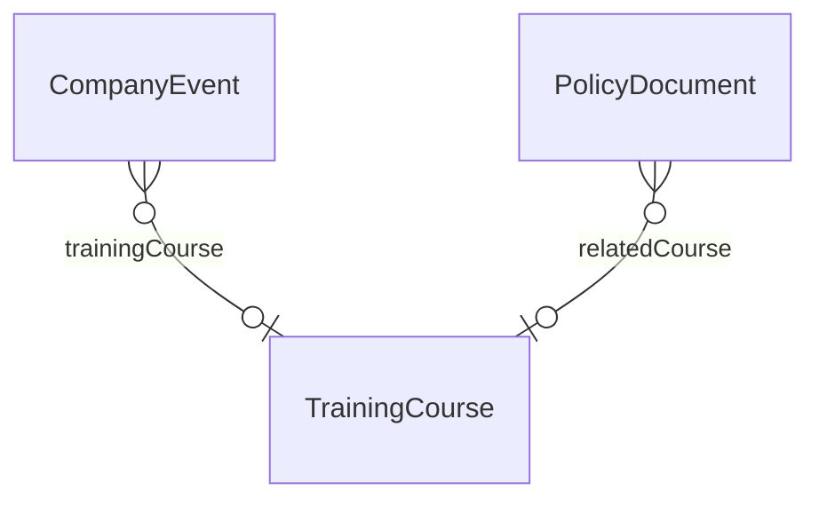

# Bridge – HR ↔ Intranet (`hr-intranet` v1.0.0)

> Generated from [`schemas/bridges.yaml`](../../schemas/bridges.yaml) by `tools/schematool.py docs`. Do not edit by hand.

Training sessions published as intranet events; attendance creates training records.

| Kind | Depends on | Entities | Extended entities | Enums | Term sets |
|---|---|---|---|---|---|
| bridge | [`hr`](hr.md), [`intranet`](intranet.md) | 0 | 2 | 0 | 0 |

## Relationships

Lookups to Country, Currency, Employee, Language are left out of the diagram to keep it readable.

## Extensions to entities from other layers

### CompanyEvent (+1)

Adds columns to [CompanyEvent](intranet.md#companyevent) from `intranet`.

| Column | Type | Req | Dataverse | SharePoint | SQL | Notes |
|---|---|:-:|---|---|---|---|
| `trainingCourse` | lookup([TrainingCourse](hr.md#trainingcourse)) |  | Lookup → TrainingCourse | Lookup → TrainingCourse | uniqueidentifier FK → TrainingCourse | Attendance marks the course completed for attendees. |

### PolicyDocument (+1)

Adds columns to [PolicyDocument](intranet.md#policydocument) from `intranet`.

| Column | Type | Req | Dataverse | SharePoint | SQL | Notes |
|---|---|:-:|---|---|---|---|
| `relatedCourse` | lookup([TrainingCourse](hr.md#trainingcourse)) |  | Lookup → TrainingCourse | Lookup → TrainingCourse | uniqueidentifier FK → TrainingCourse | Mandatory training that explains the policy. |
