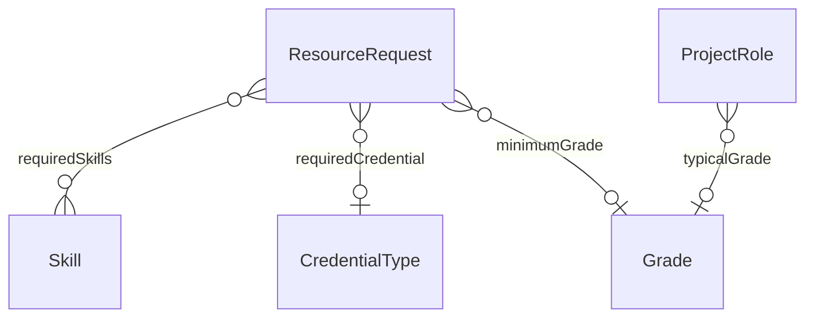

# Bridge – HR ↔ Work Management (`hr-work` v1.0.0)

> Generated from [`schemas/bridges.yaml`](../../schemas/bridges.yaml) by `tools/schematool.py docs`. Do not edit by hand.

Skills-, grade- and credential-aware resourcing.

| Kind | Depends on | Entities | Extended entities | Enums | Term sets |
|---|---|---|---|---|---|
| bridge | [`hr`](hr.md), [`work`](work.md) | 0 | 2 | 0 | 0 |

## Relationships

Lookups to Country, Currency, Employee, Language are left out of the diagram to keep it readable.

## Extensions to entities from other layers

### ResourceRequest (+3)

Adds columns to [ResourceRequest](work.md#resourcerequest) from `work`.

| Column | Type | Req | Dataverse | SharePoint | SQL | Notes |
|---|---|:-:|---|---|---|---|
| `requiredSkills` | multilookup([Skill](hr.md#skill)) |  | N:N → Skill | Lookup (multiple) → Skill | junction table → Skill |  |
| `requiredCredential` | lookup([CredentialType](hr.md#credentialtype)) |  | Lookup → CredentialType | Lookup → CredentialType | uniqueidentifier FK → CredentialType | e.g. a practising certificate or licence required to sign off. |
| `minimumGrade` | lookup([Grade](hr.md#grade)) |  | Lookup → Grade | Lookup → Grade | uniqueidentifier FK → Grade |  |

### ProjectRole (+1)

Adds columns to [ProjectRole](work.md#projectrole) from `work`.

| Column | Type | Req | Dataverse | SharePoint | SQL | Notes |
|---|---|:-:|---|---|---|---|
| `typicalGrade` | lookup([Grade](hr.md#grade)) |  | Lookup → Grade | Lookup → Grade | uniqueidentifier FK → Grade |  |
