# HR (`hr` v1.0.0)

> Generated from [`schemas/modules/hr.yaml`](../../schemas/modules/hr.yaml) by `tools/schematool.py docs`. Do not edit by hand.

Human resources for small and mid-size firms: positions and job architecture, effective-dated employment and assignment history, restricted compensation and personal data, leave and absence, onboarding/offboarding checklists, recruitment, performance and goals, training, professional credentials with CPD, and skills for resourcing. Payroll, benefits and diversity data stay out of scope by design (see notes).

| Kind | Depends on | Entities | Extended entities | Enums | Term sets |
|---|---|---|---|---|---|
| module | [`core`](core.md) | 33 | 0 | 36 | 2 |

## Entities

| Entity | Description | Dataverse | SharePoint | Volume | Sensitivity |
|---|---|---|---|---|---|
| [JobFamily](#jobfamily) | Group of related jobs (e.g. | custom | list | low | internal |
| [Grade](#grade) | Pay grade / career level with salary band. | custom | list | low | confidential |
| [JobProfile](#jobprofile) | Standard job definition (title, family, grade, responsibilities, required credentials). | custom | list | low | internal |
| [Position](#position) | Budgeted seat in the organisation that a person fills. | custom | list | low | internal |
| [Employment](#employment) | An employment contract with a legal entity. | custom | list | low | confidential |
| [JobAssignment](#jobassignment) | Effective-dated job, reporting line and location of a person. | custom | list | medium | internal |
| [Compensation](#compensation) | Effective-dated base pay. | custom | list | low | restricted |
| [EmployeePersonalDetails](#employeepersonaldetails) | Personal (non-directory) data of an employee in its own table so it can be secured separately on every platform — SharePoint has no column-level security. | custom | list | low | restricted |
| [EmergencyContact](#emergencycontact) | Person to contact in an emergency. | custom | list | low | confidential |
| [LeaveType](#leavetype) | Kind of leave (annual, sick, parental, study…). | custom | list | low | internal |
| [LeavePolicy](#leavepolicy) | Entitlement rules for a leave type in a legal entity/country. | custom | list | low | internal |
| [LeaveBalance](#leavebalance) | Balance of one leave type for one person for one leave year. | custom | list | medium | internal |
| [LeaveRequest](#leaverequest) | Request for time off. | custom | list | medium | confidential |
| [ChecklistTemplate](#checklisttemplate) | Reusable onboarding, offboarding or internal-move checklist. | custom | list | low | internal |
| [ChecklistTemplateTask](#checklisttemplatetask) | Task in a checklist template, scheduled relative to the start or leaving date. | custom | list | low | internal |
| [EmployeeChecklist](#employeechecklist) | Checklist instance for one person. | custom | list | low | internal |
| [EmployeeChecklistTask](#employeechecklisttask) | Task instance with a named assignee and due date. | custom | list | medium | internal |
| [JobRequisition](#jobrequisition) | Approved request to hire. | custom | list | low | internal |
| [Candidate](#candidate) | Person who applied or was sourced. | custom | list | medium | confidential |
| [JobApplication](#jobapplication) | A candidate's application to a requisition. | custom | list | medium | confidential |
| [Interview](#interview) | Scheduled interview for an application. | custom | list | medium | internal |
| [InterviewFeedback](#interviewfeedback) | One interviewer's scorecard. | custom | list | medium | confidential |
| [Offer](#offer) | Job offer. | custom | list | low | restricted |
| [ReviewCycle](#reviewcycle) | Performance review cycle. | custom | list | low | internal |
| [PerformanceRating](#performancerating) | Rating on the firm's performance scale. | custom | list | low | internal |
| [PerformanceReview](#performancereview) | One person's review in a cycle. | custom | list | medium | restricted |
| [Goal](#goal) | Objective or key result for a person, optionally aligned to a parent goal. | custom | list | medium | confidential |
| [CredentialType](#credentialtype) | Licence, certification or membership the firm tracks (bar admission, CPA, RIBA, AWS…). | custom | list | low | internal |
| [EmployeeCredential](#employeecredential) | A credential held by a person, with expiry and CPD progress. | custom | list | medium | internal |
| [TrainingCourse](#trainingcourse) | Course in the learning catalogue. | custom | list | low | internal |
| [TrainingRecord](#trainingrecord) | Assignment and completion of a course by a person. | custom | list ⚠ high volume | high | internal |
| [Skill](#skill) | Skill in the firm's skills catalogue. | custom | list | low | internal |
| [EmployeeSkill](#employeeskill) | A person's proficiency in a skill. | custom | list | medium | internal |

## Relationships

Lookups to Country, Currency, Employee, Language are left out of the diagram to keep it readable.

```mermaid
erDiagram
    JobFamily {
        string name
    }
    Grade {
        string name
    }
    JobProfile {
        string name
    }
    Position {
        string title
    }
    Employment {
        string name
    }
    JobAssignment {
        string name
    }
    Compensation {
        string name
    }
    EmployeePersonalDetails {
        string name
    }
    EmergencyContact {
        string name
    }
    LeaveType {
        string name
    }
    LeavePolicy {
        string name
    }
    LeaveBalance {
        string name
    }
    LeaveRequest {
        string name
    }
    ChecklistTemplate {
        string name
    }
    ChecklistTemplateTask {
        string title
    }
    EmployeeChecklist {
        string name
    }
    EmployeeChecklistTask {
        string title
    }
    JobRequisition {
        string title
    }
    Candidate {
        string fullName
    }
    JobApplication {
        string name
    }
    Interview {
        string name
    }
    InterviewFeedback {
        string name
    }
    Offer {
        string name
    }
    ReviewCycle {
        string name
    }
    PerformanceRating {
        string name
    }
    PerformanceReview {
        string name
    }
    Goal {
        string title
    }
    CredentialType {
        string name
    }
    EmployeeCredential {
        string name
    }
    TrainingCourse {
        string name
    }
    TrainingRecord {
        string name
    }
    Skill {
        string name
    }
    EmployeeSkill {
        string name
    }
    Grade }o--o| LegalEntity : "legalEntity"
    JobProfile }o--o| JobFamily : "jobFamily"
    JobProfile }o--o| Grade : "grade"
    JobProfile }o--o{ CredentialType : "requiredCredentials"
    Position }o--|| JobProfile : "jobProfile"
    Position }o--|| OrgUnit : "orgUnit"
    Position }o--|| LegalEntity : "legalEntity"
    Position }o--o| Position : "reportsTo"
    Position }o--o| Office : "office"
    Position }o--o| CostCenter : "costCenter"
    Employment }o--|| LegalEntity : "legalEntity"
    JobAssignment }o--|| Employment : "employment"
    JobAssignment }o--o| Position : "position"
    JobAssignment }o--|| JobProfile : "jobProfile"
    JobAssignment }o--o| Grade : "grade"
    JobAssignment }o--|| OrgUnit : "orgUnit"
    JobAssignment }o--o| Office : "office"
    JobAssignment }o--o| CostCenter : "costCenter"
    Compensation }o--o| Grade : "grade"
    Compensation }o--o| ApprovalRequest : "approvalRequest"
    LeavePolicy }o--|| LeaveType : "leaveType"
    LeavePolicy }o--o| LegalEntity : "legalEntity"
    LeaveBalance }o--|| LeaveType : "leaveType"
    LeaveRequest }o--|| LeaveType : "leaveType"
    LeaveRequest }o--o| ApprovalRequest : "approvalRequest"
    ChecklistTemplate }o--o| OrgUnit : "orgUnit"
    ChecklistTemplate }o--o| LegalEntity : "legalEntity"
    ChecklistTemplate ||--o{ ChecklistTemplateTask : "template"
    EmployeeChecklist }o--|| ChecklistTemplate : "template"
    EmployeeChecklist ||--o{ EmployeeChecklistTask : "checklist"
    EmployeeChecklistTask }o--o| ChecklistTemplateTask : "templateTask"
    JobRequisition }o--o| Position : "position"
    JobRequisition }o--|| JobProfile : "jobProfile"
    JobRequisition }o--|| OrgUnit : "orgUnit"
    JobRequisition }o--o| Office : "office"
    JobRequisition }o--o| ApprovalRequest : "approvalRequest"
    Candidate }o--o| Account : "agency"
    JobApplication }o--|| JobRequisition : "requisition"
    JobApplication }o--|| Candidate : "candidate"
    JobApplication ||--o{ Interview : "application"
    Interview ||--o{ InterviewFeedback : "interview"
    Offer }o--|| JobApplication : "application"
    Offer }o--|| Candidate : "candidate"
    Offer }o--o| Position : "position"
    Offer }o--o| Grade : "grade"
    Offer }o--o| ApprovalRequest : "approvalRequest"
    PerformanceReview }o--|| ReviewCycle : "cycle"
    PerformanceReview }o--o| PerformanceRating : "selfRating"
    PerformanceReview }o--o| PerformanceRating : "managerRating"
    PerformanceReview }o--o| PerformanceRating : "finalRating"
    Goal }o--o| ReviewCycle : "cycle"
    Goal }o--o| Goal : "parentGoal"
    EmployeeCredential }o--|| CredentialType : "credentialType"
    TrainingCourse }o--o| Account : "provider"
    TrainingCourse }o--o| CredentialType : "countsTowards"
    TrainingRecord }o--|| TrainingCourse : "course"
    EmployeeSkill }o--|| Skill : "skill"
```

### JobFamily

Group of related jobs (e.g. client delivery, finance, IT).

- **Display name:** Job Family / Job Families
- **Ownership:** organization · **Volume:** low · **Sensitivity:** internal
- **Dataverse:** custom table `pfx_jobfamily` · **SharePoint:** list · **SQL:** table
- **Primary column:** `name`
- **Standard columns from traits:** `base` (id, createdOn, createdBy, modifiedOn, modifiedBy, stateCode, statusReason, rowVersion)

| Column | Type | Req | Dataverse | SharePoint | SQL | Notes |
|---|---|:-:|---|---|---|---|
| `name` | string(100) | ✔ | Text (100) | Title (primary column) | nvarchar(100) |  |
| `code` | string(30) | ✔ | Text (30) | Single line of text | nvarchar(30) | _unique_ |
| `description` | text |  | Multiline text | Multiple lines (plain) | nvarchar(max) |  |

### Grade

Pay grade / career level with salary band.

- **Display name:** Grade / Grades
- **Ownership:** organization · **Volume:** low · **Sensitivity:** confidential
- **Dataverse:** custom table `pfx_grade` · **SharePoint:** list · **SQL:** table
- **Primary column:** `name`
- **Standard columns from traits:** `base` (id, createdOn, createdBy, modifiedOn, modifiedBy, stateCode, statusReason, rowVersion)

| Column | Type | Req | Dataverse | SharePoint | SQL | Notes |
|---|---|:-:|---|---|---|---|
| `name` | string(100) | ✔ | Text (100) | Title (primary column) | nvarchar(100) |  |
| `code` | string(30) | ✔ | Text (30) | Single line of text | nvarchar(30) | _unique_ |
| `level` | integer | ✔ | Whole number | Number (0 dp) | int |  |
| `legalEntity` | lookup([LegalEntity](core.md#legalentity)) |  | Lookup → LegalEntity | Lookup → LegalEntity | uniqueidentifier FK → LegalEntity |  |
| `salaryMin` | money |  | Currency | Currency | decimal(19,4) |  |
| `salaryMid` | money |  | Currency | Currency | decimal(19,4) |  |
| `salaryMax` | money |  | Currency | Currency | decimal(19,4) |  |
| `currency` | lookup([Currency](core.md#currency)) |  | Lookup → Currency | Lookup → Currency | uniqueidentifier FK → Currency |  |

### JobProfile

Standard job definition (title, family, grade, responsibilities, required credentials).

- **Display name:** Job Profile / Job Profiles
- **Ownership:** organization · **Volume:** low · **Sensitivity:** internal
- **Dataverse:** custom table `pfx_jobprofile` · **SharePoint:** list · **SQL:** table
- **Primary column:** `name`
- **Standard columns from traits:** `base` (id, createdOn, createdBy, modifiedOn, modifiedBy, stateCode, statusReason, rowVersion)

| Column | Type | Req | Dataverse | SharePoint | SQL | Notes |
|---|---|:-:|---|---|---|---|
| `name` | string(150) | ✔ | Text (150) | Title (primary column) | nvarchar(150) |  |
| `code` | string(30) |  | Text (30) | Single line of text | nvarchar(30) | _unique_ |
| `jobFamily` | lookup([JobFamily](#jobfamily)) |  | Lookup → JobFamily | Lookup → JobFamily | uniqueidentifier FK → JobFamily |  |
| `grade` | lookup([Grade](#grade)) |  | Lookup → Grade | Lookup → Grade | uniqueidentifier FK → Grade |  |
| `isPeopleManager` | boolean |  | Yes/No | Yes/No | bit |  |
| `overtimeEligible` | boolean |  | Yes/No | Yes/No | bit |  |
| `requiredCredentials` | multilookup([CredentialType](#credentialtype)) |  | N:N → CredentialType | Lookup (multiple) → CredentialType | junction table → CredentialType |  |
| `description` | richtext |  | Multiline text (rich text) | Multiple lines (enhanced rich text) | nvarchar(max) |  |
| `responsibilities` | richtext |  | Multiline text (rich text) | Multiple lines (enhanced rich text) | nvarchar(max) |  |

### Position

Budgeted seat in the organisation that a person fills. Enables vacancy and headcount planning.

- **Display name:** Position / Positions
- **Ownership:** organization · **Volume:** low · **Sensitivity:** internal
- **Dataverse:** custom table `pfx_position` · **SharePoint:** list · **SQL:** table
- **Primary column:** `title`
- **Alternate keys:** (`positionNumber`)
- **Standard columns from traits:** `base` (id, createdOn, createdBy, modifiedOn, modifiedBy, stateCode, statusReason, rowVersion), `integration` (externalId, sourceSystem, lastSyncedOn)

| Column | Type | Req | Dataverse | SharePoint | SQL | Notes |
|---|---|:-:|---|---|---|---|
| `title` | string(150) | ✔ | Text (150) | Title (primary column) | nvarchar(150) |  |
| `positionNumber` | autonumber |  | Autonumber `POS-{SEQNUM:6}` | Single line of text (set by flow) | nvarchar(30) + sequence |  |
| `jobProfile` | lookup([JobProfile](#jobprofile)) | ✔ | Lookup → JobProfile | Lookup → JobProfile | uniqueidentifier FK → JobProfile |  |
| `orgUnit` | lookup([OrgUnit](core.md#orgunit)) | ✔ | Lookup → OrgUnit | Lookup → OrgUnit | uniqueidentifier FK → OrgUnit |  |
| `legalEntity` | lookup([LegalEntity](core.md#legalentity)) | ✔ | Lookup → LegalEntity | Lookup → LegalEntity | uniqueidentifier FK → LegalEntity |  |
| `reportsTo` | lookup([Position](#position)) |  | Lookup → Position | Lookup → Position | uniqueidentifier FK → Position |  |
| `office` | lookup([Office](core.md#office)) |  | Lookup → Office | Lookup → Office | uniqueidentifier FK → Office |  |
| `costCenter` | lookup([CostCenter](core.md#costcenter)) |  | Lookup → CostCenter | Lookup → CostCenter | uniqueidentifier FK → CostCenter |  |
| `fte` | decimal(4,2) | ✔ | Decimal (4,2) | Number (2 dp) | decimal(4,2) |  |
| `status` | choice([PositionStatus](#positionstatus)) | ✔ | Choice (global: PositionStatus) | Choice | int | _default `open`_ |
| `isBudgeted` | boolean |  | Yes/No | Yes/No | bit |  |
| `currentIncumbent` | lookup([Employee](core.md#employee)) |  | Lookup → Employee | Person | uniqueidentifier FK → Employee | _read-only_ |
| `openSince` | date |  | Date only (behaviour: date only) | Date (date only) | date |  |

### Employment

An employment contract with a legal entity. A rehire creates a new row.

- **Display name:** Employment / Employment Records
- **Ownership:** user · **Volume:** low · **Sensitivity:** confidential
- **Dataverse:** custom table `pfx_employment` · **SharePoint:** list · **SQL:** table
- **Primary column:** `name` (auto-generated)
- **Standard columns from traits:** `base` (id, createdOn, createdBy, modifiedOn, modifiedBy, stateCode, statusReason, rowVersion), `owned` (owner), `integration` (externalId, sourceSystem, lastSyncedOn)

| Column | Type | Req | Dataverse | SharePoint | SQL | Notes |
|---|---|:-:|---|---|---|---|
| `name` | string(200) | ✔ | Text (200) | Title (primary column) | nvarchar(200) | Display label generated automatically (flow, plug-in or trigger). Required by Dataverse (primary name) and SharePoint (Title). _read-only_ |
| `employee` | lookup([Employee](core.md#employee)) | ✔ | Lookup → Employee | Person | uniqueidentifier FK → Employee |  |
| `legalEntity` | lookup([LegalEntity](core.md#legalentity)) | ✔ | Lookup → LegalEntity | Lookup → LegalEntity | uniqueidentifier FK → LegalEntity |  |
| `employmentType` | choice([EmploymentType](#employmenttype)) | ✔ | Choice (global: EmploymentType) | Choice | int |  |
| `contractType` | choice([ContractType](#contracttype)) | ✔ | Choice (global: ContractType) | Choice | int |  |
| `startDate` | date | ✔ | Date only (behaviour: date only) | Date (date only) | date |  |
| `continuousServiceDate` | date |  | Date only (behaviour: date only) | Date (date only) | date |  |
| `probationEndDate` | date |  | Date only (behaviour: date only) | Date (date only) | date |  |
| `endDate` | date |  | Date only (behaviour: date only) | Date (date only) | date |  |
| `noticePeriodDays` | integer |  | Whole number | Number (0 dp) | int |  |
| `terminationType` | choice([TerminationType](#terminationtype)) |  | Choice (global: TerminationType) | Choice | int |  |
| `terminationReason` | string(200) |  | Text (200) | Single line of text | nvarchar(200) |  |
| `lastWorkingDay` | date |  | Date only (behaviour: date only) | Date (date only) | date |  |
| `eligibleForRehire` | boolean |  | Yes/No | Yes/No | bit |  |
| `contractUrl` | url |  | Text (URL) | Hyperlink | nvarchar(2000) |  |

### JobAssignment

Effective-dated job, reporting line and location of a person. The row with no validTo is current and is projected onto the core Employee directory record.

- **Display name:** Job Assignment / Job Assignments
- **Ownership:** user · **Volume:** medium · **Sensitivity:** internal
- **Dataverse:** custom table `pfx_jobassignment` · **SharePoint:** list · **SQL:** table
- **Primary column:** `name` (auto-generated)
- **Standard columns from traits:** `base` (id, createdOn, createdBy, modifiedOn, modifiedBy, stateCode, statusReason, rowVersion), `owned` (owner), `effectiveDated` (validFrom, validTo), `integration` (externalId, sourceSystem, lastSyncedOn)

| Column | Type | Req | Dataverse | SharePoint | SQL | Notes |
|---|---|:-:|---|---|---|---|
| `name` | string(200) | ✔ | Text (200) | Title (primary column) | nvarchar(200) | Display label generated automatically (flow, plug-in or trigger). Required by Dataverse (primary name) and SharePoint (Title). _read-only_ |
| `employee` | parent([Employee](core.md#employee)) | ✔ | Lookup → Employee (parental) | Lookup → Employee (cascade delete) | uniqueidentifier FK → Employee (cascade) |  |
| `employment` | lookup([Employment](#employment)) | ✔ | Lookup → Employment | Lookup → Employment | uniqueidentifier FK → Employment |  |
| `position` | lookup([Position](#position)) |  | Lookup → Position | Lookup → Position | uniqueidentifier FK → Position |  |
| `jobProfile` | lookup([JobProfile](#jobprofile)) | ✔ | Lookup → JobProfile | Lookup → JobProfile | uniqueidentifier FK → JobProfile |  |
| `jobTitle` | string(150) | ✔ | Text (150) | Single line of text | nvarchar(150) |  |
| `grade` | lookup([Grade](#grade)) |  | Lookup → Grade | Lookup → Grade | uniqueidentifier FK → Grade |  |
| `orgUnit` | lookup([OrgUnit](core.md#orgunit)) | ✔ | Lookup → OrgUnit | Lookup → OrgUnit | uniqueidentifier FK → OrgUnit |  |
| `manager` | lookup([Employee](core.md#employee)) |  | Lookup → Employee | Person | uniqueidentifier FK → Employee |  |
| `office` | lookup([Office](core.md#office)) |  | Lookup → Office | Lookup → Office | uniqueidentifier FK → Office |  |
| `costCenter` | lookup([CostCenter](core.md#costcenter)) |  | Lookup → CostCenter | Lookup → CostCenter | uniqueidentifier FK → CostCenter |  |
| `fte` | decimal(4,2) | ✔ | Decimal (4,2) | Number (2 dp) | decimal(4,2) |  |
| `weeklyHours` | decimal(5,2) |  | Decimal (5,2) | Number (2 dp) | decimal(5,2) |  |
| `workArrangement` | choice([WorkArrangement](#workarrangement)) |  | Choice (global: WorkArrangement) | Choice | int |  |
| `changeReason` | choice([AssignmentReason](#assignmentreason)) | ✔ | Choice (global: AssignmentReason) | Choice | int |  |
| `isPrimary` | boolean |  | Yes/No | Yes/No | bit | _default `True`_ |

### Compensation

Effective-dated base pay. Restricted to HR, reward and the line of approval.

- **Display name:** Compensation / Compensation Records
- **Ownership:** user · **Volume:** low · **Sensitivity:** restricted
- **Dataverse:** custom table `pfx_compensation` · **SharePoint:** list · **SQL:** table
- **Primary column:** `name` (auto-generated)
- **Standard columns from traits:** `base` (id, createdOn, createdBy, modifiedOn, modifiedBy, stateCode, statusReason, rowVersion), `owned` (owner), `effectiveDated` (validFrom, validTo), `integration` (externalId, sourceSystem, lastSyncedOn)

| Column | Type | Req | Dataverse | SharePoint | SQL | Notes |
|---|---|:-:|---|---|---|---|
| `name` | string(200) | ✔ | Text (200) | Title (primary column) | nvarchar(200) | Display label generated automatically (flow, plug-in or trigger). Required by Dataverse (primary name) and SharePoint (Title). _read-only_ |
| `employee` | parent([Employee](core.md#employee)) | ✔ | Lookup → Employee (parental) | Lookup → Employee (cascade delete) | uniqueidentifier FK → Employee (cascade) |  |
| `basis` | choice([CompensationBasis](#compensationbasis)) | ✔ | Choice (global: CompensationBasis) | Choice | int |  |
| `amount` | money | ✔ | Currency | Currency | decimal(19,4) |  |
| `currency` | lookup([Currency](core.md#currency)) | ✔ | Lookup → Currency | Lookup → Currency | uniqueidentifier FK → Currency |  |
| `grade` | lookup([Grade](#grade)) |  | Lookup → Grade | Lookup → Grade | uniqueidentifier FK → Grade |  |
| `compaRatio` | decimal(5,2) |  | Decimal (5,2) | Number (2 dp) | decimal(5,2) | *Calculated:* annualised amount ÷ grade salaryMid _read-only_ |
| `changePercent` | percent |  | Decimal (5,2) | Number (%) | decimal(5,2) | _read-only_ |
| `changeReason` | choice([CompensationReason](#compensationreason)) | ✔ | Choice (global: CompensationReason) | Choice | int |  |
| `approvalRequest` | lookup([ApprovalRequest](core.md#approvalrequest)) |  | Lookup → ApprovalRequest | Lookup → ApprovalRequest | uniqueidentifier FK → ApprovalRequest |  |
| `notes` | text |  | Multiline text | Multiple lines (plain) | nvarchar(max) |  |

> Bonus, equity and benefits are out of scope for v1; payroll stays in the payroll system and links via externalId.

### EmployeePersonalDetails

Personal (non-directory) data of an employee in its own table so it can be secured separately on every platform — SharePoint has no column-level security.

- **Display name:** Employee Personal Details / Employee Personal Details
- **Ownership:** user · **Volume:** low · **Sensitivity:** restricted
- **Dataverse:** custom table `pfx_employeepersonaldetails` · **SharePoint:** list · **SQL:** table
- **Primary column:** `name` (auto-generated)
- **Alternate keys:** (`employee`)
- **Standard columns from traits:** `base` (id, createdOn, createdBy, modifiedOn, modifiedBy, stateCode, statusReason, rowVersion), `owned` (owner)

| Column | Type | Req | Dataverse | SharePoint | SQL | Notes |
|---|---|:-:|---|---|---|---|
| `name` | string(200) | ✔ | Text (200) | Title (primary column) | nvarchar(200) | Display label generated automatically (flow, plug-in or trigger). Required by Dataverse (primary name) and SharePoint (Title). _read-only_ |
| `employee` | lookup([Employee](core.md#employee)) | ✔ | Lookup → Employee | Person | uniqueidentifier FK → Employee | _unique_ |
| `legalFirstName` | string(100) |  | Text (100) | Single line of text | nvarchar(100) | _PII_ |
| `legalMiddleName` | string(100) |  | Text (100) | Single line of text | nvarchar(100) | _PII_ |
| `legalLastName` | string(100) |  | Text (100) | Single line of text | nvarchar(100) | _PII_ |
| `dateOfBirth` | date |  | Date only (behaviour: date only) | Date (date only) | date | _PII_ |
| `gender` | choice([Gender](#gender)) |  | Choice (global: Gender) | Choice | int | _PII_ |
| `nationality` | lookup([Country](core.md#country)) |  | Lookup → Country | Lookup → Country | uniqueidentifier FK → Country |  |
| `personalEmail` | email |  | Text (email) | Single line of text | nvarchar(320) | _PII_ |
| `personalPhone` | phone |  | Text (phone) | Single line of text | nvarchar(50) | _PII_ |
| `homeAddress` | address |  | Text ×5 + Lookup → Country | Text ×5 + Lookup → Country | nvarchar ×5 + FK → Country | _PII_ |
| `nationalIdReference` | string(50) |  | Text (50) | Single line of text | nvarchar(50) | Tokenised reference or last digits only — never the full number. _PII_ |
| `workPermitRequired` | boolean |  | Yes/No | Yes/No | bit |  |
| `workPermitExpiry` | date |  | Date only (behaviour: date only) | Date (date only) | date |  |

> Deliberately not stored — bank details (payroll system), health data, ethnicity, religion, disability. Collect equality data through anonymous surveys or a separate consented store.

### EmergencyContact

Person to contact in an emergency.

- **Display name:** Emergency Contact / Emergency Contacts
- **Ownership:** user · **Volume:** low · **Sensitivity:** confidential
- **Dataverse:** custom table `pfx_emergencycontact` · **SharePoint:** list · **SQL:** table
- **Primary column:** `name`
- **Standard columns from traits:** `base` (id, createdOn, createdBy, modifiedOn, modifiedBy, stateCode, statusReason, rowVersion), `owned` (owner)

| Column | Type | Req | Dataverse | SharePoint | SQL | Notes |
|---|---|:-:|---|---|---|---|
| `employee` | parent([Employee](core.md#employee)) | ✔ | Lookup → Employee (parental) | Lookup → Employee (cascade delete) | uniqueidentifier FK → Employee (cascade) |  |
| `name` | string(200) | ✔ | Text (200) | Title (primary column) | nvarchar(200) | _PII_ |
| `relationship` | string(50) | ✔ | Text (50) | Single line of text | nvarchar(50) |  |
| `phone` | phone | ✔ | Text (phone) | Single line of text | nvarchar(50) | _PII_ |
| `alternatePhone` | phone |  | Text (phone) | Single line of text | nvarchar(50) | _PII_ |
| `email` | email |  | Text (email) | Single line of text | nvarchar(320) | _PII_ |
| `isPrimary` | boolean |  | Yes/No | Yes/No | bit |  |

### LeaveType

Kind of leave (annual, sick, parental, study…).

- **Display name:** Leave Type / Leave Types
- **Ownership:** organization · **Volume:** low · **Sensitivity:** internal
- **Dataverse:** custom table `pfx_leavetype` · **SharePoint:** list · **SQL:** table
- **Primary column:** `name`
- **Standard columns from traits:** `base` (id, createdOn, createdBy, modifiedOn, modifiedBy, stateCode, statusReason, rowVersion)

| Column | Type | Req | Dataverse | SharePoint | SQL | Notes |
|---|---|:-:|---|---|---|---|
| `name` | string(100) | ✔ | Text (100) | Title (primary column) | nvarchar(100) |  |
| `code` | string(30) | ✔ | Text (30) | Single line of text | nvarchar(30) | _unique_ |
| `unit` | choice([LeaveUnit](#leaveunit)) | ✔ | Choice (global: LeaveUnit) | Choice | int | _default `days`_ |
| `isPaid` | boolean |  | Yes/No | Yes/No | bit |  |
| `requiresApproval` | boolean |  | Yes/No | Yes/No | bit | _default `True`_ |
| `deductsFromBalance` | boolean |  | Yes/No | Yes/No | bit | _default `True`_ |
| `requiresAttachmentAfterDays` | integer |  | Whole number | Number (0 dp) | int | e.g. a medical certificate after 3 days. |
| `allowNegativeBalance` | boolean |  | Yes/No | Yes/No | bit |  |
| `isPrivate` | boolean |  | Yes/No | Yes/No | bit | Shown only as "Out of office" to colleagues (e.g. sick leave). |
| `calendarColor` | string(7) |  | Text (7) | Single line of text | nvarchar(7) | Hex colour for calendars. |

### LeavePolicy

Entitlement rules for a leave type in a legal entity/country.

- **Display name:** Leave Policy / Leave Policies
- **Ownership:** organization · **Volume:** low · **Sensitivity:** internal
- **Dataverse:** custom table `pfx_leavepolicy` · **SharePoint:** list · **SQL:** table
- **Primary column:** `name`
- **Standard columns from traits:** `base` (id, createdOn, createdBy, modifiedOn, modifiedBy, stateCode, statusReason, rowVersion), `effectiveDated` (validFrom, validTo)

| Column | Type | Req | Dataverse | SharePoint | SQL | Notes |
|---|---|:-:|---|---|---|---|
| `name` | string(200) | ✔ | Text (200) | Title (primary column) | nvarchar(200) |  |
| `leaveType` | lookup([LeaveType](#leavetype)) | ✔ | Lookup → LeaveType | Lookup → LeaveType | uniqueidentifier FK → LeaveType |  |
| `legalEntity` | lookup([LegalEntity](core.md#legalentity)) |  | Lookup → LegalEntity | Lookup → LegalEntity | uniqueidentifier FK → LegalEntity |  |
| `country` | lookup([Country](core.md#country)) |  | Lookup → Country | Lookup → Country | uniqueidentifier FK → Country |  |
| `employmentType` | choice([EmploymentType](#employmenttype)) |  | Choice (global: EmploymentType) | Choice | int |  |
| `entitlementPerYear` | decimal(6,2) | ✔ | Decimal (6,2) | Number (2 dp) | decimal(6,2) |  |
| `accrualFrequency` | choice([AccrualFrequency](#accrualfrequency)) | ✔ | Choice (global: AccrualFrequency) | Choice | int |  |
| `maxCarryOver` | decimal(6,2) |  | Decimal (6,2) | Number (2 dp) | decimal(6,2) |  |
| `carryOverExpiryMonths` | integer |  | Whole number | Number (0 dp) | int |  |
| `waitingPeriodDays` | integer |  | Whole number | Number (0 dp) | int |  |
| `proRataForPartTime` | boolean |  | Yes/No | Yes/No | bit | _default `True`_ |
| `minNoticeDays` | integer |  | Whole number | Number (0 dp) | int |  |
| `yearStartMonth` | integer |  | Whole number | Number (0 dp) | int | _default `1`_ |

### LeaveBalance

Balance of one leave type for one person for one leave year.

- **Display name:** Leave Balance / Leave Balances
- **Ownership:** user · **Volume:** medium · **Sensitivity:** internal
- **Dataverse:** custom table `pfx_leavebalance` · **SharePoint:** list · **SQL:** table
- **Primary column:** `name` (auto-generated)
- **Alternate keys:** (`employee`, `leaveType`, `periodStart`)
- **Standard columns from traits:** `base` (id, createdOn, createdBy, modifiedOn, modifiedBy, stateCode, statusReason, rowVersion), `owned` (owner)

| Column | Type | Req | Dataverse | SharePoint | SQL | Notes |
|---|---|:-:|---|---|---|---|
| `name` | string(200) | ✔ | Text (200) | Title (primary column) | nvarchar(200) | Display label generated automatically (flow, plug-in or trigger). Required by Dataverse (primary name) and SharePoint (Title). _read-only_ |
| `employee` | lookup([Employee](core.md#employee)) | ✔ | Lookup → Employee | Person | uniqueidentifier FK → Employee |  |
| `leaveType` | lookup([LeaveType](#leavetype)) | ✔ | Lookup → LeaveType | Lookup → LeaveType | uniqueidentifier FK → LeaveType |  |
| `periodStart` | date | ✔ | Date only (behaviour: date only) | Date (date only) | date |  |
| `periodEnd` | date | ✔ | Date only (behaviour: date only) | Date (date only) | date |  |
| `entitlement` | decimal(6,2) |  | Decimal (6,2) | Number (2 dp) | decimal(6,2) |  |
| `carriedOver` | decimal(6,2) |  | Decimal (6,2) | Number (2 dp) | decimal(6,2) |  |
| `accrued` | decimal(6,2) |  | Decimal (6,2) | Number (2 dp) | decimal(6,2) |  |
| `adjustment` | decimal(6,2) |  | Decimal (6,2) | Number (2 dp) | decimal(6,2) |  |
| `taken` | decimal(6,2) |  | Decimal (6,2) | Number (2 dp) | decimal(6,2) | _read-only_ |
| `pending` | decimal(6,2) |  | Decimal (6,2) | Number (2 dp) | decimal(6,2) | _read-only_ |
| `available` | decimal(6,2) |  | Decimal (6,2) | Number (2 dp) | decimal(6,2) | *Calculated:* accrued + carriedOver + adjustment − taken − pending _read-only_ |
| `lastCalculatedOn` | datetime |  | Date and time (user local) | Date and time | datetime2 (UTC) |  |

### LeaveRequest

Request for time off. Dates are date-only to avoid time-zone shifts.

- **Display name:** Leave Request / Leave Requests
- **Ownership:** user · **Volume:** medium · **Sensitivity:** confidential
- **Dataverse:** custom table `pfx_leaverequest` · **SharePoint:** list · **SQL:** table
- **Primary column:** `name` (auto-generated)
- **Standard columns from traits:** `base` (id, createdOn, createdBy, modifiedOn, modifiedBy, stateCode, statusReason, rowVersion), `owned` (owner)

| Column | Type | Req | Dataverse | SharePoint | SQL | Notes |
|---|---|:-:|---|---|---|---|
| `name` | string(200) | ✔ | Text (200) | Title (primary column) | nvarchar(200) | Display label generated automatically (flow, plug-in or trigger). Required by Dataverse (primary name) and SharePoint (Title). _read-only_ |
| `employee` | lookup([Employee](core.md#employee)) | ✔ | Lookup → Employee | Person | uniqueidentifier FK → Employee |  |
| `leaveType` | lookup([LeaveType](#leavetype)) | ✔ | Lookup → LeaveType | Lookup → LeaveType | uniqueidentifier FK → LeaveType |  |
| `startDate` | date | ✔ | Date only (behaviour: date only) | Date (date only) | date |  |
| `endDate` | date | ✔ | Date only (behaviour: date only) | Date (date only) | date |  |
| `startsHalfDay` | boolean |  | Yes/No | Yes/No | bit | Starts in the afternoon. |
| `endsHalfDay` | boolean |  | Yes/No | Yes/No | bit | Ends at midday. |
| `duration` | decimal(6,2) | ✔ | Decimal (6,2) | Number (2 dp) | decimal(6,2) | In the leave type's unit; excludes weekends and holidays. |
| `status` | choice([LeaveRequestStatus](#leaverequeststatus)) | ✔ | Choice (global: LeaveRequestStatus) | Choice | int | _default `draft`_ |
| `reason` | text |  | Multiline text | Multiple lines (plain) | nvarchar(max) |  |
| `coverBy` | lookup([Employee](core.md#employee)) |  | Lookup → Employee | Person | uniqueidentifier FK → Employee |  |
| `supportingDocument` | file |  | File | Attachment / library file | nvarchar(2000) (blob URL) |  |
| `approvalRequest` | lookup([ApprovalRequest](core.md#approvalrequest)) |  | Lookup → ApprovalRequest | Lookup → ApprovalRequest | uniqueidentifier FK → ApprovalRequest |  |
| `submittedOn` | datetime |  | Date and time (user local) | Date and time | datetime2 (UTC) |  |

### ChecklistTemplate

Reusable onboarding, offboarding or internal-move checklist.

- **Display name:** Checklist Template / Checklist Templates
- **Ownership:** organization · **Volume:** low · **Sensitivity:** internal
- **Dataverse:** custom table `pfx_checklisttemplate` · **SharePoint:** list · **SQL:** table
- **Primary column:** `name`
- **Standard columns from traits:** `base` (id, createdOn, createdBy, modifiedOn, modifiedBy, stateCode, statusReason, rowVersion)

| Column | Type | Req | Dataverse | SharePoint | SQL | Notes |
|---|---|:-:|---|---|---|---|
| `name` | string(200) | ✔ | Text (200) | Title (primary column) | nvarchar(200) |  |
| `checklistType` | choice([ChecklistType](#checklisttype)) | ✔ | Choice (global: ChecklistType) | Choice | int |  |
| `orgUnit` | lookup([OrgUnit](core.md#orgunit)) |  | Lookup → OrgUnit | Lookup → OrgUnit | uniqueidentifier FK → OrgUnit | Empty means firm-wide. |
| `legalEntity` | lookup([LegalEntity](core.md#legalentity)) |  | Lookup → LegalEntity | Lookup → LegalEntity | uniqueidentifier FK → LegalEntity |  |
| `description` | text |  | Multiline text | Multiple lines (plain) | nvarchar(max) |  |

### ChecklistTemplateTask

Task in a checklist template, scheduled relative to the start or leaving date.

- **Display name:** Checklist Template Task / Checklist Template Tasks
- **Ownership:** organization · **Volume:** low · **Sensitivity:** internal
- **Dataverse:** custom table `pfx_checklisttemplatetask` · **SharePoint:** list · **SQL:** table
- **Primary column:** `title`
- **Standard columns from traits:** `base` (id, createdOn, createdBy, modifiedOn, modifiedBy, stateCode, statusReason, rowVersion)

| Column | Type | Req | Dataverse | SharePoint | SQL | Notes |
|---|---|:-:|---|---|---|---|
| `template` | parent([ChecklistTemplate](#checklisttemplate)) | ✔ | Lookup → ChecklistTemplate (parental) | Lookup → ChecklistTemplate (cascade delete) | uniqueidentifier FK → ChecklistTemplate (cascade) |  |
| `title` | string(200) | ✔ | Text (200) | Title (primary column) | nvarchar(200) |  |
| `assigneeRole` | choice([ChecklistAssigneeRole](#checklistassigneerole)) | ✔ | Choice (global: ChecklistAssigneeRole) | Choice | int |  |
| `dueOffsetDays` | integer | ✔ | Whole number | Number (0 dp) | int | Days relative to the anchor date (negative = before). |
| `sequence` | integer |  | Whole number | Number (0 dp) | int |  |
| `isMandatory` | boolean |  | Yes/No | Yes/No | bit |  |
| `linkUrl` | url |  | Text (URL) | Hyperlink | nvarchar(2000) | Form or system used to do the task. |
| `description` | text |  | Multiline text | Multiple lines (plain) | nvarchar(max) |  |

### EmployeeChecklist

Checklist instance for one person.

- **Display name:** Employee Checklist / Employee Checklists
- **Ownership:** user · **Volume:** low · **Sensitivity:** internal
- **Dataverse:** custom table `pfx_employeechecklist` · **SharePoint:** list · **SQL:** table
- **Primary column:** `name` (auto-generated)
- **Standard columns from traits:** `base` (id, createdOn, createdBy, modifiedOn, modifiedBy, stateCode, statusReason, rowVersion), `owned` (owner)

| Column | Type | Req | Dataverse | SharePoint | SQL | Notes |
|---|---|:-:|---|---|---|---|
| `name` | string(200) | ✔ | Text (200) | Title (primary column) | nvarchar(200) | Display label generated automatically (flow, plug-in or trigger). Required by Dataverse (primary name) and SharePoint (Title). _read-only_ |
| `employee` | lookup([Employee](core.md#employee)) | ✔ | Lookup → Employee | Person | uniqueidentifier FK → Employee |  |
| `template` | lookup([ChecklistTemplate](#checklisttemplate)) | ✔ | Lookup → ChecklistTemplate | Lookup → ChecklistTemplate | uniqueidentifier FK → ChecklistTemplate |  |
| `checklistType` | choice([ChecklistType](#checklisttype)) | ✔ | Choice (global: ChecklistType) | Choice | int |  |
| `anchorDate` | date | ✔ | Date only (behaviour: date only) | Date (date only) | date | Start date or last working day. |
| `status` | choice([ChecklistStatus](#checkliststatus)) | ✔ | Choice (global: ChecklistStatus) | Choice | int | _default `notStarted`_ |
| `buddy` | lookup([Employee](core.md#employee)) |  | Lookup → Employee | Person | uniqueidentifier FK → Employee |  |
| `percentComplete` | percent |  | Decimal (5,2) | Number (%) | decimal(5,2) | _read-only_ |

### EmployeeChecklistTask

Task instance with a named assignee and due date.

- **Display name:** Employee Checklist Task / Employee Checklist Tasks
- **Ownership:** user · **Volume:** medium · **Sensitivity:** internal
- **Dataverse:** custom table `pfx_employeechecklisttask` · **SharePoint:** list · **SQL:** table
- **Primary column:** `title`
- **Standard columns from traits:** `base` (id, createdOn, createdBy, modifiedOn, modifiedBy, stateCode, statusReason, rowVersion), `owned` (owner)

| Column | Type | Req | Dataverse | SharePoint | SQL | Notes |
|---|---|:-:|---|---|---|---|
| `checklist` | parent([EmployeeChecklist](#employeechecklist)) | ✔ | Lookup → EmployeeChecklist (parental) | Lookup → EmployeeChecklist (cascade delete) | uniqueidentifier FK → EmployeeChecklist (cascade) |  |
| `templateTask` | lookup([ChecklistTemplateTask](#checklisttemplatetask)) |  | Lookup → ChecklistTemplateTask | Lookup → ChecklistTemplateTask | uniqueidentifier FK → ChecklistTemplateTask |  |
| `title` | string(200) | ✔ | Text (200) | Title (primary column) | nvarchar(200) |  |
| `assigneeRole` | choice([ChecklistAssigneeRole](#checklistassigneerole)) | ✔ | Choice (global: ChecklistAssigneeRole) | Choice | int |  |
| `assignedTo` | lookup([Employee](core.md#employee)) |  | Lookup → Employee | Person | uniqueidentifier FK → Employee |  |
| `dueDate` | date |  | Date only (behaviour: date only) | Date (date only) | date |  |
| `status` | choice([ChecklistTaskStatus](#checklisttaskstatus)) | ✔ | Choice (global: ChecklistTaskStatus) | Choice | int | _default `notStarted`_ |
| `completedOn` | datetime |  | Date and time (user local) | Date and time | datetime2 (UTC) |  |
| `completedBy` | lookup([Employee](core.md#employee)) |  | Lookup → Employee | Person | uniqueidentifier FK → Employee |  |
| `notes` | text |  | Multiline text | Multiple lines (plain) | nvarchar(max) |  |

### JobRequisition

Approved request to hire.

- **Display name:** Job Requisition / Job Requisitions
- **Ownership:** user · **Volume:** low · **Sensitivity:** internal
- **Dataverse:** custom table `pfx_jobrequisition` · **SharePoint:** list · **SQL:** table
- **Primary column:** `title`
- **Alternate keys:** (`requisitionNumber`)
- **Standard columns from traits:** `base` (id, createdOn, createdBy, modifiedOn, modifiedBy, stateCode, statusReason, rowVersion), `owned` (owner), `integration` (externalId, sourceSystem, lastSyncedOn)

| Column | Type | Req | Dataverse | SharePoint | SQL | Notes |
|---|---|:-:|---|---|---|---|
| `title` | string(200) | ✔ | Text (200) | Title (primary column) | nvarchar(200) |  |
| `requisitionNumber` | autonumber |  | Autonumber `REQ-{SEQNUM:5}` | Single line of text (set by flow) | nvarchar(30) + sequence |  |
| `position` | lookup([Position](#position)) |  | Lookup → Position | Lookup → Position | uniqueidentifier FK → Position |  |
| `jobProfile` | lookup([JobProfile](#jobprofile)) | ✔ | Lookup → JobProfile | Lookup → JobProfile | uniqueidentifier FK → JobProfile |  |
| `orgUnit` | lookup([OrgUnit](core.md#orgunit)) | ✔ | Lookup → OrgUnit | Lookup → OrgUnit | uniqueidentifier FK → OrgUnit |  |
| `office` | lookup([Office](core.md#office)) |  | Lookup → Office | Lookup → Office | uniqueidentifier FK → Office |  |
| `hiringManager` | lookup([Employee](core.md#employee)) | ✔ | Lookup → Employee | Person | uniqueidentifier FK → Employee |  |
| `recruiter` | lookup([Employee](core.md#employee)) |  | Lookup → Employee | Person | uniqueidentifier FK → Employee |  |
| `openings` | integer | ✔ | Whole number | Number (0 dp) | int | _default `1`_ |
| `reason` | choice([RequisitionReason](#requisitionreason)) | ✔ | Choice (global: RequisitionReason) | Choice | int |  |
| `replacing` | lookup([Employee](core.md#employee)) |  | Lookup → Employee | Person | uniqueidentifier FK → Employee |  |
| `employmentType` | choice([EmploymentType](#employmenttype)) | ✔ | Choice (global: EmploymentType) | Choice | int |  |
| `contractType` | choice([ContractType](#contracttype)) | ✔ | Choice (global: ContractType) | Choice | int |  |
| `workArrangement` | choice([WorkArrangement](#workarrangement)) |  | Choice (global: WorkArrangement) | Choice | int |  |
| `salaryMin` | money |  | Currency | Currency | decimal(19,4) | _confidential_ |
| `salaryMax` | money |  | Currency | Currency | decimal(19,4) | _confidential_ |
| `currency` | lookup([Currency](core.md#currency)) | ✔ | Lookup → Currency | Lookup → Currency | uniqueidentifier FK → Currency |  |
| `targetStartDate` | date |  | Date only (behaviour: date only) | Date (date only) | date |  |
| `status` | choice([RequisitionStatus](#requisitionstatus)) | ✔ | Choice (global: RequisitionStatus) | Choice | int | _default `draft`_ |
| `isInternalOnly` | boolean |  | Yes/No | Yes/No | bit |  |
| `approvalRequest` | lookup([ApprovalRequest](core.md#approvalrequest)) |  | Lookup → ApprovalRequest | Lookup → ApprovalRequest | uniqueidentifier FK → ApprovalRequest |  |
| `postedOn` | date |  | Date only (behaviour: date only) | Date (date only) | date |  |
| `closedOn` | date |  | Date only (behaviour: date only) | Date (date only) | date |  |
| `jobDescription` | richtext |  | Multiline text (rich text) | Multiple lines (enhanced rich text) | nvarchar(max) |  |

### Candidate

Person who applied or was sourced. Retention is time-limited by consent.

- **Display name:** Candidate / Candidates
- **Ownership:** user · **Volume:** medium · **Sensitivity:** confidential
- **Dataverse:** custom table `pfx_candidate` · **SharePoint:** list · **SQL:** table
- **Primary column:** `fullName`
- **Alternate keys:** (`email`)
- **Standard columns from traits:** `base` (id, createdOn, createdBy, modifiedOn, modifiedBy, stateCode, statusReason, rowVersion), `owned` (owner), `integration` (externalId, sourceSystem, lastSyncedOn)

| Column | Type | Req | Dataverse | SharePoint | SQL | Notes |
|---|---|:-:|---|---|---|---|
| `fullName` | string(200) | ✔ | Text (200) | Title (primary column) | nvarchar(200) | *Calculated:* firstName + lastName _read-only_ |
| `firstName` | string(100) | ✔ | Text (100) | Single line of text | nvarchar(100) | _PII_ |
| `lastName` | string(100) | ✔ | Text (100) | Single line of text | nvarchar(100) | _PII_ |
| `email` | email | ✔ | Text (email) | Single line of text | nvarchar(320) | _PII_ |
| `phone` | phone |  | Text (phone) | Single line of text | nvarchar(50) | _PII_ |
| `linkedInUrl` | url |  | Text (URL) | Hyperlink | nvarchar(2000) |  |
| `location` | string(100) |  | Text (100) | Single line of text | nvarchar(100) |  |
| `currentEmployer` | string(200) |  | Text (200) | Single line of text | nvarchar(200) |  |
| `currentTitle` | string(150) |  | Text (150) | Single line of text | nvarchar(150) |  |
| `source` | choice([CandidateSource](#candidatesource)) |  | Choice (global: CandidateSource) | Choice | int |  |
| `referredBy` | lookup([Employee](core.md#employee)) |  | Lookup → Employee | Person | uniqueidentifier FK → Employee |  |
| `agency` | lookup([Account](core.md#account)) |  | Lookup → Account | Lookup → Account | uniqueidentifier FK → Account |  |
| `employee` | lookup([Employee](core.md#employee)) |  | Lookup → Employee | Person | uniqueidentifier FK → Employee | Set for internal candidates. |
| `resume` | file |  | File | Attachment / library file | nvarchar(2000) (blob URL) |  |
| `consentToRetain` | boolean |  | Yes/No | Yes/No | bit |  |
| `retainUntil` | date | ✔ | Date only (behaviour: date only) | Date (date only) | date | Delete or re-consent after this date (privacy law). |

### JobApplication

A candidate's application to a requisition.

- **Display name:** Job Application / Job Applications
- **Ownership:** user · **Volume:** medium · **Sensitivity:** confidential
- **Dataverse:** custom table `pfx_jobapplication` · **SharePoint:** list · **SQL:** table
- **Primary column:** `name` (auto-generated)
- **Alternate keys:** (`requisition`, `candidate`)
- **Standard columns from traits:** `base` (id, createdOn, createdBy, modifiedOn, modifiedBy, stateCode, statusReason, rowVersion), `owned` (owner)

| Column | Type | Req | Dataverse | SharePoint | SQL | Notes |
|---|---|:-:|---|---|---|---|
| `name` | string(200) | ✔ | Text (200) | Title (primary column) | nvarchar(200) | Display label generated automatically (flow, plug-in or trigger). Required by Dataverse (primary name) and SharePoint (Title). _read-only_ |
| `requisition` | lookup([JobRequisition](#jobrequisition)) | ✔ | Lookup → JobRequisition | Lookup → JobRequisition | uniqueidentifier FK → JobRequisition |  |
| `candidate` | lookup([Candidate](#candidate)) | ✔ | Lookup → Candidate | Lookup → Candidate | uniqueidentifier FK → Candidate |  |
| `stage` | choice([ApplicationStage](#applicationstage)) | ✔ | Choice (global: ApplicationStage) | Choice | int | _default `applied`_ |
| `appliedOn` | date | ✔ | Date only (behaviour: date only) | Date (date only) | date |  |
| `stageChangedOn` | datetime |  | Date and time (user local) | Date and time | datetime2 (UTC) |  |
| `rejectionReason` | choice([RejectionReason](#rejectionreason)) |  | Choice (global: RejectionReason) | Choice | int |  |
| `overallRating` | decimal(3,1) |  | Decimal (3,1) | Number (1 dp) | decimal(3,1) | *Calculated:* average InterviewFeedback.rating _read-only_ |
| `coverLetter` | text |  | Multiline text | Multiple lines (plain) | nvarchar(max) |  |

### Interview

Scheduled interview for an application.

- **Display name:** Interview / Interviews
- **Ownership:** user · **Volume:** medium · **Sensitivity:** internal
- **Dataverse:** custom table `pfx_interview` · **SharePoint:** list · **SQL:** table
- **Primary column:** `name` (auto-generated)
- **Standard columns from traits:** `base` (id, createdOn, createdBy, modifiedOn, modifiedBy, stateCode, statusReason, rowVersion), `owned` (owner)

| Column | Type | Req | Dataverse | SharePoint | SQL | Notes |
|---|---|:-:|---|---|---|---|
| `name` | string(200) | ✔ | Text (200) | Title (primary column) | nvarchar(200) | Display label generated automatically (flow, plug-in or trigger). Required by Dataverse (primary name) and SharePoint (Title). _read-only_ |
| `application` | parent([JobApplication](#jobapplication)) | ✔ | Lookup → JobApplication (parental) | Lookup → JobApplication (cascade delete) | uniqueidentifier FK → JobApplication (cascade) |  |
| `interviewType` | choice([InterviewType](#interviewtype)) | ✔ | Choice (global: InterviewType) | Choice | int |  |
| `scheduledStart` | datetime | ✔ | Date and time (user local) | Date and time | datetime2 (UTC) |  |
| `scheduledEnd` | datetime |  | Date and time (user local) | Date and time | datetime2 (UTC) |  |
| `location` | string(200) |  | Text (200) | Single line of text | nvarchar(200) |  |
| `meetingUrl` | url |  | Text (URL) | Hyperlink | nvarchar(2000) |  |
| `panel` | multilookup([Employee](core.md#employee)) |  | N:N → Employee | Person (multiple) | junction table → Employee |  |
| `status` | choice([InterviewStatus](#interviewstatus)) | ✔ | Choice (global: InterviewStatus) | Choice | int | _default `scheduled`_ |

### InterviewFeedback

One interviewer's scorecard.

- **Display name:** Interview Feedback / Interview Feedback
- **Ownership:** user · **Volume:** medium · **Sensitivity:** confidential
- **Dataverse:** custom table `pfx_interviewfeedback` · **SharePoint:** list · **SQL:** table
- **Primary column:** `name` (auto-generated)
- **Alternate keys:** (`interview`, `interviewer`)
- **Standard columns from traits:** `base` (id, createdOn, createdBy, modifiedOn, modifiedBy, stateCode, statusReason, rowVersion), `owned` (owner)

| Column | Type | Req | Dataverse | SharePoint | SQL | Notes |
|---|---|:-:|---|---|---|---|
| `name` | string(200) | ✔ | Text (200) | Title (primary column) | nvarchar(200) | Display label generated automatically (flow, plug-in or trigger). Required by Dataverse (primary name) and SharePoint (Title). _read-only_ |
| `interview` | parent([Interview](#interview)) | ✔ | Lookup → Interview (parental) | Lookup → Interview (cascade delete) | uniqueidentifier FK → Interview (cascade) |  |
| `interviewer` | lookup([Employee](core.md#employee)) | ✔ | Lookup → Employee | Person | uniqueidentifier FK → Employee |  |
| `rating` | decimal(3,1) |  | Decimal (3,1) | Number (1 dp) | decimal(3,1) |  |
| `recommendation` | choice([HiringRecommendation](#hiringrecommendation)) | ✔ | Choice (global: HiringRecommendation) | Choice | int |  |
| `strengths` | text |  | Multiline text | Multiple lines (plain) | nvarchar(max) |  |
| `concerns` | text |  | Multiline text | Multiple lines (plain) | nvarchar(max) |  |
| `submittedOn` | datetime |  | Date and time (user local) | Date and time | datetime2 (UTC) |  |

### Offer

Job offer. On acceptance a flow creates Employee, Employment, JobAssignment, Compensation and onboarding.

- **Display name:** Offer / Offers
- **Ownership:** user · **Volume:** low · **Sensitivity:** restricted
- **Dataverse:** custom table `pfx_offer` · **SharePoint:** list · **SQL:** table
- **Primary column:** `name` (auto-generated)
- **Standard columns from traits:** `base` (id, createdOn, createdBy, modifiedOn, modifiedBy, stateCode, statusReason, rowVersion), `owned` (owner)

| Column | Type | Req | Dataverse | SharePoint | SQL | Notes |
|---|---|:-:|---|---|---|---|
| `name` | string(200) | ✔ | Text (200) | Title (primary column) | nvarchar(200) | Display label generated automatically (flow, plug-in or trigger). Required by Dataverse (primary name) and SharePoint (Title). _read-only_ |
| `application` | lookup([JobApplication](#jobapplication)) | ✔ | Lookup → JobApplication | Lookup → JobApplication | uniqueidentifier FK → JobApplication |  |
| `candidate` | lookup([Candidate](#candidate)) | ✔ | Lookup → Candidate | Lookup → Candidate | uniqueidentifier FK → Candidate |  |
| `position` | lookup([Position](#position)) |  | Lookup → Position | Lookup → Position | uniqueidentifier FK → Position |  |
| `jobTitle` | string(150) | ✔ | Text (150) | Single line of text | nvarchar(150) |  |
| `grade` | lookup([Grade](#grade)) |  | Lookup → Grade | Lookup → Grade | uniqueidentifier FK → Grade |  |
| `baseSalary` | money | ✔ | Currency | Currency | decimal(19,4) |  |
| `signOnBonus` | money |  | Currency | Currency | decimal(19,4) |  |
| `currency` | lookup([Currency](core.md#currency)) | ✔ | Lookup → Currency | Lookup → Currency | uniqueidentifier FK → Currency |  |
| `proposedStartDate` | date | ✔ | Date only (behaviour: date only) | Date (date only) | date |  |
| `status` | choice([OfferStatus](#offerstatus)) | ✔ | Choice (global: OfferStatus) | Choice | int | _default `draft`_ |
| `extendedOn` | date |  | Date only (behaviour: date only) | Date (date only) | date |  |
| `expiresOn` | date |  | Date only (behaviour: date only) | Date (date only) | date |  |
| `respondedOn` | date |  | Date only (behaviour: date only) | Date (date only) | date |  |
| `approvalRequest` | lookup([ApprovalRequest](core.md#approvalrequest)) |  | Lookup → ApprovalRequest | Lookup → ApprovalRequest | uniqueidentifier FK → ApprovalRequest |  |
| `offerLetterUrl` | url |  | Text (URL) | Hyperlink | nvarchar(2000) |  |

### ReviewCycle

Performance review cycle.

- **Display name:** Review Cycle / Review Cycles
- **Ownership:** organization · **Volume:** low · **Sensitivity:** internal
- **Dataverse:** custom table `pfx_reviewcycle` · **SharePoint:** list · **SQL:** table
- **Primary column:** `name`
- **Standard columns from traits:** `base` (id, createdOn, createdBy, modifiedOn, modifiedBy, stateCode, statusReason, rowVersion)

| Column | Type | Req | Dataverse | SharePoint | SQL | Notes |
|---|---|:-:|---|---|---|---|
| `name` | string(100) | ✔ | Text (100) | Title (primary column) | nvarchar(100) |  |
| `cycleType` | choice([ReviewCycleType](#reviewcycletype)) | ✔ | Choice (global: ReviewCycleType) | Choice | int |  |
| `periodStart` | date | ✔ | Date only (behaviour: date only) | Date (date only) | date |  |
| `periodEnd` | date | ✔ | Date only (behaviour: date only) | Date (date only) | date |  |
| `selfReviewDue` | date |  | Date only (behaviour: date only) | Date (date only) | date |  |
| `managerReviewDue` | date |  | Date only (behaviour: date only) | Date (date only) | date |  |
| `status` | choice([ReviewCycleStatus](#reviewcyclestatus)) | ✔ | Choice (global: ReviewCycleStatus) | Choice | int | _default `planned`_ |

### PerformanceRating

Rating on the firm's performance scale.

- **Display name:** Performance Rating / Performance Ratings
- **Ownership:** organization · **Volume:** low · **Sensitivity:** internal
- **Dataverse:** custom table `pfx_performancerating` · **SharePoint:** list · **SQL:** table
- **Primary column:** `name`
- **Standard columns from traits:** `base` (id, createdOn, createdBy, modifiedOn, modifiedBy, stateCode, statusReason, rowVersion)

| Column | Type | Req | Dataverse | SharePoint | SQL | Notes |
|---|---|:-:|---|---|---|---|
| `name` | string(100) | ✔ | Text (100) | Title (primary column) | nvarchar(100) |  |
| `code` | string(30) | ✔ | Text (30) | Single line of text | nvarchar(30) | _unique_ |
| `score` | decimal(3,1) | ✔ | Decimal (3,1) | Number (1 dp) | decimal(3,1) |  |
| `description` | text |  | Multiline text | Multiple lines (plain) | nvarchar(max) |  |

### PerformanceReview

One person's review in a cycle.

- **Display name:** Performance Review / Performance Reviews
- **Ownership:** user · **Volume:** medium · **Sensitivity:** restricted
- **Dataverse:** custom table `pfx_performancereview` · **SharePoint:** list · **SQL:** table
- **Primary column:** `name` (auto-generated)
- **Alternate keys:** (`cycle`, `employee`)
- **Standard columns from traits:** `base` (id, createdOn, createdBy, modifiedOn, modifiedBy, stateCode, statusReason, rowVersion), `owned` (owner)

| Column | Type | Req | Dataverse | SharePoint | SQL | Notes |
|---|---|:-:|---|---|---|---|
| `name` | string(200) | ✔ | Text (200) | Title (primary column) | nvarchar(200) | Display label generated automatically (flow, plug-in or trigger). Required by Dataverse (primary name) and SharePoint (Title). _read-only_ |
| `cycle` | lookup([ReviewCycle](#reviewcycle)) | ✔ | Lookup → ReviewCycle | Lookup → ReviewCycle | uniqueidentifier FK → ReviewCycle |  |
| `employee` | lookup([Employee](core.md#employee)) | ✔ | Lookup → Employee | Person | uniqueidentifier FK → Employee |  |
| `reviewer` | lookup([Employee](core.md#employee)) | ✔ | Lookup → Employee | Person | uniqueidentifier FK → Employee |  |
| `status` | choice([ReviewStatus](#reviewstatus)) | ✔ | Choice (global: ReviewStatus) | Choice | int | _default `notStarted`_ |
| `selfAssessment` | richtext |  | Multiline text (rich text) | Multiple lines (enhanced rich text) | nvarchar(max) |  |
| `managerAssessment` | richtext |  | Multiline text (rich text) | Multiple lines (enhanced rich text) | nvarchar(max) |  |
| `selfRating` | lookup([PerformanceRating](#performancerating)) |  | Lookup → PerformanceRating | Lookup → PerformanceRating | uniqueidentifier FK → PerformanceRating |  |
| `managerRating` | lookup([PerformanceRating](#performancerating)) |  | Lookup → PerformanceRating | Lookup → PerformanceRating | uniqueidentifier FK → PerformanceRating |  |
| `finalRating` | lookup([PerformanceRating](#performancerating)) |  | Lookup → PerformanceRating | Lookup → PerformanceRating | uniqueidentifier FK → PerformanceRating |  |
| `promotionRecommended` | boolean |  | Yes/No | Yes/No | bit |  |
| `employeeAcknowledgedOn` | datetime |  | Date and time (user local) | Date and time | datetime2 (UTC) |  |
| `completedOn` | datetime |  | Date and time (user local) | Date and time | datetime2 (UTC) |  |

### Goal

Objective or key result for a person, optionally aligned to a parent goal.

- **Display name:** Goal / Goals
- **Ownership:** user · **Volume:** medium · **Sensitivity:** confidential
- **Dataverse:** custom table `pfx_goal` · **SharePoint:** list · **SQL:** table
- **Primary column:** `title`
- **Standard columns from traits:** `base` (id, createdOn, createdBy, modifiedOn, modifiedBy, stateCode, statusReason, rowVersion), `owned` (owner)

| Column | Type | Req | Dataverse | SharePoint | SQL | Notes |
|---|---|:-:|---|---|---|---|
| `title` | string(200) | ✔ | Text (200) | Title (primary column) | nvarchar(200) |  |
| `employee` | lookup([Employee](core.md#employee)) | ✔ | Lookup → Employee | Person | uniqueidentifier FK → Employee |  |
| `cycle` | lookup([ReviewCycle](#reviewcycle)) |  | Lookup → ReviewCycle | Lookup → ReviewCycle | uniqueidentifier FK → ReviewCycle |  |
| `parentGoal` | lookup([Goal](#goal)) |  | Lookup → Goal | Lookup → Goal | uniqueidentifier FK → Goal |  |
| `category` | choice([GoalCategory](#goalcategory)) |  | Choice (global: GoalCategory) | Choice | int |  |
| `weightPercent` | percent |  | Decimal (5,2) | Number (%) | decimal(5,2) |  |
| `measure` | text |  | Multiline text | Multiple lines (plain) | nvarchar(max) | How success is measured (KPI / key result). |
| `targetDate` | date |  | Date only (behaviour: date only) | Date (date only) | date |  |
| `status` | choice([GoalStatus](#goalstatus)) | ✔ | Choice (global: GoalStatus) | Choice | int | _default `draft`_ |
| `progressPercent` | percent |  | Decimal (5,2) | Number (%) | decimal(5,2) |  |
| `description` | text |  | Multiline text | Multiple lines (plain) | nvarchar(max) |  |

### CredentialType

Licence, certification or membership the firm tracks (bar admission, CPA, RIBA, AWS…).

- **Display name:** Credential Type / Credential Types
- **Ownership:** organization · **Volume:** low · **Sensitivity:** internal
- **Dataverse:** custom table `pfx_credentialtype` · **SharePoint:** list · **SQL:** table
- **Primary column:** `name`
- **Standard columns from traits:** `base` (id, createdOn, createdBy, modifiedOn, modifiedBy, stateCode, statusReason, rowVersion)

| Column | Type | Req | Dataverse | SharePoint | SQL | Notes |
|---|---|:-:|---|---|---|---|
| `name` | string(150) | ✔ | Text (150) | Title (primary column) | nvarchar(150) |  |
| `code` | string(30) | ✔ | Text (30) | Single line of text | nvarchar(30) | _unique_ |
| `category` | choice([CredentialCategory](#credentialcategory)) | ✔ | Choice (global: CredentialCategory) | Choice | int |  |
| `issuingBody` | string(200) |  | Text (200) | Single line of text | nvarchar(200) |  |
| `requiresRenewal` | boolean |  | Yes/No | Yes/No | bit |  |
| `renewalPeriodMonths` | integer |  | Whole number | Number (0 dp) | int |  |
| `requiresCpd` | boolean |  | Yes/No | Yes/No | bit |  |
| `annualCpdHours` | decimal(5,1) |  | Decimal (5,1) | Number (1 dp) | decimal(5,1) | Default; jurisdictions may differ. |
| `description` | text |  | Multiline text | Multiple lines (plain) | nvarchar(max) |  |

### EmployeeCredential

A credential held by a person, with expiry and CPD progress. Drives reminders and staffing rules.

- **Display name:** Employee Credential / Employee Credentials
- **Ownership:** user · **Volume:** medium · **Sensitivity:** internal
- **Dataverse:** custom table `pfx_employeecredential` · **SharePoint:** list · **SQL:** table
- **Primary column:** `name` (auto-generated)
- **Standard columns from traits:** `base` (id, createdOn, createdBy, modifiedOn, modifiedBy, stateCode, statusReason, rowVersion), `owned` (owner)

| Column | Type | Req | Dataverse | SharePoint | SQL | Notes |
|---|---|:-:|---|---|---|---|
| `name` | string(200) | ✔ | Text (200) | Title (primary column) | nvarchar(200) | Display label generated automatically (flow, plug-in or trigger). Required by Dataverse (primary name) and SharePoint (Title). _read-only_ |
| `employee` | lookup([Employee](core.md#employee)) | ✔ | Lookup → Employee | Person | uniqueidentifier FK → Employee |  |
| `credentialType` | lookup([CredentialType](#credentialtype)) | ✔ | Lookup → CredentialType | Lookup → CredentialType | uniqueidentifier FK → CredentialType |  |
| `credentialNumber` | string(100) |  | Text (100) | Single line of text | nvarchar(100) | _confidential_ |
| `jurisdiction` | string(100) |  | Text (100) | Single line of text | nvarchar(100) | e.g. New York, England & Wales, Maharashtra. |
| `country` | lookup([Country](core.md#country)) |  | Lookup → Country | Lookup → Country | uniqueidentifier FK → Country |  |
| `issuedOn` | date |  | Date only (behaviour: date only) | Date (date only) | date |  |
| `expiresOn` | date |  | Date only (behaviour: date only) | Date (date only) | date |  |
| `status` | choice([CredentialStatus](#credentialstatus)) | ✔ | Choice (global: CredentialStatus) | Choice | int | _default `active`_ |
| `verifiedOn` | date |  | Date only (behaviour: date only) | Date (date only) | date |  |
| `verifiedBy` | lookup([Employee](core.md#employee)) |  | Lookup → Employee | Person | uniqueidentifier FK → Employee |  |
| `cpdHoursRequired` | decimal(6,1) |  | Decimal (6,1) | Number (1 dp) | decimal(6,1) |  |
| `cpdHoursCompleted` | decimal(6,1) |  | Decimal (6,1) | Number (1 dp) | decimal(6,1) | *Calculated:* sum of TrainingRecord.cpdHoursEarned in the period _read-only_ |
| `evidenceUrl` | url |  | Text (URL) | Hyperlink | nvarchar(2000) |  |

### TrainingCourse

Course in the learning catalogue.

- **Display name:** Training Course / Training Courses
- **Ownership:** organization · **Volume:** low · **Sensitivity:** internal
- **Dataverse:** custom table `pfx_trainingcourse` · **SharePoint:** list · **SQL:** table
- **Primary column:** `name`
- **Standard columns from traits:** `base` (id, createdOn, createdBy, modifiedOn, modifiedBy, stateCode, statusReason, rowVersion)

| Column | Type | Req | Dataverse | SharePoint | SQL | Notes |
|---|---|:-:|---|---|---|---|
| `name` | string(200) | ✔ | Text (200) | Title (primary column) | nvarchar(200) |  |
| `code` | string(30) |  | Text (30) | Single line of text | nvarchar(30) | _unique_ |
| `provider` | lookup([Account](core.md#account)) |  | Lookup → Account | Lookup → Account | uniqueidentifier FK → Account |  |
| `category` | term([TrainingCategory](#trainingcategory)) |  | Lookup → Term (set TrainingCategory) | Managed metadata (TrainingCategory) | uniqueidentifier FK → Term |  |
| `deliveryMethod` | choice([DeliveryMethod](#deliverymethod)) | ✔ | Choice (global: DeliveryMethod) | Choice | int |  |
| `durationHours` | decimal(6,2) |  | Decimal (6,2) | Number (2 dp) | decimal(6,2) |  |
| `cpdHours` | decimal(6,2) |  | Decimal (6,2) | Number (2 dp) | decimal(6,2) |  |
| `countsTowards` | lookup([CredentialType](#credentialtype)) |  | Lookup → CredentialType | Lookup → CredentialType | uniqueidentifier FK → CredentialType | Credential whose CPD this course counts towards. |
| `isMandatory` | boolean |  | Yes/No | Yes/No | bit |  |
| `validityMonths` | integer |  | Whole number | Number (0 dp) | int | Re-certification interval for mandatory training. |
| `cost` | money |  | Currency | Currency | decimal(19,4) |  |
| `currency` | lookup([Currency](core.md#currency)) |  | Lookup → Currency | Lookup → Currency | uniqueidentifier FK → Currency |  |
| `courseUrl` | url |  | Text (URL) | Hyperlink | nvarchar(2000) |  |
| `description` | richtext |  | Multiline text (rich text) | Multiple lines (enhanced rich text) | nvarchar(max) |  |

### TrainingRecord

Assignment and completion of a course by a person.

- **Display name:** Training Record / Training Records
- **Ownership:** user · **Volume:** high · **Sensitivity:** internal
- **Dataverse:** custom table `pfx_trainingrecord` · **SharePoint:** list ⚠ high volume · **SQL:** table
- **Primary column:** `name` (auto-generated)
- **Standard columns from traits:** `base` (id, createdOn, createdBy, modifiedOn, modifiedBy, stateCode, statusReason, rowVersion), `owned` (owner)

| Column | Type | Req | Dataverse | SharePoint | SQL | Notes |
|---|---|:-:|---|---|---|---|
| `name` | string(200) | ✔ | Text (200) | Title (primary column) | nvarchar(200) | Display label generated automatically (flow, plug-in or trigger). Required by Dataverse (primary name) and SharePoint (Title). _read-only_ |
| `employee` | lookup([Employee](core.md#employee)) | ✔ | Lookup → Employee | Person | uniqueidentifier FK → Employee |  |
| `course` | lookup([TrainingCourse](#trainingcourse)) | ✔ | Lookup → TrainingCourse | Lookup → TrainingCourse | uniqueidentifier FK → TrainingCourse |  |
| `status` | choice([TrainingStatus](#trainingstatus)) | ✔ | Choice (global: TrainingStatus) | Choice | int | _default `assigned`_ |
| `assignedBy` | lookup([Employee](core.md#employee)) |  | Lookup → Employee | Person | uniqueidentifier FK → Employee |  |
| `assignedOn` | date |  | Date only (behaviour: date only) | Date (date only) | date |  |
| `dueDate` | date |  | Date only (behaviour: date only) | Date (date only) | date |  |
| `completedOn` | date |  | Date only (behaviour: date only) | Date (date only) | date |  |
| `expiresOn` | date |  | Date only (behaviour: date only) | Date (date only) | date | *Calculated:* completedOn + course.validityMonths _read-only_ |
| `score` | decimal(5,2) |  | Decimal (5,2) | Number (2 dp) | decimal(5,2) |  |
| `cpdHoursEarned` | decimal(6,2) |  | Decimal (6,2) | Number (2 dp) | decimal(6,2) |  |
| `certificateUrl` | url |  | Text (URL) | Hyperlink | nvarchar(2000) |  |

### Skill

Skill in the firm's skills catalogue.

- **Display name:** Skill / Skills
- **Ownership:** organization · **Volume:** low · **Sensitivity:** internal
- **Dataverse:** custom table `pfx_skill` · **SharePoint:** list · **SQL:** table
- **Primary column:** `name`
- **Standard columns from traits:** `base` (id, createdOn, createdBy, modifiedOn, modifiedBy, stateCode, statusReason, rowVersion)

| Column | Type | Req | Dataverse | SharePoint | SQL | Notes |
|---|---|:-:|---|---|---|---|
| `name` | string(150) | ✔ | Text (150) | Title (primary column) | nvarchar(150) |  |
| `code` | string(50) |  | Text (50) | Single line of text | nvarchar(50) | _unique_ |
| `category` | term([SkillCategory](#skillcategory)) |  | Lookup → Term (set SkillCategory) | Managed metadata (SkillCategory) | uniqueidentifier FK → Term |  |
| `description` | text |  | Multiline text | Multiple lines (plain) | nvarchar(max) |  |

### EmployeeSkill

A person's proficiency in a skill. Used for staffing and the people directory.

- **Display name:** Employee Skill / Employee Skills
- **Ownership:** user · **Volume:** medium · **Sensitivity:** internal
- **Dataverse:** custom table `pfx_employeeskill` · **SharePoint:** list · **SQL:** table
- **Primary column:** `name` (auto-generated)
- **Alternate keys:** (`employee`, `skill`)
- **Standard columns from traits:** `base` (id, createdOn, createdBy, modifiedOn, modifiedBy, stateCode, statusReason, rowVersion), `owned` (owner)

| Column | Type | Req | Dataverse | SharePoint | SQL | Notes |
|---|---|:-:|---|---|---|---|
| `name` | string(200) | ✔ | Text (200) | Title (primary column) | nvarchar(200) | Display label generated automatically (flow, plug-in or trigger). Required by Dataverse (primary name) and SharePoint (Title). _read-only_ |
| `employee` | lookup([Employee](core.md#employee)) | ✔ | Lookup → Employee | Person | uniqueidentifier FK → Employee |  |
| `skill` | lookup([Skill](#skill)) | ✔ | Lookup → Skill | Lookup → Skill | uniqueidentifier FK → Skill |  |
| `proficiency` | choice([ProficiencyLevel](#proficiencylevel)) | ✔ | Choice (global: ProficiencyLevel) | Choice | int |  |
| `yearsExperience` | decimal(4,1) |  | Decimal (4,1) | Number (1 dp) | decimal(4,1) |  |
| `isPrimary` | boolean |  | Yes/No | Yes/No | bit |  |
| `source` | choice([SkillSource](#skillsource)) | ✔ | Choice (global: SkillSource) | Choice | int | _default `selfAssessed`_ |
| `validatedBy` | lookup([Employee](core.md#employee)) |  | Lookup → Employee | Person | uniqueidentifier FK → Employee |  |
| `lastUsedOn` | date |  | Date only (behaviour: date only) | Date (date only) | date |  |

## Choices (enums)

Codes are stable forever. Dataverse option value = publisher choice prefix + code.

### EmploymentType

Working pattern.

| Code | Key | Label |
|--:|---|---|
| 1 | `fullTime` | Full Time |
| 2 | `partTime` | Part Time |
| 3 | `casual` | Casual |

### ContractType

Contractual basis of employment.

| Code | Key | Label |
|--:|---|---|
| 1 | `permanent` | Permanent |
| 2 | `fixedTerm` | Fixed Term |
| 3 | `contractor` | Contractor |
| 4 | `internship` | Internship |
| 5 | `apprenticeship` | Apprenticeship |

### WorkArrangement

Where the person normally works.

| Code | Key | Label |
|--:|---|---|
| 1 | `onsite` | Onsite |
| 2 | `hybrid` | Hybrid |
| 3 | `remote` | Remote |

### PositionStatus

State of a budgeted position.

| Code | Key | Label |
|--:|---|---|
| 1 | `open` | Open |
| 2 | `filled` | Filled |
| 3 | `frozen` | Frozen |
| 4 | `closed` | Closed |

### AssignmentReason

Why a new job assignment row was created.

| Code | Key | Label |
|--:|---|---|
| 1 | `hire` | Hire |
| 2 | `rehire` | Rehire |
| 3 | `promotion` | Promotion |
| 4 | `transfer` | Transfer |
| 5 | `lateralMove` | Lateral Move |
| 6 | `demotion` | Demotion |
| 7 | `reorganisation` | Reorganisation |
| 8 | `managerChange` | Manager Change |
| 9 | `hoursChange` | Hours Change |
| 10 | `locationChange` | Location Change |
| 11 | `returnFromLeave` | Return From Leave |
| 12 | `termination` | Termination |
| 13 | `correction` | Correction |

### TerminationType

Kind of leaving.

| Code | Key | Label |
|--:|---|---|
| 1 | `resignation` | Resignation |
| 2 | `dismissal` | Dismissal |
| 3 | `redundancy` | Redundancy |
| 4 | `retirement` | Retirement |
| 5 | `endOfContract` | End Of Contract |
| 6 | `mutualAgreement` | Mutual Agreement |
| 7 | `deceased` | Deceased |

### CompensationBasis

Unit the base pay is expressed in.

| Code | Key | Label |
|--:|---|---|
| 1 | `annual` | Annual |
| 2 | `monthly` | Monthly |
| 3 | `daily` | Daily |
| 4 | `hourly` | Hourly |

### CompensationReason

Why base pay changed.

| Code | Key | Label |
|--:|---|---|
| 1 | `newHire` | New Hire |
| 2 | `annualReview` | Annual Review |
| 3 | `promotion` | Promotion |
| 4 | `marketAdjustment` | Market Adjustment |
| 5 | `roleChange` | Role Change |
| 6 | `correction` | Correction |

### Gender

Self-identified gender (optional, restricted).

| Code | Key | Label |
|--:|---|---|
| 1 | `woman` | Woman |
| 2 | `man` | Man |
| 3 | `nonBinary` | Non Binary |
| 4 | `selfDescribed` | Self Described |
| 5 | `preferNotToSay` | Prefer Not To Say |

### LeaveUnit

Unit leave is booked and balanced in.

| Code | Key | Label |
|--:|---|---|
| 1 | `days` | Days |
| 2 | `hours` | Hours |

### AccrualFrequency

How entitlement builds up.

| Code | Key | Label |
|--:|---|---|
| 1 | `upfrontAnnually` | Up front |
| 2 | `monthly` | Monthly |
| 3 | `perPayPeriod` | Per Pay Period |
| 4 | `none` | None |

### LeaveRequestStatus

Lifecycle of a leave request.

| Code | Key | Label |
|--:|---|---|
| 1 | `draft` | Draft |
| 2 | `submitted` | Submitted |
| 3 | `approved` | Approved |
| 4 | `rejected` | Rejected |
| 5 | `cancelled` | Cancelled |
| 6 | `taken` | Taken |

### ChecklistType

Kind of people-process checklist.

| Code | Key | Label |
|--:|---|---|
| 1 | `onboarding` | Onboarding |
| 2 | `offboarding` | Offboarding |
| 3 | `crossboarding` | Internal move |

### ChecklistAssigneeRole

Who performs a checklist task; resolved to a person when the checklist starts.

| Code | Key | Label |
|--:|---|---|
| 1 | `hr` | Hr |
| 2 | `manager` | Manager |
| 3 | `it` | It |
| 4 | `facilities` | Facilities |
| 5 | `finance` | Finance |
| 6 | `employee` | Employee |
| 7 | `buddy` | Buddy |

### ChecklistStatus

Progress of a whole checklist.

| Code | Key | Label |
|--:|---|---|
| 1 | `notStarted` | Not Started |
| 2 | `inProgress` | In Progress |
| 3 | `completed` | Completed |
| 4 | `cancelled` | Cancelled |

### ChecklistTaskStatus

Progress of one checklist task.

| Code | Key | Label |
|--:|---|---|
| 1 | `notStarted` | Not Started |
| 2 | `inProgress` | In Progress |
| 3 | `completed` | Completed |
| 4 | `blocked` | Blocked |
| 5 | `notApplicable` | Not Applicable |

### RequisitionReason

Why a hire is needed.

| Code | Key | Label |
|--:|---|---|
| 1 | `newHeadcount` | New Headcount |
| 2 | `replacement` | Replacement |
| 3 | `temporaryCover` | Temporary Cover |

### RequisitionStatus

Lifecycle of a job requisition.

| Code | Key | Label |
|--:|---|---|
| 1 | `draft` | Draft |
| 2 | `pendingApproval` | Pending Approval |
| 3 | `open` | Open |
| 4 | `onHold` | On Hold |
| 5 | `filled` | Filled |
| 6 | `cancelled` | Cancelled |

### CandidateSource

Where a candidate came from.

| Code | Key | Label |
|--:|---|---|
| 1 | `careersSite` | Careers Site |
| 2 | `jobBoard` | Job Board |
| 3 | `linkedIn` | Linked In |
| 4 | `employeeReferral` | Employee Referral |
| 5 | `agency` | Agency |
| 6 | `university` | University |
| 7 | `directSourcing` | Direct Sourcing |
| 8 | `internal` | Internal |
| 9 | `event` | Event |

### ApplicationStage

Stage of a job application.

| Code | Key | Label |
|--:|---|---|
| 1 | `applied` | Applied |
| 2 | `screening` | Screening |
| 3 | `assessment` | Assessment |
| 4 | `interview` | Interview |
| 5 | `offer` | Offer |
| 6 | `hired` | Hired |
| 7 | `rejected` | Rejected |
| 8 | `withdrawn` | Withdrawn |

### RejectionReason

Why an application did not proceed.

| Code | Key | Label |
|--:|---|---|
| 1 | `notQualified` | Not Qualified |
| 2 | `strongerCandidate` | Stronger Candidate |
| 3 | `salaryExpectations` | Salary Expectations |
| 4 | `location` | Location |
| 5 | `failedAssessment` | Failed Assessment |
| 6 | `positionFilled` | Position Filled |
| 7 | `positionCancelled` | Position Cancelled |
| 99 | `other` | Other |

### InterviewType

Interview format.

| Code | Key | Label |
|--:|---|---|
| 1 | `phone` | Phone |
| 2 | `video` | Video |
| 3 | `onsite` | Onsite |
| 4 | `technical` | Technical |
| 5 | `panel` | Panel |
| 6 | `caseStudy` | Case Study |

### InterviewStatus

State of a scheduled interview.

| Code | Key | Label |
|--:|---|---|
| 1 | `scheduled` | Scheduled |
| 2 | `completed` | Completed |
| 3 | `cancelled` | Cancelled |
| 4 | `noShow` | No Show |

### HiringRecommendation

Interviewer's recommendation.

| Code | Key | Label |
|--:|---|---|
| 1 | `strongHire` | Strong Hire |
| 2 | `hire` | Hire |
| 3 | `noHire` | No Hire |
| 4 | `strongNoHire` | Strong No Hire |

### OfferStatus

Lifecycle of a job offer.

| Code | Key | Label |
|--:|---|---|
| 1 | `draft` | Draft |
| 2 | `pendingApproval` | Pending Approval |
| 3 | `extended` | Extended |
| 4 | `accepted` | Accepted |
| 5 | `declined` | Declined |
| 6 | `rescinded` | Rescinded |
| 7 | `expired` | Expired |

### ReviewCycleType

Kind of review cycle.

| Code | Key | Label |
|--:|---|---|
| 1 | `annual` | Annual |
| 2 | `midYear` | Mid Year |
| 3 | `quarterly` | Quarterly |
| 4 | `probation` | Probation |
| 5 | `projectEnd` | Project End |

### ReviewCycleStatus

Lifecycle of a review cycle.

| Code | Key | Label |
|--:|---|---|
| 1 | `planned` | Planned |
| 2 | `open` | Open |
| 3 | `calibration` | Calibration |
| 4 | `closed` | Closed |

### ReviewStatus

Progress of one person's review.

| Code | Key | Label |
|--:|---|---|
| 1 | `notStarted` | Not Started |
| 2 | `selfAssessment` | Self Assessment |
| 3 | `managerAssessment` | Manager Assessment |
| 4 | `calibration` | Calibration |
| 5 | `completed` | Completed |
| 6 | `cancelled` | Cancelled |

### GoalCategory

Kind of goal.

| Code | Key | Label |
|--:|---|---|
| 1 | `business` | Business |
| 2 | `client` | Client |
| 3 | `development` | Development |
| 4 | `team` | Team |
| 5 | `compliance` | Compliance |

### GoalStatus

Progress of a goal.

| Code | Key | Label |
|--:|---|---|
| 1 | `draft` | Draft |
| 2 | `active` | Active |
| 3 | `achieved` | Achieved |
| 4 | `partiallyAchieved` | Partially Achieved |
| 5 | `notAchieved` | Not Achieved |
| 6 | `cancelled` | Cancelled |

### CredentialCategory

Kind of professional credential.

| Code | Key | Label |
|--:|---|---|
| 1 | `professionalLicence` | Professional Licence |
| 2 | `certification` | Certification |
| 3 | `professionalMembership` | Professional Membership |
| 4 | `academicDegree` | Academic Degree |
| 5 | `securityClearance` | Security Clearance |

### CredentialStatus

Standing of a credential.

| Code | Key | Label |
|--:|---|---|
| 1 | `pending` | Pending |
| 2 | `active` | Active |
| 3 | `expired` | Expired |
| 4 | `suspended` | Suspended |
| 5 | `revoked` | Revoked |

### DeliveryMethod

How training is delivered.

| Code | Key | Label |
|--:|---|---|
| 1 | `classroom` | Classroom |
| 2 | `virtualClassroom` | Virtual Classroom |
| 3 | `eLearning` | ELearning |
| 4 | `onTheJob` | On The Job |
| 5 | `conference` | Conference |
| 6 | `selfStudy` | Self Study |

### TrainingStatus

Progress of a training assignment.

| Code | Key | Label |
|--:|---|---|
| 1 | `assigned` | Assigned |
| 2 | `enrolled` | Enrolled |
| 3 | `inProgress` | In Progress |
| 4 | `completed` | Completed |
| 5 | `failed` | Failed |
| 6 | `expired` | Expired |
| 7 | `waived` | Waived |

### ProficiencyLevel

Skill proficiency.

| Code | Key | Label |
|--:|---|---|
| 1 | `basic` | Basic |
| 2 | `intermediate` | Intermediate |
| 3 | `advanced` | Advanced |
| 4 | `expert` | Expert |

### SkillSource

How a skill was recorded.

| Code | Key | Label |
|--:|---|---|
| 1 | `selfAssessed` | Self Assessed |
| 2 | `managerAssessed` | Manager Assessed |
| 3 | `certified` | Certified |
| 4 | `inferred` | Inferred (from work history / AI) |

## Term sets

Stored in the SharePoint term store; mirrored to the Term table on Dataverse/SQL.

### TrainingCategory

Category of training courses.

- Technical
- Professional skills
- Leadership & management
- Compliance
- Health & safety
- Onboarding
- Wellbeing

### SkillCategory

Category of skills in the skills catalogue.

- Technical
- Industry / domain
- Professional skills
- Languages
- Tools & software
- Leadership

## Reference data (seed)

Loaded at deployment. Deactivate rows you do not need instead of deleting them.

### JobFamily (7 rows)

| code | name |
|---|---|
| LEADERSHIP | Leadership |
| DELIVERY | Client delivery |
| BUS_DEV | Business development & marketing |
| FINANCE | Finance |
| PEOPLE | People / HR |
| IT | IT & digital |
| OPERATIONS | Operations & administration |

### Grade (7 rows)

| code | name | level |
|---|---|---|
| L1 | Entry | 1 |
| L2 | Associate | 2 |
| L3 | Senior Associate | 3 |
| L4 | Manager | 4 |
| L5 | Senior Manager | 5 |
| L6 | Director | 6 |
| L7 | Partner / Executive | 7 |

### LeaveType (9 rows)

| code | name | isPaid | requiresAttachmentAfterDays | isPrivate |
|---|---|---|---|---|
| ANNUAL | Annual leave | yes |  |  |
| SICK | Sick leave | yes | 3 | yes |
| PARENTAL | Parental leave | yes |  | yes |
| BEREAVEMENT | Bereavement leave | yes |  | yes |
| STUDY | Study / exam leave | yes |  |  |
| PUBLIC_SERVICE | Jury / public service | yes |  |  |
| VOLUNTEER | Volunteering day | yes |  |  |
| TOIL | Time off in lieu | yes |  |  |
| UNPAID | Unpaid leave | no |  |  |

### PerformanceRating (5 rows)

| code | name | score |
|---|---|---|
| R5 | Exceptional | 5 |
| R4 | Exceeds expectations | 4 |
| R3 | Meets expectations | 3 |
| R2 | Partially meets expectations | 2 |
| R1 | Does not meet expectations | 1 |

### CredentialType (3 rows)

| code | name | category | requiresRenewal | renewalPeriodMonths | issuingBody | requiresCpd |
|---|---|---|---|---|---|---|
| FIRST_AID | First aid at work | certification | yes | 36 |  |  |
| PMP | Project Management Professional (PMP) | certification | yes | 36 | PMI | yes |
| PRINCE2 | PRINCE2 Practitioner | certification | yes | 36 | PeopleCert |  |

### Skill (8 rows)

| code | name | category |
|---|---|---|
| PROJECT_MGMT | Project management | Professional skills |
| CLIENT_REL | Client relationship management | Professional skills |
| PRESENTING | Presenting & public speaking | Professional skills |
| NEGOTIATION | Negotiation | Professional skills |
| EXCEL | Microsoft Excel | Tools & software |
| POWER_PLATFORM | Microsoft Power Platform | Tools & software |
| DATA_ANALYSIS | Data analysis | Technical |
| PEOPLE_MGMT | People management | Leadership |
