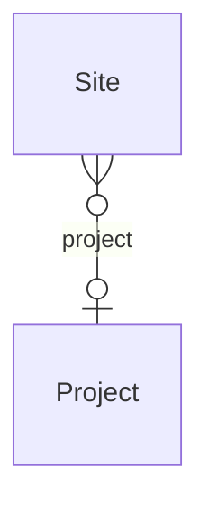

# Bridge – Intranet ↔ Work Management (`intranet-work` v1.0.0)

> Generated from [`schemas/bridges.yaml`](../../schemas/bridges.yaml) by `tools/schematool.py docs`. Do not edit by hand.

Registers each project's Teams/SharePoint workspace in the governed site directory.

| Kind | Depends on | Entities | Extended entities | Enums | Term sets |
|---|---|---|---|---|---|
| bridge | [`intranet`](intranet.md), [`work`](work.md) | 0 | 1 | 0 | 0 |

## Relationships

Lookups to Country, Currency, Employee, Language are left out of the diagram to keep it readable.

## Extensions to entities from other layers

### Site (+1)

Adds columns to [Site](intranet.md#site) from `intranet`.

| Column | Type | Req | Dataverse | SharePoint | SQL | Notes |
|---|---|:-:|---|---|---|---|
| `project` | lookup([Project](work.md#project)) |  | Lookup → Project | Lookup → Project | uniqueidentifier FK → Project |  |
