# Intranet (`intranet` v1.0.0)

> Generated from [`schemas/modules/intranet.yaml`](../../schemas/modules/intranet.yaml) by `tools/schematool.py docs`. Do not edit by hand.

Employee front door. Content types and lists for a SharePoint hub (news, announcements, events, policy library with attestation, knowledge base, quick links), a light service desk for IT/facilities/HR requests, peer recognition and a governed site directory. Audience targeting reuses core OrgUnit/Office (backed by Entra ID groups); the people directory reads core Employee and HR skills.

| Kind | Depends on | Entities | Extended entities | Enums | Term sets |
|---|---|---|---|---|---|
| module | [`core`](core.md) | 12 | 0 | 8 | 7 |

## Entities

| Entity | Description | Dataverse | SharePoint | Volume | Sensitivity |
|---|---|---|---|---|---|
| [Site](#site) | Governed register of SharePoint/Teams sites with owners and review dates — the basis for lifecycle and sharing governance. | custom | list | low | internal |
| [NewsArticle](#newsarticle) | News post. | custom | pages | medium | internal |
| [Announcement](#announcement) | Short time-boxed banner message (outage, office closure, deadline). | custom | list | low | internal |
| [CompanyEvent](#companyevent) | Internal or client-facing event with optional registration. | custom | list | low | internal |
| [EventRegistration](#eventregistration) | A person's registration for an event. | custom | list | medium | internal |
| [PolicyDocument](#policydocument) | Controlled policy or procedure. | custom | library | low | internal |
| [PolicyAttestation](#policyattestation) | Evidence that a person read and accepted a specific version of a policy. | custom | list ⚠ high volume | high | internal |
| [KnowledgeArticle](#knowledgearticle) | How-to, FAQ or process article. | custom | pages | medium | internal |
| [QuickLink](#quicklink) | Link in the intranet app launcher / mega menu. | custom | list | low | internal |
| [ServiceCategory](#servicecategory) | Catalogue entry for the service desk (IT, facilities, HR, finance requests). | custom | list | low | internal |
| [ServiceRequest](#servicerequest) | Employee request to an internal service team. | custom | list ⚠ high volume | high | internal |
| [Recognition](#recognition) | Peer-to-peer recognition ("kudos") tied to the firm's values. | custom | list | medium | internal |

## Relationships

Lookups to Country, Currency, Employee, Language are left out of the diagram to keep it readable.

```mermaid
erDiagram
    Site {
        string name
    }
    NewsArticle {
        string title
    }
    Announcement {
        string title
    }
    CompanyEvent {
        string title
    }
    EventRegistration {
        string name
    }
    PolicyDocument {
        string title
    }
    PolicyAttestation {
        string name
    }
    KnowledgeArticle {
        string title
    }
    QuickLink {
        string title
    }
    ServiceCategory {
        string name
    }
    ServiceRequest {
        string title
    }
    Recognition {
        string name
    }
    Site }o--o| Site : "hubSite"
    Site }o--o| OrgUnit : "orgUnit"
    Site }o--o| Account : "client"
    NewsArticle }o--o{ OrgUnit : "audienceOrgUnits"
    NewsArticle }o--o{ Office : "audienceOffices"
    NewsArticle }o--o| NewsArticle : "translationOf"
    NewsArticle }o--o| ApprovalRequest : "approvalRequest"
    Announcement }o--o{ OrgUnit : "audienceOrgUnits"
    Announcement }o--o{ Office : "audienceOffices"
    CompanyEvent }o--o| Office : "office"
    CompanyEvent }o--o{ OrgUnit : "audienceOrgUnits"
    CompanyEvent }o--o{ Office : "audienceOffices"
    CompanyEvent ||--o{ EventRegistration : "event"
    PolicyDocument }o--o| OrgUnit : "orgUnit"
    PolicyDocument }o--o| LegalEntity : "legalEntity"
    PolicyDocument }o--o{ OrgUnit : "appliesToOrgUnits"
    PolicyDocument }o--o| PolicyDocument : "supersedes"
    PolicyDocument }o--o| ApprovalRequest : "approvalRequest"
    PolicyAttestation }o--|| PolicyDocument : "policy"
    KnowledgeArticle }o--o{ OrgUnit : "audienceOrgUnits"
    QuickLink }o--o{ OrgUnit : "audienceOrgUnits"
    QuickLink }o--o{ Office : "audienceOffices"
    ServiceCategory }o--o| ServiceCategory : "parentCategory"
    ServiceCategory }o--o| OrgUnit : "owningOrgUnit"
    ServiceRequest }o--|| ServiceCategory : "category"
    ServiceRequest }o--o| Office : "office"
    ServiceRequest }o--o| ApprovalRequest : "approvalRequest"
```

### Site

Governed register of SharePoint/Teams sites with owners and review dates — the basis for lifecycle and sharing governance.

- **Display name:** Site / Sites
- **Ownership:** organization · **Volume:** low · **Sensitivity:** internal
- **Dataverse:** custom table `pfx_site` · **SharePoint:** list · **SQL:** table
- **Primary column:** `name`
- **Alternate keys:** (`url`)
- **Standard columns from traits:** `base` (id, createdOn, createdBy, modifiedOn, modifiedBy, stateCode, statusReason, rowVersion), `classified` (sensitivity, retentionLabel)
- **Extended by:** [`intranet-work`](intranet-work.md#site-1)

| Column | Type | Req | Dataverse | SharePoint | SQL | Notes |
|---|---|:-:|---|---|---|---|
| `name` | string(200) | ✔ | Text (200) | Title (primary column) | nvarchar(200) |  |
| `url` | url | ✔ | Text (URL) | Hyperlink | nvarchar(2000) | _unique_ |
| `siteType` | choice([SiteType](#sitetype)) | ✔ | Choice (global: SiteType) | Choice | int |  |
| `hubSite` | lookup([Site](#site)) |  | Lookup → Site | Lookup → Site | uniqueidentifier FK → Site |  |
| `primaryOwner` | lookup([Employee](core.md#employee)) | ✔ | Lookup → Employee | Person | uniqueidentifier FK → Employee |  |
| `secondaryOwner` | lookup([Employee](core.md#employee)) |  | Lookup → Employee | Person | uniqueidentifier FK → Employee | Every site needs two owners. |
| `orgUnit` | lookup([OrgUnit](core.md#orgunit)) |  | Lookup → OrgUnit | Lookup → OrgUnit | uniqueidentifier FK → OrgUnit |  |
| `client` | lookup([Account](core.md#account)) |  | Lookup → Account | Lookup → Account | uniqueidentifier FK → Account | For client extranets. |
| `m365GroupId` | string(36) |  | Text (36) | Single line of text | nvarchar(36) |  |
| `teamsEnabled` | boolean |  | Yes/No | Yes/No | bit |  |
| `externalSharingEnabled` | boolean |  | Yes/No | Yes/No | bit |  |
| `lastReviewedOn` | date |  | Date only (behaviour: date only) | Date (date only) | date |  |
| `nextReviewDate` | date |  | Date only (behaviour: date only) | Date (date only) | date |  |
| `description` | text |  | Multiline text | Multiple lines (plain) | nvarchar(max) |  |

### NewsArticle

News post. In SharePoint it is a Site Page with the News content type and these columns.

- **Display name:** News Article / News Articles
- **Ownership:** user · **Volume:** medium · **Sensitivity:** internal
- **Dataverse:** custom table `pfx_newsarticle` · **SharePoint:** pages · **SQL:** table
- **Primary column:** `title`
- **Standard columns from traits:** `base` (id, createdOn, createdBy, modifiedOn, modifiedBy, stateCode, statusReason, rowVersion), `owned` (owner), `classified` (sensitivity, retentionLabel)

| Column | Type | Req | Dataverse | SharePoint | SQL | Notes |
|---|---|:-:|---|---|---|---|
| `title` | string(200) | ✔ | Text (200) | Title (primary column) | nvarchar(200) |  |
| `summary` | string(500) |  | Text (500) | Multiple lines (plain) | nvarchar(500) | Teaser; also used by Viva Connections and Copilot. |
| `body` | richtext | ✔ | Multiline text (rich text) | Multiple lines (enhanced rich text) | nvarchar(max) |  |
| `bannerImage` | image |  | Image | Image | nvarchar(2000) (blob URL) |  |
| `category` | term([NewsCategory](#newscategory)) | ✔ | Lookup → Term (set NewsCategory) | Managed metadata (NewsCategory) | uniqueidentifier FK → Term |  |
| `tags` | multiterm([Topic](#topic)) |  | N:N → Term (set Topic) | Managed metadata, multiple (Topic) | junction table → Term |  |
| `writtenBy` | lookup([Employee](core.md#employee)) | ✔ | Lookup → Employee | Person | uniqueidentifier FK → Employee |  |
| `status` | choice([ContentStatus](#contentstatus)) | ✔ | Choice (global: ContentStatus) | Choice | int | _default `draft`_ |
| `publishedOn` | datetime |  | Date and time (user local) | Date and time | datetime2 (UTC) |  |
| `expiresOn` | datetime |  | Date and time (user local) | Date and time | datetime2 (UTC) |  |
| `isFeatured` | boolean |  | Yes/No | Yes/No | bit |  |
| `audienceOrgUnits` | multilookup([OrgUnit](core.md#orgunit)) |  | N:N → OrgUnit | Lookup (multiple) → OrgUnit | junction table → OrgUnit | Empty means everyone. |
| `audienceOffices` | multilookup([Office](core.md#office)) |  | N:N → Office | Lookup (multiple) → Office | junction table → Office |  |
| `language` | lookup([Language](core.md#language)) |  | Lookup → Language | Lookup → Language | uniqueidentifier FK → Language |  |
| `translationOf` | lookup([NewsArticle](#newsarticle)) |  | Lookup → NewsArticle | Lookup → NewsArticle | uniqueidentifier FK → NewsArticle |  |
| `approvalRequest` | lookup([ApprovalRequest](core.md#approvalrequest)) |  | Lookup → ApprovalRequest | Lookup → ApprovalRequest | uniqueidentifier FK → ApprovalRequest |  |
| `pageUrl` | url |  | Text (URL) | Hyperlink | nvarchar(2000) |  |
| `viewCount` | integer |  | Whole number | Number (0 dp) | int | _read-only_ |

> On SharePoint, targeting uses the Entra ID groups behind OrgUnit/Office (audience targeting); multilingual uses SharePoint multilingual pages.

### Announcement

Short time-boxed banner message (outage, office closure, deadline).

- **Display name:** Announcement / Announcements
- **Ownership:** organization · **Volume:** low · **Sensitivity:** internal
- **Dataverse:** custom table `pfx_announcement` · **SharePoint:** list · **SQL:** table
- **Primary column:** `title`
- **Standard columns from traits:** `base` (id, createdOn, createdBy, modifiedOn, modifiedBy, stateCode, statusReason, rowVersion)

| Column | Type | Req | Dataverse | SharePoint | SQL | Notes |
|---|---|:-:|---|---|---|---|
| `title` | string(200) | ✔ | Text (200) | Title (primary column) | nvarchar(200) |  |
| `message` | text | ✔ | Multiline text | Multiple lines (plain) | nvarchar(max) |  |
| `severity` | choice([AnnouncementSeverity](#announcementseverity)) | ✔ | Choice (global: AnnouncementSeverity) | Choice | int | _default `info`_ |
| `startOn` | datetime | ✔ | Date and time (user local) | Date and time | datetime2 (UTC) |  |
| `endOn` | datetime | ✔ | Date and time (user local) | Date and time | datetime2 (UTC) |  |
| `linkUrl` | url |  | Text (URL) | Hyperlink | nvarchar(2000) |  |
| `isDismissible` | boolean |  | Yes/No | Yes/No | bit | _default `True`_ |
| `audienceOrgUnits` | multilookup([OrgUnit](core.md#orgunit)) |  | N:N → OrgUnit | Lookup (multiple) → OrgUnit | junction table → OrgUnit |  |
| `audienceOffices` | multilookup([Office](core.md#office)) |  | N:N → Office | Lookup (multiple) → Office | junction table → Office |  |

### CompanyEvent

Internal or client-facing event with optional registration.

- **Display name:** Company Event / Company Events
- **Ownership:** user · **Volume:** low · **Sensitivity:** internal
- **Dataverse:** custom table `pfx_companyevent` · **SharePoint:** list · **SQL:** table
- **Primary column:** `title`
- **Standard columns from traits:** `base` (id, createdOn, createdBy, modifiedOn, modifiedBy, stateCode, statusReason, rowVersion), `owned` (owner)
- **Extended by:** [`hr-intranet`](hr-intranet.md#companyevent-1)

| Column | Type | Req | Dataverse | SharePoint | SQL | Notes |
|---|---|:-:|---|---|---|---|
| `title` | string(200) | ✔ | Text (200) | Title (primary column) | nvarchar(200) |  |
| `description` | richtext |  | Multiline text (rich text) | Multiple lines (enhanced rich text) | nvarchar(max) |  |
| `eventType` | term([EventType](#eventtype)) |  | Lookup → Term (set EventType) | Managed metadata (EventType) | uniqueidentifier FK → Term |  |
| `startOn` | datetime | ✔ | Date and time (user local) | Date and time | datetime2 (UTC) |  |
| `endOn` | datetime | ✔ | Date and time (user local) | Date and time | datetime2 (UTC) |  |
| `isAllDay` | boolean |  | Yes/No | Yes/No | bit |  |
| `timeZone` | string(64) |  | Text (64) | Single line of text | nvarchar(64) |  |
| `office` | lookup([Office](core.md#office)) |  | Lookup → Office | Lookup → Office | uniqueidentifier FK → Office |  |
| `venue` | string(200) |  | Text (200) | Single line of text | nvarchar(200) |  |
| `onlineMeetingUrl` | url |  | Text (URL) | Hyperlink | nvarchar(2000) |  |
| `organizer` | lookup([Employee](core.md#employee)) | ✔ | Lookup → Employee | Person | uniqueidentifier FK → Employee |  |
| `capacity` | integer |  | Whole number | Number (0 dp) | int |  |
| `registrationRequired` | boolean |  | Yes/No | Yes/No | bit |  |
| `registrationDeadline` | datetime |  | Date and time (user local) | Date and time | datetime2 (UTC) |  |
| `cpdHours` | decimal(5,2) |  | Decimal (5,2) | Number (2 dp) | decimal(5,2) | CPD/CLE/CPE hours attendees can claim. |
| `status` | choice([ContentStatus](#contentstatus)) | ✔ | Choice (global: ContentStatus) | Choice | int | _default `draft`_ |
| `bannerImage` | image |  | Image | Image | nvarchar(2000) (blob URL) |  |
| `audienceOrgUnits` | multilookup([OrgUnit](core.md#orgunit)) |  | N:N → OrgUnit | Lookup (multiple) → OrgUnit | junction table → OrgUnit |  |
| `audienceOffices` | multilookup([Office](core.md#office)) |  | N:N → Office | Lookup (multiple) → Office | junction table → Office |  |

### EventRegistration

A person's registration for an event.

- **Display name:** Event Registration / Event Registrations
- **Ownership:** user · **Volume:** medium · **Sensitivity:** internal
- **Dataverse:** custom table `pfx_eventregistration` · **SharePoint:** list · **SQL:** table
- **Primary column:** `name` (auto-generated)
- **Alternate keys:** (`event`, `attendee`)
- **Standard columns from traits:** `base` (id, createdOn, createdBy, modifiedOn, modifiedBy, stateCode, statusReason, rowVersion), `owned` (owner)

| Column | Type | Req | Dataverse | SharePoint | SQL | Notes |
|---|---|:-:|---|---|---|---|
| `name` | string(200) | ✔ | Text (200) | Title (primary column) | nvarchar(200) | Display label generated automatically (flow, plug-in or trigger). Required by Dataverse (primary name) and SharePoint (Title). _read-only_ |
| `event` | parent([CompanyEvent](#companyevent)) | ✔ | Lookup → CompanyEvent (parental) | Lookup → CompanyEvent (cascade delete) | uniqueidentifier FK → CompanyEvent (cascade) |  |
| `attendee` | lookup([Employee](core.md#employee)) | ✔ | Lookup → Employee | Person | uniqueidentifier FK → Employee |  |
| `status` | choice([EventRegistrationStatus](#eventregistrationstatus)) | ✔ | Choice (global: EventRegistrationStatus) | Choice | int | _default `registered`_ |
| `registeredOn` | datetime | ✔ | Date and time (user local) | Date and time | datetime2 (UTC) |  |
| `checkedInOn` | datetime |  | Date and time (user local) | Date and time | datetime2 (UTC) |  |
| `dietaryRequirements` | string(200) |  | Text (200) | Single line of text | nvarchar(200) | _PII_ |

### PolicyDocument

Controlled policy or procedure. The file lives in a SharePoint library with major/minor versioning and a retention label; these are its metadata columns.

- **Display name:** Policy Document / Policy Documents
- **Ownership:** organization · **Volume:** low · **Sensitivity:** internal
- **Dataverse:** custom table `pfx_policydocument` · **SharePoint:** library · **SQL:** table
- **Primary column:** `title`
- **Alternate keys:** (`documentNumber`)
- **Standard columns from traits:** `base` (id, createdOn, createdBy, modifiedOn, modifiedBy, stateCode, statusReason, rowVersion), `classified` (sensitivity, retentionLabel)
- **Extended by:** [`hr-intranet`](hr-intranet.md#policydocument-1)

| Column | Type | Req | Dataverse | SharePoint | SQL | Notes |
|---|---|:-:|---|---|---|---|
| `title` | string(250) | ✔ | Text (250) | Title (primary column) | nvarchar(250) |  |
| `documentNumber` | string(30) | ✔ | Text (30) | Single line of text | nvarchar(30) | e.g. POL-HR-012. _unique_ |
| `category` | term([PolicyCategory](#policycategory)) | ✔ | Lookup → Term (set PolicyCategory) | Managed metadata (PolicyCategory) | uniqueidentifier FK → Term |  |
| `policyOwner` | lookup([Employee](core.md#employee)) | ✔ | Lookup → Employee | Person | uniqueidentifier FK → Employee |  |
| `approver` | lookup([Employee](core.md#employee)) |  | Lookup → Employee | Person | uniqueidentifier FK → Employee |  |
| `orgUnit` | lookup([OrgUnit](core.md#orgunit)) |  | Lookup → OrgUnit | Lookup → OrgUnit | uniqueidentifier FK → OrgUnit |  |
| `legalEntity` | lookup([LegalEntity](core.md#legalentity)) |  | Lookup → LegalEntity | Lookup → LegalEntity | uniqueidentifier FK → LegalEntity |  |
| `versionLabel` | string(20) | ✔ | Text (20) | Single line of text | nvarchar(20) |  |
| `status` | choice([ContentStatus](#contentstatus)) | ✔ | Choice (global: ContentStatus) | Choice | int | _default `draft`_ |
| `effectiveDate` | date | ✔ | Date only (behaviour: date only) | Date (date only) | date |  |
| `nextReviewDate` | date | ✔ | Date only (behaviour: date only) | Date (date only) | date |  |
| `summary` | text |  | Multiline text | Multiple lines (plain) | nvarchar(max) |  |
| `requiresAttestation` | boolean |  | Yes/No | Yes/No | bit |  |
| `attestationDueDays` | integer |  | Whole number | Number (0 dp) | int |  |
| `appliesToOrgUnits` | multilookup([OrgUnit](core.md#orgunit)) |  | N:N → OrgUnit | Lookup (multiple) → OrgUnit | junction table → OrgUnit | Empty means everyone. |
| `supersedes` | lookup([PolicyDocument](#policydocument)) |  | Lookup → PolicyDocument | Lookup → PolicyDocument | uniqueidentifier FK → PolicyDocument |  |
| `approvalRequest` | lookup([ApprovalRequest](core.md#approvalrequest)) |  | Lookup → ApprovalRequest | Lookup → ApprovalRequest | uniqueidentifier FK → ApprovalRequest |  |
| `documentUrl` | url |  | Text (URL) | Hyperlink | nvarchar(2000) |  |

### PolicyAttestation

Evidence that a person read and accepted a specific version of a policy. User-owned, like EventRegistration, because the row is one person's response to something: organization ownership makes "my attestations" inexpressible, so every role asking for own-row access gets the whole firm's instead — which is how every member of staff came to be able to read every colleague's compliance status.

- **Display name:** Policy Attestation / Policy Attestations
- **Ownership:** user · **Volume:** high · **Sensitivity:** internal
- **Dataverse:** custom table `pfx_policyattestation` · **SharePoint:** list ⚠ high volume · **SQL:** table
- **Primary column:** `name` (auto-generated)
- **Alternate keys:** (`policy`, `employee`, `policyVersion`)
- **Standard columns from traits:** `base` (id, createdOn, createdBy, modifiedOn, modifiedBy, stateCode, statusReason, rowVersion), `owned` (owner)

| Column | Type | Req | Dataverse | SharePoint | SQL | Notes |
|---|---|:-:|---|---|---|---|
| `name` | string(200) | ✔ | Text (200) | Title (primary column) | nvarchar(200) | Display label generated automatically (flow, plug-in or trigger). Required by Dataverse (primary name) and SharePoint (Title). _read-only_ |
| `policy` | lookup([PolicyDocument](#policydocument)) | ✔ | Lookup → PolicyDocument | Lookup → PolicyDocument | uniqueidentifier FK → PolicyDocument |  |
| `employee` | lookup([Employee](core.md#employee)) | ✔ | Lookup → Employee | Person | uniqueidentifier FK → Employee |  |
| `policyVersion` | string(20) | ✔ | Text (20) | Single line of text | nvarchar(20) |  |
| `status` | choice([AttestationStatus](#attestationstatus)) | ✔ | Choice (global: AttestationStatus) | Choice | int | _default `pending`_ |
| `dueDate` | date |  | Date only (behaviour: date only) | Date (date only) | date |  |
| `attestedOn` | datetime |  | Date and time (user local) | Date and time | datetime2 (UTC) |  |
| `method` | choice([AttestationMethod](#attestationmethod)) |  | Choice (global: AttestationMethod) | Choice | int |  |

> Append-only evidence. A new policy version creates new pending rows; old rows are never edited.

### KnowledgeArticle

How-to, FAQ or process article. A Site Page in SharePoint.

- **Display name:** Knowledge Article / Knowledge Articles
- **Ownership:** user · **Volume:** medium · **Sensitivity:** internal
- **Dataverse:** custom table `pfx_knowledgearticle` · **SharePoint:** pages · **SQL:** table
- **Primary column:** `title`
- **Standard columns from traits:** `base` (id, createdOn, createdBy, modifiedOn, modifiedBy, stateCode, statusReason, rowVersion), `owned` (owner)

| Column | Type | Req | Dataverse | SharePoint | SQL | Notes |
|---|---|:-:|---|---|---|---|
| `title` | string(200) | ✔ | Text (200) | Title (primary column) | nvarchar(200) |  |
| `summary` | string(500) |  | Text (500) | Multiple lines (plain) | nvarchar(500) |  |
| `body` | richtext | ✔ | Multiline text (rich text) | Multiple lines (enhanced rich text) | nvarchar(max) |  |
| `category` | term([KnowledgeCategory](#knowledgecategory)) | ✔ | Lookup → Term (set KnowledgeCategory) | Managed metadata (KnowledgeCategory) | uniqueidentifier FK → Term |  |
| `tags` | multiterm([Topic](#topic)) |  | N:N → Term (set Topic) | Managed metadata, multiple (Topic) | junction table → Term |  |
| `articleOwner` | lookup([Employee](core.md#employee)) | ✔ | Lookup → Employee | Person | uniqueidentifier FK → Employee |  |
| `status` | choice([ContentStatus](#contentstatus)) | ✔ | Choice (global: ContentStatus) | Choice | int | _default `draft`_ |
| `publishedOn` | datetime |  | Date and time (user local) | Date and time | datetime2 (UTC) |  |
| `nextReviewDate` | date |  | Date only (behaviour: date only) | Date (date only) | date |  |
| `language` | lookup([Language](core.md#language)) |  | Lookup → Language | Lookup → Language | uniqueidentifier FK → Language |  |
| `audienceOrgUnits` | multilookup([OrgUnit](core.md#orgunit)) |  | N:N → OrgUnit | Lookup (multiple) → OrgUnit | junction table → OrgUnit |  |
| `helpfulYes` | integer |  | Whole number | Number (0 dp) | int | _read-only_ |
| `helpfulNo` | integer |  | Whole number | Number (0 dp) | int | _read-only_ |

### QuickLink

Link in the intranet app launcher / mega menu.

- **Display name:** Quick Link / Quick Links
- **Ownership:** organization · **Volume:** low · **Sensitivity:** internal
- **Dataverse:** custom table `pfx_quicklink` · **SharePoint:** list · **SQL:** table
- **Primary column:** `title`
- **Standard columns from traits:** `base` (id, createdOn, createdBy, modifiedOn, modifiedBy, stateCode, statusReason, rowVersion)

| Column | Type | Req | Dataverse | SharePoint | SQL | Notes |
|---|---|:-:|---|---|---|---|
| `title` | string(100) | ✔ | Text (100) | Title (primary column) | nvarchar(100) |  |
| `url` | url | ✔ | Text (URL) | Hyperlink | nvarchar(2000) |  |
| `description` | string(250) |  | Text (250) | Single line of text | nvarchar(250) |  |
| `icon` | string(50) |  | Text (50) | Single line of text | nvarchar(50) | Fluent UI icon name. |
| `category` | term([LinkCategory](#linkcategory)) |  | Lookup → Term (set LinkCategory) | Managed metadata (LinkCategory) | uniqueidentifier FK → Term |  |
| `sortOrder` | integer |  | Whole number | Number (0 dp) | int |  |
| `openInNewTab` | boolean |  | Yes/No | Yes/No | bit |  |
| `isPinned` | boolean |  | Yes/No | Yes/No | bit | Always shown; users cannot hide it. |
| `audienceOrgUnits` | multilookup([OrgUnit](core.md#orgunit)) |  | N:N → OrgUnit | Lookup (multiple) → OrgUnit | junction table → OrgUnit |  |
| `audienceOffices` | multilookup([Office](core.md#office)) |  | N:N → Office | Lookup (multiple) → Office | junction table → Office |  |

### ServiceCategory

Catalogue entry for the service desk (IT, facilities, HR, finance requests).

- **Display name:** Service Category / Service Categories
- **Ownership:** organization · **Volume:** low · **Sensitivity:** internal
- **Dataverse:** custom table `pfx_servicecategory` · **SharePoint:** list · **SQL:** table
- **Primary column:** `name`
- **Standard columns from traits:** `base` (id, createdOn, createdBy, modifiedOn, modifiedBy, stateCode, statusReason, rowVersion)

| Column | Type | Req | Dataverse | SharePoint | SQL | Notes |
|---|---|:-:|---|---|---|---|
| `name` | string(150) | ✔ | Text (150) | Title (primary column) | nvarchar(150) |  |
| `code` | string(30) | ✔ | Text (30) | Single line of text | nvarchar(30) | _unique_ |
| `parentCategory` | lookup([ServiceCategory](#servicecategory)) |  | Lookup → ServiceCategory | Lookup → ServiceCategory | uniqueidentifier FK → ServiceCategory |  |
| `owningOrgUnit` | lookup([OrgUnit](core.md#orgunit)) |  | Lookup → OrgUnit | Lookup → OrgUnit | uniqueidentifier FK → OrgUnit |  |
| `defaultAssignee` | lookup([Employee](core.md#employee)) |  | Lookup → Employee | Person | uniqueidentifier FK → Employee |  |
| `assignmentGroupId` | string(36) |  | Text (36) | Single line of text | nvarchar(36) | Entra ID group / queue that works these requests. |
| `targetResponseHours` | integer |  | Whole number | Number (0 dp) | int |  |
| `targetResolutionHours` | integer |  | Whole number | Number (0 dp) | int |  |
| `requiresApproval` | boolean |  | Yes/No | Yes/No | bit |  |
| `requestFormUrl` | url |  | Text (URL) | Hyperlink | nvarchar(2000) |  |
| `description` | text |  | Multiline text | Multiple lines (plain) | nvarchar(max) |  |

### ServiceRequest

Employee request to an internal service team.

- **Display name:** Service Request / Service Requests
- **Ownership:** user · **Volume:** high · **Sensitivity:** internal
- **Dataverse:** custom table `pfx_servicerequest` · **SharePoint:** list ⚠ high volume · **SQL:** table
- **Primary column:** `title`
- **Alternate keys:** (`requestNumber`)
- **Standard columns from traits:** `base` (id, createdOn, createdBy, modifiedOn, modifiedBy, stateCode, statusReason, rowVersion), `owned` (owner), `integration` (externalId, sourceSystem, lastSyncedOn)

| Column | Type | Req | Dataverse | SharePoint | SQL | Notes |
|---|---|:-:|---|---|---|---|
| `title` | string(200) | ✔ | Text (200) | Title (primary column) | nvarchar(200) |  |
| `requestNumber` | autonumber |  | Autonumber `SR-{SEQNUM:6}` | Single line of text (set by flow) | nvarchar(30) + sequence |  |
| `requester` | lookup([Employee](core.md#employee)) | ✔ | Lookup → Employee | Person | uniqueidentifier FK → Employee |  |
| `onBehalfOf` | lookup([Employee](core.md#employee)) |  | Lookup → Employee | Person | uniqueidentifier FK → Employee |  |
| `category` | lookup([ServiceCategory](#servicecategory)) | ✔ | Lookup → ServiceCategory | Lookup → ServiceCategory | uniqueidentifier FK → ServiceCategory |  |
| `description` | text | ✔ | Multiline text | Multiple lines (plain) | nvarchar(max) |  |
| `priority` | choice([Priority](core.md#priority)) | ✔ | Choice (global: Priority) | Choice | int | _default `medium`_ |
| `status` | choice([ServiceRequestStatus](#servicerequeststatus)) | ✔ | Choice (global: ServiceRequestStatus) | Choice | int | _default `new`_ |
| `channel` | choice([RequestChannel](#requestchannel)) |  | Choice (global: RequestChannel) | Choice | int | _default `portal`_ |
| `assignedTo` | lookup([Employee](core.md#employee)) |  | Lookup → Employee | Person | uniqueidentifier FK → Employee |  |
| `office` | lookup([Office](core.md#office)) |  | Lookup → Office | Lookup → Office | uniqueidentifier FK → Office |  |
| `raisedOn` | datetime | ✔ | Date and time (user local) | Date and time | datetime2 (UTC) | When the requester raised it, which is not when the row was created. A ticket that arrives by email or phone is typed in by an agent, sometimes the next morning, so measuring a response target from createdOn measures the agent's typing rather than the firm's responsiveness. Every SLA measure starts here. |
| `dueOn` | datetime |  | Date and time (user local) | Date and time | datetime2 (UTC) | When the response target expires: raisedOn plus the category's targetResponseHours. |
| `firstRespondedOn` | datetime |  | Date and time (user local) | Date and time | datetime2 (UTC) |  |
| `resolvedOn` | datetime |  | Date and time (user local) | Date and time | datetime2 (UTC) |  |
| `resolution` | text |  | Multiline text | Multiple lines (plain) | nvarchar(max) |  |
| `satisfactionScore` | integer |  | Whole number | Number (0 dp) | int |  |
| `approvalRequest` | lookup([ApprovalRequest](core.md#approvalrequest)) |  | Lookup → ApprovalRequest | Lookup → ApprovalRequest | uniqueidentifier FK → ApprovalRequest |  |

### Recognition

Peer-to-peer recognition ("kudos") tied to the firm's values.

- **Display name:** Recognition / Recognitions
- **Ownership:** user · **Volume:** medium · **Sensitivity:** internal
- **Dataverse:** custom table `pfx_recognition` · **SharePoint:** list · **SQL:** table
- **Primary column:** `name` (auto-generated)
- **Standard columns from traits:** `base` (id, createdOn, createdBy, modifiedOn, modifiedBy, stateCode, statusReason, rowVersion), `owned` (owner)

| Column | Type | Req | Dataverse | SharePoint | SQL | Notes |
|---|---|:-:|---|---|---|---|
| `name` | string(200) | ✔ | Text (200) | Title (primary column) | nvarchar(200) | Display label generated automatically (flow, plug-in or trigger). Required by Dataverse (primary name) and SharePoint (Title). _read-only_ |
| `givenBy` | lookup([Employee](core.md#employee)) | ✔ | Lookup → Employee | Person | uniqueidentifier FK → Employee |  |
| `recipients` | multilookup([Employee](core.md#employee)) | ✔ | N:N → Employee | Person (multiple) | junction table → Employee |  |
| `message` | text | ✔ | Multiline text | Multiple lines (plain) | nvarchar(max) |  |
| `companyValue` | term([CompanyValue](#companyvalue)) |  | Lookup → Term (set CompanyValue) | Managed metadata (CompanyValue) | uniqueidentifier FK → Term |  |
| `postedOn` | datetime | ✔ | Date and time (user local) | Date and time | datetime2 (UTC) |  |
| `isPublic` | boolean |  | Yes/No | Yes/No | bit | _default `True`_ |

## Choices (enums)

Codes are stable forever. Dataverse option value = publisher choice prefix + code.

### ContentStatus

Publishing lifecycle of intranet content and policies.

| Code | Key | Label |
|--:|---|---|
| 1 | `draft` | Draft |
| 2 | `inReview` | In Review |
| 3 | `scheduled` | Scheduled |
| 4 | `published` | Published |
| 5 | `archived` | Archived / retired |

### AnnouncementSeverity

Visual weight of an announcement banner.

| Code | Key | Label |
|--:|---|---|
| 1 | `info` | Info |
| 2 | `success` | Success |
| 3 | `warning` | Warning |
| 4 | `critical` | Critical |

### SiteType

Kind of SharePoint/Teams site in the directory.

| Code | Key | Label |
|--:|---|---|
| 1 | `hub` | Hub |
| 2 | `communication` | Communication |
| 3 | `team` | Team |
| 4 | `project` | Project |
| 5 | `clientExtranet` | Client Extranet |
| 6 | `community` | Community |

### EventRegistrationStatus

Registration state for an event.

| Code | Key | Label |
|--:|---|---|
| 1 | `registered` | Registered |
| 2 | `waitlisted` | Waitlisted |
| 3 | `cancelled` | Cancelled |
| 4 | `attended` | Attended |
| 5 | `noShow` | No Show |

### AttestationStatus

Whether a person has confirmed they read a policy.

| Code | Key | Label |
|--:|---|---|
| 1 | `pending` | Pending |
| 2 | `completed` | Completed |
| 3 | `overdue` | Overdue |
| 4 | `exempt` | Exempt |

### AttestationMethod

How the attestation was captured.

| Code | Key | Label |
|--:|---|---|
| 1 | `clickThrough` | Click Through |
| 2 | `eSignature` | ESignature |
| 3 | `trainingCompletion` | Training Completion |

### ServiceRequestStatus

Lifecycle of a service request.

| Code | Key | Label |
|--:|---|---|
| 1 | `new` | New |
| 2 | `assigned` | Assigned |
| 3 | `inProgress` | In Progress |
| 4 | `waitingOnRequester` | Waiting On Requester |
| 5 | `resolved` | Resolved |
| 6 | `closed` | Closed |
| 7 | `cancelled` | Cancelled |

### RequestChannel

Where a service request came from.

| Code | Key | Label |
|--:|---|---|
| 1 | `portal` | Portal |
| 2 | `email` | Email |
| 3 | `teams` | Teams |
| 4 | `phone` | Phone |
| 5 | `walkUp` | Walk Up |
| 6 | `virtualAgent` | Virtual agent / Copilot |

## Term sets

Stored in the SharePoint term store; mirrored to the Term table on Dataverse/SQL.

### NewsCategory

Category of news posts.

- Firm news
- Client wins
- People
- Events
- Industry insights
- Office updates
- Wellbeing
- Inclusion & belonging
- Awards & recognition

### Topic

Shared topic tags for news and knowledge. _(open)_

### PolicyCategory

Category of firm policies.

- HR
- IT & information security
- Finance & expenses
- Health & safety
- Risk & compliance
- Data protection
- Code of conduct
- Quality management

### KnowledgeCategory

Category of knowledge articles.

- How-to
- IT help
- HR FAQ
- Templates
- Processes
- Tools

### LinkCategory

Grouping of quick links in the app launcher.

- Apps
- HR
- Finance
- IT
- Knowledge
- External

### EventType

Kind of internal event.

- Town hall
- Training session
- Social
- Client event
- Webinar
- Conference
- Wellbeing
- Volunteering

### CompanyValue

The firm's values, used to tag recognition. Replace with the client's own values.

- Integrity
- Collaboration
- Excellence
- Innovation
- Respect

## Reference data (seed)

Loaded at deployment. Deactivate rows you do not need instead of deleting them.

### ServiceCategory (8 rows)

| code | name | targetResponseHours | targetResolutionHours | requiresApproval |
|---|---|---|---|---|
| IT_HARDWARE | IT – hardware | 4 | 40 |  |
| IT_ACCESS | IT – software & access | 4 | 16 | yes |
| IT_ACCOUNT | IT – account & password | 1 | 4 |  |
| FAC_MAINT | Facilities – maintenance | 8 | 40 |  |
| FAC_SPACE | Facilities – desks & rooms | 8 | 24 |  |
| HR_DOCS | HR – letters & documents | 8 | 40 |  |
| FIN_PAY | Finance – payments & expenses | 8 | 40 |  |
| COMMS | Communications – intranet content | 8 | 40 |  |
