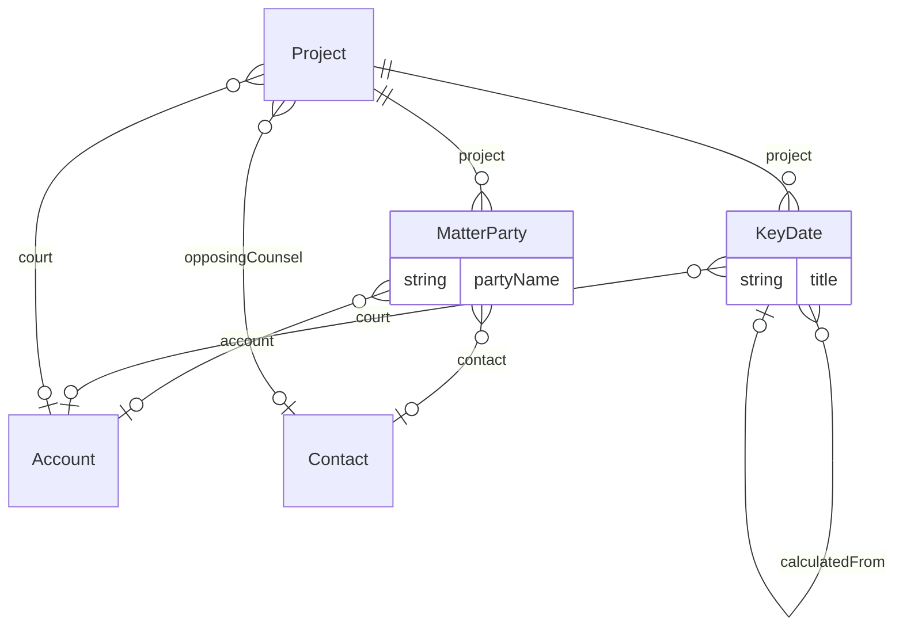

# Legal – Matter management overlay (`legal-work` v1.0.0)

> Generated from [`schemas/industries/legal.yaml`](../../schemas/industries/legal.yaml) by `tools/schematool.py docs`. Do not edit by hand.

Turns Work Management into matter management: matter terminology, lawyer roles, court and limitation data, matter parties, docketing of key dates, and UTBMS task/activity codes.

| Kind | Depends on | Entities | Extended entities | Enums | Term sets |
|---|---|---|---|---|---|
| industry | [`work`](work.md), [`proserv-compliance`](proserv-compliance.md) | 2 | 1 | 2 | 1 |

## Terminology

Display names this layer applies on top of the generic model.

| Generic name | Shown as |
|---|---|
| `Project` | Matter / Matters |
| `ProjectType` | Matter Type / Matter Types |
| `ProjectPhase` | Matter Stage / Matter Stages |
| `ProjectMember` | Matter Team Member / Matter Team |
| `ProjectRole` | Matter Role / Matter Roles |
| `Project.projectNumber` | Matter Number |
| `Project.projectManager` | Responsible Lawyer |
| `Project.sponsor` | Supervising Partner |
| `Project.client` | Client |

## Entities

| Entity | Description | Dataverse | SharePoint | Volume | Sensitivity |
|---|---|---|---|---|---|
| [MatterParty](#matterparty) | Party to a matter (client, adverse party, related party, counsel, court). | custom | list | medium | confidential |
| [KeyDate](#keydate) | Docketed court or transaction date with responsible lawyer and reminders. | custom | list | medium | internal |

## Relationships

Lookups to Country, Currency, Employee, Language are left out of the diagram to keep it readable.

### MatterParty

Party to a matter (client, adverse party, related party, counsel, court). Feeds future conflict searches.

- **Display name:** Matter Party / Matter Parties
- **Ownership:** user · **Volume:** medium · **Sensitivity:** confidential
- **Dataverse:** custom table `pfx_matterparty` · **SharePoint:** list · **SQL:** table
- **Primary column:** `partyName`
- **Standard columns from traits:** `base` (id, createdOn, createdBy, modifiedOn, modifiedBy, stateCode, statusReason, rowVersion), `owned` (owner)

| Column | Type | Req | Dataverse | SharePoint | SQL | Notes |
|---|---|:-:|---|---|---|---|
| `project` | parent([Project](work.md#project)) | ✔ | Lookup → Project (parental) | Lookup → Project (cascade delete) | uniqueidentifier FK → Project (cascade) |  |
| `partyName` | string(200) | ✔ | Text (200) | Title (primary column) | nvarchar(200) |  |
| `role` | choice([PartyRole](proserv-compliance.md#partyrole)) | ✔ | Choice (global: PartyRole) | Choice | int |  |
| `account` | lookup([Account](core.md#account)) |  | Lookup → Account | Lookup → Account | uniqueidentifier FK → Account |  |
| `contact` | lookup([Contact](core.md#contact)) |  | Lookup → Contact | Lookup → Contact | uniqueidentifier FK → Contact |  |
| `notes` | text |  | Multiline text | Multiple lines (plain) | nvarchar(max) |  |

### KeyDate

Docketed court or transaction date with responsible lawyer and reminders.

- **Display name:** Key Date / Key Dates
- **Ownership:** user · **Volume:** medium · **Sensitivity:** internal
- **Dataverse:** custom table `pfx_keydate` · **SharePoint:** list · **SQL:** table
- **Primary column:** `title`
- **Standard columns from traits:** `base` (id, createdOn, createdBy, modifiedOn, modifiedBy, stateCode, statusReason, rowVersion), `owned` (owner)

| Column | Type | Req | Dataverse | SharePoint | SQL | Notes |
|---|---|:-:|---|---|---|---|
| `project` | parent([Project](work.md#project)) | ✔ | Lookup → Project (parental) | Lookup → Project (cascade delete) | uniqueidentifier FK → Project (cascade) |  |
| `title` | string(200) | ✔ | Text (200) | Title (primary column) | nvarchar(200) |  |
| `dateType` | term([KeyDateType](#keydatetype)) | ✔ | Lookup → Term (set KeyDateType) | Managed metadata (KeyDateType) | uniqueidentifier FK → Term |  |
| `dueOn` | datetime | ✔ | Date and time (user local) | Date and time | datetime2 (UTC) |  |
| `isCritical` | boolean |  | Yes/No | Yes/No | bit | Missing it creates malpractice risk; escalate reminders. |
| `court` | lookup([Account](core.md#account)) |  | Lookup → Account | Lookup → Account | uniqueidentifier FK → Account |  |
| `responsible` | lookup([Employee](core.md#employee)) | ✔ | Lookup → Employee | Person | uniqueidentifier FK → Employee |  |
| `backupResponsible` | lookup([Employee](core.md#employee)) |  | Lookup → Employee | Person | uniqueidentifier FK → Employee |  |
| `reminderDaysBefore` | integer |  | Whole number | Number (0 dp) | int |  |
| `status` | choice([KeyDateStatus](#keydatestatus)) | ✔ | Choice (global: KeyDateStatus) | Choice | int | _default `upcoming`_ |
| `completedOn` | datetime |  | Date and time (user local) | Date and time | datetime2 (UTC) |  |
| `ruleReference` | string(200) |  | Text (200) | Single line of text | nvarchar(200) | Court rule used to calculate the date. |
| `calculatedFrom` | lookup([KeyDate](#keydate)) |  | Lookup → KeyDate | Lookup → KeyDate | uniqueidentifier FK → KeyDate | Triggering date this one was calculated from. |
| `notes` | text |  | Multiline text | Multiple lines (plain) | nvarchar(max) |  |

## Extensions to entities from other layers

### Project (+13)

Adds columns to [Project](work.md#project) from `work`.

| Column | Type | Req | Dataverse | SharePoint | SQL | Notes |
|---|---|:-:|---|---|---|---|
| `originatingLawyer` | lookup([Employee](core.md#employee)) |  | Lookup → Employee | Person | uniqueidentifier FK → Employee | Origination credit. |
| `billingPartner` | lookup([Employee](core.md#employee)) |  | Lookup → Employee | Person | uniqueidentifier FK → Employee |  |
| `clientMatterReference` | string(100) |  | Text (100) | Single line of text | nvarchar(100) | The client's own reference or PO number. |
| `court` | lookup([Account](core.md#account)) |  | Lookup → Account | Lookup → Account | uniqueidentifier FK → Account |  |
| `jurisdiction` | string(150) |  | Text (150) | Single line of text | nvarchar(150) |  |
| `caseNumber` | string(100) |  | Text (100) | Single line of text | nvarchar(100) |  |
| `opposingCounsel` | lookup([Contact](core.md#contact)) |  | Lookup → Contact | Lookup → Contact | uniqueidentifier FK → Contact |  |
| `limitationDate` | date |  | Date only (behaviour: date only) | Date (date only) | date | Critical date; also docketed as a KeyDate. |
| `amountInDispute` | money |  | Currency | Currency | decimal(19,4) |  |
| `retainerAmount` | money |  | Currency | Currency | decimal(19,4) |  |
| `isProBono` | boolean |  | Yes/No | Yes/No | bit |  |
| `eBillingRequired` | boolean |  | Yes/No | Yes/No | bit | Client requires LEDES e-billing. |
| `outcome` | choice([MatterOutcome](#matteroutcome)) |  | Choice (global: MatterOutcome) | Choice | int |  |

## Choices (enums)

Codes are stable forever. Dataverse option value = publisher choice prefix + code.

### MatterOutcome

How a matter ended.

| Code | Key | Label |
|--:|---|---|
| 1 | `transactionCompleted` | Transaction Completed |
| 2 | `settled` | Settled |
| 3 | `judgmentInFavour` | Judgment In Favour |
| 4 | `judgmentAgainst` | Judgment Against |
| 5 | `discontinued` | Discontinued |
| 6 | `adviceDelivered` | Advice Delivered |
| 99 | `other` | Other |

### KeyDateStatus

State of a docketed date.

| Code | Key | Label |
|--:|---|---|
| 1 | `upcoming` | Upcoming |
| 2 | `completed` | Completed |
| 3 | `missed` | Missed |
| 4 | `vacated` | Vacated / cancelled |

## Term sets

Stored in the SharePoint term store; mirrored to the Term table on Dataverse/SQL.

### KeyDateType

Kind of docketed date.

- Hearing
- Filing deadline
- Limitation date
- Trial
- Mediation
- Deposition
- Disclosure deadline
- Completion / closing
- IP renewal
- Internal deadline

## Reference data (seed)

Loaded at deployment. Deactivate rows you do not need instead of deleting them.

### ProjectType (7 rows)

| code | name | defaultBillingModel | requiresClient | isInternal | numberPrefix |
|---|---|---|---|---|---|
| LEG_LITIGATION | Litigation | timeAndMaterials | yes | no | M- |
| LEG_CORPORATE | Corporate / M&A | cappedFee | yes | no | M- |
| LEG_EMPLOYMENT | Employment | timeAndMaterials | yes | no | M- |
| LEG_REALESTATE | Real estate | fixedFee | yes | no | M- |
| LEG_IP | Intellectual property | fixedFee | yes | no | M- |
| LEG_ADVISORY | General advisory | timeAndMaterials | yes | no | M- |
| LEG_PROBONO | Pro bono | nonBillable | yes | no | PB- |

### ProjectPhaseDefinition (13 rows)

| code | name | framework | projectType | sequence |
|---|---|---|---|---|
| LEG_LIT_ASSESS | Case assessment & strategy | Litigation | LEG_LITIGATION | 1 |
| LEG_LIT_PLEAD | Pleadings | Litigation | LEG_LITIGATION | 2 |
| LEG_LIT_DISCLOSE | Disclosure / discovery | Litigation | LEG_LITIGATION | 3 |
| LEG_LIT_EVIDENCE | Witness & expert evidence | Litigation | LEG_LITIGATION | 4 |
| LEG_LIT_PRETRIAL | Pre-trial | Litigation | LEG_LITIGATION | 5 |
| LEG_LIT_TRIAL | Trial | Litigation | LEG_LITIGATION | 6 |
| LEG_LIT_APPEAL | Post-trial & appeal | Litigation | LEG_LITIGATION | 7 |
| LEG_TX_INSTRUCT | Instruction & scoping | Transaction | LEG_CORPORATE | 1 |
| LEG_TX_DD | Due diligence | Transaction | LEG_CORPORATE | 2 |
| LEG_TX_DRAFT | Drafting & negotiation | Transaction | LEG_CORPORATE | 3 |
| LEG_TX_SIGN | Signing | Transaction | LEG_CORPORATE | 4 |
| LEG_TX_COMPLETE | Completion | Transaction | LEG_CORPORATE | 5 |
| LEG_TX_POST | Post-completion | Transaction | LEG_CORPORATE | 6 |

### ProjectRole (6 rows)

| code | name |
|---|---|
| LEG_PARTNER | Partner |
| LEG_COUNSEL | Counsel / Of counsel |
| LEG_SENIOR_ASSOC | Senior associate |
| LEG_ASSOCIATE | Associate |
| LEG_TRAINEE | Trainee / law clerk |
| LEG_PARALEGAL | Paralegal |

### WorkItemType (4 rows)

| code | name | category | allowsChildren |
|---|---|---|---|
| LEG_DRAFTING | Drafting | task | no |
| LEG_REVIEW | Document review | task | no |
| LEG_RESEARCH | Legal research | task | no |
| LEG_FILING | Court filing | deliverable | no |

### TimeCode (16 rows)

| code | name | codeSet | isBillableDefault |
|---|---|---|---|
| L100 | Case assessment, development and administration | UTBMS-Litigation-Task | yes |
| L200 | Pre-trial pleadings and motions | UTBMS-Litigation-Task | yes |
| L300 | Discovery | UTBMS-Litigation-Task | yes |
| L400 | Trial preparation and trial | UTBMS-Litigation-Task | yes |
| L500 | Appeal | UTBMS-Litigation-Task | yes |
| A101 | Plan and prepare for | UTBMS-Activity | yes |
| A102 | Research | UTBMS-Activity | yes |
| A103 | Draft/revise | UTBMS-Activity | yes |
| A104 | Review/analyze | UTBMS-Activity | yes |
| A105 | Communicate (in firm) | UTBMS-Activity | yes |
| A106 | Communicate (with client) | UTBMS-Activity | yes |
| A107 | Communicate (other outside counsel) | UTBMS-Activity | yes |
| A108 | Communicate (other external) | UTBMS-Activity | yes |
| A109 | Appear for/attend | UTBMS-Activity | yes |
| A110 | Manage data/files | UTBMS-Activity | yes |
| A111 | Other | UTBMS-Activity | yes |
