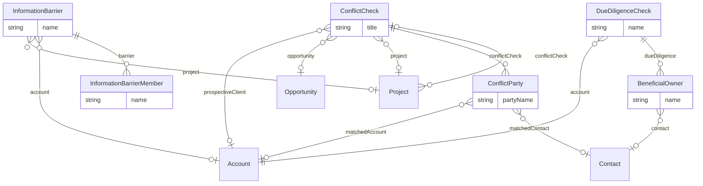

# Professional Services – Risk & Compliance (`proserv-compliance` v1.0.0)

> Generated from [`schemas/industries/professional-services.yaml`](../../schemas/industries/professional-services.yaml) by `tools/schematool.py docs`. Do not edit by hand.

Client and matter acceptance controls that law and accounting firms both need: conflict checks against existing clients and parties, information barriers (ethical walls), and client due diligence (KYC/AML) with beneficial owners and sanctions screening. Shared here so the legal and accounting overlays do not duplicate it.

| Kind | Depends on | Entities | Extended entities | Enums | Term sets |
|---|---|---|---|---|---|
| industry | [`crm`](crm.md), [`work`](work.md) | 6 | 2 | 8 | 0 |

## Entities

| Entity | Description | Dataverse | SharePoint | Volume | Sensitivity |
|---|---|---|---|---|---|
| [ConflictCheck](#conflictcheck) | Search for conflicts of interest before accepting a client or new matter/engagement. | custom | list | low | restricted |
| [ConflictParty](#conflictparty) | Party searched in a conflict check and the match found. | custom | list | medium | restricted |
| [InformationBarrier](#informationbarrier) | Ethical wall that stops screened people from accessing a matter, engagement or client. | custom | list | low | restricted |
| [InformationBarrierMember](#informationbarriermember) | Person inside or screened by an information barrier. | custom | list | low | restricted |
| [DueDiligenceCheck](#duediligencecheck) | Client due diligence (KYC/AML) performed at onboarding and on periodic review. | custom | list | low | restricted |
| [BeneficialOwner](#beneficialowner) | Person who ultimately owns or controls a client, recorded during due diligence. | custom | list | low | restricted |

## Relationships

Lookups to Country, Currency, Employee, Language are left out of the diagram to keep it readable.

### ConflictCheck

Search for conflicts of interest before accepting a client or new matter/engagement.

- **Display name:** Conflict Check / Conflict Checks
- **Ownership:** user · **Volume:** low · **Sensitivity:** restricted
- **Dataverse:** custom table `pfx_conflictcheck` · **SharePoint:** list · **SQL:** table
- **Primary column:** `title`
- **Alternate keys:** (`checkNumber`)
- **Standard columns from traits:** `base` (id, createdOn, createdBy, modifiedOn, modifiedBy, stateCode, statusReason, rowVersion), `owned` (owner)

| Column | Type | Req | Dataverse | SharePoint | SQL | Notes |
|---|---|:-:|---|---|---|---|
| `title` | string(200) | ✔ | Text (200) | Title (primary column) | nvarchar(200) |  |
| `checkNumber` | autonumber |  | Autonumber `CC-{SEQNUM:6}` | Single line of text (set by flow) | nvarchar(30) + sequence |  |
| `requestedBy` | lookup([Employee](core.md#employee)) | ✔ | Lookup → Employee | Person | uniqueidentifier FK → Employee |  |
| `requestedOn` | datetime | ✔ | Date and time (user local) | Date and time | datetime2 (UTC) |  |
| `prospectiveClient` | lookup([Account](core.md#account)) |  | Lookup → Account | Lookup → Account | uniqueidentifier FK → Account |  |
| `prospectiveClientName` | string(200) |  | Text (200) | Single line of text | nvarchar(200) | When the client is not yet an account. |
| `opportunity` | lookup([Opportunity](crm.md#opportunity)) |  | Lookup → Opportunity | Lookup → Opportunity | uniqueidentifier FK → Opportunity |  |
| `project` | lookup([Project](work.md#project)) |  | Lookup → Project | Lookup → Project | uniqueidentifier FK → Project | Matter/engagement opened after clearance. |
| `matterDescription` | text | ✔ | Multiline text | Multiple lines (plain) | nvarchar(max) |  |
| `status` | choice([ConflictCheckStatus](#conflictcheckstatus)) | ✔ | Choice (global: ConflictCheckStatus) | Choice | int | _default `pending`_ |
| `reviewedBy` | lookup([Employee](core.md#employee)) |  | Lookup → Employee | Person | uniqueidentifier FK → Employee |  |
| `decidedOn` | datetime |  | Date and time (user local) | Date and time | datetime2 (UTC) |  |
| `decisionNotes` | text |  | Multiline text | Multiple lines (plain) | nvarchar(max) |  |
| `waiverDocumentUrl` | url |  | Text (URL) | Hyperlink | nvarchar(2000) |  |

### ConflictParty

Party searched in a conflict check and the match found.

- **Display name:** Conflict Party / Conflict Parties
- **Ownership:** user · **Volume:** medium · **Sensitivity:** restricted
- **Dataverse:** custom table `pfx_conflictparty` · **SharePoint:** list · **SQL:** table
- **Primary column:** `partyName`
- **Standard columns from traits:** `base` (id, createdOn, createdBy, modifiedOn, modifiedBy, stateCode, statusReason, rowVersion), `owned` (owner)

| Column | Type | Req | Dataverse | SharePoint | SQL | Notes |
|---|---|:-:|---|---|---|---|
| `conflictCheck` | parent([ConflictCheck](#conflictcheck)) | ✔ | Lookup → ConflictCheck (parental) | Lookup → ConflictCheck (cascade delete) | uniqueidentifier FK → ConflictCheck (cascade) |  |
| `partyName` | string(200) | ✔ | Text (200) | Title (primary column) | nvarchar(200) |  |
| `partyRole` | choice([PartyRole](#partyrole)) | ✔ | Choice (global: PartyRole) | Choice | int |  |
| `matchedAccount` | lookup([Account](core.md#account)) |  | Lookup → Account | Lookup → Account | uniqueidentifier FK → Account |  |
| `matchedContact` | lookup([Contact](core.md#contact)) |  | Lookup → Contact | Lookup → Contact | uniqueidentifier FK → Contact |  |
| `matchResult` | choice([MatchResult](#matchresult)) |  | Choice (global: MatchResult) | Choice | int |  |
| `notes` | text |  | Multiline text | Multiple lines (plain) | nvarchar(max) |  |

### InformationBarrier

Ethical wall that stops screened people from accessing a matter, engagement or client.

- **Display name:** Information Barrier / Information Barriers
- **Ownership:** user · **Volume:** low · **Sensitivity:** restricted
- **Dataverse:** custom table `pfx_informationbarrier` · **SharePoint:** list · **SQL:** table
- **Primary column:** `name`
- **Standard columns from traits:** `base` (id, createdOn, createdBy, modifiedOn, modifiedBy, stateCode, statusReason, rowVersion), `owned` (owner)

| Column | Type | Req | Dataverse | SharePoint | SQL | Notes |
|---|---|:-:|---|---|---|---|
| `name` | string(200) | ✔ | Text (200) | Title (primary column) | nvarchar(200) |  |
| `project` | lookup([Project](work.md#project)) |  | Lookup → Project | Lookup → Project | uniqueidentifier FK → Project |  |
| `account` | lookup([Account](core.md#account)) |  | Lookup → Account | Lookup → Account | uniqueidentifier FK → Account |  |
| `reason` | text | ✔ | Multiline text | Multiple lines (plain) | nvarchar(max) |  |
| `status` | choice([BarrierStatus](#barrierstatus)) | ✔ | Choice (global: BarrierStatus) | Choice | int | _default `proposed`_ |
| `effectiveFrom` | date | ✔ | Date only (behaviour: date only) | Date (date only) | date |  |
| `liftedOn` | date |  | Date only (behaviour: date only) | Date (date only) | date |  |
| `approvedBy` | lookup([Employee](core.md#employee)) |  | Lookup → Employee | Person | uniqueidentifier FK → Employee |  |
| `enforcementNotes` | text |  | Multiline text | Multiple lines (plain) | nvarchar(max) | How it is enforced: Purview information barriers, site permissions, Dataverse teams. |

### InformationBarrierMember

Person inside or screened by an information barrier.

- **Display name:** Information Barrier Member / Information Barrier Members
- **Ownership:** user · **Volume:** low · **Sensitivity:** restricted
- **Dataverse:** custom table `pfx_informationbarriermember` · **SharePoint:** list · **SQL:** table
- **Primary column:** `name` (auto-generated)
- **Alternate keys:** (`barrier`, `employee`)
- **Standard columns from traits:** `base` (id, createdOn, createdBy, modifiedOn, modifiedBy, stateCode, statusReason, rowVersion), `owned` (owner)

| Column | Type | Req | Dataverse | SharePoint | SQL | Notes |
|---|---|:-:|---|---|---|---|
| `name` | string(200) | ✔ | Text (200) | Title (primary column) | nvarchar(200) | Display label generated automatically (flow, plug-in or trigger). Required by Dataverse (primary name) and SharePoint (Title). _read-only_ |
| `barrier` | parent([InformationBarrier](#informationbarrier)) | ✔ | Lookup → InformationBarrier (parental) | Lookup → InformationBarrier (cascade delete) | uniqueidentifier FK → InformationBarrier (cascade) |  |
| `employee` | lookup([Employee](core.md#employee)) | ✔ | Lookup → Employee | Person | uniqueidentifier FK → Employee |  |
| `side` | choice([BarrierSide](#barrierside)) | ✔ | Choice (global: BarrierSide) | Choice | int |  |
| `addedOn` | date |  | Date only (behaviour: date only) | Date (date only) | date |  |
| `acknowledgedOn` | datetime |  | Date and time (user local) | Date and time | datetime2 (UTC) |  |

### DueDiligenceCheck

Client due diligence (KYC/AML) performed at onboarding and on periodic review.

- **Display name:** Due Diligence Check / Due Diligence Checks
- **Ownership:** user · **Volume:** low · **Sensitivity:** restricted
- **Dataverse:** custom table `pfx_duediligencecheck` · **SharePoint:** list · **SQL:** table
- **Primary column:** `name` (auto-generated)
- **Standard columns from traits:** `base` (id, createdOn, createdBy, modifiedOn, modifiedBy, stateCode, statusReason, rowVersion), `owned` (owner)

| Column | Type | Req | Dataverse | SharePoint | SQL | Notes |
|---|---|:-:|---|---|---|---|
| `name` | string(200) | ✔ | Text (200) | Title (primary column) | nvarchar(200) | Display label generated automatically (flow, plug-in or trigger). Required by Dataverse (primary name) and SharePoint (Title). _read-only_ |
| `account` | lookup([Account](core.md#account)) | ✔ | Lookup → Account | Lookup → Account | uniqueidentifier FK → Account |  |
| `level` | choice([DueDiligenceLevel](#duediligencelevel)) | ✔ | Choice (global: DueDiligenceLevel) | Choice | int |  |
| `riskRating` | choice([RiskRating](#riskrating)) | ✔ | Choice (global: RiskRating) | Choice | int |  |
| `status` | choice([DueDiligenceStatus](#duediligencestatus)) | ✔ | Choice (global: DueDiligenceStatus) | Choice | int | _default `notStarted`_ |
| `performedBy` | lookup([Employee](core.md#employee)) |  | Lookup → Employee | Person | uniqueidentifier FK → Employee |  |
| `completedOn` | date |  | Date only (behaviour: date only) | Date (date only) | date |  |
| `nextReviewDate` | date |  | Date only (behaviour: date only) | Date (date only) | date |  |
| `sourceOfFunds` | text |  | Multiline text | Multiple lines (plain) | nvarchar(max) |  |
| `hasPoliticallyExposedPerson` | boolean |  | Yes/No | Yes/No | bit |  |
| `sanctionsScreenedOn` | datetime |  | Date and time (user local) | Date and time | datetime2 (UTC) |  |
| `sanctionsResult` | choice([MatchResult](#matchresult)) |  | Choice (global: MatchResult) | Choice | int |  |
| `evidenceUrl` | url |  | Text (URL) | Hyperlink | nvarchar(2000) |  |
| `notes` | text |  | Multiline text | Multiple lines (plain) | nvarchar(max) |  |

### BeneficialOwner

Person who ultimately owns or controls a client, recorded during due diligence.

- **Display name:** Beneficial Owner / Beneficial Owners
- **Ownership:** user · **Volume:** low · **Sensitivity:** restricted
- **Dataverse:** custom table `pfx_beneficialowner` · **SharePoint:** list · **SQL:** table
- **Primary column:** `name`
- **Standard columns from traits:** `base` (id, createdOn, createdBy, modifiedOn, modifiedBy, stateCode, statusReason, rowVersion), `owned` (owner)

| Column | Type | Req | Dataverse | SharePoint | SQL | Notes |
|---|---|:-:|---|---|---|---|
| `dueDiligence` | parent([DueDiligenceCheck](#duediligencecheck)) | ✔ | Lookup → DueDiligenceCheck (parental) | Lookup → DueDiligenceCheck (cascade delete) | uniqueidentifier FK → DueDiligenceCheck (cascade) |  |
| `name` | string(200) | ✔ | Text (200) | Title (primary column) | nvarchar(200) | _PII_ |
| `contact` | lookup([Contact](core.md#contact)) |  | Lookup → Contact | Lookup → Contact | uniqueidentifier FK → Contact |  |
| `ownershipPercent` | percent |  | Decimal (5,2) | Number (%) | decimal(5,2) |  |
| `isPoliticallyExposed` | boolean |  | Yes/No | Yes/No | bit |  |
| `dateOfBirth` | date |  | Date only (behaviour: date only) | Date (date only) | date | _PII_ |
| `nationality` | lookup([Country](core.md#country)) |  | Lookup → Country | Lookup → Country | uniqueidentifier FK → Country |  |
| `verifiedOn` | date |  | Date only (behaviour: date only) | Date (date only) | date |  |
| `verificationMethod` | string(100) |  | Text (100) | Single line of text | nvarchar(100) |  |

## Extensions to entities from other layers

### Account (+4)

Adds columns to [Account](core.md#account) from `core`.

| Column | Type | Req | Dataverse | SharePoint | SQL | Notes |
|---|---|:-:|---|---|---|---|
| `amlRiskRating` | choice([RiskRating](#riskrating)) |  | Choice (global: RiskRating) | Choice | int |  |
| `kycStatus` | choice([DueDiligenceStatus](#duediligencestatus)) |  | Choice (global: DueDiligenceStatus) | Choice | int |  |
| `kycNextReviewDate` | date |  | Date only (behaviour: date only) | Date (date only) | date |  |
| `conflictsClearedOn` | date |  | Date only (behaviour: date only) | Date (date only) | date |  |

### Project (+5)

Adds columns to [Project](work.md#project) from `work`.

| Column | Type | Req | Dataverse | SharePoint | SQL | Notes |
|---|---|:-:|---|---|---|---|
| `conflictCheck` | lookup([ConflictCheck](#conflictcheck)) |  | Lookup → ConflictCheck | Lookup → ConflictCheck | uniqueidentifier FK → ConflictCheck |  |
| `riskRating` | choice([RiskRating](#riskrating)) |  | Choice (global: RiskRating) | Choice | int |  |
| `hasInformationBarrier` | boolean |  | Yes/No | Yes/No | bit |  |
| `engagementLetterSignedOn` | date |  | Date only (behaviour: date only) | Date (date only) | date |  |
| `engagementLetterUrl` | url |  | Text (URL) | Hyperlink | nvarchar(2000) |  |

## Choices (enums)

Codes are stable forever. Dataverse option value = publisher choice prefix + code.

### ConflictCheckStatus

Outcome of a conflict check.

| Code | Key | Label |
|--:|---|---|
| 1 | `pending` | Pending |
| 2 | `searching` | Searching |
| 3 | `clear` | Clear |
| 4 | `potentialConflict` | Potential Conflict |
| 5 | `conflictWaived` | Conflict Waived |
| 6 | `declined` | Declined |

### PartyRole

Role of a party in a matter or conflict search.

| Code | Key | Label |
|--:|---|---|
| 1 | `client` | Client |
| 2 | `adverseParty` | Adverse Party |
| 3 | `relatedParty` | Related Party |
| 4 | `opposingCounsel` | Opposing Counsel |
| 5 | `coDefendant` | Co Defendant |
| 6 | `witness` | Witness |
| 7 | `expert` | Expert |
| 8 | `court` | Court |
| 99 | `other` | Other |

### MatchResult

Result of matching a name against the firm's records or a sanctions list.

| Code | Key | Label |
|--:|---|---|
| 1 | `noMatch` | No Match |
| 2 | `possibleMatch` | Possible Match |
| 3 | `confirmedMatch` | Confirmed Match |
| 4 | `falsePositive` | False Positive |

### BarrierStatus

Lifecycle of an information barrier.

| Code | Key | Label |
|--:|---|---|
| 1 | `proposed` | Proposed |
| 2 | `active` | Active |
| 3 | `lifted` | Lifted |

### BarrierSide

Which side of a barrier a person is on.

| Code | Key | Label |
|--:|---|---|
| 1 | `insider` | Inside (working on the matter) |
| 2 | `screened` | Screened (must not access) |

### DueDiligenceLevel

Depth of client due diligence.

| Code | Key | Label |
|--:|---|---|
| 1 | `simplified` | Simplified |
| 2 | `standard` | Standard |
| 3 | `enhanced` | Enhanced |

### DueDiligenceStatus

Progress of client due diligence.

| Code | Key | Label |
|--:|---|---|
| 1 | `notStarted` | Not Started |
| 2 | `inProgress` | In Progress |
| 3 | `awaitingDocuments` | Awaiting Documents |
| 4 | `completed` | Completed |
| 5 | `expired` | Expired |
| 6 | `rejected` | Rejected |

### RiskRating

Three-point risk rating for clients and engagements.

| Code | Key | Label |
|--:|---|---|
| 1 | `low` | Low |
| 2 | `medium` | Medium |
| 3 | `high` | High |
