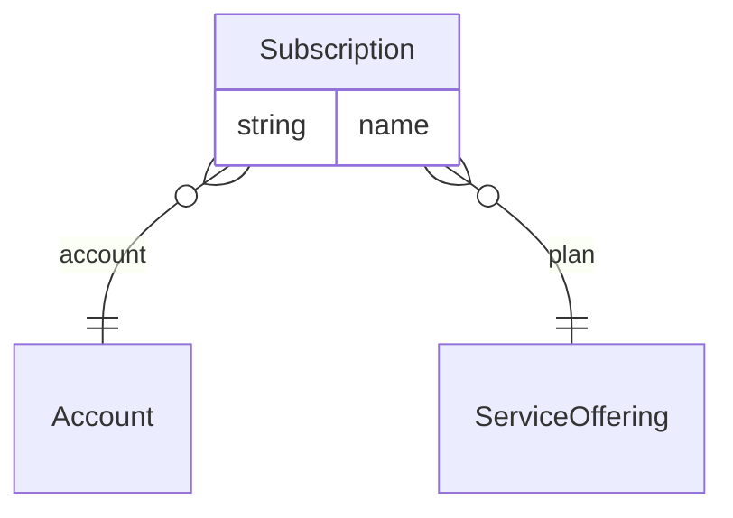

# Technology – CRM overlay (`technology-crm` v1.0.0)

> Generated from [`schemas/industries/technology.yaml`](../../schemas/industries/technology.yaml) by `tools/schematool.py docs`. Do not edit by hand.

SaaS customer data (recurring revenue, renewals, customer success) and subscriptions.

| Kind | Depends on | Entities | Extended entities | Enums | Term sets |
|---|---|---|---|---|---|
| industry | [`crm`](crm.md) | 1 | 1 | 1 | 0 |

## Terminology

Display names this layer applies on top of the generic model.

| Generic name | Shown as |
|---|---|
| `Account` | Customer / Customers |

## Entities

| Entity | Description | Dataverse | SharePoint | Volume | Sensitivity |
|---|---|---|---|---|---|
| [Subscription](#subscription) | Recurring subscription of a customer to a plan. | custom | list | medium | internal |

## Relationships

Lookups to Country, Currency, Employee, Language are left out of the diagram to keep it readable.

### Subscription

Recurring subscription of a customer to a plan.

- **Display name:** Subscription / Subscriptions
- **Ownership:** user · **Volume:** medium · **Sensitivity:** internal
- **Dataverse:** custom table `pfx_subscription` · **SharePoint:** list · **SQL:** table
- **Primary column:** `name`
- **Standard columns from traits:** `base` (id, createdOn, createdBy, modifiedOn, modifiedBy, stateCode, statusReason, rowVersion), `owned` (owner), `integration` (externalId, sourceSystem, lastSyncedOn)

| Column | Type | Req | Dataverse | SharePoint | SQL | Notes |
|---|---|:-:|---|---|---|---|
| `name` | string(200) | ✔ | Text (200) | Title (primary column) | nvarchar(200) |  |
| `account` | lookup([Account](core.md#account)) | ✔ | Lookup → Account | Lookup → Account | uniqueidentifier FK → Account |  |
| `plan` | lookup([ServiceOffering](crm.md#serviceoffering)) | ✔ | Lookup → ServiceOffering | Lookup → ServiceOffering | uniqueidentifier FK → ServiceOffering |  |
| `seats` | integer |  | Whole number | Number (0 dp) | int |  |
| `monthlyRecurringRevenue` | money | ✔ | Currency | Currency | decimal(19,4) |  |
| `currency` | lookup([Currency](core.md#currency)) | ✔ | Lookup → Currency | Lookup → Currency | uniqueidentifier FK → Currency |  |
| `startDate` | date | ✔ | Date only (behaviour: date only) | Date (date only) | date |  |
| `renewalDate` | date |  | Date only (behaviour: date only) | Date (date only) | date |  |
| `termMonths` | integer |  | Whole number | Number (0 dp) | int |  |
| `autoRenew` | boolean |  | Yes/No | Yes/No | bit |  |
| `status` | choice([SubscriptionStatus](#subscriptionstatus)) | ✔ | Choice (global: SubscriptionStatus) | Choice | int | _default `active`_ |
| `cancellationReason` | string(200) |  | Text (200) | Single line of text | nvarchar(200) |  |

## Extensions to entities from other layers

### Account (+4)

Adds columns to [Account](core.md#account) from `core`.

| Column | Type | Req | Dataverse | SharePoint | SQL | Notes |
|---|---|:-:|---|---|---|---|
| `annualRecurringRevenue` | money |  | Currency | Currency | decimal(19,4) | *Calculated:* 12 × sum of active Subscription.monthlyRecurringRevenue _read-only_ |
| `renewalDate` | date |  | Date only (behaviour: date only) | Date (date only) | date |  |
| `customerSuccessManager` | lookup([Employee](core.md#employee)) |  | Lookup → Employee | Person | uniqueidentifier FK → Employee |  |
| `healthScore` | integer |  | Whole number | Number (0 dp) | int |  |

## Choices (enums)

Codes are stable forever. Dataverse option value = publisher choice prefix + code.

### SubscriptionStatus

Lifecycle of a subscription.

| Code | Key | Label |
|--:|---|---|
| 1 | `trial` | Trial |
| 2 | `active` | Active |
| 3 | `pastDue` | Past Due |
| 4 | `cancelled` | Cancelled |
| 5 | `expired` | Expired |

## Reference data (seed)

Loaded at deployment. Deactivate rows you do not need instead of deleting them.

### SalesPipeline (1 rows)

| code | name |
|---|---|
| TEC_SAAS | SaaS new business |

### PipelineStage (7 rows)

| pipeline | code | name | sequence | defaultProbability | isClosed | isWon |
|---|---|---|---|---|---|---|
| TEC_SAAS | TEC_S_DISCOVERY | Discovery | 1 | 10 | no | no |
| TEC_SAAS | TEC_S_DEMO | Demo | 2 | 25 | no | no |
| TEC_SAAS | TEC_S_TRIAL | Trial / proof of concept | 3 | 40 | no | no |
| TEC_SAAS | TEC_S_PROPOSAL | Proposal | 4 | 60 | no | no |
| TEC_SAAS | TEC_S_NEGOTIATION | Negotiation | 5 | 80 | no | no |
| TEC_SAAS | TEC_S_WON | Closed won | 6 | 100 | yes | yes |
| TEC_SAAS | TEC_S_LOST | Closed lost | 7 | 0 | yes | no |
