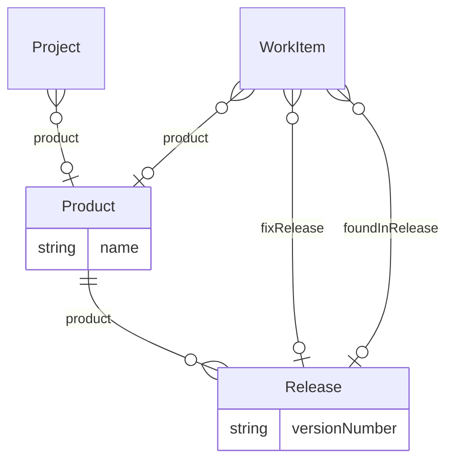

# Technology – Product delivery overlay (`technology-work` v1.0.0)

> Generated from [`schemas/industries/technology.yaml`](../../schemas/industries/technology.yaml) by `tools/schematool.py docs`. Do not edit by hand.

Agile product delivery: products and releases, backlog item types (epic/feature/story/bug), bug severity and environments, and links to the code repository and pull requests.

| Kind | Depends on | Entities | Extended entities | Enums | Term sets |
|---|---|---|---|---|---|
| industry | [`work`](work.md) | 2 | 2 | 5 | 0 |

## Entities

| Entity | Description | Dataverse | SharePoint | Volume | Sensitivity |
|---|---|---|---|---|---|
| [Product](#product) | Software product or platform the company builds and runs. | custom | list | low | internal |
| [Release](#release) | Versioned release of a product. | custom | list | low | internal |

## Relationships

Lookups to Country, Currency, Employee, Language are left out of the diagram to keep it readable.

### Product

Software product or platform the company builds and runs.

- **Display name:** Product / Products
- **Ownership:** organization · **Volume:** low · **Sensitivity:** internal
- **Dataverse:** custom table `pfx_product` · **SharePoint:** list · **SQL:** table
- **Primary column:** `name`
- **Standard columns from traits:** `base` (id, createdOn, createdBy, modifiedOn, modifiedBy, stateCode, statusReason, rowVersion)

| Column | Type | Req | Dataverse | SharePoint | SQL | Notes |
|---|---|:-:|---|---|---|---|
| `name` | string(200) | ✔ | Text (200) | Title (primary column) | nvarchar(200) |  |
| `code` | string(30) | ✔ | Text (30) | Single line of text | nvarchar(30) | _unique_ |
| `productOwner` | lookup([Employee](core.md#employee)) |  | Lookup → Employee | Person | uniqueidentifier FK → Employee |  |
| `status` | choice([ProductStatus](#productstatus)) | ✔ | Choice (global: ProductStatus) | Choice | int | _default `inDevelopment`_ |
| `repositoryUrl` | url |  | Text (URL) | Hyperlink | nvarchar(2000) |  |
| `documentationUrl` | url |  | Text (URL) | Hyperlink | nvarchar(2000) |  |
| `description` | text |  | Multiline text | Multiple lines (plain) | nvarchar(max) |  |

### Release

Versioned release of a product.

- **Display name:** Release / Releases
- **Ownership:** user · **Volume:** low · **Sensitivity:** internal
- **Dataverse:** custom table `pfx_release` · **SharePoint:** list · **SQL:** table
- **Primary column:** `versionNumber`
- **Alternate keys:** (`product`, `versionNumber`)
- **Standard columns from traits:** `base` (id, createdOn, createdBy, modifiedOn, modifiedBy, stateCode, statusReason, rowVersion), `owned` (owner)

| Column | Type | Req | Dataverse | SharePoint | SQL | Notes |
|---|---|:-:|---|---|---|---|
| `product` | parent([Product](#product)) | ✔ | Lookup → Product (parental) | Lookup → Product (cascade delete) | uniqueidentifier FK → Product (cascade) |  |
| `versionNumber` | string(30) | ✔ | Text (30) | Title (primary column) | nvarchar(30) | Semantic version, e.g. 2.4.0. |
| `codename` | string(50) |  | Text (50) | Single line of text | nvarchar(50) |  |
| `plannedDate` | date |  | Date only (behaviour: date only) | Date (date only) | date |  |
| `releasedOn` | date |  | Date only (behaviour: date only) | Date (date only) | date |  |
| `status` | choice([ReleaseStatus](#releasestatus)) | ✔ | Choice (global: ReleaseStatus) | Choice | int | _default `planned`_ |
| `releaseManager` | lookup([Employee](core.md#employee)) |  | Lookup → Employee | Person | uniqueidentifier FK → Employee |  |
| `releaseNotes` | richtext |  | Multiline text (rich text) | Multiple lines (enhanced rich text) | nvarchar(max) |  |

## Extensions to entities from other layers

### Project (+3)

Adds columns to [Project](work.md#project) from `work`.

| Column | Type | Req | Dataverse | SharePoint | SQL | Notes |
|---|---|:-:|---|---|---|---|
| `product` | lookup([Product](#product)) |  | Lookup → Product | Lookup → Product | uniqueidentifier FK → Product |  |
| `deliveryMethodology` | choice([DeliveryMethodology](#deliverymethodology)) |  | Choice (global: DeliveryMethodology) | Choice | int |  |
| `repositoryUrl` | url |  | Text (URL) | Hyperlink | nvarchar(2000) |  |

### WorkItem (+7)

Adds columns to [WorkItem](work.md#workitem) from `work`.

| Column | Type | Req | Dataverse | SharePoint | SQL | Notes |
|---|---|:-:|---|---|---|---|
| `product` | lookup([Product](#product)) |  | Lookup → Product | Lookup → Product | uniqueidentifier FK → Product |  |
| `fixRelease` | lookup([Release](#release)) |  | Lookup → Release | Lookup → Release | uniqueidentifier FK → Release |  |
| `foundInRelease` | lookup([Release](#release)) |  | Lookup → Release | Lookup → Release | uniqueidentifier FK → Release |  |
| `severity` | choice([BugSeverity](#bugseverity)) |  | Choice (global: BugSeverity) | Choice | int |  |
| `environment` | choice([DeployEnvironment](#deployenvironment)) |  | Choice (global: DeployEnvironment) | Choice | int |  |
| `gitBranch` | string(200) |  | Text (200) | Single line of text | nvarchar(200) |  |
| `pullRequestUrl` | url |  | Text (URL) | Hyperlink | nvarchar(2000) |  |

## Choices (enums)

Codes are stable forever. Dataverse option value = publisher choice prefix + code.

### ProductStatus

Lifecycle of a product.

| Code | Key | Label |
|--:|---|---|
| 1 | `ideation` | Ideation |
| 2 | `inDevelopment` | In Development |
| 3 | `live` | Live |
| 4 | `sunset` | Sunset |
| 5 | `retired` | Retired |

### ReleaseStatus

Lifecycle of a release.

| Code | Key | Label |
|--:|---|---|
| 1 | `planned` | Planned |
| 2 | `inProgress` | In Progress |
| 3 | `released` | Released |
| 4 | `rolledBack` | Rolled Back |
| 5 | `cancelled` | Cancelled |

### BugSeverity

Impact of a defect.

| Code | Key | Label |
|--:|---|---|
| 1 | `critical` | S1 – Critical |
| 2 | `major` | S2 – Major |
| 3 | `minor` | S3 – Minor |
| 4 | `trivial` | S4 – Trivial |

### DeployEnvironment

Environment where a defect was found or a change is deployed.

| Code | Key | Label |
|--:|---|---|
| 1 | `development` | Development |
| 2 | `test` | Test |
| 3 | `staging` | Staging |
| 4 | `production` | Production |

### DeliveryMethodology

Delivery approach of a project.

| Code | Key | Label |
|--:|---|---|
| 1 | `scrum` | Scrum |
| 2 | `kanban` | Kanban |
| 3 | `waterfall` | Waterfall |
| 4 | `hybrid` | Hybrid |
| 5 | `scaledAgile` | Scaled Agile |

## Reference data (seed)

Loaded at deployment. Deactivate rows you do not need instead of deleting them.

### ProjectType (4 rows)

| code | name | defaultBillingModel | requiresClient | isInternal |
|---|---|---|---|---|
| TEC_PRODUCT | Product development | nonBillable | no | yes |
| TEC_IMPLEMENTATION | Customer implementation | fixedFee | yes | no |
| TEC_MANAGED | Managed service / support | subscription | yes | no |
| TEC_INTERNAL_IT | Internal IT | nonBillable | no | yes |

### ProjectPhaseDefinition (6 rows)

| code | name | framework | sequence |
|---|---|---|---|
| TEC_DISCOVERY | Discovery | Delivery | 1 |
| TEC_DESIGN | Design | Delivery | 2 |
| TEC_BUILD | Build | Delivery | 3 |
| TEC_TEST | Test & QA | Delivery | 4 |
| TEC_RELEASE | Release | Delivery | 5 |
| TEC_HYPERCARE | Hypercare | Delivery | 6 |

### ProjectRole (8 rows)

| code | name |
|---|---|
| TEC_ENG_MANAGER | Engineering manager |
| TEC_PRODUCT_OWNER | Product owner / manager |
| TEC_DELIVERY_LEAD | Scrum master / delivery lead |
| TEC_ARCHITECT | Solution architect |
| TEC_ENGINEER | Software engineer |
| TEC_QA | QA engineer |
| TEC_UX | UX designer |
| TEC_DEVOPS | DevOps engineer |

### WorkItemType (6 rows)

| code | name | category | allowsChildren |
|---|---|---|---|
| TEC_EPIC | Epic | epic | yes |
| TEC_FEATURE | Feature | feature | yes |
| TEC_STORY | User story | story | yes |
| TEC_BUG | Bug | bug | no |
| TEC_SPIKE | Spike | task | no |
| TEC_TECH_DEBT | Tech debt | task | no |
