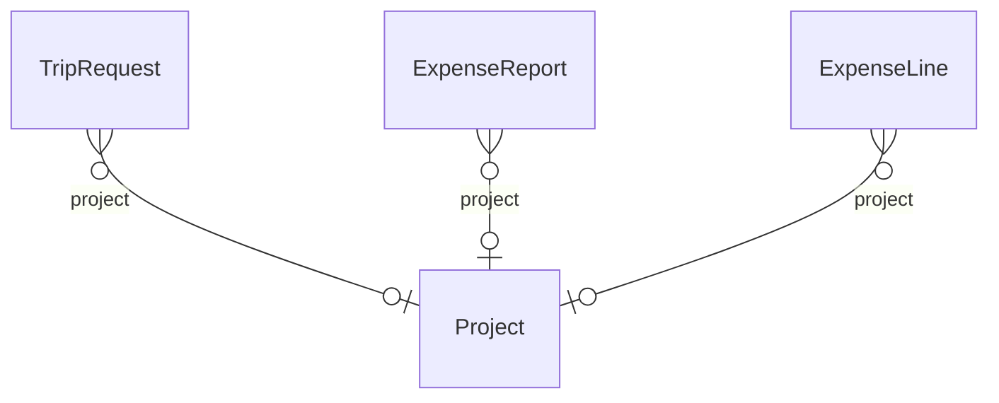

# Bridge – Travel ↔ Work Management (`travel-work` v1.0.0)

> Generated from [`schemas/bridges.yaml`](../../schemas/bridges.yaml) by `tools/schematool.py docs`. Do not edit by hand.

Charges trips and expenses to projects so they can be re-billed and reported per project.

| Kind | Depends on | Entities | Extended entities | Enums | Term sets |
|---|---|---|---|---|---|
| bridge | [`travel`](travel.md), [`work`](work.md) | 0 | 3 | 0 | 0 |

## Relationships

Lookups to Country, Currency, Employee, Language are left out of the diagram to keep it readable.

## Extensions to entities from other layers

### TripRequest (+1)

Adds columns to [TripRequest](travel.md#triprequest) from `travel`.

| Column | Type | Req | Dataverse | SharePoint | SQL | Notes |
|---|---|:-:|---|---|---|---|
| `project` | lookup([Project](work.md#project)) |  | Lookup → Project | Lookup → Project | uniqueidentifier FK → Project |  |

### ExpenseReport (+1)

Adds columns to [ExpenseReport](travel.md#expensereport) from `travel`.

| Column | Type | Req | Dataverse | SharePoint | SQL | Notes |
|---|---|:-:|---|---|---|---|
| `project` | lookup([Project](work.md#project)) |  | Lookup → Project | Lookup → Project | uniqueidentifier FK → Project | Default project for the lines of this report. |

### ExpenseLine (+1)

Adds columns to [ExpenseLine](travel.md#expenseline) from `travel`.

| Column | Type | Req | Dataverse | SharePoint | SQL | Notes |
|---|---|:-:|---|---|---|---|
| `project` | lookup([Project](work.md#project)) |  | Lookup → Project | Lookup → Project | uniqueidentifier FK → Project |  |
