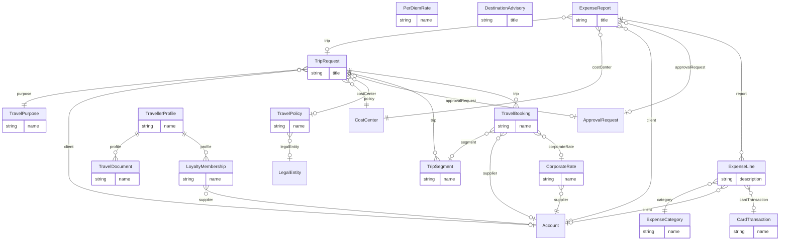

# Travel Portal (`travel` v1.0.0)

> Generated from [`schemas/modules/travel.yaml`](../../schemas/modules/travel.yaml) by `tools/schematool.py docs`. Do not edit by hand.

End-to-end business travel: policy, pre-trip approval, itinerary and bookings (direct or via a travel management company), traveller profiles and travel documents (locked down), destination risk for duty of care, corporate card feed and expense claims with receipts. Emissions per booking are captured for ESG reporting.

| Kind | Depends on | Entities | Extended entities | Enums | Term sets |
|---|---|---|---|---|---|
| module | [`core`](core.md) | 15 | 0 | 13 | 0 |

## Entities

| Entity | Description | Dataverse | SharePoint | Volume | Sensitivity |
|---|---|---|---|---|---|
| [TravelPurpose](#travelpurpose) | Reason for travel. | custom | list | low | internal |
| [TravelPolicy](#travelpolicy) | Travel rules for a legal entity over a period. | custom | list | low | internal |
| [PerDiemRate](#perdiemrate) | Daily allowance by country/city (e.g. | custom | list | medium | internal |
| [DestinationAdvisory](#destinationadvisory) | Current risk advisory for a country or city (duty of care). | custom | list | low | internal |
| [CorporateRate](#corporaterate) | Negotiated supplier rate (airline deal, hotel rate code, car rental discount). | custom | list | low | internal |
| [TravellerProfile](#travellerprofile) | Booking data for one traveller. | custom | list | low | restricted |
| [TravelDocument](#traveldocument) | Passport, visa or other document of a traveller. | custom | list | low | restricted |
| [LoyaltyMembership](#loyaltymembership) | Frequent flyer, hotel or rail loyalty number of a traveller. | custom | list | low | confidential |
| [TripRequest](#triprequest) | Request to travel, approved before booking. | custom | list | medium | internal |
| [TripSegment](#tripsegment) | Requested leg or stay of a trip (what the traveller asks for, before booking). | custom | list | medium | internal |
| [TravelBooking](#travelbooking) | Confirmed booking (ticket, reservation) from a supplier or TMC. | custom | list | medium | internal |
| [ExpenseCategory](#expensecategory) | Expense type with GL mapping and limits. | custom | list | low | internal |
| [ExpenseReport](#expensereport) | Expense claim submitted for approval and reimbursement. | custom | list | medium | internal |
| [ExpenseLine](#expenseline) | One expense item with receipt, in its original currency and the claim currency. | custom | list ⚠ high volume | high | internal |
| [CardTransaction](#cardtransaction) | Corporate card transaction imported from the card provider feed. | custom | list ⚠ high volume | high | internal |

## Relationships

Lookups to Country, Currency, Employee, Language are left out of the diagram to keep it readable.

### TravelPurpose

Reason for travel. Industry overlays add their own (site visit, court hearing, audit fieldwork).

- **Display name:** Travel Purpose / Travel Purposes
- **Ownership:** organization · **Volume:** low · **Sensitivity:** internal
- **Dataverse:** custom table `pfx_travelpurpose` · **SharePoint:** list · **SQL:** table
- **Primary column:** `name`
- **Standard columns from traits:** `base` (id, createdOn, createdBy, modifiedOn, modifiedBy, stateCode, statusReason, rowVersion)

| Column | Type | Req | Dataverse | SharePoint | SQL | Notes |
|---|---|:-:|---|---|---|---|
| `name` | string(100) | ✔ | Text (100) | Title (primary column) | nvarchar(100) |  |
| `code` | string(30) | ✔ | Text (30) | Single line of text | nvarchar(30) | _unique_ |
| `requiresClient` | boolean |  | Yes/No | Yes/No | bit |  |
| `isBillableDefault` | boolean |  | Yes/No | Yes/No | bit |  |
| `description` | text |  | Multiline text | Multiple lines (plain) | nvarchar(max) |  |

### TravelPolicy

Travel rules for a legal entity over a period. Used to flag out-of-policy requests and bookings.

- **Display name:** Travel Policy / Travel Policies
- **Ownership:** organization · **Volume:** low · **Sensitivity:** internal
- **Dataverse:** custom table `pfx_travelpolicy` · **SharePoint:** list · **SQL:** table
- **Primary column:** `name`
- **Standard columns from traits:** `base` (id, createdOn, createdBy, modifiedOn, modifiedBy, stateCode, statusReason, rowVersion), `effectiveDated` (validFrom, validTo)

| Column | Type | Req | Dataverse | SharePoint | SQL | Notes |
|---|---|:-:|---|---|---|---|
| `name` | string(200) | ✔ | Text (200) | Title (primary column) | nvarchar(200) |  |
| `code` | string(30) |  | Text (30) | Single line of text | nvarchar(30) | _unique_ |
| `legalEntity` | lookup([LegalEntity](core.md#legalentity)) |  | Lookup → LegalEntity | Lookup → LegalEntity | uniqueidentifier FK → LegalEntity |  |
| `domesticCabinClass` | choice([CabinClass](#cabinclass)) | ✔ | Choice (global: CabinClass) | Choice | int |  |
| `internationalCabinClass` | choice([CabinClass](#cabinclass)) | ✔ | Choice (global: CabinClass) | Choice | int |  |
| `longHaulThresholdHours` | decimal(4,1) |  | Decimal (4,1) | Number (1 dp) | decimal(4,1) | Flights longer than this may use longHaulCabinClass. |
| `longHaulCabinClass` | choice([CabinClass](#cabinclass)) |  | Choice (global: CabinClass) | Choice | int |  |
| `maxHotelRatePerNight` | money |  | Currency | Currency | decimal(19,4) |  |
| `currency` | lookup([Currency](core.md#currency)) | ✔ | Lookup → Currency | Lookup → Currency | uniqueidentifier FK → Currency |  |
| `minAdvanceBookingDays` | integer |  | Whole number | Number (0 dp) | int |  |
| `preApprovalRequired` | boolean |  | Yes/No | Yes/No | bit |  |
| `preApprovalThreshold` | money |  | Currency | Currency | decimal(19,4) |  |
| `receiptRequiredAbove` | money |  | Currency | Currency | decimal(19,4) |  |
| `policyDocumentUrl` | url |  | Text (URL) | Hyperlink | nvarchar(2000) |  |
| `description` | text |  | Multiline text | Multiple lines (plain) | nvarchar(max) |  |

### PerDiemRate

Daily allowance by country/city (e.g. from GSA, HMRC or local tax authority tables).

- **Display name:** Per Diem Rate / Per Diem Rates
- **Ownership:** organization · **Volume:** medium · **Sensitivity:** internal
- **Dataverse:** custom table `pfx_perdiemrate` · **SharePoint:** list · **SQL:** table
- **Primary column:** `name` (auto-generated)
- **Standard columns from traits:** `base` (id, createdOn, createdBy, modifiedOn, modifiedBy, stateCode, statusReason, rowVersion), `effectiveDated` (validFrom, validTo)

| Column | Type | Req | Dataverse | SharePoint | SQL | Notes |
|---|---|:-:|---|---|---|---|
| `name` | string(200) | ✔ | Text (200) | Title (primary column) | nvarchar(200) | Display label generated automatically (flow, plug-in or trigger). Required by Dataverse (primary name) and SharePoint (Title). _read-only_ |
| `country` | lookup([Country](core.md#country)) | ✔ | Lookup → Country | Lookup → Country | uniqueidentifier FK → Country |  |
| `city` | string(100) |  | Text (100) | Single line of text | nvarchar(100) | Empty means the country default. |
| `lodgingRate` | money |  | Currency | Currency | decimal(19,4) |  |
| `mealsRate` | money |  | Currency | Currency | decimal(19,4) |  |
| `incidentalsRate` | money |  | Currency | Currency | decimal(19,4) |  |
| `currency` | lookup([Currency](core.md#currency)) | ✔ | Lookup → Currency | Lookup → Currency | uniqueidentifier FK → Currency |  |
| `source` | string(100) |  | Text (100) | Single line of text | nvarchar(100) |  |

### DestinationAdvisory

Current risk advisory for a country or city (duty of care).

- **Display name:** Destination Advisory / Destination Advisories
- **Ownership:** organization · **Volume:** low · **Sensitivity:** internal
- **Dataverse:** custom table `pfx_destinationadvisory` · **SharePoint:** list · **SQL:** table
- **Primary column:** `title`
- **Standard columns from traits:** `base` (id, createdOn, createdBy, modifiedOn, modifiedBy, stateCode, statusReason, rowVersion), `effectiveDated` (validFrom, validTo)

| Column | Type | Req | Dataverse | SharePoint | SQL | Notes |
|---|---|:-:|---|---|---|---|
| `title` | string(200) | ✔ | Text (200) | Title (primary column) | nvarchar(200) |  |
| `country` | lookup([Country](core.md#country)) | ✔ | Lookup → Country | Lookup → Country | uniqueidentifier FK → Country |  |
| `city` | string(100) |  | Text (100) | Single line of text | nvarchar(100) |  |
| `riskLevel` | choice([RiskLevel](#risklevel)) | ✔ | Choice (global: RiskLevel) | Choice | int |  |
| `summary` | text | ✔ | Multiline text | Multiple lines (plain) | nvarchar(max) |  |
| `requiresSecurityApproval` | boolean |  | Yes/No | Yes/No | bit |  |
| `sourceUrl` | url |  | Text (URL) | Hyperlink | nvarchar(2000) |  |

### CorporateRate

Negotiated supplier rate (airline deal, hotel rate code, car rental discount).

- **Display name:** Corporate Rate / Corporate Rates
- **Ownership:** organization · **Volume:** low · **Sensitivity:** internal
- **Dataverse:** custom table `pfx_corporaterate` · **SharePoint:** list · **SQL:** table
- **Primary column:** `name`
- **Standard columns from traits:** `base` (id, createdOn, createdBy, modifiedOn, modifiedBy, stateCode, statusReason, rowVersion), `effectiveDated` (validFrom, validTo)

| Column | Type | Req | Dataverse | SharePoint | SQL | Notes |
|---|---|:-:|---|---|---|---|
| `name` | string(200) | ✔ | Text (200) | Title (primary column) | nvarchar(200) |  |
| `supplier` | lookup([Account](core.md#account)) | ✔ | Lookup → Account | Lookup → Account | uniqueidentifier FK → Account |  |
| `segmentType` | choice([SegmentType](#segmenttype)) | ✔ | Choice (global: SegmentType) | Choice | int |  |
| `city` | string(100) |  | Text (100) | Single line of text | nvarchar(100) |  |
| `country` | lookup([Country](core.md#country)) |  | Lookup → Country | Lookup → Country | uniqueidentifier FK → Country |  |
| `rateCode` | string(50) |  | Text (50) | Single line of text | nvarchar(50) | _confidential_ |
| `negotiatedRate` | money |  | Currency | Currency | decimal(19,4) |  |
| `currency` | lookup([Currency](core.md#currency)) | ✔ | Lookup → Currency | Lookup → Currency | uniqueidentifier FK → Currency |  |
| `isPreferred` | boolean |  | Yes/No | Yes/No | bit |  |
| `terms` | text |  | Multiline text | Multiple lines (plain) | nvarchar(max) |  |

### TravellerProfile

Booking data for one traveller. Kept apart from Employee so it can be locked to the traveller, travel bookers and the TMC. Do not store it at all if the TMC holds profiles.

- **Display name:** Traveller Profile / Traveller Profiles
- **Ownership:** user · **Volume:** low · **Sensitivity:** restricted
- **Dataverse:** custom table `pfx_travellerprofile` · **SharePoint:** list · **SQL:** table
- **Primary column:** `name` (auto-generated)
- **Alternate keys:** (`employee`)
- **Standard columns from traits:** `base` (id, createdOn, createdBy, modifiedOn, modifiedBy, stateCode, statusReason, rowVersion), `owned` (owner)

| Column | Type | Req | Dataverse | SharePoint | SQL | Notes |
|---|---|:-:|---|---|---|---|
| `name` | string(200) | ✔ | Text (200) | Title (primary column) | nvarchar(200) | Display label generated automatically (flow, plug-in or trigger). Required by Dataverse (primary name) and SharePoint (Title). _read-only_ |
| `employee` | lookup([Employee](core.md#employee)) | ✔ | Lookup → Employee | Person | uniqueidentifier FK → Employee | _unique_ |
| `legalFirstName` | string(100) |  | Text (100) | Single line of text | nvarchar(100) | As printed on the passport. _PII_ |
| `legalMiddleName` | string(100) |  | Text (100) | Single line of text | nvarchar(100) | _PII_ |
| `legalLastName` | string(100) |  | Text (100) | Single line of text | nvarchar(100) | _PII_ |
| `dateOfBirth` | date |  | Date only (behaviour: date only) | Date (date only) | date | _PII_ |
| `documentGender` | choice([DocumentGender](#documentgender)) |  | Choice (global: DocumentGender) | Choice | int | _PII_ |
| `nationality` | lookup([Country](core.md#country)) |  | Lookup → Country | Lookup → Country | uniqueidentifier FK → Country |  |
| `homeAirport` | string(3) |  | Text (3) | Single line of text | nvarchar(3) | IATA airport code. |
| `seatPreference` | choice([SeatPreference](#seatpreference)) |  | Choice (global: SeatPreference) | Choice | int |  |
| `mealPreference` | string(100) |  | Text (100) | Single line of text | nvarchar(100) |  |
| `specialAssistance` | text |  | Multiline text | Multiple lines (plain) | nvarchar(max) | Health/accessibility needs. Special-category data — collect only with consent. _PII_ |
| `knownTravellerNumber` | string(50) |  | Text (50) | Single line of text | nvarchar(50) | _PII_ |
| `emergencyContactName` | string(200) |  | Text (200) | Single line of text | nvarchar(200) | _PII_ |
| `emergencyContactPhone` | phone |  | Text (phone) | Single line of text | nvarchar(50) | _PII_ |
| `consentToShareWithTmc` | boolean |  | Yes/No | Yes/No | bit |  |
| `consentGivenOn` | datetime |  | Date and time (user local) | Date and time | datetime2 (UTC) |  |

### TravelDocument

Passport, visa or other document of a traveller. Store numbers encrypted or tokenised where possible.

- **Display name:** Travel Document / Travel Documents
- **Ownership:** user · **Volume:** low · **Sensitivity:** restricted
- **Dataverse:** custom table `pfx_traveldocument` · **SharePoint:** list · **SQL:** table
- **Primary column:** `name` (auto-generated)
- **Standard columns from traits:** `base` (id, createdOn, createdBy, modifiedOn, modifiedBy, stateCode, statusReason, rowVersion), `owned` (owner)

| Column | Type | Req | Dataverse | SharePoint | SQL | Notes |
|---|---|:-:|---|---|---|---|
| `name` | string(200) | ✔ | Text (200) | Title (primary column) | nvarchar(200) | Display label generated automatically (flow, plug-in or trigger). Required by Dataverse (primary name) and SharePoint (Title). _read-only_ |
| `profile` | parent([TravellerProfile](#travellerprofile)) | ✔ | Lookup → TravellerProfile (parental) | Lookup → TravellerProfile (cascade delete) | uniqueidentifier FK → TravellerProfile (cascade) |  |
| `documentType` | choice([TravelDocumentType](#traveldocumenttype)) | ✔ | Choice (global: TravelDocumentType) | Choice | int |  |
| `documentNumber` | string(50) | ✔ | Text (50) | Single line of text | nvarchar(50) | _PII_ |
| `issuingCountry` | lookup([Country](core.md#country)) | ✔ | Lookup → Country | Lookup → Country | uniqueidentifier FK → Country |  |
| `validForCountry` | lookup([Country](core.md#country)) |  | Lookup → Country | Lookup → Country | uniqueidentifier FK → Country | For visas and travel authorisations. |
| `visaType` | string(50) |  | Text (50) | Single line of text | nvarchar(50) |  |
| `issueDate` | date |  | Date only (behaviour: date only) | Date (date only) | date |  |
| `expiryDate` | date | ✔ | Date only (behaviour: date only) | Date (date only) | date |  |
| `isPrimary` | boolean |  | Yes/No | Yes/No | bit |  |
| `scanUrl` | url |  | Text (URL) | Hyperlink | nvarchar(2000) | Link to a restricted document library or vault. |

### LoyaltyMembership

Frequent flyer, hotel or rail loyalty number of a traveller.

- **Display name:** Loyalty Membership / Loyalty Memberships
- **Ownership:** user · **Volume:** low · **Sensitivity:** confidential
- **Dataverse:** custom table `pfx_loyaltymembership` · **SharePoint:** list · **SQL:** table
- **Primary column:** `name` (auto-generated)
- **Standard columns from traits:** `base` (id, createdOn, createdBy, modifiedOn, modifiedBy, stateCode, statusReason, rowVersion), `owned` (owner)

| Column | Type | Req | Dataverse | SharePoint | SQL | Notes |
|---|---|:-:|---|---|---|---|
| `name` | string(200) | ✔ | Text (200) | Title (primary column) | nvarchar(200) | Display label generated automatically (flow, plug-in or trigger). Required by Dataverse (primary name) and SharePoint (Title). _read-only_ |
| `profile` | parent([TravellerProfile](#travellerprofile)) | ✔ | Lookup → TravellerProfile (parental) | Lookup → TravellerProfile (cascade delete) | uniqueidentifier FK → TravellerProfile (cascade) |  |
| `programName` | string(100) | ✔ | Text (100) | Single line of text | nvarchar(100) |  |
| `supplier` | lookup([Account](core.md#account)) |  | Lookup → Account | Lookup → Account | uniqueidentifier FK → Account |  |
| `membershipNumber` | string(50) | ✔ | Text (50) | Single line of text | nvarchar(50) |  |
| `tier` | string(50) |  | Text (50) | Single line of text | nvarchar(50) |  |

### TripRequest

Request to travel, approved before booking. The anchor for segments, bookings and expenses.

- **Display name:** Trip Request / Trip Requests
- **Ownership:** user · **Volume:** medium · **Sensitivity:** internal
- **Dataverse:** custom table `pfx_triprequest` · **SharePoint:** list · **SQL:** table
- **Primary column:** `title`
- **Alternate keys:** (`tripNumber`)
- **Standard columns from traits:** `base` (id, createdOn, createdBy, modifiedOn, modifiedBy, stateCode, statusReason, rowVersion), `owned` (owner), `integration` (externalId, sourceSystem, lastSyncedOn), `classified` (sensitivity, retentionLabel)
- **Extended by:** [`travel-work`](travel-work.md#triprequest-1)

| Column | Type | Req | Dataverse | SharePoint | SQL | Notes |
|---|---|:-:|---|---|---|---|
| `title` | string(200) | ✔ | Text (200) | Title (primary column) | nvarchar(200) |  |
| `tripNumber` | autonumber |  | Autonumber `TRP-{SEQNUM:6}` | Single line of text (set by flow) | nvarchar(30) + sequence |  |
| `traveller` | lookup([Employee](core.md#employee)) | ✔ | Lookup → Employee | Person | uniqueidentifier FK → Employee |  |
| `requestedBy` | lookup([Employee](core.md#employee)) |  | Lookup → Employee | Person | uniqueidentifier FK → Employee | Travel booker or assistant acting for the traveller. |
| `purpose` | lookup([TravelPurpose](#travelpurpose)) | ✔ | Lookup → TravelPurpose | Lookup → TravelPurpose | uniqueidentifier FK → TravelPurpose |  |
| `businessJustification` | text | ✔ | Multiline text | Multiple lines (plain) | nvarchar(max) |  |
| `tripType` | choice([TripType](#triptype)) | ✔ | Choice (global: TripType) | Choice | int |  |
| `status` | choice([TripStatus](#tripstatus)) | ✔ | Choice (global: TripStatus) | Choice | int | _default `draft`_ |
| `departureDate` | date | ✔ | Date only (behaviour: date only) | Date (date only) | date |  |
| `returnDate` | date | ✔ | Date only (behaviour: date only) | Date (date only) | date |  |
| `origin` | string(100) | ✔ | Text (100) | Single line of text | nvarchar(100) |  |
| `originCountry` | lookup([Country](core.md#country)) |  | Lookup → Country | Lookup → Country | uniqueidentifier FK → Country |  |
| `destination` | string(100) | ✔ | Text (100) | Single line of text | nvarchar(100) |  |
| `destinationCountry` | lookup([Country](core.md#country)) | ✔ | Lookup → Country | Lookup → Country | uniqueidentifier FK → Country |  |
| `additionalDestinations` | text |  | Multiline text | Multiple lines (plain) | nvarchar(max) |  |
| `client` | lookup([Account](core.md#account)) |  | Lookup → Account | Lookup → Account | uniqueidentifier FK → Account |  |
| `isBillable` | boolean |  | Yes/No | Yes/No | bit |  |
| `costCenter` | lookup([CostCenter](core.md#costcenter)) | ✔ | Lookup → CostCenter | Lookup → CostCenter | uniqueidentifier FK → CostCenter |  |
| `policy` | lookup([TravelPolicy](#travelpolicy)) |  | Lookup → TravelPolicy | Lookup → TravelPolicy | uniqueidentifier FK → TravelPolicy |  |
| `estimatedCost` | money |  | Currency | Currency | decimal(19,4) |  |
| `actualCost` | money |  | Currency | Currency | decimal(19,4) | *Calculated:* sum of TravelBooking.totalCost (converted) _read-only_ |
| `currency` | lookup([Currency](core.md#currency)) | ✔ | Lookup → Currency | Lookup → Currency | uniqueidentifier FK → Currency |  |
| `isOutOfPolicy` | boolean |  | Yes/No | Yes/No | bit |  |
| `outOfPolicyReason` | text |  | Multiline text | Multiple lines (plain) | nvarchar(max) |  |
| `visaRequired` | boolean |  | Yes/No | Yes/No | bit |  |
| `highestRiskLevel` | choice([RiskLevel](#risklevel)) |  | Choice (global: RiskLevel) | Choice | int | *Calculated:* max DestinationAdvisory.riskLevel for the destinations _read-only_ |
| `groupTripCode` | string(30) |  | Text (30) | Single line of text | nvarchar(30) | Same code on the requests of travellers going together. |
| `approvalRequest` | lookup([ApprovalRequest](core.md#approvalrequest)) |  | Lookup → ApprovalRequest | Lookup → ApprovalRequest | uniqueidentifier FK → ApprovalRequest |  |
| `submittedOn` | datetime |  | Date and time (user local) | Date and time | datetime2 (UTC) |  |
| `notes` | text |  | Multiline text | Multiple lines (plain) | nvarchar(max) |  |

### TripSegment

Requested leg or stay of a trip (what the traveller asks for, before booking).

- **Display name:** Trip Segment / Trip Segments
- **Ownership:** user · **Volume:** medium · **Sensitivity:** internal
- **Dataverse:** custom table `pfx_tripsegment` · **SharePoint:** list · **SQL:** table
- **Primary column:** `name` (auto-generated)
- **Standard columns from traits:** `base` (id, createdOn, createdBy, modifiedOn, modifiedBy, stateCode, statusReason, rowVersion), `owned` (owner)

| Column | Type | Req | Dataverse | SharePoint | SQL | Notes |
|---|---|:-:|---|---|---|---|
| `name` | string(200) | ✔ | Text (200) | Title (primary column) | nvarchar(200) | Display label generated automatically (flow, plug-in or trigger). Required by Dataverse (primary name) and SharePoint (Title). _read-only_ |
| `trip` | parent([TripRequest](#triprequest)) | ✔ | Lookup → TripRequest (parental) | Lookup → TripRequest (cascade delete) | uniqueidentifier FK → TripRequest (cascade) |  |
| `sequence` | integer | ✔ | Whole number | Number (0 dp) | int |  |
| `segmentType` | choice([SegmentType](#segmenttype)) | ✔ | Choice (global: SegmentType) | Choice | int |  |
| `fromLocation` | string(100) |  | Text (100) | Single line of text | nvarchar(100) |  |
| `toLocation` | string(100) |  | Text (100) | Single line of text | nvarchar(100) |  |
| `startOn` | datetime | ✔ | Date and time (user local) | Date and time | datetime2 (UTC) | Departure or check-in. |
| `endOn` | datetime |  | Date and time (user local) | Date and time | datetime2 (UTC) | Arrival or check-out. |
| `preferredClass` | choice([CabinClass](#cabinclass)) |  | Choice (global: CabinClass) | Choice | int |  |
| `preferences` | text |  | Multiline text | Multiple lines (plain) | nvarchar(max) |  |
| `estimatedCost` | money |  | Currency | Currency | decimal(19,4) |  |
| `currency` | lookup([Currency](core.md#currency)) |  | Lookup → Currency | Lookup → Currency | uniqueidentifier FK → Currency |  |

### TravelBooking

Confirmed booking (ticket, reservation) from a supplier or TMC.

- **Display name:** Travel Booking / Travel Bookings
- **Ownership:** user · **Volume:** medium · **Sensitivity:** internal
- **Dataverse:** custom table `pfx_travelbooking` · **SharePoint:** list · **SQL:** table
- **Primary column:** `name` (auto-generated)
- **Standard columns from traits:** `base` (id, createdOn, createdBy, modifiedOn, modifiedBy, stateCode, statusReason, rowVersion), `owned` (owner), `integration` (externalId, sourceSystem, lastSyncedOn)

| Column | Type | Req | Dataverse | SharePoint | SQL | Notes |
|---|---|:-:|---|---|---|---|
| `name` | string(200) | ✔ | Text (200) | Title (primary column) | nvarchar(200) | Display label generated automatically (flow, plug-in or trigger). Required by Dataverse (primary name) and SharePoint (Title). _read-only_ |
| `trip` | parent([TripRequest](#triprequest)) | ✔ | Lookup → TripRequest (parental) | Lookup → TripRequest (cascade delete) | uniqueidentifier FK → TripRequest (cascade) |  |
| `segment` | lookup([TripSegment](#tripsegment)) |  | Lookup → TripSegment | Lookup → TripSegment | uniqueidentifier FK → TripSegment |  |
| `bookingType` | choice([SegmentType](#segmenttype)) | ✔ | Choice (global: SegmentType) | Choice | int |  |
| `status` | choice([BookingStatus](#bookingstatus)) | ✔ | Choice (global: BookingStatus) | Choice | int | _default `requested`_ |
| `channel` | choice([BookingChannel](#bookingchannel)) |  | Choice (global: BookingChannel) | Choice | int |  |
| `supplier` | lookup([Account](core.md#account)) |  | Lookup → Account | Lookup → Account | uniqueidentifier FK → Account |  |
| `supplierName` | string(200) |  | Text (200) | Single line of text | nvarchar(200) | Airline/hotel name when the supplier is not an account. |
| `confirmationCode` | string(50) |  | Text (50) | Single line of text | nvarchar(50) | _confidential_ |
| `ticketNumber` | string(30) |  | Text (30) | Single line of text | nvarchar(30) |  |
| `serviceNumber` | string(20) |  | Text (20) | Single line of text | nvarchar(20) | Flight or train number. |
| `fromLocation` | string(100) |  | Text (100) | Single line of text | nvarchar(100) |  |
| `toLocation` | string(100) |  | Text (100) | Single line of text | nvarchar(100) |  |
| `startOn` | datetime | ✔ | Date and time (user local) | Date and time | datetime2 (UTC) |  |
| `endOn` | datetime |  | Date and time (user local) | Date and time | datetime2 (UTC) |  |
| `cabinClass` | choice([CabinClass](#cabinclass)) |  | Choice (global: CabinClass) | Choice | int |  |
| `baseFare` | money |  | Currency | Currency | decimal(19,4) |  |
| `taxesAndFees` | money |  | Currency | Currency | decimal(19,4) |  |
| `totalCost` | money | ✔ | Currency | Currency | decimal(19,4) |  |
| `currency` | lookup([Currency](core.md#currency)) | ✔ | Lookup → Currency | Lookup → Currency | uniqueidentifier FK → Currency |  |
| `corporateRate` | lookup([CorporateRate](#corporaterate)) |  | Lookup → CorporateRate | Lookup → CorporateRate | uniqueidentifier FK → CorporateRate |  |
| `isInPolicy` | boolean |  | Yes/No | Yes/No | bit |  |
| `isRefundable` | boolean |  | Yes/No | Yes/No | bit |  |
| `cancellationDeadline` | datetime |  | Date and time (user local) | Date and time | datetime2 (UTC) |  |
| `bookedOn` | datetime |  | Date and time (user local) | Date and time | datetime2 (UTC) |  |
| `bookedBy` | lookup([Employee](core.md#employee)) |  | Lookup → Employee | Person | uniqueidentifier FK → Employee |  |
| `co2Kg` | decimal(10,2) |  | Decimal (10,2) | Number (2 dp) | decimal(10,2) | Estimated emissions for ESG / Scope 3 reporting. |
| `itineraryUrl` | url |  | Text (URL) | Hyperlink | nvarchar(2000) |  |

### ExpenseCategory

Expense type with GL mapping and limits.

- **Display name:** Expense Category / Expense Categories
- **Ownership:** organization · **Volume:** low · **Sensitivity:** internal
- **Dataverse:** custom table `pfx_expensecategory` · **SharePoint:** list · **SQL:** table
- **Primary column:** `name`
- **Standard columns from traits:** `base` (id, createdOn, createdBy, modifiedOn, modifiedBy, stateCode, statusReason, rowVersion)

| Column | Type | Req | Dataverse | SharePoint | SQL | Notes |
|---|---|:-:|---|---|---|---|
| `name` | string(100) | ✔ | Text (100) | Title (primary column) | nvarchar(100) |  |
| `code` | string(30) | ✔ | Text (30) | Single line of text | nvarchar(30) | _unique_ |
| `glAccountCode` | string(30) |  | Text (30) | Single line of text | nvarchar(30) |  |
| `unit` | choice([UnitOfMeasure](core.md#unitofmeasure)) |  | Choice (global: UnitOfMeasure) | Choice | int | For per-unit categories such as mileage. |
| `ratePerUnit` | money |  | Currency | Currency | decimal(19,4) |  |
| `currency` | lookup([Currency](core.md#currency)) |  | Lookup → Currency | Lookup → Currency | uniqueidentifier FK → Currency |  |
| `receiptRequiredAbove` | money |  | Currency | Currency | decimal(19,4) |  |
| `maxAmountPerItem` | money |  | Currency | Currency | decimal(19,4) |  |
| `requiresAttendees` | boolean |  | Yes/No | Yes/No | bit | Client entertainment needs attendee names. |
| `isTaxReclaimable` | boolean |  | Yes/No | Yes/No | bit |  |
| `description` | text |  | Multiline text | Multiple lines (plain) | nvarchar(max) |  |

### ExpenseReport

Expense claim submitted for approval and reimbursement.

- **Display name:** Expense Report / Expense Reports
- **Ownership:** user · **Volume:** medium · **Sensitivity:** internal
- **Dataverse:** custom table `pfx_expensereport` · **SharePoint:** list · **SQL:** table
- **Primary column:** `title`
- **Alternate keys:** (`reportNumber`)
- **Standard columns from traits:** `base` (id, createdOn, createdBy, modifiedOn, modifiedBy, stateCode, statusReason, rowVersion), `owned` (owner), `integration` (externalId, sourceSystem, lastSyncedOn)
- **Extended by:** [`travel-work`](travel-work.md#expensereport-1)

| Column | Type | Req | Dataverse | SharePoint | SQL | Notes |
|---|---|:-:|---|---|---|---|
| `title` | string(200) | ✔ | Text (200) | Title (primary column) | nvarchar(200) |  |
| `reportNumber` | autonumber |  | Autonumber `EXP-{SEQNUM:6}` | Single line of text (set by flow) | nvarchar(30) + sequence |  |
| `employee` | lookup([Employee](core.md#employee)) | ✔ | Lookup → Employee | Person | uniqueidentifier FK → Employee |  |
| `trip` | lookup([TripRequest](#triprequest)) |  | Lookup → TripRequest | Lookup → TripRequest | uniqueidentifier FK → TripRequest |  |
| `status` | choice([ExpenseReportStatus](#expensereportstatus)) | ✔ | Choice (global: ExpenseReportStatus) | Choice | int | _default `draft`_ |
| `periodStart` | date |  | Date only (behaviour: date only) | Date (date only) | date |  |
| `periodEnd` | date |  | Date only (behaviour: date only) | Date (date only) | date |  |
| `currency` | lookup([Currency](core.md#currency)) | ✔ | Lookup → Currency | Lookup → Currency | uniqueidentifier FK → Currency | Reimbursement currency. |
| `totalAmount` | money |  | Currency | Currency | decimal(19,4) | _read-only_ |
| `reimbursableAmount` | money |  | Currency | Currency | decimal(19,4) | _read-only_ |
| `costCenter` | lookup([CostCenter](core.md#costcenter)) | ✔ | Lookup → CostCenter | Lookup → CostCenter | uniqueidentifier FK → CostCenter |  |
| `client` | lookup([Account](core.md#account)) |  | Lookup → Account | Lookup → Account | uniqueidentifier FK → Account |  |
| `approvalRequest` | lookup([ApprovalRequest](core.md#approvalrequest)) |  | Lookup → ApprovalRequest | Lookup → ApprovalRequest | uniqueidentifier FK → ApprovalRequest |  |
| `submittedOn` | datetime |  | Date and time (user local) | Date and time | datetime2 (UTC) |  |
| `approvedOn` | datetime |  | Date and time (user local) | Date and time | datetime2 (UTC) |  |
| `paidOn` | date |  | Date only (behaviour: date only) | Date (date only) | date |  |
| `paymentReference` | string(50) |  | Text (50) | Single line of text | nvarchar(50) |  |
| `notes` | text |  | Multiline text | Multiple lines (plain) | nvarchar(max) |  |

### ExpenseLine

One expense item with receipt, in its original currency and the claim currency.

- **Display name:** Expense Line / Expense Lines
- **Ownership:** user · **Volume:** high · **Sensitivity:** internal
- **Dataverse:** custom table `pfx_expenseline` · **SharePoint:** list ⚠ high volume · **SQL:** table
- **Primary column:** `description`
- **Standard columns from traits:** `base` (id, createdOn, createdBy, modifiedOn, modifiedBy, stateCode, statusReason, rowVersion), `owned` (owner)
- **Extended by:** [`travel-work`](travel-work.md#expenseline-1)

| Column | Type | Req | Dataverse | SharePoint | SQL | Notes |
|---|---|:-:|---|---|---|---|
| `report` | parent([ExpenseReport](#expensereport)) | ✔ | Lookup → ExpenseReport (parental) | Lookup → ExpenseReport (cascade delete) | uniqueidentifier FK → ExpenseReport (cascade) |  |
| `description` | string(250) | ✔ | Text (250) | Title (primary column) | nvarchar(250) |  |
| `expenseDate` | date | ✔ | Date only (behaviour: date only) | Date (date only) | date |  |
| `category` | lookup([ExpenseCategory](#expensecategory)) | ✔ | Lookup → ExpenseCategory | Lookup → ExpenseCategory | uniqueidentifier FK → ExpenseCategory |  |
| `merchant` | string(200) |  | Text (200) | Single line of text | nvarchar(200) |  |
| `paymentMethod` | choice([PaymentMethod](#paymentmethod)) | ✔ | Choice (global: PaymentMethod) | Choice | int |  |
| `originalAmount` | money | ✔ | Currency | Currency | decimal(19,4) | _currency from `originalCurrency`_ |
| `originalCurrency` | lookup([Currency](core.md#currency)) | ✔ | Lookup → Currency | Lookup → Currency | uniqueidentifier FK → Currency |  |
| `exchangeRate` | decimal(18,10) |  | Decimal (18,10) | Number (10 dp) | decimal(18,10) |  |
| `amount` | money | ✔ | Currency | Currency | decimal(19,4) | In the report currency. |
| `taxAmount` | money |  | Currency | Currency | decimal(19,4) |  |
| `currency` | lookup([Currency](core.md#currency)) | ✔ | Lookup → Currency | Lookup → Currency | uniqueidentifier FK → Currency |  |
| `quantity` | decimal(10,2) |  | Decimal (10,2) | Number (2 dp) | decimal(10,2) | Distance, nights or units for per-unit categories. |
| `isReimbursable` | boolean |  | Yes/No | Yes/No | bit | *Calculated:* paymentMethod in (personalCard, cash, mileage) _read-only_ |
| `isBillable` | boolean |  | Yes/No | Yes/No | bit |  |
| `client` | lookup([Account](core.md#account)) |  | Lookup → Account | Lookup → Account | uniqueidentifier FK → Account |  |
| `attendees` | text |  | Multiline text | Multiple lines (plain) | nvarchar(max) | Names and companies for entertainment expenses. |
| `receipt` | file |  | File | Attachment / library file | nvarchar(2000) (blob URL) |  |
| `cardTransaction` | lookup([CardTransaction](#cardtransaction)) |  | Lookup → CardTransaction | Lookup → CardTransaction | uniqueidentifier FK → CardTransaction |  |
| `isOutOfPolicy` | boolean |  | Yes/No | Yes/No | bit |  |
| `policyNote` | text |  | Multiline text | Multiple lines (plain) | nvarchar(max) |  |

### CardTransaction

Corporate card transaction imported from the card provider feed.

- **Display name:** Card Transaction / Card Transactions
- **Ownership:** user · **Volume:** high · **Sensitivity:** internal
- **Dataverse:** custom table `pfx_cardtransaction` · **SharePoint:** list ⚠ high volume · **SQL:** table
- **Primary column:** `name` (auto-generated)
- **Standard columns from traits:** `base` (id, createdOn, createdBy, modifiedOn, modifiedBy, stateCode, statusReason, rowVersion), `owned` (owner), `integration` (externalId, sourceSystem, lastSyncedOn)

| Column | Type | Req | Dataverse | SharePoint | SQL | Notes |
|---|---|:-:|---|---|---|---|
| `name` | string(200) | ✔ | Text (200) | Title (primary column) | nvarchar(200) | Display label generated automatically (flow, plug-in or trigger). Required by Dataverse (primary name) and SharePoint (Title). _read-only_ |
| `cardholder` | lookup([Employee](core.md#employee)) | ✔ | Lookup → Employee | Person | uniqueidentifier FK → Employee |  |
| `cardLast4` | string(4) |  | Text (4) | Single line of text | nvarchar(4) |  |
| `transactionDate` | date | ✔ | Date only (behaviour: date only) | Date (date only) | date |  |
| `postedDate` | date |  | Date only (behaviour: date only) | Date (date only) | date |  |
| `merchant` | string(200) | ✔ | Text (200) | Single line of text | nvarchar(200) |  |
| `merchantCategoryCode` | string(4) |  | Text (4) | Single line of text | nvarchar(4) |  |
| `originalAmount` | money |  | Currency | Currency | decimal(19,4) | _currency from `originalCurrency`_ |
| `originalCurrency` | lookup([Currency](core.md#currency)) |  | Lookup → Currency | Lookup → Currency | uniqueidentifier FK → Currency |  |
| `amount` | money | ✔ | Currency | Currency | decimal(19,4) |  |
| `currency` | lookup([Currency](core.md#currency)) | ✔ | Lookup → Currency | Lookup → Currency | uniqueidentifier FK → Currency |  |
| `status` | choice([CardTransactionStatus](#cardtransactionstatus)) | ✔ | Choice (global: CardTransactionStatus) | Choice | int | _default `unmatched`_ |
| `statementReference` | string(50) |  | Text (50) | Single line of text | nvarchar(50) |  |

> High volume. Use Dataverse (or an elastic table) or SQL rather than a SharePoint list.

## Choices (enums)

Codes are stable forever. Dataverse option value = publisher choice prefix + code.

### TripStatus

Lifecycle of a trip request.

| Code | Key | Label |
|--:|---|---|
| 1 | `draft` | Draft |
| 2 | `submitted` | Submitted |
| 3 | `approved` | Approved |
| 4 | `rejected` | Rejected |
| 5 | `booking` | Booking in progress |
| 6 | `booked` | Booked |
| 7 | `inProgress` | Travelling |
| 8 | `completed` | Completed |
| 9 | `cancelled` | Cancelled |

### TripType

Domestic or international.

| Code | Key | Label |
|--:|---|---|
| 1 | `domestic` | Domestic |
| 2 | `international` | International |

### SegmentType

Kind of travel service.

| Code | Key | Label |
|--:|---|---|
| 1 | `flight` | Flight |
| 2 | `rail` | Rail |
| 3 | `hotel` | Hotel |
| 4 | `carRental` | Car Rental |
| 5 | `transfer` | Taxi / transfer |
| 6 | `ferry` | Ferry |
| 99 | `other` | Other |

### CabinClass

Class of service (air and rail).

| Code | Key | Label |
|--:|---|---|
| 1 | `economy` | Economy / Standard |
| 2 | `premiumEconomy` | Premium Economy |
| 3 | `business` | Business / First (rail) |
| 4 | `first` | First |

### BookingStatus

State of a booking with the supplier.

| Code | Key | Label |
|--:|---|---|
| 1 | `requested` | Requested |
| 2 | `held` | Held |
| 3 | `confirmed` | Confirmed |
| 4 | `ticketed` | Ticketed |
| 5 | `changed` | Changed |
| 6 | `cancelled` | Cancelled |
| 7 | `refunded` | Refunded |

### BookingChannel

How the booking was made.

| Code | Key | Label |
|--:|---|---|
| 1 | `travelManagementCompany` | Travel Management Company |
| 2 | `onlineBookingTool` | Online Booking Tool |
| 3 | `directWithSupplier` | Direct With Supplier |
| 4 | `bookedByTraveller` | Booked By Traveller |

### RiskLevel

Destination risk level for duty of care.

| Code | Key | Label |
|--:|---|---|
| 1 | `low` | Low |
| 2 | `medium` | Medium |
| 3 | `high` | High |
| 4 | `extreme` | Extreme |

### SeatPreference

Traveller seat preference.

| Code | Key | Label |
|--:|---|---|
| 1 | `window` | Window |
| 2 | `aisle` | Aisle |
| 3 | `noPreference` | No Preference |

### DocumentGender

Gender marker as printed on the travel document (required by airlines for APIS).

| Code | Key | Label |
|--:|---|---|
| 1 | `female` | Female |
| 2 | `male` | Male |
| 3 | `unspecified` | Unspecified (X) |

### TravelDocumentType

Kind of identity or travel document.

| Code | Key | Label |
|--:|---|---|
| 1 | `passport` | Passport |
| 2 | `visa` | Visa |
| 3 | `nationalId` | National Id |
| 4 | `residencePermit` | Residence Permit |
| 5 | `drivingLicence` | Driving Licence |
| 6 | `electronicTravelAuthorisation` | Electronic travel authorisation (ESTA/ETA) |

### ExpenseReportStatus

Lifecycle of an expense claim.

| Code | Key | Label |
|--:|---|---|
| 1 | `draft` | Draft |
| 2 | `submitted` | Submitted |
| 3 | `approved` | Approved |
| 4 | `rejected` | Rejected |
| 5 | `processing` | Processing by finance |
| 6 | `paid` | Paid |
| 7 | `cancelled` | Cancelled |

### PaymentMethod

How an expense was paid.

| Code | Key | Label |
|--:|---|---|
| 1 | `corporateCard` | Corporate Card |
| 2 | `personalCard` | Personal Card |
| 3 | `cash` | Cash |
| 4 | `directBilled` | Direct billed to company |
| 5 | `mileage` | Mileage / allowance (no payment) |

### CardTransactionStatus

Reconciliation state of a corporate card transaction.

| Code | Key | Label |
|--:|---|---|
| 1 | `unmatched` | Unmatched |
| 2 | `matched` | Matched |
| 3 | `personal` | Personal |
| 4 | `disputed` | Disputed |
| 5 | `excluded` | Excluded |

## Reference data (seed)

Loaded at deployment. Deactivate rows you do not need instead of deleting them.

### TravelPurpose (6 rows)

| code | name | requiresClient | isBillableDefault |
|---|---|---|---|
| CLIENT_MEETING | Client meeting | yes | yes |
| CONFERENCE | Conference / event | no | no |
| TRAINING | Training | no | no |
| INTERNAL | Internal meeting | no | no |
| BUS_DEV | Business development | no | no |
| RECRUITING | Recruiting | no | no |

### ExpenseCategory (14 rows)

| code | name | glAccountCode | unit | requiresAttendees |
|---|---|---|---|---|
| AIR | Airfare | 6100 |  |  |
| RAIL | Rail | 6100 |  |  |
| HOTEL | Hotel | 6110 |  |  |
| CAR_RENTAL | Car rental | 6120 |  |  |
| TAXI | Taxi / rideshare | 6120 |  |  |
| MILEAGE | Mileage | 6125 | kilometre |  |
| PARKING | Parking and tolls | 6125 |  |  |
| MEALS | Meals while travelling | 6130 |  |  |
| ENTERTAIN | Client entertainment | 6140 |  | yes |
| PER_DIEM | Per diem allowance | 6135 |  |  |
| VISA_FEES | Visa and travel document fees | 6150 |  |  |
| CONF_FEES | Conference fees | 6160 |  |  |
| COMMS | Phone and internet | 6170 |  |  |
| OTHER | Other | 6199 |  |  |
