# Work Management (`work` v1.0.0)

> Generated from [`schemas/modules/work.yaml`](../../schemas/modules/work.yaml) by `tools/schematool.py docs`. Do not edit by hand.

Generic "unit of work" management. A Project is a project for architects and tech firms, a Matter for law firms and an Engagement for accounting firms — same table, different terminology and reference data. Covers phases, team and rates, tasks/backlog, sprints, milestones, timesheets, resourcing, RAID log and status reporting.

| Kind | Depends on | Entities | Extended entities | Enums | Term sets |
|---|---|---|---|---|---|
| module | [`core`](core.md) | 17 | 0 | 14 | 1 |

## Entities

| Entity | Description | Dataverse | SharePoint | Volume | Sensitivity |
|---|---|---|---|---|---|
| [ProjectType](#projecttype) | Kind of project (matter type, engagement type, job type). | custom | list | low | internal |
| [ProjectPhaseDefinition](#projectphasedefinition) | Template phase/stage (RIBA stages, audit phases, litigation stages, delivery phases). | custom | list | low | internal |
| [ProjectRole](#projectrole) | Role on a project with default rates (Partner, Project Architect, Associate, Engineer…). | custom | list | low | internal |
| [WorkItemType](#workitemtype) | Configurable work item type mapped to a behaviour category. | custom | list | low | internal |
| [TimeCode](#timecode) | Activity/task code for time recording (UTBMS for law, phase codes for architects…). | custom | list | low | internal |
| [Project](#project) | The unit of client or internal work — project, matter, engagement or job. | custom | list | medium | internal |
| [ProjectPhase](#projectphase) | Phase/stage of one project, with its own budget and dates. | custom | list | medium | internal |
| [ProjectMember](#projectmember) | Person on a project team with role, allocation and rates. | custom | list | medium | internal |
| [Milestone](#milestone) | Key date or deliverable, optionally a billing trigger. | custom | list | medium | internal |
| [Sprint](#sprint) | Time-boxed iteration for agile projects. | custom | list | low | internal |
| [WorkItem](#workitem) | Task, deliverable, story or bug. | custom | list ⚠ high volume | high | internal |
| [WorkItemDependency](#workitemdependency) | Scheduling dependency between two work items. | custom | list | medium | internal |
| [Timesheet](#timesheet) | One person's time for one period; the unit of submission and approval. | custom | list | medium | internal |
| [TimeEntry](#timeentry) | Hours worked by a person on a project on a day. | custom | list ⚠ high volume | high | internal |
| [ResourceRequest](#resourcerequest) | Request to staff a role on a project for a period. | custom | list | low | internal |
| [RaidItem](#raiditem) | Risk, assumption, issue, decision, dependency or change request on a project. | custom | list | medium | internal |
| [StatusReport](#statusreport) | Periodic project status report. | custom | list | medium | internal |

## Relationships

Lookups to Country, Currency, Employee, Language are left out of the diagram to keep it readable.

```mermaid
erDiagram
    ProjectType {
        string name
    }
    ProjectPhaseDefinition {
        string name
    }
    ProjectRole {
        string name
    }
    WorkItemType {
        string name
    }
    TimeCode {
        string name
    }
    Project {
        string name
    }
    ProjectPhase {
        string name
    }
    ProjectMember {
        string name
    }
    Milestone {
        string name
    }
    Sprint {
        string name
    }
    WorkItem {
        string title
    }
    WorkItemDependency {
        string name
    }
    Timesheet {
        string name
    }
    TimeEntry {
        string name
    }
    ResourceRequest {
        string name
    }
    RaidItem {
        string title
    }
    StatusReport {
        string name
    }
    ProjectPhaseDefinition }o--o| ProjectType : "projectType"
    TimeCode }o--o| TimeCode : "parentCode"
    Project }o--|| ProjectType : "projectType"
    Project }o--o| Account : "client"
    Project }o--o| Contact : "clientContact"
    Project }o--o| ProjectPhase : "currentPhase"
    Project }o--|| OrgUnit : "orgUnit"
    Project }o--o| LegalEntity : "legalEntity"
    Project }o--o| Office : "office"
    Project }o--o| CostCenter : "costCenter"
    Project }o--o| Project : "parentProject"
    Project ||--o{ ProjectPhase : "project"
    ProjectPhase }o--o| ProjectPhaseDefinition : "definition"
    Project ||--o{ ProjectMember : "project"
    ProjectMember }o--|| ProjectRole : "role"
    Project ||--o{ Milestone : "project"
    Milestone }o--o| ProjectPhase : "phase"
    Project ||--o{ Sprint : "project"
    Project ||--o{ WorkItem : "project"
    WorkItem }o--o| ProjectPhase : "phase"
    WorkItem }o--|| WorkItemType : "workItemType"
    WorkItem }o--o| WorkItem : "parentWorkItem"
    WorkItem }o--o| Sprint : "sprint"
    WorkItem }o--o| Milestone : "milestone"
    WorkItem ||--o{ WorkItemDependency : "predecessor"
    WorkItemDependency }o--|| WorkItem : "successor"
    Timesheet }o--o| ApprovalRequest : "approvalRequest"
    TimeEntry }o--o| Timesheet : "timesheet"
    TimeEntry }o--|| Project : "project"
    TimeEntry }o--o| ProjectPhase : "phase"
    TimeEntry }o--o| WorkItem : "workItem"
    TimeEntry }o--o| TimeCode : "timeCode"
    Project ||--o{ ResourceRequest : "project"
    ResourceRequest }o--|| ProjectRole : "role"
    Project ||--o{ RaidItem : "project"
    RaidItem }o--o| ApprovalRequest : "approvalRequest"
    Project ||--o{ StatusReport : "project"
```

### ProjectType

Kind of project (matter type, engagement type, job type). Drives defaults and numbering.

- **Display name:** Project Type / Project Types
- **Ownership:** organization · **Volume:** low · **Sensitivity:** internal
- **Dataverse:** custom table `pfx_projecttype` · **SharePoint:** list · **SQL:** table
- **Primary column:** `name`
- **Standard columns from traits:** `base` (id, createdOn, createdBy, modifiedOn, modifiedBy, stateCode, statusReason, rowVersion)

| Column | Type | Req | Dataverse | SharePoint | SQL | Notes |
|---|---|:-:|---|---|---|---|
| `name` | string(100) | ✔ | Text (100) | Title (primary column) | nvarchar(100) |  |
| `code` | string(30) | ✔ | Text (30) | Single line of text | nvarchar(30) | _unique_ |
| `defaultBillingModel` | choice([BillingModel](core.md#billingmodel)) |  | Choice (global: BillingModel) | Choice | int |  |
| `requiresClient` | boolean |  | Yes/No | Yes/No | bit |  |
| `isInternal` | boolean |  | Yes/No | Yes/No | bit |  |
| `numberPrefix` | string(10) |  | Text (10) | Single line of text | nvarchar(10) | Prefix for project numbers of this type, e.g. M- for matters. |
| `description` | text |  | Multiline text | Multiple lines (plain) | nvarchar(max) |  |

### ProjectPhaseDefinition

Template phase/stage (RIBA stages, audit phases, litigation stages, delivery phases).

- **Display name:** Project Phase Definition / Project Phase Definitions
- **Ownership:** organization · **Volume:** low · **Sensitivity:** internal
- **Dataverse:** custom table `pfx_projectphasedefinition` · **SharePoint:** list · **SQL:** table
- **Primary column:** `name`
- **Standard columns from traits:** `base` (id, createdOn, createdBy, modifiedOn, modifiedBy, stateCode, statusReason, rowVersion)

| Column | Type | Req | Dataverse | SharePoint | SQL | Notes |
|---|---|:-:|---|---|---|---|
| `name` | string(100) | ✔ | Text (100) | Title (primary column) | nvarchar(100) |  |
| `code` | string(30) | ✔ | Text (30) | Single line of text | nvarchar(30) | _unique_ |
| `framework` | string(50) |  | Text (50) | Single line of text | nvarchar(50) | Method this phase belongs to, e.g. RIBA 2020, AIA, Audit, Scrum. |
| `projectType` | lookup([ProjectType](#projecttype)) |  | Lookup → ProjectType | Lookup → ProjectType | uniqueidentifier FK → ProjectType | Empty means usable by every project type. |
| `sequence` | integer | ✔ | Whole number | Number (0 dp) | int |  |
| `defaultFeePercent` | percent |  | Decimal (5,2) | Number (%) | decimal(5,2) |  |
| `description` | text |  | Multiline text | Multiple lines (plain) | nvarchar(max) |  |

### ProjectRole

Role on a project with default rates (Partner, Project Architect, Associate, Engineer…).

- **Display name:** Project Role / Project Roles
- **Ownership:** organization · **Volume:** low · **Sensitivity:** internal
- **Dataverse:** custom table `pfx_projectrole` · **SharePoint:** list · **SQL:** table
- **Primary column:** `name`
- **Standard columns from traits:** `base` (id, createdOn, createdBy, modifiedOn, modifiedBy, stateCode, statusReason, rowVersion)
- **Extended by:** [`hr-work`](hr-work.md#projectrole-1)

| Column | Type | Req | Dataverse | SharePoint | SQL | Notes |
|---|---|:-:|---|---|---|---|
| `name` | string(100) | ✔ | Text (100) | Title (primary column) | nvarchar(100) |  |
| `code` | string(30) | ✔ | Text (30) | Single line of text | nvarchar(30) | _unique_ |
| `defaultBillRate` | money |  | Currency | Currency | decimal(19,4) |  |
| `defaultCostRate` | money |  | Currency | Currency | decimal(19,4) | _confidential_ |
| `currency` | lookup([Currency](core.md#currency)) |  | Lookup → Currency | Lookup → Currency | uniqueidentifier FK → Currency |  |
| `description` | text |  | Multiline text | Multiple lines (plain) | nvarchar(max) |  |

### WorkItemType

Configurable work item type mapped to a behaviour category.

- **Display name:** Work Item Type / Work Item Types
- **Ownership:** organization · **Volume:** low · **Sensitivity:** internal
- **Dataverse:** custom table `pfx_workitemtype` · **SharePoint:** list · **SQL:** table
- **Primary column:** `name`
- **Standard columns from traits:** `base` (id, createdOn, createdBy, modifiedOn, modifiedBy, stateCode, statusReason, rowVersion)

| Column | Type | Req | Dataverse | SharePoint | SQL | Notes |
|---|---|:-:|---|---|---|---|
| `name` | string(100) | ✔ | Text (100) | Title (primary column) | nvarchar(100) |  |
| `code` | string(30) | ✔ | Text (30) | Single line of text | nvarchar(30) | _unique_ |
| `category` | choice([WorkItemCategory](#workitemcategory)) | ✔ | Choice (global: WorkItemCategory) | Choice | int |  |
| `allowsChildren` | boolean |  | Yes/No | Yes/No | bit |  |
| `icon` | string(50) |  | Text (50) | Single line of text | nvarchar(50) | Fluent UI icon name. |
| `description` | text |  | Multiline text | Multiple lines (plain) | nvarchar(max) |  |

### TimeCode

Activity/task code for time recording (UTBMS for law, phase codes for architects…).

- **Display name:** Time Code / Time Codes
- **Ownership:** organization · **Volume:** low · **Sensitivity:** internal
- **Dataverse:** custom table `pfx_timecode` · **SharePoint:** list · **SQL:** table
- **Primary column:** `name`
- **Standard columns from traits:** `base` (id, createdOn, createdBy, modifiedOn, modifiedBy, stateCode, statusReason, rowVersion)

| Column | Type | Req | Dataverse | SharePoint | SQL | Notes |
|---|---|:-:|---|---|---|---|
| `name` | string(150) | ✔ | Text (150) | Title (primary column) | nvarchar(150) |  |
| `code` | string(20) | ✔ | Text (20) | Single line of text | nvarchar(20) | _unique_ |
| `codeSet` | string(50) |  | Text (50) | Single line of text | nvarchar(50) | Group of codes, e.g. UTBMS-Litigation, Internal. |
| `parentCode` | lookup([TimeCode](#timecode)) |  | Lookup → TimeCode | Lookup → TimeCode | uniqueidentifier FK → TimeCode |  |
| `isBillableDefault` | boolean |  | Yes/No | Yes/No | bit |  |
| `description` | text |  | Multiline text | Multiple lines (plain) | nvarchar(max) |  |

### Project

The unit of client or internal work — project, matter, engagement or job. Industries rename it and add columns through overlays; the core shape stays the same.

- **Display name:** Project / Projects
- **Ownership:** user · **Volume:** medium · **Sensitivity:** internal
- **Dataverse:** custom table `pfx_project` · **SharePoint:** list · **SQL:** table
- **Primary column:** `name`
- **Alternate keys:** (`projectNumber`)
- **Standard columns from traits:** `base` (id, createdOn, createdBy, modifiedOn, modifiedBy, stateCode, statusReason, rowVersion), `owned` (owner), `integration` (externalId, sourceSystem, lastSyncedOn), `classified` (sensitivity, retentionLabel)
- **Extended by:** [`crm-work`](crm-work.md#project-2), [`proserv-compliance`](proserv-compliance.md#project-5), [`accounting-work`](accounting-work.md#project-12), [`architecture-work`](architecture-work.md#project-12), [`legal-work`](legal-work.md#project-13), [`technology-work`](technology-work.md#project-3)

| Column | Type | Req | Dataverse | SharePoint | SQL | Notes |
|---|---|:-:|---|---|---|---|
| `name` | string(200) | ✔ | Text (200) | Title (primary column) | nvarchar(200) |  |
| `projectNumber` | autonumber |  | Autonumber `PRJ-{SEQNUM:6}` | Single line of text (set by flow) | nvarchar(30) + sequence | Prefix can follow ProjectType.numberPrefix. |
| `projectType` | lookup([ProjectType](#projecttype)) | ✔ | Lookup → ProjectType | Lookup → ProjectType | uniqueidentifier FK → ProjectType |  |
| `client` | lookup([Account](core.md#account)) |  | Lookup → Account | Lookup → Account | uniqueidentifier FK → Account |  |
| `clientContact` | lookup([Contact](core.md#contact)) |  | Lookup → Contact | Lookup → Contact | uniqueidentifier FK → Contact |  |
| `status` | choice([ProjectStatus](#projectstatus)) | ✔ | Choice (global: ProjectStatus) | Choice | int | _default `proposed`_ |
| `health` | choice([RagStatus](#ragstatus)) |  | Choice (global: RagStatus) | Choice | int |  |
| `currentPhase` | lookup([ProjectPhase](#projectphase)) |  | Lookup → ProjectPhase | Lookup → ProjectPhase | uniqueidentifier FK → ProjectPhase |  |
| `projectManager` | lookup([Employee](core.md#employee)) | ✔ | Lookup → Employee | Person | uniqueidentifier FK → Employee |  |
| `sponsor` | lookup([Employee](core.md#employee)) |  | Lookup → Employee | Person | uniqueidentifier FK → Employee | Partner-in-charge / principal / director accountable for the work. |
| `orgUnit` | lookup([OrgUnit](core.md#orgunit)) | ✔ | Lookup → OrgUnit | Lookup → OrgUnit | uniqueidentifier FK → OrgUnit |  |
| `legalEntity` | lookup([LegalEntity](core.md#legalentity)) |  | Lookup → LegalEntity | Lookup → LegalEntity | uniqueidentifier FK → LegalEntity |  |
| `office` | lookup([Office](core.md#office)) |  | Lookup → Office | Lookup → Office | uniqueidentifier FK → Office |  |
| `costCenter` | lookup([CostCenter](core.md#costcenter)) |  | Lookup → CostCenter | Lookup → CostCenter | uniqueidentifier FK → CostCenter |  |
| `serviceLine` | term([ServiceLine](core.md#serviceline)) |  | Lookup → Term (set ServiceLine) | Managed metadata (ServiceLine) | uniqueidentifier FK → Term |  |
| `parentProject` | lookup([Project](#project)) |  | Lookup → Project | Lookup → Project | uniqueidentifier FK → Project |  |
| `isTemplate` | boolean |  | Yes/No | Yes/No | bit | Template projects are copied to create new ones. |
| `billingModel` | choice([BillingModel](core.md#billingmodel)) | ✔ | Choice (global: BillingModel) | Choice | int |  |
| `contractValue` | money |  | Currency | Currency | decimal(19,4) |  |
| `budgetAmount` | money |  | Currency | Currency | decimal(19,4) |  |
| `budgetHours` | decimal(12,2) |  | Decimal (12,2) | Number (2 dp) | decimal(12,2) |  |
| `currency` | lookup([Currency](core.md#currency)) | ✔ | Lookup → Currency | Lookup → Currency | uniqueidentifier FK → Currency |  |
| `startDate` | date |  | Date only (behaviour: date only) | Date (date only) | date |  |
| `targetEndDate` | date |  | Date only (behaviour: date only) | Date (date only) | date |  |
| `actualEndDate` | date |  | Date only (behaviour: date only) | Date (date only) | date |  |
| `priority` | choice([Priority](core.md#priority)) |  | Choice (global: Priority) | Choice | int |  |
| `isConfidential` | boolean |  | Yes/No | Yes/No | bit | Visible to project members only. |
| `workspaceUrl` | url |  | Text (URL) | Hyperlink | nvarchar(2000) | Teams/SharePoint workspace provisioned for the project. |
| `description` | richtext |  | Multiline text (rich text) | Multiple lines (enhanced rich text) | nvarchar(max) |  |
| `actualHours` | decimal(12,2) |  | Decimal (12,2) | Number (2 dp) | decimal(12,2) | *Calculated:* sum of approved TimeEntry.hours _read-only_ |
| `actualCost` | money |  | Currency | Currency | decimal(19,4) | *Calculated:* sum of TimeEntry hours × cost rate + expenses _read-only_ |
| `percentComplete` | percent |  | Decimal (5,2) | Number (%) | decimal(5,2) | _read-only_ |

### ProjectPhase

Phase/stage of one project, with its own budget and dates.

- **Display name:** Project Phase / Project Phases
- **Ownership:** user · **Volume:** medium · **Sensitivity:** internal
- **Dataverse:** custom table `pfx_projectphase` · **SharePoint:** list · **SQL:** table
- **Primary column:** `name`
- **Standard columns from traits:** `base` (id, createdOn, createdBy, modifiedOn, modifiedBy, stateCode, statusReason, rowVersion), `owned` (owner)

| Column | Type | Req | Dataverse | SharePoint | SQL | Notes |
|---|---|:-:|---|---|---|---|
| `project` | parent([Project](#project)) | ✔ | Lookup → Project (parental) | Lookup → Project (cascade delete) | uniqueidentifier FK → Project (cascade) |  |
| `definition` | lookup([ProjectPhaseDefinition](#projectphasedefinition)) |  | Lookup → ProjectPhaseDefinition | Lookup → ProjectPhaseDefinition | uniqueidentifier FK → ProjectPhaseDefinition |  |
| `name` | string(100) | ✔ | Text (100) | Title (primary column) | nvarchar(100) |  |
| `sequence` | integer | ✔ | Whole number | Number (0 dp) | int |  |
| `status` | choice([PhaseStatus](#phasestatus)) | ✔ | Choice (global: PhaseStatus) | Choice | int | _default `notStarted`_ |
| `startDate` | date |  | Date only (behaviour: date only) | Date (date only) | date |  |
| `endDate` | date |  | Date only (behaviour: date only) | Date (date only) | date |  |
| `actualEndDate` | date |  | Date only (behaviour: date only) | Date (date only) | date |  |
| `feePercent` | percent |  | Decimal (5,2) | Number (%) | decimal(5,2) |  |
| `budgetHours` | decimal(12,2) |  | Decimal (12,2) | Number (2 dp) | decimal(12,2) |  |
| `budgetAmount` | money |  | Currency | Currency | decimal(19,4) |  |
| `currency` | lookup([Currency](core.md#currency)) |  | Lookup → Currency | Lookup → Currency | uniqueidentifier FK → Currency |  |

### ProjectMember

Person on a project team with role, allocation and rates.

- **Display name:** Project Member / Project Members
- **Ownership:** user · **Volume:** medium · **Sensitivity:** internal
- **Dataverse:** custom table `pfx_projectmember` · **SharePoint:** list · **SQL:** table
- **Primary column:** `name` (auto-generated)
- **Alternate keys:** (`project`, `employee`, `role`)
- **Standard columns from traits:** `base` (id, createdOn, createdBy, modifiedOn, modifiedBy, stateCode, statusReason, rowVersion), `owned` (owner)

| Column | Type | Req | Dataverse | SharePoint | SQL | Notes |
|---|---|:-:|---|---|---|---|
| `name` | string(200) | ✔ | Text (200) | Title (primary column) | nvarchar(200) | Display label generated automatically (flow, plug-in or trigger). Required by Dataverse (primary name) and SharePoint (Title). _read-only_ |
| `project` | parent([Project](#project)) | ✔ | Lookup → Project (parental) | Lookup → Project (cascade delete) | uniqueidentifier FK → Project (cascade) |  |
| `employee` | lookup([Employee](core.md#employee)) | ✔ | Lookup → Employee | Person | uniqueidentifier FK → Employee |  |
| `role` | lookup([ProjectRole](#projectrole)) | ✔ | Lookup → ProjectRole | Lookup → ProjectRole | uniqueidentifier FK → ProjectRole |  |
| `allocationPercent` | percent |  | Decimal (5,2) | Number (%) | decimal(5,2) |  |
| `startDate` | date |  | Date only (behaviour: date only) | Date (date only) | date |  |
| `endDate` | date |  | Date only (behaviour: date only) | Date (date only) | date |  |
| `billRate` | money |  | Currency | Currency | decimal(19,4) |  |
| `costRate` | money |  | Currency | Currency | decimal(19,4) | _confidential_ |
| `currency` | lookup([Currency](core.md#currency)) |  | Lookup → Currency | Lookup → Currency | uniqueidentifier FK → Currency |  |

### Milestone

Key date or deliverable, optionally a billing trigger.

- **Display name:** Milestone / Milestones
- **Ownership:** user · **Volume:** medium · **Sensitivity:** internal
- **Dataverse:** custom table `pfx_milestone` · **SharePoint:** list · **SQL:** table
- **Primary column:** `name`
- **Standard columns from traits:** `base` (id, createdOn, createdBy, modifiedOn, modifiedBy, stateCode, statusReason, rowVersion), `owned` (owner)

| Column | Type | Req | Dataverse | SharePoint | SQL | Notes |
|---|---|:-:|---|---|---|---|
| `project` | parent([Project](#project)) | ✔ | Lookup → Project (parental) | Lookup → Project (cascade delete) | uniqueidentifier FK → Project (cascade) |  |
| `phase` | lookup([ProjectPhase](#projectphase)) |  | Lookup → ProjectPhase | Lookup → ProjectPhase | uniqueidentifier FK → ProjectPhase |  |
| `name` | string(200) | ✔ | Text (200) | Title (primary column) | nvarchar(200) |  |
| `dueDate` | date | ✔ | Date only (behaviour: date only) | Date (date only) | date |  |
| `completedOn` | date |  | Date only (behaviour: date only) | Date (date only) | date |  |
| `status` | choice([MilestoneStatus](#milestonestatus)) | ✔ | Choice (global: MilestoneStatus) | Choice | int | _default `planned`_ |
| `isBillingMilestone` | boolean |  | Yes/No | Yes/No | bit |  |
| `billingAmount` | money |  | Currency | Currency | decimal(19,4) |  |
| `currency` | lookup([Currency](core.md#currency)) |  | Lookup → Currency | Lookup → Currency | uniqueidentifier FK → Currency |  |

### Sprint

Time-boxed iteration for agile projects.

- **Display name:** Sprint / Sprints
- **Ownership:** user · **Volume:** low · **Sensitivity:** internal
- **Dataverse:** custom table `pfx_sprint` · **SharePoint:** list · **SQL:** table
- **Primary column:** `name`
- **Standard columns from traits:** `base` (id, createdOn, createdBy, modifiedOn, modifiedBy, stateCode, statusReason, rowVersion), `owned` (owner)

| Column | Type | Req | Dataverse | SharePoint | SQL | Notes |
|---|---|:-:|---|---|---|---|
| `project` | parent([Project](#project)) | ✔ | Lookup → Project (parental) | Lookup → Project (cascade delete) | uniqueidentifier FK → Project (cascade) |  |
| `name` | string(100) | ✔ | Text (100) | Title (primary column) | nvarchar(100) |  |
| `goal` | text |  | Multiline text | Multiple lines (plain) | nvarchar(max) |  |
| `startDate` | date | ✔ | Date only (behaviour: date only) | Date (date only) | date |  |
| `endDate` | date | ✔ | Date only (behaviour: date only) | Date (date only) | date |  |
| `status` | choice([SprintStatus](#sprintstatus)) | ✔ | Choice (global: SprintStatus) | Choice | int | _default `planned`_ |
| `capacityHours` | decimal(8,2) |  | Decimal (8,2) | Number (2 dp) | decimal(8,2) |  |

### WorkItem

Task, deliverable, story or bug. Hierarchical through parentWorkItem.

- **Display name:** Work Item / Work Items
- **Ownership:** user · **Volume:** high · **Sensitivity:** internal
- **Dataverse:** custom table `pfx_workitem` · **SharePoint:** list ⚠ high volume · **SQL:** table
- **Primary column:** `title`
- **Alternate keys:** (`itemNumber`)
- **Standard columns from traits:** `base` (id, createdOn, createdBy, modifiedOn, modifiedBy, stateCode, statusReason, rowVersion), `owned` (owner), `integration` (externalId, sourceSystem, lastSyncedOn)
- **Extended by:** [`technology-work`](technology-work.md#workitem-7)

| Column | Type | Req | Dataverse | SharePoint | SQL | Notes |
|---|---|:-:|---|---|---|---|
| `title` | string(250) | ✔ | Text (250) | Title (primary column) | nvarchar(250) |  |
| `itemNumber` | autonumber |  | Autonumber `WI-{SEQNUM:7}` | Single line of text (set by flow) | nvarchar(30) + sequence |  |
| `project` | parent([Project](#project)) | ✔ | Lookup → Project (parental) | Lookup → Project (cascade delete) | uniqueidentifier FK → Project (cascade) |  |
| `phase` | lookup([ProjectPhase](#projectphase)) |  | Lookup → ProjectPhase | Lookup → ProjectPhase | uniqueidentifier FK → ProjectPhase |  |
| `workItemType` | lookup([WorkItemType](#workitemtype)) | ✔ | Lookup → WorkItemType | Lookup → WorkItemType | uniqueidentifier FK → WorkItemType |  |
| `parentWorkItem` | lookup([WorkItem](#workitem)) |  | Lookup → WorkItem | Lookup → WorkItem | uniqueidentifier FK → WorkItem |  |
| `status` | choice([WorkItemStatus](#workitemstatus)) | ✔ | Choice (global: WorkItemStatus) | Choice | int | _default `backlog`_ |
| `priority` | choice([Priority](core.md#priority)) |  | Choice (global: Priority) | Choice | int |  |
| `assignedTo` | lookup([Employee](core.md#employee)) |  | Lookup → Employee | Person | uniqueidentifier FK → Employee |  |
| `reporter` | lookup([Employee](core.md#employee)) |  | Lookup → Employee | Person | uniqueidentifier FK → Employee |  |
| `sprint` | lookup([Sprint](#sprint)) |  | Lookup → Sprint | Lookup → Sprint | uniqueidentifier FK → Sprint |  |
| `milestone` | lookup([Milestone](#milestone)) |  | Lookup → Milestone | Lookup → Milestone | uniqueidentifier FK → Milestone |  |
| `startDate` | date |  | Date only (behaviour: date only) | Date (date only) | date |  |
| `dueDate` | date |  | Date only (behaviour: date only) | Date (date only) | date |  |
| `completedOn` | datetime |  | Date and time (user local) | Date and time | datetime2 (UTC) |  |
| `estimateHours` | decimal(8,2) |  | Decimal (8,2) | Number (2 dp) | decimal(8,2) |  |
| `remainingHours` | decimal(8,2) |  | Decimal (8,2) | Number (2 dp) | decimal(8,2) |  |
| `storyPoints` | decimal(5,1) |  | Decimal (5,1) | Number (1 dp) | decimal(5,1) |  |
| `rank` | string(50) |  | Text (50) | Single line of text | nvarchar(50) | Lexicographic sort key (LexoRank) so drag-and-drop reordering never renumbers rows. _indexed_ |
| `isBillable` | boolean |  | Yes/No | Yes/No | bit |  |
| `tags` | multiterm([WorkTag](#worktag)) |  | N:N → Term (set WorkTag) | Managed metadata, multiple (WorkTag) | junction table → Term |  |
| `description` | richtext |  | Multiline text (rich text) | Multiple lines (enhanced rich text) | nvarchar(max) |  |
| `acceptanceCriteria` | richtext |  | Multiline text (rich text) | Multiple lines (enhanced rich text) | nvarchar(max) |  |

### WorkItemDependency

Scheduling dependency between two work items.

- **Display name:** Work Item Dependency / Work Item Dependencies
- **Ownership:** user · **Volume:** medium · **Sensitivity:** internal
- **Dataverse:** custom table `pfx_workitemdependency` · **SharePoint:** list · **SQL:** table
- **Primary column:** `name` (auto-generated)
- **Standard columns from traits:** `base` (id, createdOn, createdBy, modifiedOn, modifiedBy, stateCode, statusReason, rowVersion), `owned` (owner)

| Column | Type | Req | Dataverse | SharePoint | SQL | Notes |
|---|---|:-:|---|---|---|---|
| `name` | string(200) | ✔ | Text (200) | Title (primary column) | nvarchar(200) | Display label generated automatically (flow, plug-in or trigger). Required by Dataverse (primary name) and SharePoint (Title). _read-only_ |
| `predecessor` | parent([WorkItem](#workitem)) | ✔ | Lookup → WorkItem (parental) | Lookup → WorkItem (cascade delete) | uniqueidentifier FK → WorkItem (cascade) |  |
| `successor` | lookup([WorkItem](#workitem)) | ✔ | Lookup → WorkItem | Lookup → WorkItem | uniqueidentifier FK → WorkItem |  |
| `dependencyType` | choice([DependencyType](#dependencytype)) | ✔ | Choice (global: DependencyType) | Choice | int | _default `finishToStart`_ |
| `lagDays` | integer |  | Whole number | Number (0 dp) | int |  |

### Timesheet

One person's time for one period; the unit of submission and approval.

- **Display name:** Timesheet / Timesheets
- **Ownership:** user · **Volume:** medium · **Sensitivity:** internal
- **Dataverse:** custom table `pfx_timesheet` · **SharePoint:** list · **SQL:** table
- **Primary column:** `name` (auto-generated)
- **Alternate keys:** (`employee`, `periodStart`)
- **Standard columns from traits:** `base` (id, createdOn, createdBy, modifiedOn, modifiedBy, stateCode, statusReason, rowVersion), `owned` (owner)

| Column | Type | Req | Dataverse | SharePoint | SQL | Notes |
|---|---|:-:|---|---|---|---|
| `name` | string(200) | ✔ | Text (200) | Title (primary column) | nvarchar(200) | Display label generated automatically (flow, plug-in or trigger). Required by Dataverse (primary name) and SharePoint (Title). _read-only_ |
| `employee` | lookup([Employee](core.md#employee)) | ✔ | Lookup → Employee | Person | uniqueidentifier FK → Employee |  |
| `periodStart` | date | ✔ | Date only (behaviour: date only) | Date (date only) | date |  |
| `periodEnd` | date | ✔ | Date only (behaviour: date only) | Date (date only) | date |  |
| `status` | choice([TimesheetStatus](#timesheetstatus)) | ✔ | Choice (global: TimesheetStatus) | Choice | int | _default `open`_ |
| `totalHours` | decimal(6,2) |  | Decimal (6,2) | Number (2 dp) | decimal(6,2) | _read-only_ |
| `billableHours` | decimal(6,2) |  | Decimal (6,2) | Number (2 dp) | decimal(6,2) | _read-only_ |
| `submittedOn` | datetime |  | Date and time (user local) | Date and time | datetime2 (UTC) |  |
| `approvalRequest` | lookup([ApprovalRequest](core.md#approvalrequest)) |  | Lookup → ApprovalRequest | Lookup → ApprovalRequest | uniqueidentifier FK → ApprovalRequest |  |

### TimeEntry

Hours worked by a person on a project on a day. Billing narrative included.

- **Display name:** Time Entry / Time Entries
- **Ownership:** user · **Volume:** high · **Sensitivity:** internal
- **Dataverse:** custom table `pfx_timeentry` · **SharePoint:** list ⚠ high volume · **SQL:** table
- **Primary column:** `name` (auto-generated)
- **Standard columns from traits:** `base` (id, createdOn, createdBy, modifiedOn, modifiedBy, stateCode, statusReason, rowVersion), `owned` (owner), `integration` (externalId, sourceSystem, lastSyncedOn)

| Column | Type | Req | Dataverse | SharePoint | SQL | Notes |
|---|---|:-:|---|---|---|---|
| `name` | string(200) | ✔ | Text (200) | Title (primary column) | nvarchar(200) | Display label generated automatically (flow, plug-in or trigger). Required by Dataverse (primary name) and SharePoint (Title). _read-only_ |
| `timesheet` | lookup([Timesheet](#timesheet)) |  | Lookup → Timesheet | Lookup → Timesheet | uniqueidentifier FK → Timesheet |  |
| `employee` | lookup([Employee](core.md#employee)) | ✔ | Lookup → Employee | Person | uniqueidentifier FK → Employee |  |
| `project` | lookup([Project](#project)) | ✔ | Lookup → Project | Lookup → Project | uniqueidentifier FK → Project |  |
| `phase` | lookup([ProjectPhase](#projectphase)) |  | Lookup → ProjectPhase | Lookup → ProjectPhase | uniqueidentifier FK → ProjectPhase |  |
| `workItem` | lookup([WorkItem](#workitem)) |  | Lookup → WorkItem | Lookup → WorkItem | uniqueidentifier FK → WorkItem |  |
| `timeCode` | lookup([TimeCode](#timecode)) |  | Lookup → TimeCode | Lookup → TimeCode | uniqueidentifier FK → TimeCode |  |
| `entryDate` | date | ✔ | Date only (behaviour: date only) | Date (date only) | date |  |
| `hours` | decimal(6,2) | ✔ | Decimal (6,2) | Number (2 dp) | decimal(6,2) |  |
| `isBillable` | boolean |  | Yes/No | Yes/No | bit |  |
| `narrative` | text |  | Multiline text | Multiple lines (plain) | nvarchar(max) | Client-facing description; appears on invoices. |
| `internalNotes` | text |  | Multiline text | Multiple lines (plain) | nvarchar(max) |  |
| `status` | choice([TimeEntryStatus](#timeentrystatus)) | ✔ | Choice (global: TimeEntryStatus) | Choice | int | _default `draft`_ |
| `billRate` | money |  | Currency | Currency | decimal(19,4) |  |
| `billAmount` | money |  | Currency | Currency | decimal(19,4) | *Calculated:* hours × billRate _read-only_ |
| `currency` | lookup([Currency](core.md#currency)) |  | Lookup → Currency | Lookup → Currency | uniqueidentifier FK → Currency |  |
| `invoiceReference` | string(50) |  | Text (50) | Single line of text | nvarchar(50) | Invoice number in the finance/ERP system. |

> High volume. Not suitable for SharePoint lists beyond a small pilot; use Dataverse or SQL.

### ResourceRequest

Request to staff a role on a project for a period.

- **Display name:** Resource Request / Resource Requests
- **Ownership:** user · **Volume:** low · **Sensitivity:** internal
- **Dataverse:** custom table `pfx_resourcerequest` · **SharePoint:** list · **SQL:** table
- **Primary column:** `name` (auto-generated)
- **Standard columns from traits:** `base` (id, createdOn, createdBy, modifiedOn, modifiedBy, stateCode, statusReason, rowVersion), `owned` (owner)
- **Extended by:** [`hr-work`](hr-work.md#resourcerequest-3)

| Column | Type | Req | Dataverse | SharePoint | SQL | Notes |
|---|---|:-:|---|---|---|---|
| `name` | string(200) | ✔ | Text (200) | Title (primary column) | nvarchar(200) | Display label generated automatically (flow, plug-in or trigger). Required by Dataverse (primary name) and SharePoint (Title). _read-only_ |
| `project` | parent([Project](#project)) | ✔ | Lookup → Project (parental) | Lookup → Project (cascade delete) | uniqueidentifier FK → Project (cascade) |  |
| `role` | lookup([ProjectRole](#projectrole)) | ✔ | Lookup → ProjectRole | Lookup → ProjectRole | uniqueidentifier FK → ProjectRole |  |
| `requestedBy` | lookup([Employee](core.md#employee)) | ✔ | Lookup → Employee | Person | uniqueidentifier FK → Employee |  |
| `startDate` | date | ✔ | Date only (behaviour: date only) | Date (date only) | date |  |
| `endDate` | date | ✔ | Date only (behaviour: date only) | Date (date only) | date |  |
| `hoursRequired` | decimal(8,2) |  | Decimal (8,2) | Number (2 dp) | decimal(8,2) |  |
| `allocationPercent` | percent |  | Decimal (5,2) | Number (%) | decimal(5,2) |  |
| `priority` | choice([Priority](core.md#priority)) |  | Choice (global: Priority) | Choice | int |  |
| `status` | choice([ResourceRequestStatus](#resourcerequeststatus)) | ✔ | Choice (global: ResourceRequestStatus) | Choice | int | _default `draft`_ |
| `assignedEmployee` | lookup([Employee](core.md#employee)) |  | Lookup → Employee | Person | uniqueidentifier FK → Employee |  |
| `notes` | text |  | Multiline text | Multiple lines (plain) | nvarchar(max) |  |

### RaidItem

Risk, assumption, issue, decision, dependency or change request on a project.

- **Display name:** RAID Item / RAID Items
- **Ownership:** user · **Volume:** medium · **Sensitivity:** internal
- **Dataverse:** custom table `pfx_raiditem` · **SharePoint:** list · **SQL:** table
- **Primary column:** `title`
- **Standard columns from traits:** `base` (id, createdOn, createdBy, modifiedOn, modifiedBy, stateCode, statusReason, rowVersion), `owned` (owner)

| Column | Type | Req | Dataverse | SharePoint | SQL | Notes |
|---|---|:-:|---|---|---|---|
| `project` | parent([Project](#project)) | ✔ | Lookup → Project (parental) | Lookup → Project (cascade delete) | uniqueidentifier FK → Project (cascade) |  |
| `raidType` | choice([RaidType](#raidtype)) | ✔ | Choice (global: RaidType) | Choice | int |  |
| `title` | string(250) | ✔ | Text (250) | Title (primary column) | nvarchar(250) |  |
| `description` | text |  | Multiline text | Multiple lines (plain) | nvarchar(max) |  |
| `assignedTo` | lookup([Employee](core.md#employee)) |  | Lookup → Employee | Person | uniqueidentifier FK → Employee |  |
| `probability` | choice([ImpactLevel](#impactlevel)) |  | Choice (global: ImpactLevel) | Choice | int |  |
| `impact` | choice([ImpactLevel](#impactlevel)) |  | Choice (global: ImpactLevel) | Choice | int |  |
| `severityScore` | integer |  | Whole number | Number (0 dp) | int | *Calculated:* probability code × impact code _read-only_ |
| `status` | choice([RaidStatus](#raidstatus)) | ✔ | Choice (global: RaidStatus) | Choice | int | _default `open`_ |
| `raisedOn` | date |  | Date only (behaviour: date only) | Date (date only) | date |  |
| `dueDate` | date |  | Date only (behaviour: date only) | Date (date only) | date |  |
| `closedOn` | date |  | Date only (behaviour: date only) | Date (date only) | date |  |
| `mitigation` | text |  | Multiline text | Multiple lines (plain) | nvarchar(max) |  |
| `costImpact` | money |  | Currency | Currency | decimal(19,4) |  |
| `scheduleImpactDays` | integer |  | Whole number | Number (0 dp) | int |  |
| `currency` | lookup([Currency](core.md#currency)) |  | Lookup → Currency | Lookup → Currency | uniqueidentifier FK → Currency |  |
| `decidedBy` | lookup([Employee](core.md#employee)) |  | Lookup → Employee | Person | uniqueidentifier FK → Employee |  |
| `approvalRequest` | lookup([ApprovalRequest](core.md#approvalrequest)) |  | Lookup → ApprovalRequest | Lookup → ApprovalRequest | uniqueidentifier FK → ApprovalRequest | For change requests. |

### StatusReport

Periodic project status report.

- **Display name:** Status Report / Status Reports
- **Ownership:** user · **Volume:** medium · **Sensitivity:** internal
- **Dataverse:** custom table `pfx_statusreport` · **SharePoint:** list · **SQL:** table
- **Primary column:** `name` (auto-generated)
- **Alternate keys:** (`project`, `periodEnd`)
- **Standard columns from traits:** `base` (id, createdOn, createdBy, modifiedOn, modifiedBy, stateCode, statusReason, rowVersion), `owned` (owner)

| Column | Type | Req | Dataverse | SharePoint | SQL | Notes |
|---|---|:-:|---|---|---|---|
| `name` | string(200) | ✔ | Text (200) | Title (primary column) | nvarchar(200) | Display label generated automatically (flow, plug-in or trigger). Required by Dataverse (primary name) and SharePoint (Title). _read-only_ |
| `project` | parent([Project](#project)) | ✔ | Lookup → Project (parental) | Lookup → Project (cascade delete) | uniqueidentifier FK → Project (cascade) |  |
| `periodEnd` | date | ✔ | Date only (behaviour: date only) | Date (date only) | date |  |
| `overallHealth` | choice([RagStatus](#ragstatus)) | ✔ | Choice (global: RagStatus) | Choice | int |  |
| `scheduleHealth` | choice([RagStatus](#ragstatus)) |  | Choice (global: RagStatus) | Choice | int |  |
| `budgetHealth` | choice([RagStatus](#ragstatus)) |  | Choice (global: RagStatus) | Choice | int |  |
| `scopeHealth` | choice([RagStatus](#ragstatus)) |  | Choice (global: RagStatus) | Choice | int |  |
| `percentComplete` | percent |  | Decimal (5,2) | Number (%) | decimal(5,2) |  |
| `summary` | richtext | ✔ | Multiline text (rich text) | Multiple lines (enhanced rich text) | nvarchar(max) |  |
| `accomplishments` | richtext |  | Multiline text (rich text) | Multiple lines (enhanced rich text) | nvarchar(max) |  |
| `nextSteps` | richtext |  | Multiline text (rich text) | Multiple lines (enhanced rich text) | nvarchar(max) |  |
| `risksAndIssues` | richtext |  | Multiline text (rich text) | Multiple lines (enhanced rich text) | nvarchar(max) |  |
| `reportedBy` | lookup([Employee](core.md#employee)) |  | Lookup → Employee | Person | uniqueidentifier FK → Employee |  |
| `publishedOn` | datetime |  | Date and time (user local) | Date and time | datetime2 (UTC) |  |

## Choices (enums)

Codes are stable forever. Dataverse option value = publisher choice prefix + code.

### ProjectStatus

Lifecycle of a project.

| Code | Key | Label |
|--:|---|---|
| 1 | `proposed` | Proposed |
| 2 | `active` | Active |
| 3 | `onHold` | On Hold |
| 4 | `completed` | Completed |
| 5 | `cancelled` | Cancelled |
| 6 | `closed` | Closed (financially) |

### RagStatus

Red/amber/green health indicator.

| Code | Key | Label |
|--:|---|---|
| 1 | `green` | Green |
| 2 | `amber` | Amber |
| 3 | `red` | Red |

### PhaseStatus

Progress of a project phase.

| Code | Key | Label |
|--:|---|---|
| 1 | `notStarted` | Not Started |
| 2 | `inProgress` | In Progress |
| 3 | `completed` | Completed |
| 4 | `skipped` | Skipped |

### MilestoneStatus

State of a milestone.

| Code | Key | Label |
|--:|---|---|
| 1 | `planned` | Planned |
| 2 | `achieved` | Achieved |
| 3 | `missed` | Missed |
| 4 | `cancelled` | Cancelled |

### WorkItemCategory

Behaviour class behind configurable work item types.

| Code | Key | Label |
|--:|---|---|
| 1 | `epic` | Epic |
| 2 | `feature` | Feature |
| 3 | `story` | Story |
| 4 | `task` | Task |
| 5 | `bug` | Bug |
| 6 | `deliverable` | Deliverable |
| 7 | `issue` | Issue |
| 8 | `request` | Request |

### WorkItemStatus

Board column / progress of a work item.

| Code | Key | Label |
|--:|---|---|
| 1 | `backlog` | Backlog |
| 2 | `toDo` | To Do |
| 3 | `inProgress` | In Progress |
| 4 | `inReview` | In Review |
| 5 | `blocked` | Blocked |
| 6 | `done` | Done |
| 7 | `cancelled` | Cancelled |

### DependencyType

Scheduling link between two work items.

| Code | Key | Label |
|--:|---|---|
| 1 | `finishToStart` | Finish To Start |
| 2 | `startToStart` | Start To Start |
| 3 | `finishToFinish` | Finish To Finish |
| 4 | `startToFinish` | Start To Finish |

### SprintStatus

Lifecycle of a sprint/iteration.

| Code | Key | Label |
|--:|---|---|
| 1 | `planned` | Planned |
| 2 | `active` | Active |
| 3 | `completed` | Completed |

### TimesheetStatus

Lifecycle of a timesheet period.

| Code | Key | Label |
|--:|---|---|
| 1 | `open` | Open |
| 2 | `submitted` | Submitted |
| 3 | `approved` | Approved |
| 4 | `rejected` | Rejected |

### TimeEntryStatus

Lifecycle of a single time entry through to billing.

| Code | Key | Label |
|--:|---|---|
| 1 | `draft` | Draft |
| 2 | `submitted` | Submitted |
| 3 | `approved` | Approved |
| 4 | `rejected` | Rejected |
| 5 | `billed` | Billed |
| 6 | `writtenOff` | Written Off |

### ResourceRequestStatus

Progress of a staffing request.

| Code | Key | Label |
|--:|---|---|
| 1 | `draft` | Draft |
| 2 | `submitted` | Submitted |
| 3 | `partiallyFilled` | Partially Filled |
| 4 | `filled` | Filled |
| 5 | `cancelled` | Cancelled |

### RaidType

RAID log entry type.

| Code | Key | Label |
|--:|---|---|
| 1 | `risk` | Risk |
| 2 | `assumption` | Assumption |
| 3 | `issue` | Issue |
| 4 | `decision` | Decision |
| 5 | `dependency` | Dependency |
| 6 | `changeRequest` | Change Request |

### RaidStatus

Progress of a RAID entry.

| Code | Key | Label |
|--:|---|---|
| 1 | `open` | Open |
| 2 | `inProgress` | In Progress |
| 3 | `resolved` | Resolved |
| 4 | `accepted` | Accepted |
| 5 | `closed` | Closed |

### ImpactLevel

Four-point probability/impact scale.

| Code | Key | Label |
|--:|---|---|
| 1 | `low` | Low |
| 2 | `medium` | Medium |
| 3 | `high` | High |
| 4 | `veryHigh` | Very High |

## Term sets

Stored in the SharePoint term store; mirrored to the Term table on Dataverse/SQL.

### WorkTag

Free tags for work items. _(open)_

## Reference data (seed)

Loaded at deployment. Deactivate rows you do not need instead of deleting them.

### ProjectType (4 rows)

| code | name | defaultBillingModel | requiresClient | isInternal |
|---|---|---|---|---|
| CLIENT | Client project | timeAndMaterials | yes | no |
| RETAINER | Retainer / ongoing support | retainer | yes | no |
| PURSUIT | Business development pursuit | nonBillable | no | yes |
| INTERNAL | Internal project | nonBillable | no | yes |

### ProjectPhaseDefinition (4 rows)

| code | name | framework | sequence |
|---|---|---|---|
| GEN_INITIATE | Initiate | Generic | 1 |
| GEN_PLAN | Plan | Generic | 2 |
| GEN_EXECUTE | Execute | Generic | 3 |
| GEN_CLOSE | Close | Generic | 4 |

### ProjectRole (6 rows)

| code | name |
|---|---|
| DIRECTOR | Director / Partner |
| PM | Project Manager |
| SENIOR | Senior Consultant |
| CONSULTANT | Consultant |
| ANALYST | Analyst |
| ADMIN | Project Administrator |

### WorkItemType (4 rows)

| code | name | category | allowsChildren |
|---|---|---|---|
| TASK | Task | task | yes |
| DELIVERABLE | Deliverable | deliverable | yes |
| ISSUE | Issue | issue | no |
| REQUEST | Client request | request | no |

### TimeCode (6 rows)

| code | name | codeSet | isBillableDefault |
|---|---|---|---|
| GEN | General | Internal | yes |
| MTG | Meetings | Internal | yes |
| TRAVEL | Travel time | Internal | no |
| ADMIN | Administration | Internal | no |
| BD | Business development | Internal | no |
| TRAINING | Training | Internal | no |
